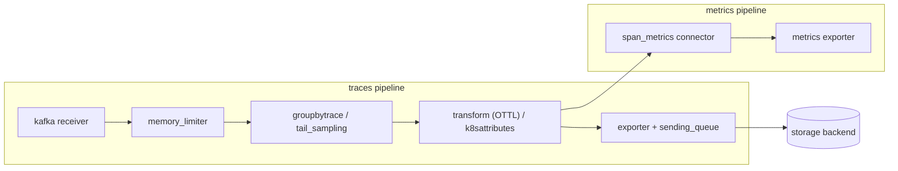
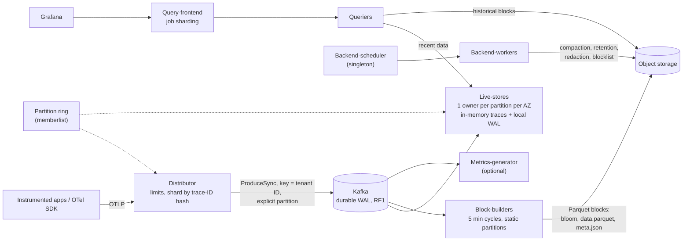
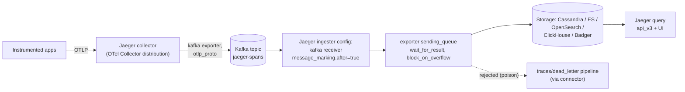

# 01. Overview of Existing Trace Collection Technologies

*Trace Collector System (TCS) design series: Kafka → Java 25 / Spring Boot 4.1 services → PostgreSQL 18 → React UI.*
*Research cut-off: 2026-11-21. Statements marked **UNVERIFIED** could not be confirmed from a primary source. Statements marked **(inference)** or **(derived)** are conclusions or arithmetic drawn from cited facts, not claims made by the source.*

## Related documents

- [02 — High-level design (C4)](02-high-level-design.md)
- [03 — Low-level design of the services](03-low-level-design.md)
- [04 — Storage design (PostgreSQL)](04-storage-design.md)
- [05 — Domain model](05-domain-model.md)
- [06 — Use cases](06-use-cases.md)
- [07 — Sequence diagrams](07-sequence-diagrams.md)
- [08 — ER diagrams](08-er-diagrams.md)

## Purpose

The assignment ([trace-collector-design-prompt.md](trace-collector-design-prompt.md)) requires that TCS "take all the best properties of currently existing trace collection services like Tempo or OpenTelemetry or others" and that their architecture be examined first. This document is that examination. It covers:

- the OpenTelemetry data model, propagation and Collector,
- Grafana Tempo 3.x,
- Jaeger v2,
- ClickHouse-based backends (OTel ClickHouse exporter, Jaeger ClickHouse, SigNoz, Uptrace),
- Zipkin and the one PostgreSQL precedent, Timescale Promscale,
- the two earlier in-house design reports.

It ends with a comparison matrix, a list of the properties TCS borrows (mapped to ADR-01 … ADR-12 of the design), and the gaps in existing tools that justify building TCS.

---

## 1. Scope and versions

All versions below are the latest releases as of 2026-11-21, taken from the GitHub releases API or official download pages. Where the research did not record a release date, the cell says "current on 2026-11-21".

| Technology | Version reviewed | Date | Notes | Source |
|---|---|---|---|---|
| Grafana Tempo | **v3.1.1** | 2026-10-21 (v3.1.0: 2026-09-29) | v3.0.x and v2.10.x are maintained in parallel. Source-code facts are taken from tag `v3.1.1` | [releases](https://github.com/grafana/tempo/releases) |
| Tempo 3.0 | 3.0 | blog published 2026-06-01 | Ingester and compactor removed. Kafka-based ingest is the only microservices ingest path | [Tempo 3.0 blog](https://grafana.com/blog/tempo-3-0-release-all-the-latest-features) |
| OTel Collector core / contrib | **v0.165.0 / v0.165.1** | current on 2026-11-21 | | [collector](https://github.com/open-telemetry/opentelemetry-collector), [contrib](https://github.com/open-telemetry/opentelemetry-collector-contrib) |
| OTel specification | **v1.62.0** | current on 2026-11-21 | | [spec](https://github.com/open-telemetry/opentelemetry-specification/tree/v1.62.0) |
| OTel semantic conventions | **v1.45.0** | current on 2026-11-21 | Messaging conventions are at status *Development* | [semconv](https://github.com/open-telemetry/semantic-conventions/tree/v1.45.0) |
| opentelemetry-proto | **v1.11.1** | current on 2026-11-21 | | [trace.proto](https://github.com/open-telemetry/opentelemetry-proto/blob/v1.11.1/opentelemetry/proto/trace/v1/trace.proto) |
| Jaeger | **v2.23.0** | current on 2026-11-21 | Jaeger v1 reached EOL on 2025-12-31 | [download](https://www.jaegertracing.io/download/) |
| SigNoz otel-collector | **v0.144.18** | current on 2026-11-21 | Schema migrator and ClickHouse exporter | [signoz-otel-collector](https://github.com/SigNoz/signoz-otel-collector/tree/v0.144.18) |
| Uptrace | **v2.1.0** | current on 2026-11-21 | | [uptrace](https://github.com/uptrace/uptrace/tree/v2.1.0) |
| Zipkin | **3.6.1** | current on 2026-11-21 | | [zipkin-storage](https://github.com/openzipkin/zipkin/tree/master/zipkin-storage) |
| Timescale Promscale | **0.17.0** (last release) | archived | "Promscale has been discontinued and is deprecated" | [promscale](https://github.com/timescale/promscale) |
| Spring Boot | **4.1.3** (TCS target); **4.2.0** also GA | both 2026-11-19 | 4.1.0 GA 2026-06-10. Boot 4.1.x uses Spring Framework 7.0.11. Boot 4.2.0 brings Framework 7.1.0 and Spring Kafka 4.2.0 | [Boot releases](https://github.com/spring-projects/spring-boot/releases) |
| Spring for Apache Kafka | **4.1.3** (managed by Boot 4.1.3); 4.2.0 tagged | current on 2026-11-21 | kafka-clients 4.2.2 is managed by Boot 4.1.3 | [coordinates](https://docs.spring.io/spring-boot/4.1/appendix/dependency-versions/coordinates.html) |
| Micrometer Tracing | 1.7.3 (Boot 4.1.3); 1.8.0 latest | current on 2026-11-21 | | [v4.1.3 notes](https://github.com/spring-projects/spring-boot/releases/tag/v4.1.3) |
| PostgreSQL | **18.7** (TCS choice); **19.0** released | 19.0: 2026-11-19; PG 18 supported until 2030-11-14 | | [versioning](https://www.postgresql.org/support/versioning/) |
| Apache Kafka | **4.4.0** latest | 2026-10-22 (4.3.2: 2026-10-23; 4.2.2: 2026-09-29) | | [downloads](https://kafka.apache.org/community/downloads/) |

> **Note:** TCS targets Spring Boot 4.1.3 and PostgreSQL 18. Boot 4.2.0 and PostgreSQL 19.0 both shipped two days before this review. TCS treats them as the upgrade path and will adopt them after their first patch releases.

---

## 2. OpenTelemetry

### 2.1 Trace data model

The OTLP protobuf ([trace.proto v1.11.1](https://github.com/open-telemetry/opentelemetry-proto/blob/v1.11.1/opentelemetry/proto/trace/v1/trace.proto)) nests spans in three levels:

```
TracesData
 └─ ResourceSpans { resource, schema_url }
     └─ ScopeSpans { scope: InstrumentationScope{name, version, attributes}, schema_url }
         └─ Span
```

- **Resource** describes the entity that produced telemetry, such as `service.name`. It is stored **once per ResourceSpans**, not once per span. TCS's input contract does not keep this property (section 2.6).
- **InstrumentationScope** identifies the instrumentation library (name, version, attributes).

**Span fields:**

| Field | Type / meaning |
|---|---|
| `trace_id` | bytes, 16 |
| `span_id` | bytes, 8 |
| `trace_state` | string (W3C tracestate) |
| `parent_span_id` | bytes, 8 (empty for root) |
| `flags` | fixed32. Low 8 bits are the W3C trace flags; bits 8–9 encode "has is_remote" and "is_remote" |
| `name` | string |
| `kind` | UNSPECIFIED, INTERNAL, SERVER, CLIENT, PRODUCER, CONSUMER |
| `start_time_unix_nano`, `end_time_unix_nano` | fixed64 |
| `attributes`, `dropped_attributes_count` | key/value list |
| `events{time_unix_nano, name, attributes, dropped_attributes_count}`, `dropped_events_count` | timestamped annotations |
| `links{trace_id, span_id, trace_state, attributes, dropped_attributes_count, flags}`, `dropped_links_count` | references to other spans |
| `status{message, code}` | UNSET=0, OK=1, ERROR=2 |

**SpanContext** ([api.md](https://github.com/open-telemetry/opentelemetry-specification/blob/v1.62.0/specification/trace/api.md#spancontext)):

- TraceId is 16 bytes and SpanId is 8 bytes. Each must have at least one non-zero byte.
- TraceFlags carry Sampled, plus the Random flag from W3C Trace Context Level 2.
- SpanContext also carries TraceState and IsRemote.

**Status:**

- The description is used only together with Error.
- Status values are totally ordered `Ok > Error > Unset`. Ok overrides everything else, and setting Unset is ignored.

**Attributes** ([common/README.md](https://github.com/open-telemetry/opentelemetry-specification/blob/v1.62.0/specification/common/README.md)):

- Keys are non-empty and case-sensitive.
- Values are **AnyValue**: string, bool, double, int64, homogeneous primitive arrays, byte arrays, arrays of AnyValue, and `map<string, AnyValue>`, with arbitrary nesting. Empty values and null are meaningful.
- For non-OTLP representations the spec recommends JSON, with bytes Base64-encoded.
- **Design consequence:** a general-purpose store must cope with map and array values, not only primitives.

**Links** ([overview.md#links-between-spans](https://github.com/open-telemetry/opentelemetry-specification/blob/v1.62.0/specification/overview.md#links-between-spans)):

- A span may link to zero or more causally related spans, in the same trace or in other traces.
- Typical uses are batch operations (one span triggered by many incoming items), a new trace started at a trust boundary, and async processing. For scatter/gather the spec recommends links rather than setting a parent.
- Links should be added at span creation, because samplers only see them then. Their order should be preserved.
- A link with an all-zero ID should still be recorded if it has attributes or a tracestate.

**Links are the only native cross-trace relation in OTel.** That matters for TCS's business-operation requirement (FR3).

### 2.2 W3C Trace Context and Baggage

**Trace Context Level 1** is a W3C Recommendation of 23 Nov 2021 ([spec](https://www.w3.org/TR/trace-context/)). Level 2 is a Candidate Recommendation Draft of 28 Mar 2024 ([spec](https://www.w3.org/TR/trace-context-2/)).

- `traceparent: {version}-{trace-id}-{parent-id}-{trace-flags}`, all in lowercase hex:
  - `version` is 2 hex digits, currently `00`; `ff` is invalid.
  - `trace-id` is 32 hex digits (16 bytes); all zeros is invalid.
  - `parent-id` is 16 hex digits (8 bytes, the caller's span id); all zeros is invalid.
  - `trace-flags` is 2 hex digits. Bit `0x01` means sampled. Level 2 adds `0x02`, random-trace-id.
  - Example: `00-4bf92f3577b34da6a3ce929d0e0e4736-00f067aa0ba902b7-01`.
- `tracestate` is a comma-separated `key=value` list of at most **32 list-members**.
  - Vendors SHOULD propagate at least 512 characters.
  - When truncating, entries longer than 128 characters are removed first, then entries from the end.

**Baggage** is a W3C Candidate Recommendation Snapshot of 30 May 2024 ([spec](https://www.w3.org/TR/baggage/)).

- Header format: `baggage: key1=value1;property1;propertyKey=propertyValue,key2=value2`.
- Platforms must propagate baggage if the result has at most **64 list-members** and at most **8192 bytes**. Beyond that they may drop members.
- Baggage is how a business identifier can travel with the request across all services. TCS ADR-09 recommends this practice (section 9).

### 2.3 Propagation over Kafka headers: Spring Kafka and Micrometer behaviour

**OTel Java.** `W3CTraceContextPropagator` writes the `traceparent` header and writes `tracestate` **only when it is non-empty** ([source](https://github.com/open-telemetry/opentelemetry-java/blob/main/api/all/src/main/java/io/opentelemetry/api/trace/propagation/W3CTraceContextPropagator.java)).

**Spring Boot 4.1 / Spring Kafka 4.x** ([Spring Kafka micrometer docs](https://docs.spring.io/spring-kafka/reference/kafka/micrometer.html)):

- **Observation is off by default.**
  - `spring.kafka.template.observation-enabled` and `spring.kafka.listener.observation-enabled` both default to `false`.
  - It can also be enabled in code with `observationEnabled` on `KafkaTemplate` and `ContainerProperties`.
- **Which formats are used.**
  - `management.tracing.propagation.produce` defaults to `[W3C]`.
  - `management.tracing.propagation.consume` defaults to `[W3C, B3, B3_MULTI]`.
  - `management.tracing.propagation.type` overrides both. `management.tracing.baggage.remote-fields` is also available.
  - The producer therefore writes `traceparent`, and writes `tracestate` only when it is non-empty. Whether `baggage` is written whenever baggage exists is **UNVERIFIED**.
- **How headers are written and read.**
  - On send, `KafkaRecordSenderContext` does `headers.remove(key); headers.add(key, value)`, so it replaces existing headers ([source](https://github.com/spring-projects/spring-kafka/blob/main/spring-kafka/src/main/java/org/springframework/kafka/support/micrometer/KafkaRecordSenderContext.java)).
  - On receive, it reads `headers().lastHeader(key)`.
- **Parent vs link.** Micrometer's `PropagatingReceiverTracingObservationHandler` builds the consumer span from `propagator.extract(...)`, so **the consumer span is a child of the producer span, not a link** ([source](https://github.com/micrometer-metrics/tracing/blob/main/micrometer-tracing/src/main/java/io/micrometer/tracing/handler/PropagatingReceiverTracingObservationHandler.java)). The remote service name is `"Apache Kafka: <clusterId>"`. Since 4.1.1, failures to fetch the cluster id are cached for `clusterIdRetryInterval` (default 5 min).
- **Names and tags.**
  - Span names are `spring.kafka.template` and `spring.kafka.listener`.
  - Tags use the **old** semantic-convention names: `messaging.system`, `messaging.operation`, `messaging.destination.name`, `messaging.kafka.consumer.group`, `messaging.kafka.message.offset`, `messaging.kafka.source.partition`, `messaging.kafka.client_id`, `spring.kafka.listener.id` and `spring.kafka.template.name` ([appendix](https://docs.spring.io/spring-kafka/reference/appendix/micrometer.html)).
- **Batch listeners.**
  - Observation does not support batch listeners, so by default no observation is created for them.
  - `ContainerProperties.setRecordObservationsInBatch(true)` creates one observation per record, but "the observation is not propagated to the listener method".

**Relevance to TCS:**

- Enrichment events on client topics will normally carry `traceparent` written by exactly this machinery. TCS's default `TRACEPARENT_HEADER` extraction strategy reads it with `lastHeader` semantics.
- TCS's own `tc-ingester` uses a batch listener, so it gets no per-record observation. This fits ADR-12: no self-tracing into `otlp-traces`.

### 2.4 Messaging semantic conventions (v1.45.0, status Development)

Sources: [kafka.md](https://github.com/open-telemetry/semantic-conventions/blob/v1.45.0/docs/messaging/kafka.md), [messaging-spans.md](https://github.com/open-telemetry/semantic-conventions/blob/v1.45.0/docs/messaging/messaging-spans.md), [registry](https://github.com/open-telemetry/semantic-conventions/blob/v1.45.0/docs/registry/attributes/messaging.md).

- **Span types:**
  - *create* (PRODUCER)
  - *send* (PRODUCER when its context is the message's creation context; otherwise CLIENT, linking to the create span)
  - *receive* (CLIENT)
  - *process* (CONSUMER)
  - *settle* (CLIENT)
- **Span names** look like `send T`, `poll T`, `process T` and `commit T`.
- **Links are the default correlation mechanism.** A producer SHOULD attach a creation context to each message, and receive and process spans SHOULD **link** to it. The reason is that a span has only one parent, which matters for batch consumption.
- **Process span parenting.** A process span MAY use the creation context as its parent, but only for single-message processing. That is NOT RECOMMENDED by default when an ambient span exists. When the parent is used, the ambient context should be added as a link.
- **Current attribute names:**
  - `messaging.system.name`, `messaging.operation.name`, `messaging.operation.type`
  - `messaging.destination.name`, `messaging.destination.partition.id`, `messaging.consumer.group.name`, `messaging.client.id`, `messaging.batch.message_count`
  - `kafka.message.key`, `kafka.offset`, `kafka.message.tombstone`, `kafka.cluster.id`
- **Deprecated names:** `messaging.kafka.consumer.group`, `messaging.kafka.message.offset`, `messaging.kafka.offset`, `messaging.kafka.message.key`, `messaging.kafka.destination.partition`. Users opt in to the new names with `OTEL_SEMCONV_STABILITY_OPT_IN=messaging` or `messaging/dup`.

**Consequences for TCS:**

1. Spring Kafka emits the old names, while new OTel instrumentation emits the new ones. TCS must accept and index both.
2. Producer → consumer causality may arrive either as parent/child (Spring/Micrometer) or as links (semconv default). TCS must therefore store links as first-class data (`span_link`).

### 2.5 The OpenTelemetry Collector

#### 2.5.1 Pipeline model

A pipeline is **receivers → processors → exporters** and carries one signal type. A **connector** acts as the exporter of one pipeline and the receiver of another. It may emit the same signal type or a different one, for example traces → metrics. Sources: [connector README](https://github.com/open-telemetry/opentelemetry-collector/blob/v0.165.0/connector/README.md), [configuration](https://opentelemetry.io/docs/collector/configuration/).



#### 2.5.2 kafkareceiver (contrib v0.165.1, beta for traces)

Source: [kafkareceiver README](https://github.com/open-telemetry/opentelemetry-collector-contrib/blob/v0.165.1/receiver/kafkareceiver/README.md).

- **Client and topics.** Built on franz-go. A topic that starts with `^` is treated as a regex, and `exclude_topics` then becomes available.
- **Encodings:**
  - For all signals: `otlp_proto` (default) and `otlp_json`.
  - For traces: `zipkin_proto`, `zipkin_json` and `zipkin_thrift`. `jaeger_proto` and `jaeger_json` were deprecated in v0.164.0 in favour of `jaegerencodingextension`.
  - Custom formats plug in as **encoding extensions**, which can receive headers and record metadata through `encoding.WithMessageMetadata`.
- **Defaults:**
  - Traces topic `otlp_spans`; `group_id` and `client_id` = `otel-collector`; `initial_offset` = `latest`.
  - `group_rebalance_strategies` = `cooperative-sticky`.
  - `session_timeout` 10 s, `heartbeat_interval` 3 s.
  - Fetch sizes 1 MiB.
- **Message marking (offset semantics):**
  - `autocommit.enable` defaults to true, with a 1 s interval.
  - `message_marking.after` (default false): when true, a message is marked only after the pipeline call returns.
  - `message_marking.on_error` (default false): when false, only successfully processed messages are marked. Without `error_backoff`, a failed partition stays paused until a rebalance. With it, the failed record is retried on the next poll.
  - `on_permanent_error` defaults to the `on_error` value and "can block the entire partition".
  - **`after: true` plus `on_error: false` gives at-least-once delivery. The defaults mark before processing, which is at-most-once in effect.**
- **`error_backoff`** offers exponential back-off. `max_elapsed_time: 0` means retry forever.
- **`partition_processing.independent`** gives each partition its own worker, so one blocked partition does not stall the others. Setting `max_in_flight.records` above 1 gives up ordering within a partition.
- **`header_extraction`:**
  - `extract_headers` (default false) plus an exact-match `headers` list. Extracted headers become **resource attributes**.
  - Separately, `kafka.topic`, `kafka.partition`, `kafka.offset` and all headers always go into request metadata (`client.Metadata`).
- **Trace context in headers.** The receiver extracts it, but **its own span starts a new trace and links to** the extracted context.
- **Companion kafkaexporter.** It offers `partition_traces_by_id` (the trace ID becomes the record key), which is the same co-partitioning idea the TCS starter uses ([kafkaexporter README](https://github.com/open-telemetry/opentelemetry-collector-contrib/blob/v0.165.1/exporter/kafkaexporter/README.md)).

#### 2.5.3 memory_limiter

Source: [README](https://github.com/open-telemetry/opentelemetry-collector/blob/v0.165.0/processor/memorylimiterprocessor/README.md).

- It checks memory periodically.
- Above the soft limit (`limit_mib - spike_limit_mib`) it refuses data with a **non-permanent error**, and the caller is expected to retry or apply back-pressure. Above the hard limit it also forces GC.
- The README warns that **data is lost if the component before it does not retry**.

#### 2.5.4 Batching and the sending queue

- **batch processor** (beta). Defaults: `send_batch_size` 8192, `timeout` 200 ms, `send_batch_max_size` 0. `metadata_keys` gives per-tenant batchers. It should come after memory_limiter and after sampling ([README](https://github.com/open-telemetry/opentelemetry-collector/blob/v0.165.0/processor/batchprocessor/README.md)).
- **exporterhelper** ([README](https://github.com/open-telemetry/opentelemetry-collector/blob/v0.165.0/exporter/exporterhelper/README.md)):
  - `sending_queue`: `num_consumers` 10, `queue_size` 1000, `sizer` = requests, items or bytes, `block_on_overflow`, `wait_for_result`. **If the queue is full, data is dropped** unless blocking is enabled.
  - `sending_queue.batch`: `flush_timeout` 200 ms, `min_size` 8192.
  - `retry_on_failure`: 5 s initial, 30 s max, 300 s max elapsed.
  - A persistent queue (`storage: file_storage`) survives restarts.
  - The Collector warns at startup if one pipeline uses both a batch processor and exporter batching.
- The ClickHouse exporter README recommends exporter-side batching over the batch processor "to avoid data-loss issues associated with the external processor" ([README](https://github.com/open-telemetry/opentelemetry-collector-contrib/blob/v0.165.1/exporter/clickhouseexporter/README.md)).

#### 2.5.5 groupbytrace and tail_sampling: partial traces are normal

**groupbytrace** ([README](https://github.com/open-telemetry/opentelemetry-collector-contrib/blob/v0.165.1/processor/groupbytraceprocessor/README.md)):

- It buffers spans per trace for `wait_duration` (default **1 s**), holding at most `num_traces` (default **1,000,000**), then releases them.
- **A span that arrives after its trace was released opens a new window**, so partial traces downstream are expected.
- `emit_strategy: service` groups by (trace, service) instead.
- Do not put the batch processor before it.

**tail_sampling** ([README](https://github.com/open-telemetry/opentelemetry-collector-contrib/blob/v0.165.1/processor/tailsamplingprocessor/README.md)):

- Settings:
  - `decision_wait` (default **30 s**)
  - `num_traces` (default **50,000**; a circular buffer that evicts the oldest trace)
  - `decision_wait_after_root_received`
  - `decision_cache` (LRU caches of sampled and non-sampled traces, for late spans)
- Strategies: `trace-complete` and `span-ingest`.
- Many policies: latency, status_code, string/numeric/boolean attribute, ottl_condition, rate/bytes limiting, composite, and others.
- **All spans of a trace must reach the same instance.** This normally needs a load-balancing exporter tier in front. **A Kafka record key of traceId gives the same guarantee**, and the TCS starter already uses that key.
- Late spans inherit the decision while it is still buffered. After that, without a cache, a fresh decision is made.

#### 2.5.6 transform (OTTL), attributes and resource processors

- **transform** runs OTTL statements per signal and per context (resource, scope, span, spanevent). `error_mode` defaults to `ignore` ([README](https://github.com/open-telemetry/opentelemetry-collector-contrib/blob/v0.165.1/processor/transformprocessor/README.md)).
- **attributes and resource processors** support insert, update, upsert, delete, hash and extract actions. The attributes processor can take values `from_context`, meaning request metadata such as Kafka headers ([attributesprocessor](https://github.com/open-telemetry/opentelemetry-collector-contrib/tree/v0.165.1/processor/attributesprocessor), [resourceprocessor](https://github.com/open-telemetry/opentelemetry-collector-contrib/tree/v0.165.1/processor/resourceprocessor)). The exact `from_context` option names are **UNVERIFIED**.
- All of these mutate telemetry **in flight, before storage**. None of them can change data that has already been stored.

#### 2.5.7 k8sattributes: the reference pattern for enrichment from an external source

Source: [README](https://github.com/open-telemetry/opentelemetry-collector-contrib/blob/v0.165.1/processor/k8sattributesprocessor/README.md).

- It watches the Kubernetes API and keeps an **in-memory cache** of pods (IP, UID, metadata).
- Each span is joined to a pod by `pod_association` rules (up to 4 sources each; the default is the connection IP).
- The pod metadata is added as resource attributes.

The pattern is a **local cache of an external source, refreshed by a watch, with no remote lookup per span**. This is the closest Collector analogue to TCS enrichment. The difference is that k8sattributes enriches *before* storage from a source the Collector knows about. TCS must enrich *after* storage, from event streams defined by clients at runtime (ADR-07, ADR-08).

#### 2.5.8 spanmetrics connector (renamed `span_metrics`)

Source: [README](https://github.com/open-telemetry/opentelemetry-collector-contrib/blob/v0.165.1/connector/spanmetricsconnector/README.md).

- It produces RED metrics `traces.span.metrics.calls` and `traces.span.metrics.duration`.
- Base dimensions are `service.name`, `span.name`, `span.kind` and `status.code`, plus configured extra dimensions.
- The default duration unit is moving from ms to s behind a feature gate.
- RED metrics are out of TCS scope, but this is the standard way to add them later, from the same Kafka topic.

### 2.6 How the starter's `TraceMessage` relates to OTLP

**The starter does not emit OTLP.** `otlp-kafka-export-tracing-starter` publishes a **custom JSON contract** (`TraceMessage`, `schemaVersion = 1`) to topic `otlp-traces`. The record key is the traceId (32 lowercase hex). Sources: the starter's `TraceMessage`, `TraceMessageMapper` and `KafkaSpanExporter`, as digested in the prior-reports research.

**Message structure:**

- `TraceMessage { schemaVersion, traceId, spans[] }`
- Each span carries:
  - `spanId`, `parentSpanId`, `name`, `kind`
  - `startEpochNanos` and `endEpochNanos` as **strings**
  - `spanContext` and `parentSpanContext`
  - `status{code, description}`
  - `attributes` as a map `key → {type, value}`
  - `events[]` and `links[]`
  - `hasEnded`, total and dropped counts
  - the **full `resource`** and **full `instrumentationScope`**

**How it differs from OTLP/JSON (`ExportTraceServiceRequest`):**

| Aspect | OTLP | `TraceMessage` v1 |
|---|---|---|
| Nesting | Resource → Scope → Span, with the resource stored once | Flat span list. **Resource and scope are repeated in every span**, which is the main size driver |
| IDs | bytes (hex in OTLP/JSON) | hex strings, repeated at top level, in `spanContext` and in `parentSpanContext` |
| Root parent | empty | `"0000000000000000"` plus an invalid `parentSpanContext` (`valid=false`). The backend must normalise this to null |
| Kind / status | numeric enums | Java enum names (`SERVER`, `UNSET`/`OK`/`ERROR`) |
| Attribute values | AnyValue (including bytes and maps) | `{type, value}` where `type` is the OTel Java `AttributeType` name (STRING, BOOLEAN, LONG, DOUBLE and the four `_ARRAY` variants). **No bytes or map support.** LONG is a raw JSON number, so it must be parsed as `long` to avoid precision loss above 2^53 |
| Trace flags | fixed32 | Java `byte`, serialised as a signed number |
| TraceState | string | map, so entry order is lost |
| Message metadata | n/a | **No message id, no export timestamp, no fragment or sequence marker, no Kafka headers** |

**Partial by construction.** `KafkaSpanExporter` groups spans by traceId *within one BatchSpanProcessor export call*. One trace therefore arrives as several **fragments**: one per batch, one per service instance, plus late spans. Because the key is the traceId, all fragments land on the same partition. This is the same property Tempo's distributor obtains by hashing trace IDs (section 3.2).

**Delivery.**

- A failed `kafkaTemplate.send` is not resent, because the BatchSpanProcessor does not retry. Those spans are lost on the producer side.
- The producer is idempotent within a session only, so duplicates across restarts are possible.

**Consequences.** No off-the-shelf OTLP consumer can read this topic as-is. The Collector's kafkareceiver, Jaeger's ingester and Tempo all expect OTLP or Zipkin/Jaeger encodings; a custom encoding extension written in Go would be needed. This is one of the reasons TCS has its own Java ingester.

---

## 3. Grafana Tempo (v3.1.1)

Shorthand: DOCS = <https://grafana.com/docs/tempo/latest>, SRC = <https://github.com/grafana/tempo/blob/v3.1.1>.

### 3.1 Architecture evolution: from ingesters to Kafka ("Project Rhythm")

| Era | Write path | Durability / replication | Background processing |
|---|---|---|---|
| ≤ 2.x (classic) | Distributor → **ingesters** with RF3-replicated writes → blocks | RF3 in the ingesters | **Compactor** deduplicates the RF3 copies |
| 2.9 / 2.10 | "Rhythm" introduced as experimental: distributors write to Kafka, *live-stores* replace ingesters, a new *block-builder* appears | Kafka as WAL | compactor still present |
| **3.0** (blog 2026-06-01) | Rhythm "replaces ingesters with a design that separates read and write paths" and "is now the only ingest path". **Ingester and compactor removed**, together with the v2 block encoding and the `scalable-single-binary` target | **RF1**: "After Kafka acknowledges a write, the data is durable" | backend-scheduler plus backend-workers |
| 3.1 | vParquet5 becomes the default block format. TraceQL/time-window redaction, `blocks_per_shard`, traces diff (experimental) | — | — |

Sources: [DOCS/release-notes/v2-9](https://grafana.com/docs/tempo/latest/release-notes/v2-9/), [v3-0](https://grafana.com/docs/tempo/latest/release-notes/v3-0/), [v3-1](https://grafana.com/docs/tempo/latest/release-notes/v3-1/), [Tempo 3.0 blog](https://grafana.com/blog/tempo-3-0-release-all-the-latest-features).

**Why it was rebuilt.** The old design stored "3 to 3.5 times the actual volume of tracing data", from RF3 ingester replication plus extra block sets from the metrics-generator. The new design stores "one copy".

**Deployment modes** ([DOCS/introduction/architecture](https://grafana.com/docs/tempo/latest/introduction/architecture/)):

- **Monolithic** (`-target=all`). No Kafka. The distributor pushes in-process to the live-store and metrics-generator.
- **Microservices**, "recommended for production". Kafka is used as a WAL.

### 3.2 Components (microservices mode)

| Component | Role |
|---|---|
| **Distributor** | Receives OTLP and other protocols. Enforces per-tenant ingestion limits, which are "the only limits enforced synchronously at ingestion time". Shards by trace-ID hash, writes to Kafka, and **replies to the client only after Kafka acks** |
| **Kafka** | Durable WAL that allows RF1 |
| **Partition ring** | Lives in memberlist. Tracks partitions, their owners and state (pending, active, inactive). The distributor uses "the partition ring, not Kafka's partition routing" |
| **Live-store** | Consumes partitions and holds live traces in memory plus a local Parquet WAL. Serves recent data. One owner per partition **per AZ**; queriers need a "read quorum of 1" |
| **Block-builder** | Consumes Kafka in fixed cycles, builds Parquet blocks per tenant per partition, and uploads them to object storage. Static partition assignment, no Kafka rebalancing |
| **Query-frontend** | Shards queries into jobs for live-stores and backend blocks, then merges the results |
| **Querier** | Executes those jobs |
| **Backend-scheduler** (singleton) + **backend-workers** (stateless) | Replace the compactor. Run compaction, retention, blocklist maintenance and redaction jobs. Failed jobs are rescheduled |
| **Metrics-generator** (optional) | RED metrics and service graphs. In 3.0 it reads the same Kafka topic |

Sources: [DOCS/reference-tempo-architecture/components/*](https://grafana.com/docs/tempo/latest/reference-tempo-architecture/components/distributor/), [architecture](https://grafana.com/docs/tempo/latest/introduction/architecture/).



### 3.3 Write path

**Sharding** ([SRC/modules/distributor/distributor.go](https://github.com/grafana/tempo/blob/v3.1.1/modules/distributor/distributor.go)):

- The distributor regroups each incoming request by trace ID (`requestsByTraceID`) and computes `util.HashForTraceID(traceID)`.
- It rejects trace IDs that are not 128-bit and span IDs that are not 64-bit.
- It then writes to the active partitions of the tenant's shuffle-shard.
- Because all spans of a trace land in one partition, "block-builders can co-locate a trace's spans in one consumption cycle".

**Kafka record format** ([SRC/pkg/ingest/encoding.go](https://github.com/grafana/tempo/blob/v3.1.1/pkg/ingest/encoding.go), [config.go](https://github.com/grafana/tempo/blob/v3.1.1/pkg/ingest/config.go)):

- One protobuf `PushBytesRequest` per partition, which can hold many traces. It is split when it exceeds `producer_max_record_size_bytes`.
- **Record key = tenant ID**, and the partition is set explicitly.
- Writes are synchronous (`ProduceSync`) with a 10 s `write_timeout`.

**Combining partial traces** happens at four points:

1. **Live-store** ([SRC/modules/livestore/config.go](https://github.com/grafana/tempo/blob/v3.1.1/modules/livestore/config.go)):
   - Assembles spans by trace ID in memory.
   - Flushes a trace to the WAL head block after `max_trace_idle` (default **5 s**) or `max_trace_live` (default **30 s**).
   - Cuts the head block after 30 s or 50 MB.
   - Keeps complete blocks locally for **20 min**.
   - `max_live_traces_bytes` defaults to 250 MB.
2. **Block-builder** ([DOCS/.../block-builder](https://grafana.com/docs/tempo/latest/reference-tempo-architecture/components/block-builder/), [SRC/modules/blockbuilder/config.go](https://github.com/grafana/tempo/blob/v3.1.1/modules/blockbuilder/config.go)):
   - Each cycle (default **5 min**) rewinds to the last committed offset and reads up to a time boundary.
   - It groups by tenant, writes Parquet blocks (default 20 MiB) to local disk, uploads them, and **then commits the offset**.
   - "The block-builder has no concept of 'live traces' or trace completion". A trace that spans two cycles lands in two blocks.
   - Duplicate spans are removed by **(span ID, span kind)**.
   - **Block IDs are deterministic from (partition, tenant, offset range)**, so re-processing after a crash is idempotent.
   - Flush order is bloom/index → `data.parquet` → `nocompact.flg` → `meta.json`. "A block isn't visible to the read path until its `meta.json` is written".
3. **Query time.** "Trace assembly is handled at query time by the querier, which merges spans from multiple blocks".
   - The combiner deduplicates spans by ID + kind using a 64-bit FNV hash.
   - "A collision results in a dropped span during combine" ([SRC/pkg/model/trace/combine.go](https://github.com/grafana/tempo/blob/v3.1.1/pkg/model/trace/combine.go)).
4. **Compaction time.**
   - Rows with the same trace ID are merged.
   - Byte-identical rows are dropped. Other rows are combined and checked for "connected" or "rootless".
   - Source: [SRC/tempodb/encoding/vparquet5/compactor.go](https://github.com/grafana/tempo/blob/v3.1.1/tempodb/encoding/vparquet5/compactor.go).

**Long-running traces** ([DOCS/troubleshooting/querying/long-running-traces](https://grafana.com/docs/tempo/latest/troubleshooting/querying/long-running-traces/)):

- Spans separated by a pause longer than the idle period "end up in different blocks".
- TraceQL search then sees per-block fragments: duration is partial, spanset operators may be wrong, and the trace may appear rootless.
- **Trace-by-ID remains accurate** because it merges all blocks.
- The documented mitigation is to use span links to split long work into shorter traces.

**Default ingestion limits** ([SRC/modules/overrides/config.go](https://github.com/grafana/tempo/blob/v3.1.1/modules/overrides/config.go)):

| Limit | Default |
|---|---|
| `ingestion_rate_limit_bytes` / `ingestion_burst_size_bytes` | 30 MB/s / 30 MB per tenant |
| `max_bytes_per_trace` | **5 MB**. Enforced downstream; over-limit spans are discarded during compaction |
| `max_traces_per_user` (local) | 10,000 |
| `max_attribute_bytes` | 2 KB. Longer attributes are **truncated** in the distributor |

### 3.4 Storage: vParquet4 / vParquet5

Sources: [DOCS/operations/schema](https://grafana.com/docs/tempo/latest/operations/schema/), [block-format](https://grafana.com/docs/tempo/latest/reference-tempo-architecture/block-format/), [SRC/tempodb/encoding/vparquet5/schema.go](https://github.com/grafana/tempo/blob/v3.1.1/tempodb/encoding/vparquet5/schema.go).

**Format versions.** vParquet5 has been the default since 3.1. vParquet4 can still be written. vParquet3 writing is refused in 3.1, and v2 was removed in 3.0.

**Row model:**

- **One Parquet row = one trace**, and rows are sorted by trace ID.
- Resource → scope → spans are nested repeated groups.
- The resource is stored once per batch, which makes blocks "much smaller" than with a flattened schema.

**Trace-level columns, computed at ingest:**

- `TraceID` (keeps the sort order) and `TraceIDText`
- `StartTimeUnixNano`, `EndTimeUnixNano`, `DurationNano` (delta-encoded)
- `RootServiceName` and `RootSpanName` (dictionary-encoded)
- `ServiceStats` (span and error counts per service)
- vParquet5 adds span `ChildCount` and rounded start-time buckets.

**Span fields:**

- IDs, Name, Kind, Status, TraceState and timestamps.
- The **nested-set** columns `NestedSetLeft`/`NestedSetRight` encode tree position. They make structural operators (`>>`, `>`, `~`) cheap.

**Generic attributes.** `Attrs` is a list of `{Key, IsArray, Value[], ValueInt[], ValueDouble[], ValueBool[], ValueUnsupported (JSON)}`. The same shape is used for resource, scope, span, event and link attributes.

**Dedicated attribute columns.** These are spare typed columns per scope that promote "hot" attributes out of the generic `Attrs` list.

- vParquet4 has 10 string spares per scope.
- **vParquet5 has 20 string + 5 int spares per scope** and adds an event scope. It drops the hard-coded k8s and HTTP well-known columns.
- They are configured per tenant (`parquet_dedicated_columns`). **Only blocks with the same dedicated-column configuration compact together.**

**Events and links.**

- Events store `TimeSinceStartNano`, `Name`, `Attrs` and a dropped count.
- Links store `TraceID`, `SpanID`, `TraceState`, `Attrs` and a dropped count.

**Block layout** ([object-storage](https://grafana.com/docs/tempo/latest/reference-tempo-architecture/object-storage/)):

- Objects live under `<tenant>/<blockID>/`: `meta.json`, `data.parquet`, `bloom-N` shards and `index`.
- Queriers and frontends read a **tenant index** to find blocks.

**Bloom filters.**

- Tempo uses its own **sharded bloom filters over trace IDs**, not Parquet-native ones.
- Defaults: false-positive rate **1 %**, shard size **100 KiB** ([SRC/tempodb/encoding/common/config.go](https://github.com/grafana/tempo/blob/v3.1.1/tempodb/encoding/common/config.go)).

**Row groups and compression.**

- `parquet_row_group_size_bytes` defaults to **100 MB**, with a hard cut at 800 MB.
- Columns are tagged `snappy,dict` in the schema. The [compression docs](https://grafana.com/docs/tempo/latest/configuration/compression/) mention zstd. **UNVERIFIED** which setting applies to vParquet5 data pages versus the WAL.

### 3.5 Query path

**Trace by ID** ([SRC/.../vparquet5/block_findtracebyid.go](https://github.com/grafana/tempo/blob/v3.1.1/tempodb/encoding/vparquet5/block_findtracebyid.go)):

1. The frontend selects blocks by time range, or all blocks if `start` and `end` are absent.
2. For each block it reads the bloom shard for the ID. A negative answer skips the block.
3. The optional `index` maps a trace ID to a row group. It is **off by default** (`VPARQUET_INDEX=1`).
4. Otherwise it **binary-searches row groups** by the minimum trace ID of each.
5. It reads the single row (the trace).
6. Results from all blocks and live-stores are merged by the combiner.

Frontend sharding uses `blocks_per_shard`, default 30, new in 3.1.

**TraceQL search:**

- **Condition push-down.** Conditions are pushed into Parquet column iterators with predicates at the column-chunk, page and value levels ([SRC/pkg/parquetquery/predicates.go](https://github.com/grafana/tempo/blob/v3.1.1/pkg/parquetquery/predicates.go)).
- **Two-pass fetch.** Filter columns are read first. The remaining columns are fetched only for matching spansets.
- **Attribute cost.** A filter on a generic `Attrs` attribute must scan the key/value columns. A dedicated column reads one column.
- **Job sharding.** "The smallest possible job size is a single parquet row group". `target_bytes_per_job` is recommended at 100–200 MB ([backend_search](https://grafana.com/docs/tempo/latest/operations/backend_search/)).

**Search defaults** ([SRC/modules/frontend/config.go](https://github.com/grafana/tempo/blob/v3.1.1/modules/frontend/config.go)):

| Setting | Default |
|---|---|
| `query_backend_after` | 15 min (newer data comes from live-stores) |
| `default_limit` / `max_limit` | 20 / 262,144 |
| `max_duration` (search) | **168 h** |
| `spss` / `max_spans_per_spanset` | 3 / 100 |
| `max_query_expression_size_bytes` | 128 KiB |
| Metrics `max_duration` | 24 h |

**Search semantics.** "Tempo does a massively parallel search over the given time range, and takes the first N results", so **results are non-deterministic** ([api_docs](https://grafana.com/docs/tempo/latest/api_docs/)).

**HTTP APIs:**

- `GET /api/traces/{id}` and `/api/v2/traces/{id}`. v2 adds a `q` filter, `keep_hierarchy` and span pruning.
- `GET /api/search` with `q`, `tags`, `minDuration`, `maxDuration`, `start`, `end`, `limit` and `spss`. **Without start/end it searches only live-store data.**
- `/api/search/tags`, `/api/v2/search/tags` and `/api/v2/search/tag/{tag}/values`. Tag-value responses are capped at 1 MB.
- `/api/metrics/query_range` and `/api/metrics/query`.

### 3.6 Span links and correlation

- **Storage.** Links are stored per span.
- **TraceQL.** It has a `link.` attribute scope and the `link:traceID` / `link:spanID` intrinsics ([construct-traceql-queries](https://grafana.com/docs/tempo/latest/traceql/construct-traceql-queries/)).
- **Structural operators** (`>>`, `>`, `<<`, `<`, `~`, the union variants `&>>`, and the experimental negated variants `!>>`) work **only within one trace**. They do not follow links across traces.
- **No reverse index.** **There is no reverse index from a target trace to the traces that link to it**, so "who links to trace X" is a column scan over the time range. This is an **inference** from the schema and fetch design, not stated in the docs.
- **Grafana.** The trace view shows links in span details, and Grafana 12+ adds configurable "trace correlations" ([trace-integration](https://grafana.com/docs/grafana/latest/explore/trace-integration/), [trace-correlations](https://grafana.com/docs/grafana/latest/datasources/tempo/configure-tempo-data-source/trace-correlations/)). Whether clicking a link opens the linked trace directly is **UNVERIFIED**.
- **Traces diff.** Version 3.1 adds an experimental traces diff.

### 3.7 Retention, compaction and mutation

**Compaction** ([DOCS/operations/compaction](https://grafana.com/docs/tempo/latest/operations/compaction/), [SRC/tempodb/config.go](https://github.com/grafana/tempo/blob/v3.1.1/tempodb/config.go)):

- Blocks are grouped by a 1 h `compaction_window`. Within the last 24 h they are also grouped by level.
- Each group takes 2–4 input blocks.
- Blocks must share encoding, version and dedicated-column configuration to compact together.
- Defaults: `max_block_bytes` 100 GB, 6,000,000 traces per block, `compacted_block_retention` 1 h, `blocklist_poll` 5 min.

**Retention:**

- `block_retention` defaults to **14 days** and can be overridden per tenant.
- It is enforced by **deleting whole blocks**.

**Mutation:**

- Blocks are immutable. **The only rewrite path is redaction.** Redaction by trace-ID list arrived in 3.0; 3.1 added redaction by TraceQL query and by time window. It runs as scheduler jobs that rewrite blocks.
- **There is no post-ingest enrichment.**
- Derived fields (root service and name, duration, ServiceStats) are computed at block-build time and can be partial for split traces.

### 3.8 Limitations and sizing guidance

**Attribute search cost:**

- Generic attribute columns can be "up to 70% of the overall block size".
- High-cardinality strings create huge dictionaries that inflate querier memory.
- Dedicated columns gave up to **75 % lower tail latency, 70 % lower querier CPU and 50 % lower querier memory** at 600 MB/s and 1.2 M spans/s ([Grafana blog, 2024-01-22](https://grafana.com/blog/2024/01/22/accelerate-traceql-queries-at-scale-with-dedicated-attribute-columns-in-grafana-tempo)).

**Other limits:**

- Attributes are truncated at 2 KB.
- Tag-value responses are capped.
- The number of dedicated columns is fixed, and changing their configuration fragments compaction.
- Retention works at block granularity.
- Traces over 5 MB are truncated.
- Hash collisions in the combiner can drop spans.

**Official sizing** ([DOCS/set-up-for-tracing/setup-tempo/plan/size](https://grafana.com/docs/tempo/latest/set-up-for-tracing/setup-tempo/plan/size/)):

| Component | Replicas | CPU | Memory |
|---|---|---|---|
| Distributor | 1 per ~10 MB/s | 2 cores | 2 GB |
| Live-store | 1 per 6–10 MB/s | 1 core | 4–20 GB |
| Block-builder | 1 per partition | 0.5 cores | 5–10 GB |
| Querier | 1 per 1–2 MB/s ingested | — | 4–20 GB |
| Query-frontend | 2 (HA) | — | 4–20 GB |
| Backend-scheduler | 1 | 0.5 cores | 1–2 GB |
| Backend-worker | TBD | 0.5 cores | 1–2 GB |

**Bytes per span and compression ratio for Tempo are UNVERIFIED.**

- No official figure exists, and a [GitHub discussion](https://github.com/grafana/tempo/discussions/3774) asking for one has no authoritative answer.
- The compactor source says that estimating marshalled size from a Parquet row "is generally 66%-100% of actual size". This is not a compression ratio.

---

## 4. Jaeger v2 (v2.23.0)

### 4.1 Architecture

- Jaeger v2 "is a customized distribution of the OpenTelemetry Collector" ([architecture](https://www.jaegertracing.io/docs/latest/architecture/)).
- Its roles are **collector**, **query**, **ingester** (reads spans from Kafka and writes them to storage) and **all-in-one**.
- Kafka is described as an "intermediary, persistent queue", and multiple ingesters split the partitions.
- Storage backends: Badger, Cassandra, ClickHouse, Elasticsearch, Kafka, Memory and OpenSearch. A remote gRPC storage option also exists in the source tree.
- Jaeger v1 reached EOL on 2025-12-31.



### 4.2 Kafka ingester and the DLQ pattern

In v2 the ingester is **not a separate binary**. It is a config: `kafka` receiver → `jaeger_storage_exporter` ([config-kafka-ingester.yaml](https://github.com/jaegertracing/jaeger/blob/v2.23.0/cmd/jaeger/config-kafka-ingester.yaml); default topic `jaeger-spans`, encoding `otlp_proto`).

The **dead-letter variant** is the most instructive reference for TCS ([config-kafka-ingester-dead-letter.yaml](https://github.com/jaegertracing/jaeger/blob/v2.23.0/cmd/jaeger/config-kafka-ingester-dead-letter.yaml)):

- **No batch processor.** Batching happens in the exporter queue "so the Kafka offset stays coupled to the write result".
- **Kafka marking.** `message_marking.after: true` with `on_error: false`, which gives at-least-once delivery.
- **Queue.** `wait_for_result: true`, `block_on_overflow: true`, `sizer: bytes`, `num_consumers: 1`, a 100 MiB queue. Batches have `min_size` 1 MiB, `max_size` 4 MiB and `flush_timeout` 200 ms.
- **Retry.** Infinite (`max_elapsed_time: 0`).
- **Poison spans.** Spans that storage rejects go to a `traces/dead_letter` pipeline through a connector.
- **Elasticsearch writes** are a synchronous `_bulk` per batch ([ADR-014](https://github.com/jaegertracing/jaeger/blob/v2.23.0/docs/adr/014-synchronous-elasticsearch-writes.md)).

**In short:** commit offsets only after a durable write, block instead of dropping, retry transient errors forever, and divert poison records. TCS's ADR-02 follows the same pattern.

### 4.3 Cassandra schema (v004)

Source: [v004.cql.tmpl](https://github.com/jaegertracing/jaeger/blob/v2.23.0/internal/storage/v1/cassandra/schema/v004.cql.tmpl).

**UDTs:**

- `keyvalue{key, value_type, value_string, value_bool, value_long, value_double, value_binary}`: typed columns for attribute values.
- `log{ts, fields}`, `span_ref{ref_type, trace_id, span_id}`, `process{service_name, tags}`.

**Tables:**

| Table | Primary key | Purpose |
|---|---|---|
| `traces` | `(trace_id, span_id, span_hash)` | Span bodies. `operation_name`, `flags`, `start_time` and `duration` in µs, and `tags`, `logs`, `refs`, `process` as frozen lists |
| `service_names` | — | service catalog |
| `operation_names_v2` | `((service_name), span_kind, operation_name)` | operation catalog |
| `service_operation_index` | `((service_name, operation_name), start_time)` DESC | search by service and operation |
| `service_name_index` | `((service_name, bucket), start_time)` | `bucket = span_hash % 10` spreads hot partitions |
| `duration_index` | `((service_name, operation_name, bucket=hour), duration, start_time, trace_id)` | Written twice per span: once with an empty operation and once with the real one |
| `tag_index` | `((service_name, tag_key, tag_value), start_time, trace_id, span_id)` | inverted attribute index |
| `dependencies_v2`, sampling tables | — | — |

**Table settings.** All tables use TimeWindowCompactionStrategy and `default_time_to_live = ${trace_ttl}`.

**Query path** ([reader.go](https://github.com/jaegertracing/jaeger/blob/v2.23.0/internal/storage/v1/cassandra/spanstore/reader.go)):

- Each index returns a set of trace IDs, and the sets are **intersected** (`IntersectTraceIDs`).
- Index queries fetch `limit × 3` because many hits belong to the same trace.
- A duration query takes a separate path and **cannot be combined with tag filters** ([ADR-001](https://github.com/jaegertracing/jaeger/blob/v2.23.0/docs/adr/001-cassandra-find-traces-duration.md)).

### 4.4 Elasticsearch / OpenSearch layout

Sources: [jaeger-span.json](https://github.com/jaegertracing/jaeger/blob/v2.23.0/internal/storage/elasticsearch/esclient/index_templates/jaeger-span.json), [config.go](https://github.com/jaegertracing/jaeger/blob/v2.23.0/internal/storage/elasticsearch/config/config.go).

- **Indices.** One per day, `jaeger-span-YYYY-MM-DD`; hourly is possible. Optional ILM/ISM rollover aliases are `jaeger-span-read` and `jaeger-span-write`.
- **Span document:**
  - `traceID`, `spanID`, `parentSpanID`
  - `operationName` (keyword)
  - `startTime` (µs), `startTimeMillis` (date), `duration`, `flags`
  - nested `references`, nested `logs`, `process{serviceName, tags}`
  - `tags`, nested key/value/type by default
- **`tags_as_fields`** stores tags as object fields `tag.*` through dynamic templates (keyword, `ignore_above` 256). `index.mapping.nested_fields.limit` = 50.
- **Retention.** An external `es-index-cleaner` deletes old daily indices ([docs](https://www.jaegertracing.io/docs/2.19/storage/elasticsearch/)).

### 4.5 ClickHouse storage (alpha since v2.18)

Sources: [ADR-008](https://github.com/jaegertracing/jaeger/blob/v2.23.0/docs/adr/008-clickhouse-storage-schema.md), [DDL](https://github.com/jaegertracing/jaeger/tree/v2.23.0/internal/storage/v2/clickhouse/sql).

**`spans` table**, one row per span:

- **Typed attributes** are split into `bool_`, `double_`, `int_`, `str_` and `complex_attributes`, each `Nested(key, value)`. The same split repeats at resource, scope, event and link level.
- Complex types (bytes, slice, map) are serialised to strings with key prefixes `@bytes@`, `@slice@` and `@map@`.
- Map columns were rejected for poor compression.

**Layout:**

- `PARTITION BY toDate(start_time)`, `ORDER BY (service_name, name, toDateTime(start_time))`. This optimises search over trace fetch.
- Trace fetch uses a `bloom_filter` on `trace_id` plus the time bounds stored in `trace_id_timestamps`, an AggregatingMergeTree of min/max.

**Derived tables**, all maintained by materialized views:

- `services`
- `operations(service_name, name, span_kind)`
- `attribute_metadata(attribute_key, type, level)`, which resolves a UI string filter to the right typed column and level. If the key is unknown, the query falls back to a string match at every level.
- `dependencies`

**TTL and limitation:**

- Retention is `TTL start_time + N SECOND DELETE`.
- **Stated limitation:** attribute filters run as `arrayExists` per row and cannot use a skip index.

### 4.6 Query API

- **Legacy v1 HTTP `/api/traces`** takes `service`, `operation`, `tags`, `start`/`end` (µs), `minDuration`/`maxDuration`, `limit` (default 100) and `spanKind` ([query_parser.go v1.65.0](https://github.com/jaegertracing/jaeger/blob/v1.65.0/cmd/query/app/query_parser.go)).
- **In v2.23.0** the internal HTTP handler registers only `GET /traces/{id}` plus the dependencies and metrics routes ([http_handler.go](https://github.com/jaegertracing/jaeger/blob/v2.23.0/cmd/jaeger/internal/extension/jaegerquery/internal/http_handler.go)). Search goes through **api_v3**.
- **api_v3 routes:** `/api/v3/traces`, `/api/v3/trace-summaries`, `/api/v3/spans`, `/api/v3/services`, `/api/v3/operations`, `/api/v3/capabilities`.
- **api_v3 parameters:** `query.serviceName`, `query.operationName`, `query.startTimeMin`/`Max`, `query.durationMin`/`Max`, `query.searchDepth`, `query.attributes`, `query.filter`, `spanKind`, `query.orderBy`, `query.pagination.pageSize`/`pageToken` and `rawTraces` ([apiv3 query_parser.go](https://github.com/jaegertracing/jaeger/blob/v2.23.0/cmd/jaeger/internal/extension/jaegerquery/internal/apiv3/query_parser.go)).
- **Design takeaway for TCS:** separate *trace summaries* from full traces, keep search parameters explicit, and use page-token pagination.

---

## 5. ClickHouse-based backends

### 5.1 OTel `clickhouseexporter`: `otel_traces`

DDL: [traces_table.sql (contrib v0.165.1)](https://github.com/open-telemetry/opentelemetry-collector-contrib/blob/v0.165.1/exporter/clickhouseexporter/internal/sqltemplates/traces_table.sql).

```sql
-- Schematic reconstruction of the published template (column list, codecs, indexes and settings as
-- recorded in the research notes; index names and exact Nested sub-column types omitted).
-- Every column uses CODEC(ZSTD(3)).
CREATE TABLE otel_traces (
    Timestamp          DateTime64(9) CODEC(Delta, ZSTD(3)),
    TraceId            String,
    SpanId             String,
    ParentSpanId       String,
    TraceState         String,
    SpanName           LowCardinality(String),
    SpanKind           LowCardinality(String),
    ServiceName        LowCardinality(String),
    ResourceAttributes Map(LowCardinality(String), String),
    ScopeName          String,
    ScopeVersion       String,
    SpanAttributes     Map(LowCardinality(String), String),
    Duration           UInt64,
    StatusCode         LowCardinality(String),
    StatusMessage      String,
    Events Nested (Timestamp, Name, Attributes),          -- Attributes is a Map
    Links  Nested (TraceId, SpanId, TraceState, Attributes),
    -- skip indexes: bloom_filter(0.001) on TraceId;
    --               bloom_filter(0.01) on mapKeys/mapValues of ResourceAttributes and SpanAttributes;
    --               minmax on Duration
) ENGINE = MergeTree
PARTITION BY toDate(Timestamp)
ORDER BY (ServiceName, SpanName, toDateTime(Timestamp))
SETTINGS index_granularity = 8192, ttl_only_drop_parts = 1;
-- TTL comes from the exporter's `ttl` setting (default 0 = none)
```

This block is schematic and will not run as written. Consult the source template for the literal DDL.

- **Attribute typing.** All attribute values become **strings** in the maps.
- **Companion table.** `otel_traces_trace_id_ts(TraceId, Start, End)`, ORDER BY `(TraceId, Start)`, is filled by a materialized view computing `min`/`max(Timestamp)` GROUP BY TraceId. It finds a trace's time range **before** the trace is fetched from the main table, whose sort key does not start with TraceId. **TCS `trace_summary` serves the same purpose (ADR-04).**
- **Compression figure.** The README's "compression 7–11×" figure is for **logs**, not traces.

### 5.2 SigNoz (`signoz_traces.signoz_index_v3`, otel-collector v0.144.18)

Source: migration 1000 in [traces_migrations.go](https://github.com/SigNoz/signoz-otel-collector/blob/v0.144.18/cmd/signozschemamigrator/schema_migrator/traces_migrations.go).

**Columns:**

- `ts_bucket_start UInt64`, a 30-minute bucket (`distributedTracesResourceV2Seconds = 1800` in [clickhouse_exporter_v3.go](https://github.com/SigNoz/signoz-otel-collector/blob/v0.144.18/exporter/clickhousetracesexporter/clickhouse_exporter_v3.go))
- `resource_fingerprint`
- `timestamp DateTime64(9)`, `trace_id FixedString(32)`, `span_id`, `parent_span_id`, `flags`
- `name` (LowCardinality), `kind`/`kind_string`, `duration_nano`
- status fields, `has_error`, `is_remote`
- **typed maps** `attributes_string`, `attributes_number` (Float64), `attributes_bool`, `resources_string`
- `events Array(String)` (JSON), `links String` (JSON)

**Materialized attribute columns:**

- Extracted columns such as `resource_string_service$$name DEFAULT resources_string['service.name']` and `attribute_string_http$$route`, plus messaging, db and rpc system columns.
- Later migrations (1006, 1009) add `JSON` columns `resource` and `scope`.

**Skip indexes:**

- `tokenbf_v1` on trace_id and span_id
- `ngrambf_v1` on name
- `tokenbf_v1` on map keys, `ngrambf_v1` on string map values, `bloom_filter` on number values
- `set(…)` on status, kind and response code
- `minmax` on duration and timestamp

**Table settings:**

- `PARTITION BY toDate(timestamp)`
- `ORDER BY (ts_bucket_start, resource_fingerprint, has_error, name, timestamp)`
- **TTL 1,296,000 s (15 days)**, `ttl_only_drop_parts=1`

**Companion tables:**

- `traces_v3_resource(labels, fingerprint, seen_at_ts_bucket_start)`: a ReplacingMergeTree that is the **resource dictionary**, storing each distinct resource once per bucket.
- `trace_summary(trace_id, start min, end max, num_spans sum)`: an AggregatingMergeTree.

### 5.3 Uptrace (v2.1.0)

DDL: [20211205231031_initial.up.sql](https://github.com/uptrace/uptrace/blob/v2.1.0/pkg/bunapp/chmigrations/20211205231031_initial.up.sql).

**Index / data split:**

- `spans_index` holds flat search columns (service, host, db, telemetry, …) plus `all_keys` and `string_keys`/`string_values` arrays. ORDER BY `(project_id, system, group_id, time)`.
- `spans_data(trace_id UUID, id UInt64, time, data String)` holds the raw span blob. ORDER BY `(trace_id, id)`, `index_granularity` 2048.

**Table settings and IDs:**

- Both tables use daily partitions, `TTL … DELETE` and `ttl_only_drop_parts=1`.
- The trace ID is a **UUID** and the span ID a **UInt64**: binary types, not hex strings.
- `group_id` is a precomputed span-grouping hash. Its exact semantics are **UNVERIFIED**.

### 5.4 Published compression and bytes-per-span figures

| Source | Dataset | Result | Bytes/span |
|---|---|---|---|
| [CNCF blog, 2026-06-23: Jaeger ClickHouse backend](https://www.cncf.io/blog/2026/06/23/building-jaegers-clickhouse-backend-8-6x-compression-on-10-million-spans/) | 10 M spans / 1 M traces | **8.6×** (≈ 6 GiB → ≈ 722 MiB) | ≈ 75 B/span compressed (**derived**) |
| [Coroot blog](https://coroot.com/blog/youre-overpaying-for-opentelemetrys-verbosity-by-at-least-30/) | `otel_traces`, 410 M rows | 118.71 GiB → 20.26 GiB (**5.9×**) | ≈ 53 B/span (**derived**) |
| Coroot, per column | same | SpanAttributes 11.9×, ResourceAttributes 33.4×, **TraceId 1.97×, SpanId 1.94×** | TraceId and SpanId are the largest compressed columns (6.37 + 3.33 GiB) |
| Tempo | — | **UNVERIFIED**; no official figure | — |

**Takeaway:** random IDs stored as hex strings barely compress and dominate compressed size. Store IDs in binary form (TCS ADR-10: `uuid` and `bigint`).

---

## 6. Zipkin and the PostgreSQL precedent (Promscale)

### 6.1 Zipkin 3.6.1 (brief)

- **Storage modules:** Cassandra, Elasticsearch and MySQL (`mysql-v1`). The "-v1" modules are "discouraged for new sites" ([zipkin-storage](https://github.com/openzipkin/zipkin/tree/master/zipkin-storage)).
- **MySQL schema** ([mysql.sql](https://github.com/openzipkin/zipkin/blob/master/zipkin-storage/mysql-v1/src/main/resources/mysql.sql)):
  - `zipkin_spans` has PK `(trace_id_high, trace_id, id)`, with name, remote service, parent, `start_ts` and `duration` in µs, and indexes on name, remote service name and `start_ts`.
  - `zipkin_annotations` is an **EAV** table (`a_key`, `a_value` BLOB, `a_type`, endpoint fields) with a unique key for idempotent inserts.
  - `zipkin_dependencies(day, parent, child, call_count, error_count)`.
- **Kafka collector.** A native consumer (default topic `zipkin`) reads JSON or Thrift span lists ([zipkin-collector/kafka](https://github.com/openzipkin/zipkin/tree/master/zipkin-collector/kafka)).
- **Relevance.** This is a relational precedent, with idempotent inserts by unique key. Its EAV attribute design is what TCS avoids, in favour of jsonb plus a selective inverted index.

### 6.2 Timescale Promscale (archived)

Promscale is the closest prior art to "traces in PostgreSQL".

- **Status.** The repository is archived; the README states "Promscale has been discontinued and is deprecated", and the last release is 0.17.0 ([promscale](https://github.com/timescale/promscale)). **The research notes do not record a reason for the discontinuation**, so none is given here.
- **Schema location.** The tracing schema lives in the (also archived) [promscale_extension migrations](https://github.com/timescale/promscale_extension/tree/master/migration). The key files are `incremental/012-tracing.sql` and `incremental/015-tracing-redesign.sql`.

**Dictionary tables (schema `_ps_trace`):**

- `schema_url(id, url UNIQUE)`
- `instrumentation_lib(id, name, version, schema_url_id, UNIQUE(name, version, schema_url_id))`
- `tag_key(id, tag_type smallint bitmap, key)`. `tag_type` is a bitmap of the levels where the key was seen: span, resource, event or link.
- `tag(id, key_id, tag_type, key, value jsonb)`, with a unique index on `(key, jsonb_digest(value))`. `value` is not in the PK "because value can be big".
- `operation(id, service_name_id, span_kind, span_name, UNIQUE(...))`

**`span` table:**

- `trace_id` is a custom 16-byte uuid-compatible type; `span_id` and `parent_span_id` are `bigint`.
- `operation_id`, `start_time`/`end_time timestamptz`, `duration_ms`, `instrumentation_lib_id`, `resource_schema_url_id`, `event_time tstzrange`, dropped counts, status, `trace_state`.
- **`span_tags` and `resource_tags` of type `tag_map` (jsonb)**, which holds `{tag_key.id: tag.id}` pairs, not raw values.
- PK `(span_id, trace_id, start_time)`.

**Indexes on `span`:**

- btree `(trace_id, parent_span_id) INCLUDE (span_id)`, for recursive tree CTEs
- **GIN `jsonb_path_ops`** on `span_tags` and on `resource_tags`
- btree on `operation_id`

**`event` and `link` tables:**

- `event(time, trace_id, span_id, event_nbr, name, tags, …)` with GIN on tags.
- `link(trace_id, span_id, span_start_time, linked_trace_id, linked_span_id, link_nbr, trace_state, tags)`.

**Attribute queries.**

- A filter such as `span_tags -> 'k' = v` is rewritten into GIN containment `@>` against the `{key_id: tag_id}` pairs looked up in `tag`.
- `tag_map_denormalize` rebuilds `{key: value}` for display.

**Partitioning, compression and retention:**

- With TimescaleDB, span, event and link are **hypertables** with `chunk_time_interval => '1 hours'`, space-partitioned on `trace_id`.
- Compression uses `compress_orderby='trace_id,span_id,start_time'` and runs hourly.
- Retention defaults to `trace_retention_period` = **30 days**, enforced by dropping chunks.
- Without TimescaleDB these remain plain tables.

**Lessons for TCS:**

- Promscale demonstrates hourly time partitioning, binary IDs, dictionary-encoded operations and scopes, and retention by chunk drop.
- **TCS adopts all of these** (ADR-03, ADR-06, ADR-10).
- TCS deliberately **does not** adopt GIN on every span's attributes (ADR-05). At the TCS baseline of 60 k spans/s peak, the write amplification of GIN on every row is the risk. The same risk was flagged as unquantified in the earlier in-house Doc A (section 7).

---

## 7. Prior in-house reports

Two Russian-language design reports preceded this work. `CLAUDE.md` places them under `opentelemetry-demo/reports/`, but **that directory does not exist**. They were found and read at `/Users/aasmc/Desktop/SberID/opentelemetry-demo/reports/` as "Архитектура backend трассировки.md" (Doc A, 853 lines) and "Проектирование backend трассировки.md" (Doc B, 948 lines). **They are two competing designs, not one specification.**

| | Doc A ("Architecture") | Doc B ("Design") |
|---|---|---|
| Input format | The real `TraceMessage` JSON (key = traceId) | **OTLP/JSON `ExportTraceServiceRequest`**, which does **not** match the starter |
| Enrichment | Kafka Streams (EOS v2) + additions topic + projector; versioned append-only additions with full lineage; JSONPath (RFC 9535 singular) | Inside the ingestion service, no Streams and no new topics; JSON Pointer (RFC 6901); first-write-wins `trace_attr` |
| Reliability | Zero loss of acknowledged data. Offset committed after the PG commit; DB `offset_ledger` as source of truth; durable DLQ table; replay | Loss tolerated. No DLQ topic; poison records dropped with a metric |
| Storage | `span_read` (daily RANGE) with `base_payload jsonb`, **GIN `jsonb_path_ops` on `search_attributes` for every span**, a mutable `trace_directory`, `attribute_addition`, `enrichment_pending` | Global unpartitioned `trace_head`; daily `span`; allowlisted `trace_attr`; `trace_count_second`; `log_link`; `business_operation` / `operation_trace` |
| Search | Arbitrary attributes via GIN; numeric via an allowlist table; `503 SEARCH_INCOMPLETE` under lag | Allowlisted exact match only; `dataWatermark` + `stale` on every response |
| Correlation | Alias index correlationId → (traceId, spanId); no "business operation" concept | Explicit `business.operation.id` with stages; heuristics forbidden; span links and baggage not accepted |
| Capacity | Target ≥ 10,000 msg/s; scenarios of 8/16/32 KiB per message (**not measured**) | Row formulas only, no numbers |

Source: the digest of both reports in the prior-reports research notes.

**Gaps that TCS addresses:**

1. **Doc B's input contract is wrong.** It assumes OTLP/JSON, so its parser would not work with the starter.
2. **The reliability philosophies conflict**, as do the Kafka Streams and topic policies. TCS decides: at-least-once with idempotent writes, Kafka DLQ topics, and no Kafka Streams (ADR-01, ADR-02).
3. **No measured message sizes.** All capacity figures are scenarios, and the real size is dominated by the resource repeated in every span. TCS deduplicates resources (ADR-06) and ships a benchmark plan.
4. **Doc B's trace-by-ID scans every retained partition** when no hint is given. Doc A avoids this with a mutable, hot directory table. TCS uses `trace_summary` (daily, at most 30 index probes) to bound the span-partition range (ADR-04).
5. **Neither document defines how `@TraceAttribute` keys become searchable.** TCS adds the indexed-attribute registry with backfill (ADR-05).
6. **Doc A's GIN on every span row at ~10 k msg/s** is an unquantified write-amplification risk. TCS has no GIN on `span.attributes` (ADR-05).
7. **Doc B has no durable DLQ**, so replay is possible only within Kafka retention. TCS uses `otlp-traces.dlq` with 14-day retention.
8. **Neither handles a `schemaVersion` bump.** The TCS ingester accepts v1 and routes unknown versions to the DLQ.
9. **Doc B's first-write-wins `trace_ts`** lets a late root span be missed by time search. TCS builds `trace_summary.start_time` as min() over fragments.

TCS supersedes both reports. It keeps Doc A's append-only enrichment lineage and offset-after-commit discipline, and Doc B's explicit business-operation model and Streams-free topology.

---

## 8. Comparative matrix

"Inference" marks cells reasoned from cited schemas rather than stated by the source.

| Dimension | Grafana Tempo 3.x | Jaeger v2 (+ Cassandra / ES / ClickHouse) | SigNoz / OTel CH exporter | Promscale (archived) | **TCS (this design)** |
|---|---|---|---|---|---|
| **Ingest / buffering** | Distributor → Kafka WAL (sync produce, ack after Kafka). Live-stores and block-builders consume | Collector → optional Kafka → ingester config. Exporter queue tied to the offset (`message_marking.after`, `wait_for_result`) | Collector pipeline (kafkareceiver optional) → ClickHouse exporter. Exporter-side batching recommended | Not covered by the research notes | Starter → `otlp-traces` (Kafka = WAL). `tc-ingester` batch listener; **offset committed after the PG commit** (ADR-02); infinite back-off when PG is down |
| **Sharding** | Trace-ID hash → partition via the partition ring; record key = tenant | Kafka partitions split across ingesters; key by trace ID with `partition_traces_by_id` | Not a backend concern (Collector tier) | `trace_id` space partitioning in hypertables (1 by default) | Kafka key = traceId, so all fragments go to one partition and one consumer thread; 24 partitions at baseline M |
| **Partial trace handling** | Live-store assembles for 5–30 s; block-builder hard-cuts every 5 min; merged at query and compaction time; split traces give partial search results | Per-span rows, assembled at read time (inference from the `traces` PK) | One row per span; `trace_summary` / `otel_traces_trace_id_ts` aggregate min/max per trace | One row per span | Each fragment is upserted span-by-span (`ON CONFLICT DO NOTHING`). `trace_summary` is updated **only from actually inserted spans**, which keeps replay safe (ADR-04) |
| **Storage layout** | Parquet on object storage, one row per trace, nested resource → scope → span, sorted by trace ID | Cassandra wide rows + index tables; ES daily indices; CH `spans` ordered by (service, name, time) | CH MergeTree with daily partitions; SigNoz order (ts_bucket, resource_fingerprint, has_error, name, ts) | PG hypertables (1 h chunks) + dictionary tables | PG 18 declarative RANGE partitions: `span` and `trace_attribute` hourly; summary, enrichment, correlation and links daily (ADR-03) |
| **Attribute indexing** | Generic `Attrs` columns (scan) + up to 20 string / 5 int dedicated columns per scope (vParquet5) | Cassandra `tag_index` (service, key, value); ES nested or `tags_as_fields`; CH typed Nested, with no skip index on attribute filters | Bloom/tokenbf/ngram skip indexes on map keys and values; SigNoz materialized columns | GIN `jsonb_path_ops` on `tag_map` for every span | **Registry of indexed keys** → inverted table `trace_attribute(key_id, value_str/num, ts)`. Others via bounded brute-force scan (≤ 1 h); no GIN (ADR-05) |
| **Trace-by-ID** | Bloom (1 % FP) per block → binary search of row groups → merge with live-stores | Cassandra PK lookup; CH bloom + `trace_id_timestamps` | bloom_filter / tokenbf on trace_id + `*_trace_id_ts` / `trace_summary` time bounds | btree on `(trace_id, parent_span_id)` | `trace_summary` probe (≤ 30 daily partitions, or fewer with a time hint) → read only span partitions within [start, end] |
| **Search** | TraceQL, parallel and **non-deterministic first N**; max 168 h; tag APIs | Index intersection; duration cannot combine with tags (Cassandra); api_v3 with page tokens | SQL over skip indexes and order key | SQL + GIN containment | `POST /traces/search`: most selective indexed predicate → intersect → join `trace_summary`; deterministic keyset pagination; max 7 d window |
| **Enrichment / mutation** | **None after ingest**; blocks are immutable and only redaction rewrites them | In-pipeline Collector processors, pre-storage only (which processors Jaeger includes is not verified) | Collector processors pre-storage (transform/OTTL, k8sattributes) | None (inference; no mechanism in the research notes) | **Post-ingest, append-only** `trace_enrichment` from client-defined Kafka topics configured at runtime; joined at read time; order-independent (ADR-07, ADR-08) |
| **Trace linking / correlation** | Links stored and queryable with `link:traceID`; **no reverse index**; structural operators stay within one trace | Links/refs stored per span (`span_ref`, `references`) | Links stored (Nested in CH exporter; JSON string in SigNoz) | `link` table with `linked_trace_id` | `span_link` indexed **both ways** + **correlation types** → `trace_correlation` → resolver → `business_operation` (ADR-09) |
| **Retention** | `block_retention` 14 d default, whole-block deletion by backend-workers | Cassandra TTL + TWCS; ES daily index cleaner; CH `TTL … DELETE` | Partition TTL, `ttl_only_drop_parts=1`; SigNoz 15 d default | `drop_chunks`, 30 d default | `DETACH PARTITION … CONCURRENTLY` + `DROP`; no DEFAULT partition; span 14 d, summary 30 d, correlation 90 d |
| **Compression** | Parquet per-column (snappy/dict tags; zstd option); ratio UNVERIFIED | CH: 8.6× published (≈ 75 B/span, derived) | 5.9× on `otel_traces` (≈ 53 B/span, derived) | Timescale columnar compression (hourly) | PG TOAST (lz4) only for values over ~2 KB; binary IDs; resource dedup. Estimated ≈ 520 B/span (**assumption**, to be benchmarked) |
| **Operational complexity** | High: about 8 component types, Kafka, object storage, memberlist ring | Medium–high: Collector config + a storage cluster (Cassandra/ES/CH) | Medium: Collector + ClickHouse cluster | Low–medium (PG + Timescale extension), but **discontinued** | Medium: 5 Spring services + Kafka (existing) + PG primary/replica + PgBouncer |

---

## 9. Lessons borrowed and gaps that motivate TCS

### 9.1 Lessons borrowed

| # | Property | Source system(s) | How TCS applies it | ADR |
|---|---|---|---|---|
| 1 | Kafka as a durable WAL; the ingest acknowledgement *is* the Kafka ack | Tempo 3.x Rhythm (RF1, "durable after Kafka acks") | The starter already produces to `otlp-traces`. TCS treats the topic as the WAL; replay = consumer-group offset reset | ADR-02 |
| 2 | Commit offsets only after the durable write; block rather than drop; retry transient errors forever; divert poison records | Jaeger v2 DLQ ingester config; kafkareceiver `message_marking.after` + `on_error: false`; Tempo block-builder (commit after upload) | Batch listener → one PG transaction → ack. `DefaultErrorHandler` + `BatchListenerFailedException` → `otlp-traces.dlq`. Exponential back-off (max 60 s) while PG is down | ADR-02 |
| 3 | No batcher between consume and commit | Jaeger DLQ config ("offset coupled to write result"); CH exporter README | One poll batch = one transaction; no async buffer that could ack before the write | ADR-02 |
| 4 | Shard by trace ID so a trace's fragments meet in one worker | Tempo distributor hash; tail_sampling constraint; kafkaexporter `partition_traces_by_id` | Kafka key = traceId (existing starter); all fragments go to the same `tc-ingester` thread | ADR-01 |
| 5 | Idempotent re-processing | Tempo deterministic block IDs; Zipkin unique annotation key; Doc A | PK `(trace_id, span_id, start_time)` + `ON CONFLICT DO NOTHING RETURNING`; summary counters updated only from inserted rows | ADR-02, ADR-04 |
| 6 | Expect partial and late traces; keep a per-trace summary | groupbytrace re-opened windows; Tempo trace-level columns; SigNoz `trace_summary`; OTel `otel_traces_trace_id_ts`; Jaeger CH `trace_id_timestamps` | `trace_summary` (daily): min start, max end, span/error/fragment counts, root service/name, service ids | ADR-04 |
| 7 | Two access paths: fetch by ID vs search | Jaeger CH (search-ordered + trace-id bounds); Uptrace `spans_index`/`spans_data`; Tempo bloom vs TraceQL | Fetch: `trace_summary` → span PK on the bounded hours. Search: `trace_attribute` + `trace_summary` | ADR-03, ADR-04, ADR-05 |
| 8 | Promote hot attributes to cheap indexed structures; scan the rest within a bounded window | Tempo dedicated columns (up to 75 % lower tail latency); SigNoz materialized columns; Doc B allowlist | Indexed-attribute registry with backfill; other keys via brute-force scan ≤ 1 h | ADR-05 |
| 9 | Dictionary-encode low-cardinality strings; store each resource once | Promscale `operation` / `instrumentation_lib` / `tag_key`; SigNoz `resource_fingerprint` + `traces_v3_resource`; Tempo nested resource | `resource` and `instrumentation_scope` keyed by xxHash64; `service`, `span_name`, `attribute_key` dictionaries | ADR-06 |
| 10 | Keep attribute types; catalog keys with type and level | Jaeger CH typed Nested + `attribute_metadata`; Promscale `tag_key.tag_type`; Cassandra `keyvalue` UDT | `attribute_key(key, value_type)`; `trace_attribute.value_num` for numeric ranges; LONG parsed as `long` | ADR-05, ADR-06 |
| 11 | Binary IDs, never hex text | Coroot (TraceId/SpanId are the largest compressed columns); Uptrace UUID/UInt64; Promscale 16-byte trace_id | `trace_id uuid`, `span_id bigint` | ADR-10 |
| 12 | Retention by dropping time partitions | Tempo whole-block deletion; Cassandra TWCS+TTL; ES daily indices; CH `ttl_only_drop_parts`; Timescale `drop_chunks` | `tc-maintenance` PartitionManager: pre-create 3 days ahead, `DETACH … CONCURRENTLY` + `DROP`; no DEFAULT partition | ADR-03 |
| 13 | Enrichment via a cached view of an external source, not a lookup per span | k8sattributes (watch + in-memory cache) | `tc-enricher` consumes client event streams instead of querying them. Control-plane config is cached and refreshed by polling `config_revision` | ADR-07, ADR-08 |
| 14 | Links as first-class, indexed data; accept both parent/child and link causality | OTel spec + messaging semconv (links by default); Promscale `link` table; Tempo `link:traceID` | `span_link` with indexes on `trace_id` **and** `linked_trace_id`; `GET /traces/{id}/related` | ADR-09 |
| 15 | Separate read path from write path | Tempo 3.x design goal; Doc A | `tc-query-api` reads from a hot-standby replica; writes go to the primary via PgBouncer | ADR-11 |
| 16 | Ingest limits enforced early (size, attribute length, spans per trace) | Tempo `max_attribute_bytes` 2 KB truncate, `max_bytes_per_trace` 5 MB | 4 KiB attribute truncation with a flag, 8 MiB fragment cap, 50,000 spans per trace | ADR-02 (ingester limits) |
| 17 | Back-pressure instead of OOM | memory_limiter (non-permanent error, caller retries) | Bounded poll batches; when PG is slow or down the container stays assigned and lag grows in Kafka | ADR-02 |
| 18 | Do not trace the tracer | TCS design principle (no external source in the research notes) | TCS services never export to `otlp-traces` | ADR-12 |
| 19 | No dynamically created topics | Kafka Streams internal-topic behaviour (`<application.id>-…-changelog/-repartition`) | Plain Spring Kafka only, `allow.auto.create.topics=false`, no RetryableTopic; all topics pre-created | ADR-01 |

### 9.2 Gaps in existing tools that motivate TCS

1. **No post-ingest enrichment from arbitrary, client-defined Kafka topics.**
   - Tempo blocks are immutable; redaction is the only rewrite.
   - Collector processors (transform, attributes, k8sattributes) mutate telemetry **in flight, before storage**, from sources known when the Collector is configured.
   - The kafkareceiver can read other topics, but only in OTLP, Zipkin or Jaeger encodings, or through a custom Go encoding extension. It has no notion of joining a business event to an already-stored trace.
   - None of the reviewed backends lets a *client* register a new Kafka cluster, topic and field mapping at runtime, with dry-run, and have the extracted values become searchable attributes of traces stored earlier or later.
   - TCS adds this with ADR-07 and ADR-08 (`enrichment_source` revisions, `tc-enricher` runtime containers, `trace_enrichment`).
2. **No business-operation correlation across traces.**
   - OTel offers span links, and messaging semconv uses them for producer/consumer causality. But a business operation like the IdP login (T1 password → T2 OTP → T3 token exchange) consists of independent requests with no shared span context.
   - Tempo's structural operators stay inside one trace. Jaeger, SigNoz and Promscale store links but have no concept of "operation keyed by `idp.auth_session_id` with alias `oauth.authorization_code`".
   - TCS adds correlation types, `trace_correlation`, a union-find resolver and `business_operation` (ADR-09).
3. **No reverse link index in Tempo.**
   - Finding the traces that link *to* trace X is a TraceQL scan of `link:traceID` over a time range. This is an inference from the schema; it is not stated in the docs.
   - TCS indexes `span_link.linked_trace_id` (ADR-09).
4. **PostgreSQL mandate.**
   - The organisation requires PostgreSQL as the primary store. Every maintained open-source backend reviewed targets object storage (Tempo), Cassandra or Elasticsearch/OpenSearch (Jaeger, Zipkin), or ClickHouse (SigNoz, Uptrace, Jaeger CH, OTel exporter).
   - The only PostgreSQL tracing backend, Promscale, is **discontinued**.
   - TCS therefore applies the lessons above to PostgreSQL 18 directly (ADR-03 … ADR-06, ADR-10). ClickHouse and Tempo remain documented alternatives for loads beyond profile M or retention beyond 30 days.
5. **Input contract mismatch.**
   - The starter's `TraceMessage` is not OTLP (section 2.6), so no existing receiver or ingester can consume `otlp-traces` without custom decoding code.
   - TCS's `TraceMessageParser` (Jackson 3 streaming) handles the contract natively. It normalises the zero root parent id, `long` attribute parsing and the signed trace flags.
6. **Deterministic, paginated search.**
   - Tempo returns a non-deterministic "first N", and Jaeger's Cassandra search cannot combine duration with tags.
   - TCS's keyset pagination on `(start_time, trace_id)` over `trace_summary` gives stable pages for the UI.

---

## 10. References

**OpenTelemetry**

1. OTLP trace.proto v1.11.1 — <https://github.com/open-telemetry/opentelemetry-proto/blob/v1.11.1/opentelemetry/proto/trace/v1/trace.proto>
2. OTel spec v1.62.0, trace API (SpanContext, Status, Link) — <https://github.com/open-telemetry/opentelemetry-specification/blob/v1.62.0/specification/trace/api.md>
3. OTel spec v1.62.0, common (attributes / AnyValue) — <https://github.com/open-telemetry/opentelemetry-specification/blob/v1.62.0/specification/common/README.md>
4. OTel spec v1.62.0, overview (links between spans) — <https://github.com/open-telemetry/opentelemetry-specification/blob/v1.62.0/specification/overview.md#links-between-spans>
5. Semconv v1.45.0 Kafka — <https://github.com/open-telemetry/semantic-conventions/blob/v1.45.0/docs/messaging/kafka.md>
6. Semconv v1.45.0 messaging spans — <https://github.com/open-telemetry/semantic-conventions/blob/v1.45.0/docs/messaging/messaging-spans.md>
7. Semconv v1.45.0 messaging attribute registry — <https://github.com/open-telemetry/semantic-conventions/blob/v1.45.0/docs/registry/attributes/messaging.md>
8. OTel Java W3CTraceContextPropagator — <https://github.com/open-telemetry/opentelemetry-java/blob/main/api/all/src/main/java/io/opentelemetry/api/trace/propagation/W3CTraceContextPropagator.java>
9. Collector configuration — <https://opentelemetry.io/docs/collector/configuration/>
10. Collector connectors — <https://github.com/open-telemetry/opentelemetry-collector/blob/v0.165.0/connector/README.md>
11. kafkareceiver — <https://github.com/open-telemetry/opentelemetry-collector-contrib/blob/v0.165.1/receiver/kafkareceiver/README.md>
12. kafkaexporter — <https://github.com/open-telemetry/opentelemetry-collector-contrib/blob/v0.165.1/exporter/kafkaexporter/README.md>
13. memory_limiter — <https://github.com/open-telemetry/opentelemetry-collector/blob/v0.165.0/processor/memorylimiterprocessor/README.md>
14. batch processor — <https://github.com/open-telemetry/opentelemetry-collector/blob/v0.165.0/processor/batchprocessor/README.md>
15. exporterhelper — <https://github.com/open-telemetry/opentelemetry-collector/blob/v0.165.0/exporter/exporterhelper/README.md>
16. groupbytrace — <https://github.com/open-telemetry/opentelemetry-collector-contrib/blob/v0.165.1/processor/groupbytraceprocessor/README.md>
17. tail_sampling — <https://github.com/open-telemetry/opentelemetry-collector-contrib/blob/v0.165.1/processor/tailsamplingprocessor/README.md>
18. transform processor — <https://github.com/open-telemetry/opentelemetry-collector-contrib/blob/v0.165.1/processor/transformprocessor/README.md>
19. attributes / resource processors — <https://github.com/open-telemetry/opentelemetry-collector-contrib/tree/v0.165.1/processor/attributesprocessor>, <https://github.com/open-telemetry/opentelemetry-collector-contrib/tree/v0.165.1/processor/resourceprocessor>
20. k8sattributes — <https://github.com/open-telemetry/opentelemetry-collector-contrib/blob/v0.165.1/processor/k8sattributesprocessor/README.md>
21. spanmetrics connector — <https://github.com/open-telemetry/opentelemetry-collector-contrib/blob/v0.165.1/connector/spanmetricsconnector/README.md>
22. clickhouseexporter README and traces DDL — <https://github.com/open-telemetry/opentelemetry-collector-contrib/blob/v0.165.1/exporter/clickhouseexporter/README.md>, <https://github.com/open-telemetry/opentelemetry-collector-contrib/blob/v0.165.1/exporter/clickhouseexporter/internal/sqltemplates/traces_table.sql>

**W3C**

23. Trace Context Level 1 — <https://www.w3.org/TR/trace-context/>; Level 2 — <https://www.w3.org/TR/trace-context-2/>
24. Baggage — <https://www.w3.org/TR/baggage/>

**Spring / Micrometer**

25. Spring Boot releases (4.1.3, 4.2.0) — <https://github.com/spring-projects/spring-boot/releases>
26. Spring Boot 4.1 dependency coordinates — <https://docs.spring.io/spring-boot/4.1/appendix/dependency-versions/coordinates.html>
27. Spring Kafka observation — <https://docs.spring.io/spring-kafka/reference/kafka/micrometer.html>; appendix — <https://docs.spring.io/spring-kafka/reference/appendix/micrometer.html>
28. KafkaRecordSenderContext — <https://github.com/spring-projects/spring-kafka/blob/main/spring-kafka/src/main/java/org/springframework/kafka/support/micrometer/KafkaRecordSenderContext.java>
29. Micrometer PropagatingReceiverTracingObservationHandler — <https://github.com/micrometer-metrics/tracing/blob/main/micrometer-tracing/src/main/java/io/micrometer/tracing/handler/PropagatingReceiverTracingObservationHandler.java>

**Grafana Tempo**

30. Tempo releases — <https://github.com/grafana/tempo/releases>
31. Tempo 3.0 blog — <https://grafana.com/blog/tempo-3-0-release-all-the-latest-features>
32. Release notes v2.9 / v3.0 / v3.1 — <https://grafana.com/docs/tempo/latest/release-notes/v2-9/>, <https://grafana.com/docs/tempo/latest/release-notes/v3-0/>, <https://grafana.com/docs/tempo/latest/release-notes/v3-1/>
33. Architecture — <https://grafana.com/docs/tempo/latest/introduction/architecture/>
34. Components (distributor, live-store, block-builder, compaction) — <https://grafana.com/docs/tempo/latest/reference-tempo-architecture/components/distributor/>, <https://grafana.com/docs/tempo/latest/reference-tempo-architecture/components/live-store/>, <https://grafana.com/docs/tempo/latest/reference-tempo-architecture/components/block-builder/>, <https://grafana.com/docs/tempo/latest/reference-tempo-architecture/components/compaction/>
35. Parquet schema — <https://grafana.com/docs/tempo/latest/operations/schema/>; block format — <https://grafana.com/docs/tempo/latest/reference-tempo-architecture/block-format/>; object storage — <https://grafana.com/docs/tempo/latest/reference-tempo-architecture/object-storage/>
36. Compaction — <https://grafana.com/docs/tempo/latest/operations/compaction/>; compression — <https://grafana.com/docs/tempo/latest/configuration/compression/>
37. Backend search — <https://grafana.com/docs/tempo/latest/operations/backend_search/>; API — <https://grafana.com/docs/tempo/latest/api_docs/>; TraceQL — <https://grafana.com/docs/tempo/latest/traceql/construct-traceql-queries/>
38. Long-running traces — <https://grafana.com/docs/tempo/latest/troubleshooting/querying/long-running-traces/>
39. Sizing — <https://grafana.com/docs/tempo/latest/set-up-for-tracing/setup-tempo/plan/size/>
40. Dedicated attribute columns blog — <https://grafana.com/blog/2024/01/22/accelerate-traceql-queries-at-scale-with-dedicated-attribute-columns-in-grafana-tempo>
41. Tempo source v3.1.1 (distributor, ingest encoding/config, livestore, blockbuilder, vparquet5 schema/compactor/findtracebyid/traceql, combine, parquetquery predicates, overrides, frontend config) — <https://github.com/grafana/tempo/tree/v3.1.1>
42. Bytes-per-span discussion — <https://github.com/grafana/tempo/discussions/3774>
43. Grafana trace integration / trace correlations — <https://grafana.com/docs/grafana/latest/explore/trace-integration/>, <https://grafana.com/docs/grafana/latest/datasources/tempo/configure-tempo-data-source/trace-correlations/>

**Jaeger**

44. Architecture — <https://www.jaegertracing.io/docs/latest/architecture/>; download / v1 EOL — <https://www.jaegertracing.io/download/>
45. Kafka ingester configs — <https://github.com/jaegertracing/jaeger/blob/v2.23.0/cmd/jaeger/config-kafka-ingester.yaml>, <https://github.com/jaegertracing/jaeger/blob/v2.23.0/cmd/jaeger/config-kafka-ingester-dead-letter.yaml>
46. ADR-014 synchronous ES writes — <https://github.com/jaegertracing/jaeger/blob/v2.23.0/docs/adr/014-synchronous-elasticsearch-writes.md>
47. Cassandra schema v004 — <https://github.com/jaegertracing/jaeger/blob/v2.23.0/internal/storage/v1/cassandra/schema/v004.cql.tmpl>; reader — <https://github.com/jaegertracing/jaeger/blob/v2.23.0/internal/storage/v1/cassandra/spanstore/reader.go>; ADR-001 — <https://github.com/jaegertracing/jaeger/blob/v2.23.0/docs/adr/001-cassandra-find-traces-duration.md>
48. ES template and config — <https://github.com/jaegertracing/jaeger/blob/v2.23.0/internal/storage/elasticsearch/esclient/index_templates/jaeger-span.json>, <https://github.com/jaegertracing/jaeger/blob/v2.23.0/internal/storage/elasticsearch/config/config.go>, <https://www.jaegertracing.io/docs/2.19/storage/elasticsearch/>
49. ClickHouse ADR-008 and DDL — <https://github.com/jaegertracing/jaeger/blob/v2.23.0/docs/adr/008-clickhouse-storage-schema.md>, <https://github.com/jaegertracing/jaeger/tree/v2.23.0/internal/storage/v2/clickhouse/sql>
50. Query APIs — <https://github.com/jaegertracing/jaeger/blob/v1.65.0/cmd/query/app/query_parser.go>, <https://github.com/jaegertracing/jaeger/blob/v2.23.0/cmd/jaeger/internal/extension/jaegerquery/internal/http_handler.go>, <https://github.com/jaegertracing/jaeger/blob/v2.23.0/cmd/jaeger/internal/extension/jaegerquery/internal/apiv3/query_parser.go>
51. CNCF blog, Jaeger ClickHouse 8.6× compression — <https://www.cncf.io/blog/2026/06/23/building-jaegers-clickhouse-backend-8-6x-compression-on-10-million-spans/>

**ClickHouse-based, Zipkin, Promscale**

52. SigNoz traces migrations and exporter — <https://github.com/SigNoz/signoz-otel-collector/blob/v0.144.18/cmd/signozschemamigrator/schema_migrator/traces_migrations.go>, <https://github.com/SigNoz/signoz-otel-collector/blob/v0.144.18/exporter/clickhousetracesexporter/clickhouse_exporter_v3.go>
53. Uptrace initial migration — <https://github.com/uptrace/uptrace/blob/v2.1.0/pkg/bunapp/chmigrations/20211205231031_initial.up.sql>
54. Coroot, OTel verbosity — <https://coroot.com/blog/youre-overpaying-for-opentelemetrys-verbosity-by-at-least-30/>
55. Zipkin storage, MySQL schema, Kafka collector — <https://github.com/openzipkin/zipkin/tree/master/zipkin-storage>, <https://github.com/openzipkin/zipkin/blob/master/zipkin-storage/mysql-v1/src/main/resources/mysql.sql>, <https://github.com/openzipkin/zipkin/tree/master/zipkin-collector/kafka>
56. Promscale and extension migrations — <https://github.com/timescale/promscale>, <https://github.com/timescale/promscale_extension/tree/master/migration>

**Platform**

57. PostgreSQL versioning — <https://www.postgresql.org/support/versioning/>
58. Apache Kafka downloads — <https://kafka.apache.org/community/downloads/>
