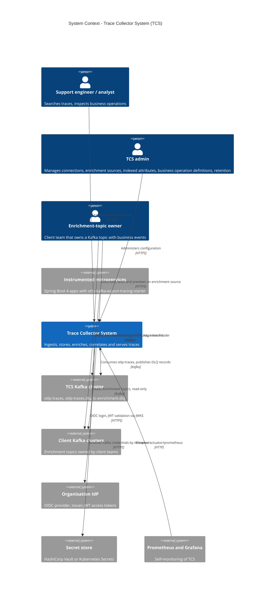
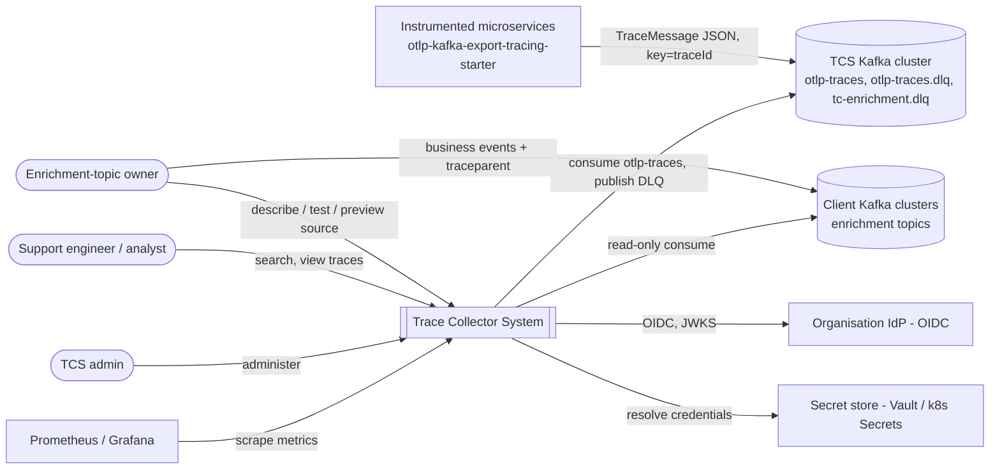
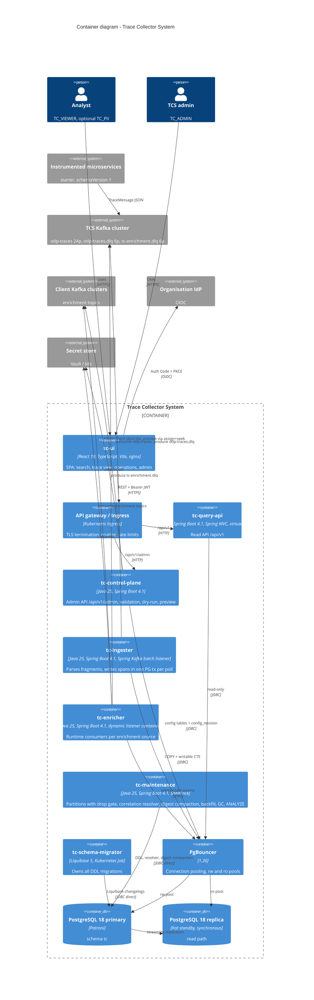
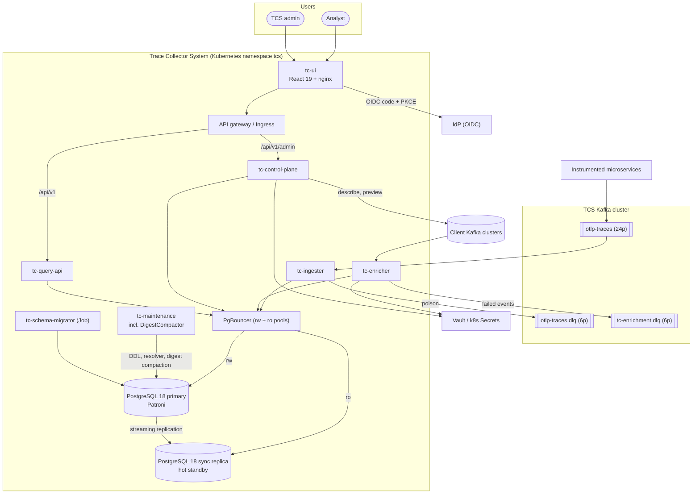
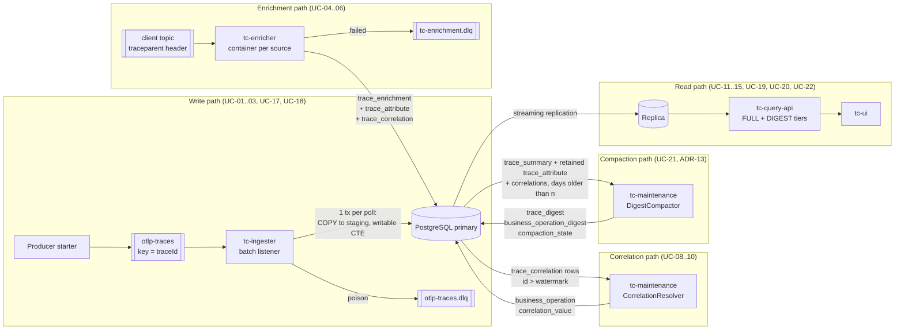
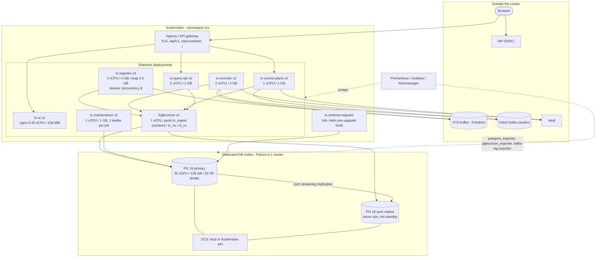

# 02 — Trace Collector System (TCS): High-Level Design

**Related documents**

- [01-technology-overview.md](01-technology-overview.md): Tempo, the OpenTelemetry Collector, Jaeger, Promscale, SigNoz and the verified stack versions
- [02-high-level-design.md](02-high-level-design.md): this document
- [03-low-level-design.md](03-low-level-design.md): per-service low-level design
- [04-storage-design.md](04-storage-design.md): PostgreSQL schema, partitioning, sizing details
- [05-domain-model.md](05-domain-model.md): domain model
- [06-use-cases.md](06-use-cases.md): use cases UC-01 … UC-23
- [07-sequence-diagrams.md](07-sequence-diagrams.md): sequence diagrams
- [08-er-diagrams.md](08-er-diagrams.md): ER diagrams

Use cases are referenced by ID (UC-xx) as defined in 06-use-cases.md.

---

## 1. Purpose and scope

The Trace Collector System (TCS) is the backend for the spans that Spring Boot 4 microservices publish through `otlp-kafka-export-tracing-starter`. It must:

1. **Ingest** every `TraceMessage` from the Kafka topic `otlp-traces` at sampling probability 1.0 (UC-01, UC-02, UC-03).
2. **Store** spans durably in PostgreSQL 18. PostgreSQL is the primary store; other stores appear only as alternatives (§13).
3. **Enrich** traces with fields extracted from client-owned Kafka topics. These topics are not known at build time and are registered at runtime as data (UC-04, UC-05, UC-06).
4. **Link** traces that belong to one business operation, for example IdP first factor → second factor → token exchange (UC-08, UC-09, UC-10, UC-14).
5. **Query** traces by trace id, time range and attributes such as `user_id`, `client_id` and `auth.factor` (UC-11, UC-12, UC-13, UC-15, UC-20).
6. **Present** results in a React UI (`tc-ui`) and manage configuration through an admin API (UC-04 … UC-08, UC-16, UC-19).
7. **Retain** data in two tiers (ADR-13): full span detail for `fullDataDays` = n days (default 7), then a compact per-trace and per-business-operation **digest** (operation, outcome, retained custom attributes) for another `digestDays` = m days (default 90) (UC-21, UC-22, UC-23).

**In scope:** the seven deployables listed in §6, the PostgreSQL schema `tc`, the Kafka topic contract, deployment, capacity and operations.

**Out of scope:**
- Metrics and logs storage.
- Tail sampling.
- Changing the producer starter. The optional, non-breaking evolution in §12 is a recommendation only.
- Running the Kafka clusters. They are operated by the platform team, and TCS consumes them.

### 1.1 Relation to prior reports

This design **supersedes** the two Russian-language reports that were in `opentelemetry-demo/reports` at the time of writing: *Архитектура backend трассировки* and *Проектирование backend трассировки*. The reasons:

- **The first report** (Kafka Streams with EOS, an additions topic, GIN over all span attributes, and a DB offset ledger):
  - It needs Kafka Streams internal topics, which conflicts with the "no dynamic topics" constraint.
  - It needs a mutable per-trace directory plus a pending-enrichment queue.
  - It indexes every attribute with GIN. At 60 000 spans/s this multiplies WAL and write amplification.
- **The second report** assumed OTLP/JSON `ExportTraceServiceRequest` input, which does not match the starter's `TraceMessage`. It also accepted silent data loss with no DLQ topic.

TCS keeps the ideas from both that held up:
- commit offsets after the DB commit
- allowlisted search keys
- append-only enrichment
- partition drops for retention

It replaces the rest with the decisions in §9.

---

## 2. Requirements

### 2.1 Functional requirements

| ID | Requirement | Use cases |
|---|---|---|
| FR-01 | Ingest **all** traces (sampling probability 1.0) from `otlp-traces`. Accept `TraceMessage` `schemaVersion = 1`; route unknown versions to `otlp-traces.dlq`. | UC-01 |
| FR-02 | Accept traces split into many fragments (per `BatchSpanProcessor` batch, per service instance, minutes apart) and present them as one trace. | UC-01, UC-11 |
| FR-03 | Make duplicate fragments and full replays harmless: no duplicate spans, no double-counted summaries. | UC-02, UC-18 |
| FR-04 | Move poison messages to a DLQ with the original bytes and a reason. Ingestion continues. | UC-03 |
| FR-05 | Let clients register Kafka connections and enrichment sources at runtime: topic, trace-context location, field mappings, transforms. No redeploy. Includes dry-run on a sample event and preview of the last N records. | UC-04 |
| FR-06 | Activate, pause, update and delete enrichment sources at runtime. Running consumers follow within ≤ 30 s. | UC-05 |
| FR-07 | Attach enrichment values to a trace (or span) whether the event arrives before or after the spans. | UC-06 |
| FR-08 | Let admins declare which attribute keys are searchable ("indexed attributes"), with backfill over retained data. Indexed keys can be flagged `retainInDigest` with a `digestTransform` (NONE, SHA256, MASK); flagging a non-indexed key indexes it. | UC-07, UC-23 |
| FR-09 | Let admins declare business operation definitions (PRIMARY and ALIAS keys) with an optional `outcomeRule`. Link traces automatically into business operations and merge operations through alias keys. | UC-08, UC-09, UC-10 |
| FR-10 | Get a full trace by id: span tree, resources, enrichments, links, correlations. After n days, return the trace digest instead (`tier = DIGEST`, `spansExpired = true`). | UC-11, UC-22 |
| FR-11 | Search traces by time range (≤ 7 days when the range touches the FULL tier, ≤ 31 days when it lies entirely in the DIGEST tier) plus service, root span name, duration, status and indexed attributes, with keyset pagination across both tiers. | UC-12, UC-22 |
| FR-12 | Bounded brute-force search on non-indexed attributes (window ≤ 1 h). | UC-13 |
| FR-13 | Show the business-operation timeline: ordered traces plus step labels and the operation outcome, for n + m days (DIGEST tier after n days). | UC-14, UC-22 |
| FR-14 | Autocomplete services, span names, indexed keys and values. | UC-15 |
| FR-15 | Enforce retention per table by dropping partitions; pre-create partitions 3 days ahead. A FULL-tier partition is dropped only after the days it covers are compacted into the DIGEST tier (drop gate, ADR-13). | UC-16 |
| FR-16 | Survive PostgreSQL outages without loss, then catch up. | UC-17 |
| FR-17 | Replay ingestion from Kafka by resetting consumer-group offsets. | UC-18 |
| FR-18 | Role-based access (`TC_VIEWER`, `TC_ADMIN`) and PII masking unless the caller has the `TC_PII` scope. | UC-19 |
| FR-19 | Show related traces through OTel span links (both directions) and shared business operations. | UC-20 |
| FR-20 | Provide a React UI for search, trace view, business-operation timeline and administration. | UC-11 … UC-15, UC-04 … UC-08 |
| FR-21 | Compact FULL-tier data older than n days into `trace_digest` and `business_operation_digest` (root service and name, duration, outcome, services, business operation, retained attributes; operation steps and outcome). Exclude configured noise (`compaction_exclusion`) unless the trace belongs to a business operation. | UC-21 |
| FR-22 | Query the DIGEST tier: trace digest by id, search across tiers with warnings for unsupported predicates, historical business operations with outcome. | UC-22 |
| FR-23 | Let admins configure retention tiers (`fullDataDays`, `digestDays`), retained attributes, outcome rules and compaction exclusions at runtime. | UC-23 |

### 2.2 Non-functional requirements

| ID | Category | Requirement (baseline profile M unless stated) |
|---|---|---|
| NFR-01 | Throughput | Sustain 1 000 traces/s ≈ 20 000 spans/s on average and 60 000 spans/s at peak (factor 3), sampling 1.0. |
| NFR-02 | Freshness | p95 time from Kafka append to searchable ≤ 15 s at steady state. A trace is visible as soon as its first fragment commits. |
| NFR-03 | Durability | No loss of a span after it is appended to `otlp-traces`, within the topic's 3-day retention. Offsets are committed only after the PostgreSQL commit. Synchronous replication makes the committed offsets RPO 0. |
| NFR-04 | Idempotency | Replay of any offset range produces identical `span` rows and identical `trace_summary` counters ("effectively once"). |
| NFR-05 | Query latency | Trace by id (≤ 10 000 spans): p95 < 1 s. Trace digest by id: p95 < 1 s. Indexed search, 24 h window, selective predicate: p95 < 2 s. DIGEST-tier search, 31 d window, selective predicate: p95 < 3 s. Brute-force search: hard limit 30 s. |
| NFR-06 | Availability | Read API 99.9 %. Ingestion survives a PostgreSQL outage for up to the Kafka retention (3 days) minus the catch-up time. |
| NFR-07 | Retention | Two tiers (ADR-13), configurable at runtime in `retention_policy` (`tier` FULL / DIGEST). **FULL** (span, trace_attribute, span_link, trace_summary, trace_enrichment, trace_correlation, correlation_value, business_operation): n = `fullDataDays`, default **7 d** (min 2). **DIGEST** (trace_digest, business_operation_digest): a further m = `digestDays`, default **90 d** (0 = disabled), i.e. dropped at n + m = 97 d total age. Compaction lag ≤ 1 day; uncompacted FULL data is never dropped. |
| NFR-08 | Scalability | Ingest scales horizontally up to the partition count of `otlp-traces` (24). Profile L (5 000 traces/s) exceeds a single PostgreSQL primary, so use an alternative (§13). |
| NFR-09 | Isolation | A failing or slow enrichment source must not delay span ingestion or other enrichment sources. |
| NFR-10 | Operability | No Kafka topic is created by TCS. Configuration changes apply without redeploy (ingester ≤ 10 s, enricher ≤ 30 s). Every component exports Prometheus metrics. |
| NFR-11 | Security | OIDC (Authorization Code + PKCE) in the UI and JWT resource servers in the APIs. TLS on every hop. Kafka credentials live only in the secret store, never in the DB. |
| NFR-12 | Technology | Java 25, Spring Boot **4.1.3** (latest 4.1 patch; 4.2.0 is the upgrade path), Spring Kafka 4.1.3, Jackson 3.1 (`tools.jackson`), PostgreSQL 18.7, Liquibase 5.0.4. **No Kafka Streams.** |

### 2.3 Assumptions

All numbers are **assumptions** to be validated by the benchmark plan in 04-storage-design.md.

- A1. Average trace = 20 spans (N = 20) across 3–4 services. Average wire size ≈ 1.6 KB of JSON per span, of which ≈ 700 B is the `resource` repeated in each span.
- A2. zstd compresses this JSON about 8× (measure before sizing Kafka disks).
- A3. About 30 % of traces receive enrichment, with ~3 values each. About 0.5 correlation rows per trace.
- A4. Peak factor 3 lasts ≤ 2 h per day.
- A5. ~12 indexed attribute rows per trace (built-in keys plus a dozen business keys).
- A6. The producer's `BatchSpanProcessor` flushes every 5 s with ≤ 512 spans per batch (starter defaults, see `OtlpKafkaTracingProperties.Export`).
- A7. Clocks of producing hosts are NTP-synchronised to within seconds.
- A8. Kafka brokers run ≥ 4.0 (KRaft) with `auto.create.topics.enable=false`.

### 2.4 Load profiles

| Profile | Traces/s (avg) | Spans/s avg / peak | Traces/day | Spans/day | Comment |
|---|---|---|---|---|---|
| **S** | 100 | 2 000 / 6 000 | 8.64 M | 172.8 M | Small installation, one DB node pair on modest hardware |
| **M** (baseline) | 1 000 | 20 000 / 60 000 | 86.4 M | 1.728 B | Design target |
| **L** | 5 000 | 100 000 / 300 000 | 432 M | 8.64 B | Beyond a single PostgreSQL primary, so use ClickHouse, Tempo or Citus (§13) |

---

## 3. C4 Level 1 — System Context

> Mermaid C4 support is experimental, so an equivalent `flowchart` follows each C4 diagram.

Equivalent flowchart:

**Actors and external systems.**

- **Instrumented microservices** know nothing about TCS except the topic name. The starter disables Boot's OTLP exporter and publishes one Kafka record per trace per `BatchSpanProcessor` batch.
- **Client teams** own enrichment topics, possibly in other clusters, and grant TCS `READ`/`DESCRIBE` plus group `READ` ACLs for `tc-enricher.<sourceName>`.
- **Analysts** have `TC_VIEWER`, plus optionally `TC_PII`.
- **Admins** have `TC_ADMIN`.
- **The IdP** issues JWTs.
- **The secret store** holds Kafka credentials and truststores referenced from `kafka_connection.credentials_secret_ref` and `truststore_secret_ref`.
- **Prometheus/Grafana** monitor TCS itself. TCS does not trace itself into `otlp-traces` (ADR-12).

---

## 4. C4 Level 2 — Containers

Equivalent flowchart:

### 4.1 Container responsibilities (summary)

| Container | Responsibility | State | Scales by |
|---|---|---|---|
| `tc-ingester` | Consumes `otlp-traces` with a batch listener. Parses and normalises fragments. Writes `span`, `trace_summary`, `trace_attribute`, `span_link` and `trace_correlation` in **one PG transaction per poll batch**, then acks. | Stateless (Caffeine caches) | Partitions of `otlp-traces` (24 consumers max) |
| `tc-enricher` | Runs one Spring Kafka `ConcurrentMessageListenerContainer` per ACTIVE enrichment source, created at runtime. Extracts trace context and fields, then writes `trace_enrichment` plus derived `trace_attribute` and `trace_correlation` rows. | Stateless | Partitions of each enrichment topic |
| `tc-query-api` | REST read API for the UI. Reads from the replica through the PgBouncer ro pool. Tier-aware (ADR-13): trace by id falls back to `trace_digest`; search splits the range at the tier boundary; business operations fall back to `business_operation_digest`. | Stateless | CPU / requests |
| `tc-control-plane` | REST admin API. Validation, connection test, dry-run, preview. Retention tiers, retained attributes, outcome rules, compaction exclusions (UC-23). Writes config tables and bumps `config_revision`. | Stateless | Fixed (2) |
| `tc-maintenance` | ShedLock-guarded jobs: PartitionManager (with the ADR-13 drop gate), CorrelationResolver, **DigestCompactor** (lock `digest-compactor`, every 5 min), AttributeBackfill, DictionaryGc, StatsRefresher. | Leader per job | Fixed (2, one active per lock) |
| `tc-schema-migrator` | Liquibase changelogs (formatted SQL). Ensures initial partitions on bootstrap. | Job | n/a |
| `tc-ui` | SPA served by nginx. | Static | Fixed (2) |
| PgBouncer | Pools `tc_rw` → primary and `tc_ro` → replica. | — | Fixed (2) |
| PostgreSQL 18 | Primary plus a synchronous hot-standby replica, managed by Patroni. | Stateful | Vertical. Beyond M, use alternatives |

**`tc-maintenance` and the DIGEST tier (ADR-13).** `DigestCompactor` runs every 5 min under the ShedLock lock `digest-compactor`. It takes each `trace_day` whose whole day is older than n days, processes it in 1-hour chunks of `trace_summary.start_time` with one set-based `INSERT … SELECT` per chunk (no span reads), and records progress in `compaction_state` so a crash resumes at the last chunk. After a day is DONE it compacts the business operations that have ended (`last_seen` older than n days) and whose member days are all DONE. `PartitionManager` drops a FULL-tier partition only when every `trace_day` whose read window overlaps it is DONE, so a lagging compactor costs disk, never data. Both jobs connect directly to the primary (03 §6).

---

## 5. Data flow overview

**Write path.**
- The starter's `KafkaSpanExporter` sends one record per trace per batch: key = traceId, value = `TraceMessage`. Because the key is the trace id, every fragment of a trace lands in the same partition and is therefore processed by the same ingester thread. This is the same property Tempo gets by sharding the distributor on a trace-id hash.
- The ingester polls up to 500 records and parses them with Jackson 3 streaming. It normalises ids, times and attributes, then resolves dictionaries (`service`, `span_name`, `attribute_key`, `resource`, `instrumentation_scope`) in short separate transactions. It resolves each trace's stable `trace_day`.
- It then opens **one** transaction:
  - `COPY` into `ON COMMIT DELETE ROWS` temp staging tables
  - a single writable CTE that inserts into `span` with `ON CONFLICT DO NOTHING RETURNING`
  - upserts of `trace_summary` aggregates computed **only from actually inserted spans**
  - inserts of `trace_attribute`, `span_link` and `trace_correlation` rows for the inserted spans
- After the commit, the container commits the Kafka offsets. A crash between the DB commit and the offset commit causes a replay, and the replay inserts nothing (UC-02).

**Enrichment path.**
- Admins register a `kafka_connection` and an `enrichment_source` (with an immutable revision) through `tc-control-plane`. It validates the definition, tests the connection with `AdminClient.describeTopics`, and offers dry-run and preview (UC-04). It then bumps `config_revision`.
- `tc-enricher` polls `config_revision` and diffs desired against actual sources. It then starts, stops, restarts or hot-swaps per-source listener containers (UC-05).
- For each event it extracts the trace context (W3C `traceparent` by default) and the mapped fields. It writes append-only `trace_enrichment` rows, keyed for idempotency by `(source_id, kafka_partition, kafka_offset, key_id, observed_at)`. For inserted rows only, it also writes `trace_attribute` (when the key is indexed) and `trace_correlation` (when the key belongs to a business operation definition).
- Order does not matter: enrichment is joined to spans at read time by `trace_id` (UC-06).

**Correlation path.**
- Ingester and enricher append `trace_correlation` rows synchronously, inside their main transactions.
- `tc-maintenance`'s single-leader `CorrelationResolver` reads new rows every 10 s past a watermark (`correlation_resolver_state`). It links the new traces one at a time (`OperationLinker`): a trace whose values belong to no operation creates one, to one operation extends it, to several merges them; then it writes the `business_operation` rows and maintains `correlation_value` (value → operation).
- In the IdP example:
  - T1 and T2 share `idp.auth_session_id=as-777`.
  - T2 and T3 share `oauth.authorization_code=code-abc`.
  - All three end up in one operation (UC-09, UC-10).

**Compaction path (ADR-13).**
- Data lives in the **FULL tier** for n = `fullDataDays` days (default 7). `DigestCompactor` then condenses each trace into one `trace_digest` row (root service and name, duration, span and error counts, outcome, services, business operation, and the values of the attribute keys flagged `retain_in_digest`, transformed by `digest_transform`) and each ended business operation into one `business_operation_digest` row (steps, outcome by the business operation definition's `outcome_rule`, union of retained attributes).
- Inputs are `trace_summary`, `trace_attribute` (retained keys only), `trace_correlation` and `correlation_value`, never `span`. Traces matching a `compaction_exclusion` (for example `GET /actuator/%`) are skipped unless they belong to a business operation.
- The **DIGEST tier** is kept for a further m = `digestDays` days (default 90), so business history covers n + m = 97 days at about 0.5 KB per trace instead of ~13.8 KB.
- `PartitionManager` drops FULL-tier partitions only after the days they cover are compacted (drop gate).

**Read path.**
- `tc-query-api` reads from the synchronous replica.
- **Trace by id:**
  1. Probe `trace_summary` (≤ n + 3 ≈ 10 daily partitions). If no row exists, probe `trace_digest` (≤ n + m daily partitions, PK probes) and return the digest with `tier = DIGEST`, `spansExpired = true` (UC-22).
  2. Read only the hourly `span` partitions between `start_time` and `end_time`.
  3. Merge in resources, enrichments, links and correlations.
  4. Mark the trace incomplete when there is no root or `last_ingested_at` is < 60 s ago (UC-11).
- **Search:** pick the most selective indexed predicate, scan `trace_attribute` for the window, intersect with the other predicates, join `trace_summary`, and paginate by `(start_time, trace_id)` (UC-12).
- **Search across tiers:** a range older than the tier boundary (≈ now − n days) is split. The newer part runs as above; the older part queries `trace_digest` (containment on `attributes` through GIN, values of SHA256-transformed keys hashed by the API). Predicates the digest cannot answer (non-retained keys, PREFIX/GT/LT) skip the DIGEST part and are reported in `warnings`. One keyset cursor spans both tiers (UC-22).

---

## 6. Deployables (from the brief)

The Maven multi-module repository is `trace-collector`, with base package `ru.aasmc.tracing.collector`.

| Deployable | Kind | Key packages | Detail |
|---|---|---|---|
| `tc-ingester` | Deployment | `ingest.kafka`, `ingest.parse`, `ingest.normalize`, `ingest.index`, `ingest.persist`, `ingest.trace` | 03 §2 |
| `tc-enricher` | Deployment | `enrich.registry`, `enrich.kafka`, `enrich.extract`, `enrich.persist` | 03 §3 |
| `tc-query-api` | Deployment | `query.api`, `query.search`, `query.trace`, `query.tier`, `query.digest`, `query.security` | 03 §4 |
| `tc-control-plane` | Deployment | `admin.api`, `admin.validation`, `admin.kafka`, `admin.config` | 03 §5 |
| `tc-maintenance` | Deployment | `maintenance.partition`, `maintenance.correlation`, `maintenance.digest`, `maintenance.backfill`, `maintenance.gc`, `maintenance.stats` | 03 §6 |
| `tc-schema-migrator` | Kubernetes Job | Liquibase `db/changelog` | 03 §7 |
| `tc-ui` | Deployment (nginx) | React SPA | 03 §8 |
| Shared libs | jars | `tc-domain`, `tc-persistence`, `tc-kafka-support` | 03 §9 |

---

## 7. Kafka topics

All topics are **pre-created** by Kafka admins (ADR-01). TCS never creates topics:
- `spring.kafka.admin.auto-create=false`
- no `NewTopic` beans
- no `@RetryableTopic`
- consumers set `allow.auto.create.topics=false`
- brokers are expected to run with `auto.create.topics.enable=false`

At startup each service checks with `Admin.describeTopics` that its topics exist and fails readiness if they do not.

| Topic | Partitions | RF / min ISR | Retention | Other configs | Producer → Consumer |
|---|---|---|---|---|---|
| `otlp-traces` | 24 | 3 / 2 | 3 days (`retention.ms=259200000`) | `max.message.bytes=8388608` (8 MiB fragment limit), `cleanup.policy=delete`, `compression.type=producer` | starter → `tc-ingester` (group `tc-ingester`) |
| `otlp-traces.dlq` | 6 | 3 / 2 | 14 days | `max.message.bytes=9437184` | `tc-ingester` → operators (manual replay tool) |
| `tc-enrichment.dlq` | 6 | 3 / 2 | 14 days | `max.message.bytes=2097152` | `tc-enricher` → operators |
| client enrichment topics | client-defined | client-defined | client-defined | — | client producers → `tc-enricher` (group `tc-enricher.<sourceName>`) |

Consumer groups: `tc-ingester` and `tc-enricher.<sourceName>`. There are no others. Preview in `tc-control-plane` uses `assign()` without a `group.id`, so it creates no group and commits nothing.

**Required ACLs:**

| Principal | Permissions |
|---|---|
| `tc-ingester` | READ+DESCRIBE `otlp-traces`; READ group `tc-ingester`; WRITE+DESCRIBE `otlp-traces.dlq` |
| `tc-enricher` (TCS cluster) | WRITE+DESCRIBE `tc-enrichment.dlq` |
| per client cluster (granted by the client team) | READ+DESCRIBE on the topic; READ group `tc-enricher.<sourceName>` |
| `tc-control-plane` | DESCRIBE+READ on the client topics |

---

## 8. Deployment view (Kubernetes)

### 8.1 Workloads (profile M; resources from the brief §7)

| Workload | Kind | Replicas | CPU / memory (request = limit) | Notes |
|---|---|---|---|---|
| `tc-ingester` | Deployment | 3 | 4 vCPU / 4 GB (heap 2.5 GB, `-XX:MaxRAMPercentage` not used, `-Xmx2560m`) | `spring.kafka.listener.concurrency=8` → 24 consumers = 24 partitions. `terminationGracePeriodSeconds: 90`. PodDisruptionBudget `maxUnavailable: 1`. |
| `tc-enricher` | Deployment | 2 | 2 vCPU / 2 GB | Every replica runs a container for each ACTIVE source, and Kafka balances partitions between them. |
| `tc-query-api` | Deployment | 2 (HPA 2–6 on CPU 70 %) | 2 vCPU / 2 GB | Virtual threads. Hikari pool 20 → PgBouncer `tc_ro`. |
| `tc-control-plane` | Deployment | 2 | 1 vCPU / 1 GB | Low traffic. Needs egress to client Kafka for test/preview. |
| `tc-maintenance` | Deployment | 2 | 1 vCPU / 1 GB | ShedLock: one active executor per job. Connects **directly** to the Patroni primary service (DDL, `DETACH ... CONCURRENTLY`, digest compaction). `DigestCompactor` work is set-based SQL on the primary, so the pod size does not change; the DB cost is ≈ 20–40 min of primary I/O per day of data at M (assumption, benchmark). |
| `tc-schema-migrator` | Job | 1 run per release | 1 vCPU / 1 GB | Liquibase. Runs before the application rollouts (Helm pre-upgrade hook / Argo CD sync wave −1). |
| `tc-ui` | Deployment | 2 | 0.25 vCPU / 128 MiB | nginx serving static assets plus `/config.json`. |
| PgBouncer 1.26.1 | Deployment | 2 | 1 vCPU / 256 MiB | `tc_ingest` pool → primary (`pool_mode=session`, tc-ingester only), `tc_rw` pool → primary, `tc_ro` → replica (both `pool_mode=transaction`). `max_prepared_statements=200`. |
| PostgreSQL 18.7 | Patroni 4.1.5 cluster on dedicated nodes (VMs, or a StatefulSet with local NVMe PVs) | 1 primary + 1 sync replica | 32 vCPU / 128 GB / 20 TB usable NVMe each (04 §9; two-tier retention n = 7 d, m = 90 d; 18 TB if inline lz4 is confirmed) | `synchronous_mode: true`. `shared_buffers=32GB`, `wal_compression=zstd`, `max_wal_size=64GB`, `default_toast_compression=lz4`. |
| Kafka | Existing cluster | 3 brokers | ≥ 1.5 TB per broker for `otlp-traces` | Not operated by TCS. |

**PgBouncer note.** Transaction pooling breaks session state such as `SET`, session advisory locks, and temp tables created with `ON COMMIT PRESERVE/DELETE ROWS`. For this reason:
- `tc-ingester` connects through a **dedicated** PgBouncer database entry `tc_ingest` with `pool_mode=session`. Its connection count is small and fixed (3 pods × 10).
- In addition, `CREATE TEMP TABLE IF NOT EXISTS ... ON COMMIT DELETE ROWS` is executed at the start of every batch transaction, so it would also be correct under transaction pooling.
- Query and control-plane traffic uses transaction pooling. Per-query timeouts use `set_config('statement_timeout', ?, true)`, which is transaction-local.
- `tc-maintenance` and `tc-schema-migrator` bypass PgBouncer.

### 8.2 Network and security boundaries

- **Ingress:** only `tc-ui`, `/api/v1/**` → `tc-query-api` and `/api/v1/admin/**` → `tc-control-plane` are exposed. The gateway terminates TLS. The services validate JWTs again themselves, so the gateway is not the only check.
- **NetworkPolicies (default deny):**

  | Workload | Allowed |
  |---|---|
  | ingester | egress to TCS Kafka and PgBouncer |
  | enricher | egress to client Kafka CIDR allow-list, TCS Kafka, Vault and PgBouncer |
  | control-plane | egress to client Kafka, Vault and PgBouncer |
  | query-api | egress to PgBouncer only |
  | maintenance / migrator | egress to PG primary only |
  | Prometheus | ingress to `/actuator/prometheus` on management port 8081 |

- **Database roles:**

  | Role | Rights |
  |---|---|
  | `tc_ingester` | INSERT/SELECT on data and dictionary tables, SELECT on config |
  | `tc_enricher` | INSERT on `trace_enrichment`, `trace_attribute`, `trace_correlation`, `attribute_key`; SELECT config |
  | `tc_query` | SELECT only, used on the replica |
  | `tc_admin` | DML on config tables |
  | `tc_maintenance` | member of `tc_owner`; partition DDL, resolver tables |
  | `tc_owner` | owns schema `tc`; used by the migrator |

- **Kafka:** SASL_SSL (SCRAM-SHA-512 or OAUTHBEARER) or mTLS, with per-service principals and the ACLs in §7.
- **Secrets:** DB passwords and TCS Kafka credentials come from Kubernetes Secrets (or the Vault Agent injector). Client Kafka credentials are resolved at runtime by `SecretResolver` from the references stored in `kafka_connection`. They are never persisted in PostgreSQL or logs.

---

## 9. Architecture Decision Records

Each ADR records which property is **borrowed** and from where. "Tempo" refers to Grafana Tempo 3.x (v3.1.1); see 01-technology-overview.md for sources.

### ADR-01 — Plain Spring Kafka consumers/producers; no Kafka Streams; no topic auto-creation

- **Context.**
  - The environment forbids dynamic topic creation.
  - Kafka Streams creates `<application.id>-…-repartition` and `-changelog` internal topics. The classic protocol can validate pre-created internal topics, but the names depend on topology and the convention "is not guaranteed for future releases".
  - Spring Kafka's `@RetryableTopic` auto-creates retry and DLT topics through `NewTopic` beans, and it does not support batch listeners.
  - `KafkaAdmin` creates `NewTopic` beans unless `spring.kafka.admin.auto-create=false`.
- **Decision.**
  - Use only `@KafkaListener` batch containers, programmatically created `ConcurrentMessageListenerContainer`s and `KafkaTemplate`.
  - Set `spring.kafka.admin.auto-create=false`, define no `NewTopic` beans, and do not use `@RetryableTopic`.
  - Set consumer `allow.auto.create.topics=false`.
  - Pre-create the three topics in §7.
  - DLQ publishing uses `DeadLetterPublishingRecoverer` with a custom destination resolver (default would be `<topic>-dlt`).
- **Consequences.**
  - TCS creates no topics.
  - We need no stateful stream processing, because key = traceId already co-partitions fragments.
  - Trace assembly happens in PostgreSQL (summary upsert) and at query time.
- **Alternatives considered.**
  - Kafka Streams with explicitly named, pre-created internal topics (`ensure.explicit.internal.resource.naming=true`): viable but unnecessary (§13 D).
  - Kafka share groups (KIP-932): no batch listeners and no `CommonErrorHandler`/DLT integration, so rejected.
  - Running an OTel Collector between Kafka and DB: the Collector acks batches without a durable DB write and has no PostgreSQL exporter of production quality.
- **Borrowed from:** the **OTel Collector** receiver → processor → exporter pipeline shape (mirrored by parse → normalize → index → persist), but kept inside one JVM transaction.

### ADR-02 — Kafka is the write-ahead log; at-least-once delivery plus idempotent writes

- **Context.** The producer already writes durably to Kafka (`acks=all`, idempotent producer). Tempo 3.x made Kafka the only ingest path in microservices mode, because once Kafka acknowledges a write the data is durable.
- **Decision.**
  - The ingester commits offsets only **after** the PostgreSQL transaction commits: `AckMode.BATCH`, listener returns after the commit, `enable.auto.commit=false`.
  - Every write is idempotent:
    - `span` uses `ON CONFLICT (trace_id, span_id, start_time) DO NOTHING`.
    - `trace_summary` counters and `trace_attribute`/`span_link`/`trace_correlation` are derived **only from rows returned by that insert**.
    - `trace_enrichment` is unique on Kafka coordinates.
  - Replay = reset consumer-group offsets (UC-18).
  - PostgreSQL outage = infinite exponential back-off while Kafka buffers (UC-17).
- **Consequences.**
  - Effectively-once results with no transaction coordinator, no offset ledger in the DB, and no outbox.
  - Outage tolerance is bounded by topic retention (3 days).
  - The producer drops spans when its own send fails. That loss is outside TCS guarantees.
- **Alternatives.**
  - DB offset ledger (prior report A): stronger with an async standby, but adds a hot table. We use synchronous replication instead (SD-3).
  - Kafka transactions: do not span PostgreSQL.
- **Borrowed from:** **Tempo** (Kafka as WAL, commit after the block flush; deterministic block ids make reprocessing idempotent, and our PK conflict does the same).

### ADR-03 — Time-partitioned PostgreSQL 18 storage; retention by DROP

- **Context.** At M we write 1.728 B spans/day. DELETE-based retention would generate as much WAL and vacuum work as the inserts. A B-tree on a random `trace_id` must stay in RAM.
- **Decision.**
  - Declarative RANGE partitioning.
  - `span` and `trace_attribute` are **hourly** (current-hour span PK ≈ 3.6 GB).
  - `trace_summary`, `trace_enrichment`, `trace_correlation` and `span_link` are **daily**. `business_operation` is **monthly**.
  - No DEFAULT partition. A default partition would make `ATTACH` scan it and would forbid `DETACH PARTITION … CONCURRENTLY`.
  - `tc-maintenance` pre-creates partitions 3 days ahead and drops expired ones with `DETACH … CONCURRENTLY` + `DROP`.
- **Consequences.**
  - Roughly 1 000 partitions in total, within the "few thousand" the planner handles well **when queries prune**. Every query therefore carries a partition-key predicate.
  - Spans newer than now + 1 day go to the DLQ (`FUTURE_TIMESTAMP`). Spans older than retention are dropped.
- **Alternatives.**
  - pg_partman 5.5.1 (acceptable substitute for PartitionManager).
  - TimescaleDB hypertables (§13 C).
  - Daily `span` partitions: the PK no longer fits in RAM at M.
- **Borrowed from:** **Tempo** (retention deletes whole blocks, never rows; Tempo's `block_retention` default is 14 d, our FULL-tier default is 7 d followed by the DIGEST tier, ADR-13).
- **Amended by ADR-13:** FULL-tier partitions are dropped only behind the compaction drop gate.

### ADR-04 — Trace-level header table `trace_summary`

- **Context.** Search results show trace-level facts: root service and name, duration, span and error counts, services. Computing them from spans at query time is too expensive.
- **Decision.**
  - One row per `(trace_id, trace_day)`, upserted incrementally from inserted spans:
    - `LEAST(start_time)` / `GREATEST(end_time)`
    - `span_count +=`, `error_count +=`, `fragment_count +=`
    - root fields set when the root span arrives
  - `trace_day` is resolved once per trace (`TraceDayResolver`) so that all fragments hit the same row.
- **Consequences.**
  - Search is index-driven on `(start_time DESC)` or `(root_service_id, start_time DESC)`.
  - Long traces that cross the cache horizon may get two rows. The read path merges them.
- **Alternatives.** A global unpartitioned `trace_head` (prior report B) concentrates DELETE pressure and bloat.
- **Borrowed from:** **Tempo** trace-level Parquet columns (`StartTimeUnixNano`, `DurationNano`, `RootServiceName`, `RootSpanName`, `ServiceStats`) and the **Jaeger** trace/duration index.

### ADR-05 — Explicit indexed-attribute registry; no GIN on span attributes

- **Context.** A GIN index on all span attributes at 60 000 spans/s is prohibitive in WAL, write amplification and pending-list cleanups. Most searches use a handful of business keys (`user_id`, `client_id`, `auth.factor`).
- **Decision.**
  - Only keys registered in `indexed_attribute` (status `BACKFILLING` or `ACTIVE`) produce rows in the inverted index `trace_attribute(ts, key_id, value_str, value_num, trace_id, origin)`.
  - Built-in indexed keys: `service.name`, `span.name` (root spans only) and `status` (only for ERROR).
  - Non-registered keys are searchable only through the bounded brute-force mode (window ≤ 1 h, `statement_timeout`) (UC-13).
  - New keys get a backfill job (UC-07).
- **Consequences.**
  - Write cost is proportional to the number of indexed values, not to all attributes.
  - Admins must curate the list.
- **Alternatives.**
  - GIN `jsonb_path_ops` on `span.attributes`.
  - A per-key column (not possible to change at runtime).
- **Borrowed from:** **Tempo** dedicated attribute columns, **SigNoz** materialized attribute columns, and the **Jaeger** Cassandra `tag_index`.

### ADR-06 — Resource and scope deduplication; dictionaries

- **Context.** The starter repeats the full `resource` (~700 B) in every span.
- **Decision.**
  - `resource.id` = xxHash64 of the canonical, sorted attributes plus `schemaUrl`; spans store `resource_id`.
  - `instrumentation_scope` is handled the same way.
  - Dictionaries: `service`, `span_name` (≤ 5 000 per service; overflow → `name_overflow`) and `attribute_key`.
  - Dictionary rows are inserted insert-if-absent in short autocommit transactions outside the batch transaction (SD-2).
- **Consequences.**
  - Roughly 40 % fewer bytes per span.
  - Lookups are cached in Caffeine.
- **Alternatives.** Store the resource per span (simple, but doubles storage).
- **Borrowed from:** **Promscale** (normalised `resource`/`schema_url`/`instrumentation_lib` and `tag_key` tables) and **Tempo** vParquet (resource stored once per batch).

### ADR-07 — Enrichment as append-only additions joined at read time

- **Context.** Enrichment events can arrive before or after the spans. Mutating `span` rows would cause updates, bloat and ordering problems.
- **Decision.**
  - `trace_enrichment` rows are keyed by `trace_id` (and an optional `span_id`) and joined at read time.
  - If an enrichment key is indexed, it is also written to `trace_attribute` with `origin=ENRICHMENT`.
  - If the key belongs to a business operation definition, it is also written to `trace_correlation`.
  - There is no pending queue.
- **Consequences.**
  - Order independence (UC-06).
  - Values from several sources and revisions coexist; the UI shows provenance.
- **Alternatives.**
  - Kafka Streams join with windows (prior report A).
  - Fill-if-missing updates of a header row (prior report B).
- **Borrowed from:** **OTel Collector** `attributes`/`transform` processors (the declarative extraction and transform vocabulary). Unlike the Collector, we do not mutate spans in flight.

### ADR-08 — Enrichment sources are data; runtime listener containers

- **Context.** Topics are unknown at build time and may be in other clusters.
- **Decision.**
  - `kafka_connection`, `enrichment_source` and immutable `enrichment_source_revision` rows are the configuration.
  - `tc-enricher` creates a `ConcurrentMessageListenerContainer` per ACTIVE source, with its own `DefaultKafkaConsumerFactory` per connection and consumer group `tc-enricher.<sourceName>`.
  - Credentials come from the `SecretResolver`.
  - A mapping-only change is hot-swapped without a restart.
- **Consequences.**
  - Admins self-serve sources.
  - A source failure is isolated to its own container (NFR-09).
- **Alternatives.**
  - `KafkaListenerEndpointRegistry.registerListenerContainer`. Rejected: `unregisterListenerContainer` does not stop the container, and the registry adds nothing when every source has its own consumer factory.
  - One redeploy per source.
- **Borrowed from:** **OTel Collector** (receivers declared in configuration).

### ADR-09 — Business-operation linking through business operation definitions; span links indexed

- **Context.** IdP login spans three traces. There is no shared trace id, but there are shared business ids.
- **Decision.**
  - A `business_operation_definition` declares keys with role PRIMARY or ALIAS and a `step_label`.
  - Ingester and enricher append `trace_correlation` rows synchronously.
  - The single-leader `CorrelationResolver` (linking traces one at a time, in time order) maintains `business_operation` and `correlation_value`. Merges respect `merge_window`.
  - Native OTel span links are stored in `span_link`, indexed by `trace_id` and `linked_trace_id` (UC-20).
  - Recommended producer practice: propagate the business id as W3C Baggage and copy it to span tags (`management.tracing.baggage.remote-fields` plus `management.tracing.baggage.tag-fields`), or set it with `@TraceAttribute`.
- **Consequences.**
  - Linking is eventually consistent (≈ 10–20 s).
  - Ingest has no read-modify-write of operations.
- **Alternatives.**
  - Explicit `business.operation.id` only (prior report B): too rigid.
  - Linking at query time only: slow for merged chains.
- **Borrowed from:** **Tempo/TraceQL** `link:traceID` (we add the reverse index Tempo lacks) and **Jaeger** span references.

### ADR-10 — Compact ids and time types

- **Decision.**
  - `trace_id uuid` (16 B, from 32 hex) and `span_id bigint` (8 B, from 16 hex, reinterpreted as signed).
  - Times are `timestamptz` (µs; nanos truncated) plus exact `duration_ns bigint`.
  - Root `parentSpanId = "0000000000000000"` → `parent_span_id NULL`.
- **Consequences.** Half the size of the hex text forms, cheaper B-trees, natural time partitioning.
- **Borrowed from:** **Tempo** (128-bit/64-bit id validation in the distributor).

### ADR-11 — Read from a streaming replica; write to the primary through PgBouncer

- **Decision.**
  - `tc-query-api` uses the PgBouncer `tc_ro` pool → hot standby (`hot_standby_feedback=off`, `max_standby_streaming_delay=30s`).
  - Writers use `tc_rw` and `tc_ingest` → primary.
  - The replica is the **synchronous** standby (SD-3).
- **Consequences.**
  - Heavy searches do not slow ingest.
  - Read-your-writes is not guaranteed, but lag is normally < 1 s.
  - Queries that conflict with partition drops are cancelled and retried.
- **Borrowed from:** **Tempo** (separate read and write paths).

### ADR-12 — No self-tracing into `otlp-traces`

- **Decision.** TCS services do not depend on the starter. Spring Boot tracing export is disabled, or pointed at a separate backend. This prevents a feedback loop where ingesting a span produces spans.
- **Consequences.** Self-observability relies on metrics and logs (§11).

### ADR-13 — Two-tier retention: FULL tier for n days, then a DIGEST tier for m days

- **Context.**
  - Users need business history (which operation ran, how it ended, for which user or client) for about three months, but span-level detail is needed mainly for recent incidents.
  - Span detail is ~13 KB of the ~13.8 KB stored per trace (04 §9). Keeping everything for 14–90 days (the previous per-table mix) costs ≈ 23.5 TB per node at M and still keeps spans for only 14 days.
  - A digest of one trace (root service and name, duration, outcome, services, business operation, a dozen business attribute values) is about 0.5 KB.
- **Decision.**
  - **FULL tier:** everything as designed so far (`span`, `trace_attribute`, `span_link`, `trace_summary`, `trace_enrichment`, `trace_correlation`, `correlation_value`, `business_operation`) is kept `fullDataDays` = n days (default **7**, min 2). `business_operation` stays monthly; a month partition is dropped when the whole month is older than n days and all its operations are compacted.
  - **DIGEST tier:** `trace_digest` (one row per trace) and `business_operation_digest` (one row per business operation), daily partitions, kept `digestDays` = m days (default **90**) **after** the FULL tier ends, i.e. dropped at n + m days of age (97 by default). m = 0 disables the digest.
  - Configuration lives in `retention_policy` (new column `tier` FULL / DIGEST) and is changed with `PUT /api/v1/admin/retention-policies/tiers` `{"fullDataDays":7,"digestDays":90}` in one transaction with a `config_revision` bump. Validation: `fullDataDays ≥ 2` and `fullDataDays >` the largest correlation `merge_window` (in days, rounded up); `digestDays ≥ 0`. `tc.retention.full-days=7` and `tc.retention.digest-days=90` only seed the migration.
  - **Retained attributes:** `indexed_attribute.retain_in_digest` and `digest_transform` (NONE, SHA256, MASK). A retained key must be indexed, because compaction reads `trace_attribute` and never `span`; flagging a non-indexed key creates the `indexed_attribute` (BACKFILLING). Enrichment-derived values are covered, because indexed enrichment keys already reach `trace_attribute`.
  - **Outcome:** `trace_digest.outcome` 1 = OK, 2 = ERROR (from `error_count`). Business operations get `OperationOutcome` (UNKNOWN, SUCCESS, FAILED, INCOMPLETE) from the business operation definition's `outcome_rule` (`outcomeKey`, `successValues`, `failureValues`, `finalStepLabel`).
  - **Compaction:** `tc-maintenance` `DigestCompactor` (ShedLock `digest-compactor`, every 5 min) processes each whole day older than n days in 1-hour chunks with one set-based `INSERT … SELECT … ON CONFLICT DO NOTHING` per chunk, resumable through `compaction_state`. `compaction_exclusion` filters noise such as health checks.
  - **Drop gate:** a FULL-tier partition is dropped only when its upper bound ≤ now − n days **and** every `trace_day` whose compaction read window overlaps it is DONE. Uncompacted data is never dropped; the gate is skipped when m = 0.
  - **Reads:** trace by id falls back to `trace_digest`; search splits the range at the tier boundary (max window 7 d when touching FULL, 31 d entirely in DIGEST); business operations fall back to `business_operation_digest`. The DIGEST part of a search uses a GIN `jsonb_path_ops` index on `attributes`: unlike live spans (ADR-05), the digest is written once in batches, so GIN maintenance is affordable.
- **Consequences.**
  - Disk per node at M (with 25 % headroom) drops from 23.5 TB to ≈ 19.7 TB with m = 90 d (−16 %), or to ≈ 14.6 TB with m = 30 d (−38 %), while business history grows from 14–30 days to 97 days (04 §9). The digest tier itself costs ≈ 789 B/trace (≈ 68 GB/day at M); `digestDays` is the main lever.
  - Keys not flagged `retain_in_digest` are lost after n days. Flagging a key later is **not retroactive** for already-compacted days. A late `trace_attribute` value outside the compaction read window `[D − 1 h, D + 1 day + 6 h)` is not captured.
  - After n days, trace by id returns only the digest (no spans, enrichments or links). Brute-force search and span-level detail are unavailable in the DIGEST tier. Predicates on non-retained keys, PREFIX and range predicates are not answered there and produce warnings.
  - PII is retained longer. Admins must choose `SHA256` or `MASK` for PII keys; the query API hashes query values for SHA256 keys, so equality search still works.
  - Compaction adds ≈ 20–40 min of primary I/O per day of data at M (assumption, benchmark). If it lags, FULL-tier data stays on disk and `tc_compaction_lag_days > 1` alerts.
  - Shortening n causes a one-off compaction burst; changing a key's transform affects only days compacted afterwards.
- **Alternatives considered.**
  - **Keep 14 days of full data** (previous design): simplest, but span detail for 14 days and searchable trace history for only 14–30 days, at ≈ 23.5 TB per node.
  - **Sampling after the fact** (delete most old spans, keep e.g. errors and 1 % of OK traces): keeps some span detail, but answers "what happened to user X's login on day Y" only by luck, and DELETE on hot partitions brings back the vacuum and WAL cost that ADR-03 avoids.
  - **Move old spans to object storage as Parquet** (Tempo-style blocks, §13 B): keeps full detail cheaply, but adds a second storage engine, a block builder and a separate query path; worth it only when old span detail is required. The digest can coexist with it.
  - **ClickHouse for all spans** (§13 A): 5–10× compression makes long full retention cheap, but replaces the PostgreSQL design and operations. Preferred above profile M or when full span detail must be kept longer than n days.
  - **Continuous per-trace digest written by the ingester:** would require read-modify-write of a digest row per fragment and the retained-attribute values from enrichment, which arrive late; batch compaction after n days sees final data and costs no ingest latency.
- **Borrowed from:** **Tempo** compaction (rewrite old data into a compact form in the background, retention by whole blocks) and **Jaeger/SigNoz** practice of separate, longer-lived aggregate/index data.

### Supplementary decisions (detail added by this document)

- **SD-1 — Two DLQ strategies.**
  - The ingester uses `DefaultErrorHandler` + `BatchListenerFailedException` → `DeadLetterPublishingRecoverer` (brief). Poison is rare, so an extra small transaction per poison record is acceptable.
  - The enricher invokes the same recoverer **inline** for extraction failures, because mapping errors can be frequent and must not re-poll batches.
- **SD-2 — Dictionaries outside the batch transaction.**
  - `INSERT … ON CONFLICT DO NOTHING` waits on concurrent uncommitted inserts of the same key. Inside long batch transactions on different pods, that could cause lock waits or deadlocks.
  - Dictionary upserts therefore run in short autocommit statements with sorted keys before the batch transaction. Orphans from failed batches are harmless.
- **SD-3 — Patroni synchronous replication.**
  - Offsets are committed after the primary's commit. With asynchronous replication, a failover could lose transactions whose offsets were already committed.
  - `synchronous_mode: true` (not strict) closes that window.
  - As defence in depth, the failover runbook resets `tc-ingester` offsets to the failover timestamp minus 5 min. Idempotent writes make that safe (UC-18).
- **SD-4 — Shared extraction engine.** The extraction code (`enrich.extract`) lives in `tc-kafka-support`, so `tc-control-plane` runs exactly the same logic for dry-run and preview.

---

## 10. Capacity summary

Formulas, per-row byte estimates and the benchmark plan are in **04-storage-design.md**. Summary:

| Metric | Formula | S | M (baseline) | L |
|---|---|---|---|---|
| Spans/s avg / peak | T × N, × 3 | 2 k / 6 k | 20 k / 60 k | 100 k / 300 k |
| Kafka ingress uncompressed | spans/s × 1.6 KB | 3.2 / 9.6 MB/s | 32 / 96 MB/s | 160 / 480 MB/s |
| Kafka disk for 3 days (zstd ~8×, RF 3) | T × 86 400 × N × 1.6 KB / 8 × 3 × 3 | ≈ 0.31 TB | ≈ 3.1 TB | ≈ 15.6 TB |
| PG bytes per trace | 04 §9.2 refined arithmetic (brief: 20 × 520 + 350 + 1 440 + 135 + 50 ≈ 12.4 KB) | 13.8 KB (11.0 KB with inline lz4) | 13.8 KB (11.0 KB) | 13.8 KB (11.0 KB) |
| PG growth per day, FULL tier | traces/day × 13.8 KB | ≈ 120 GB | ≈ 1.2 TB | ≈ 6.0 TB |
| PG growth per day, DIGEST tier | traces/day × 660 B (`trace_digest`) + 0.1 op/trace × 1 290 B (`business_operation_digest`) = 789 B/trace (04 §9) | ≈ 6.8 GB | ≈ 68 GB | ≈ 341 GB |
| FULL tier retained, n = 7 d | ≈ 8 effective days × growth/day (one day waits for compaction and the drop gate; inline lz4 in brackets) | ≈ 0.96 TB (0.77 TB) | ≈ 9.6 TB (7.7 TB) | ≈ 48 TB (38.5 TB) |
| DIGEST tier retained, m = 90 d | ≈ 90 × digest growth/day | ≈ 0.61 TB | ≈ 6.1 TB | ≈ 30.5 TB |
| PG retained (n = 7 d + m = 90 d) + 25 % headroom | 04 §9 (uncompressed / inline lz4) | ≈ 1.97 / 1.73 TB | ≈ 19.7 / 17.3 TB (vs 23.5 / 19.2 TB before ADR-13) | ≈ 98.6 / 86.4 TB |
| Variant m = 30 d, + 25 % headroom | 04 §9 (uncompressed / inline lz4) | ≈ 1.46 / 1.22 TB | ≈ 14.6 / 12.2 TB | ≈ 73.1 / 60.9 TB |
| Table-data write rate avg / peak | | 1.4 / 4.1 MB/s | 13.8 / 41 MB/s | 69 / 207 MB/s |
| WAL peak (04 §9.4) | | ≈ 6.5–8 MB/s | ≈ 65–78 MB/s | ≈ 325–390 MB/s |
| PG primary | 04 §9–§10 | 8 vCPU / 32 GB / ≈ 2 TB NVMe | 32 vCPU / 128 GB / 20 TB NVMe (18 TB if inline lz4 is confirmed; 15 TB with m = 30 d) | not a single node (§13) |
| Compaction work per day of data (ADR-13) | reads `trace_summary` + retained `trace_attribute` (≈ 75 GB/day at M), writes digests (≈ 68 GB/day at M) | ≈ 2–4 min | ≈ 20–40 min (assumption, benchmark) | ≈ 2–3.5 h |
| `shared_buffers` | ≈ 25 % RAM, ≥ hot index set | 8 GB | 32 GB | — |
| `tc-ingester` | ≥ 10 k spans/s/vCPU (assumption) | 2 × 2 vCPU | 3 × 4 vCPU | 8 × 4 vCPU (48+ partitions) |
| `otlp-traces` partitions | ≥ consumers | 6–12 | 24 | 48–96 |

All storage figures in this table come from 04 §9, which takes precedence if they ever diverge. Profile L exceeds what one PostgreSQL primary can comfortably absorb (WAL ≈ 325–390 MB/s, ≈ 99 TB even with two-tier retention). The recommendation there is alternative A (ClickHouse) or B (Tempo plus PostgreSQL side tables).

---

## 11. Reliability, scalability and operations

### 11.1 Delivery semantics

| Path | Guarantee | Mechanism |
|---|---|---|
| Producer → `otlp-traces` | Best effort at the producer: a failed send drops spans | Starter `acks=all`, idempotent producer, no resend. Outside TCS scope. |
| `otlp-traces` → PostgreSQL | At-least-once delivery, effectively-once result | Offset commit after DB commit; `ON CONFLICT DO NOTHING RETURNING`; counters derived from inserted rows only (UC-02) |
| Poison message | Exactly one DLQ record per poison record (at-least-once publish) | `DeadLetterPublishingRecoverer`, `failIfSendResultIsError=true`; offset committed only after the DLQ ack (UC-03) |
| Enrichment topic → PostgreSQL | Effectively-once | Unique `(source_id, kafka_partition, kafka_offset, key_id, observed_at)`; derived rows only for inserted rows |
| Correlation resolution | Eventually consistent, idempotent | Lagged watermark plus idempotent trace-by-trace linking (03 §6.3) |
| Primary failover | RPO 0 for committed offsets | Patroni synchronous replication plus an offset-rewind runbook (SD-3) |
| FULL tier → DIGEST tier (ADR-13) | Effectively-once per trace and per operation; no FULL data dropped before it is compacted | One transaction per chunk inserts digests `ON CONFLICT DO NOTHING` and advances `compaction_state.last_chunk_end`; PartitionManager drop gate (03 §6.2, §6.7) |

### 11.2 Failure modes

| Failure | Detection | Behaviour | Recovery |
|---|---|---|---|
| PostgreSQL primary down | JDBC 08xxx / 57P01 / 25006 errors; `tc_ingest_db_errors_total` | Batch retried with `ExponentialBackOff` (max interval 60 s, unlimited). Consumers stay assigned but paused, and lag grows in Kafka. Query API fails over to the replica after Patroni promotes it. | Automatic catch-up. Catch-up rate = PG capacity − incoming rate (UC-17). |
| Replica down | PgBouncer `tc_ro` errors | Query API returns 503. Optional fallback route `tc_ro` → primary, with stricter timeouts. Synchronous mode degrades to async (non-strict). | Patroni reinit. |
| Missing partition (maintenance stalled) | SQLState 23514 "no partition of relation found" | Treated as transient: infinite back-off and alert `TcPartitionsAheadLow`. | Fix maintenance. Ingestion resumes without loss. |
| Poison message | Parse/validation error | Record → `otlp-traces.dlq` with `tc-error-reason`; batch continues. | Fix the producer; replay with a DLQ tool. |
| Ingester pod crash | Kafka rebalance | Uncommitted batch is re-delivered; idempotent writes. | Automatic. |
| Hot trace (> 50 000 spans) | `tc_ingest_spans_dropped_total{reason="TRACE_SPAN_LIMIT"}` | Extra spans dropped; trace marked truncated at read time. | Fix the instrumentation. |
| Enrichment source misconfigured | DLQ rate per source; `tc_enrich_source_state` | Bad events → `tc-enrichment.dlq`. Auth failures → container retries every 60 s and the state shows FAILED. Other sources are unaffected. | Admin fixes the definition (new revision, hot-swapped). |
| Client cluster unreachable | Consumer metrics, FAILED state | Only that source stalls. | Automatic retry. |
| Kafka unavailable | Consumer errors | Ingest stalls. Producers buffer per the starter's limits, then drop. | Platform. |
| CorrelationResolver down | `tc_maintenance_job_last_success_timestamp` | Operations are stale; traces are still searchable. | ShedLock fails over to the other replica after `lockAtMostFor`. |
| Hourly partition creation blocked by locks | `lock_timeout` errors in PartitionManager | Retried every 15 min; 3-day buffer. | Alert when fewer than 24 h of partitions remain. |
| Correlation "mega-merge" (bad key such as `client_id`) | `tc_correlation_operation_size` histogram | Merge capped at 1 000 traces per operation; further merges refused and counted. | Admin fixes the business operation definition. |
| Digest compaction lagging (slow chunks, primary saturated, job down) | `tc_compaction_lag_days > 1`; `tc_maintenance_job_last_success_timestamp{job="digest-compactor"}` | The drop gate keeps every uncompacted FULL-tier partition, so **no data is lost**; disk grows by ≈ 1.2 TB per lagging day at M. Search and trace by id keep serving those days from the FULL tier. | Find the cause (chunk timings, primary I/O); compaction resumes from `compaction_state.last_chunk_end`. Disk alert at 80 % gives several days of margin with the headroom. |
| Compaction chunk fails (statement timeout, deadlock, bad data) | `compaction_state.status = FAILED` with `error`; `tc_compaction_chunk_seconds` | Chunk transaction rolls back; the day is retried after a back-off (default 30 min); later days continue. | Automatic retry; persistent failures need an operator (e.g. raise the chunk timeout or shrink the chunk). |
| Retained key misconfigured (PII retained in clear, key not flagged) | Admin review, audit log | Not retroactive in either direction: wrongly retained values stay until their digest partitions expire (n + m days); values of unflagged keys are lost after n days. | Fix the flag/transform; for PII retained in clear, drop or rewrite the affected `trace_digest` partitions with a runbook. |

### 11.3 Scalability

- **Ingest:**
  - Scale `tc-ingester` replicas × concurrency up to the partition count of `otlp-traces` (24).
  - Beyond that, increase partitions. Increasing changes key→partition mapping for **new** records only. That is safe here because a trace's day is resolved through the DB/cache, not by partition locality.
  - The DB is the real limit: about 60 000–100 000 spans/s per primary on NVMe (assumption; benchmark).
- **Enrichment:** each source scales to its topic partitions. Per-source `concurrency` ≤ 4.
- **Query:** stateless, with HPA. Heavy searches are bounded by `statement_timeout`, `limit ≤ 500` and a brute-force semaphore.
- **Storage:** vertical up to M. Two-tier retention (ADR-13) brings the M footprint to ≈ 19.7 TB per node with headroom (≈ 14.6 TB with m = 30 d; 04 §9) and makes n and m the main sizing levers: each FULL day costs ≈ 1.2 TB, each DIGEST day ≈ 68 GB at M. Beyond M, see §13.
- **Compaction:** one leader; throughput is bounded by primary I/O. If one day of data takes longer than a day to compact, shrink the chunk, add retained-key selectivity, or move to an alternative (§13).

### 11.4 Security overview (UC-19)

- **Authentication:**
  - `tc-ui` uses OIDC Authorization Code + PKCE (`oidc-client-ts`).
  - APIs are Spring Security OAuth2 Resource Servers validating JWTs (issuer, audience `tcs-api`, JWKS).
- **Authorization:**

  | Role / scope | Grants |
  |---|---|
  | `TC_VIEWER` | read API |
  | `TC_ADMIN` | admin API and preview of raw client payloads |
  | `TC_PII` | see unmasked values of PII keys |

- **PII:**
  - Masking policy by key pattern (e.g. `user_id`, `*.phone`, `*.email`) applied in `tc-query-api` responses.
  - Enrichment transforms `SHA256` and `MASK` let sources avoid storing raw PII at all.
  - **PII in the DIGEST tier (ADR-13):** retained values live up to n + m days (97 by default) instead of n. Admins choose a `digest_transform` per retained key: `SHA256` (hex digest; equality search still works because `tc-query-api` hashes the query value) or `MASK` (first 2 characters + `***`; not searchable). Retaining a key that matches the PII policy with `NONE` requires an explicit acknowledgement in the admin API and is audited. `PiiMasker` also applies to digest attributes and `business_operation_digest.display_value`. Changing a transform is not retroactive.
  - Values in DLQ records are not logged.
- **Data at rest:** encrypted volumes for PG and Kafka. **In transit:** TLS everywhere.
- **Secrets:** stored only in Vault or Kubernetes Secrets. The DB holds only references (`credentials_secret_ref`, `truststore_secret_ref`). `client_properties` is allow-listed (no `sasl.jaas.config`, `group.id` or deserializers).
- **Audit:** every admin mutation emits a structured `tc.audit` log event (who, what, before/after revision) and is shipped to the SIEM. Revisions are immutable.

### 11.5 Self-observability

All services expose `/actuator/prometheus` on management port 8081. TCS does not trace itself (ADR-12).

| Metric | Type | Source | Alert (example) |
|---|---|---|---|
| Consumer lag `tc-ingester` (`kafka_consumer_fetch_manager_records_lag_max`, plus broker-side group lag via kafka-exporter) | gauge | Micrometer Kafka client metrics; exporter | lag > 5 min of traffic for 10 min |
| `tc_ingest_spans_total{result=inserted\|duplicate\|dropped_expired\|dropped_limit}` | counter | ingester | inserted rate = 0 for 5 min while lag > 0 |
| `tc_ingest_records_total{result=ok\|dlq}` | counter | ingester | — |
| `tc_ingest_batch_tx_seconds` (histogram: COPY, CTE, commit) | timer | ingester | p99 > 5 s |
| `tc_ingest_dlq_total{reason}` | counter | ingester | > 0.1 % of records |
| `tc_enrich_events_total{source,result=ok\|filtered\|dlq\|dropped\|no_trace_context}` | counter | enricher | per-source DLQ rate > 5 % |
| `tc_enrich_source_lag{source}` (records-lag-max per source) | gauge | enricher (per-source `MicrometerConsumerListener`) | per-source lag > threshold |
| `tc_enrich_source_state{source,state}` | gauge | enricher | FAILED > 5 min |
| `tc_maintenance_partition_ahead_hours{table}` | gauge | maintenance | < 24 h |
| `tc_maintenance_job_last_success_timestamp{job}` | gauge | maintenance | resolver > 2 min, PartitionManager > 1 h |
| `tc_correlation_resolver_lag_rows` | gauge | maintenance | > 100 k |
| `tc_compaction_lag_days` (whole days older than n days that are not DONE in `compaction_state`) | gauge | maintenance (`DigestCompactor`) | > 1 for 1 h (disk grows, drop gate holds data) |
| `tc_compaction_traces_total{result=digested\|excluded}` | counter | maintenance | digested rate = 0 for 2 h while lag > 0 |
| `tc_compaction_chunk_seconds` | timer | maintenance | p99 > 10 min (chunk timeout is 15 min) |
| `tc_maintenance_job_last_success_timestamp{job="digest-compactor"}` | gauge | maintenance | > 1 h |
| `http_server_requests_seconds{uri}` | timer | query-api | search p95 > 2 s |
| PostgreSQL: replication lag, WAL rate, checkpoints, autovacuum, table sizes, connections | gauges | postgres_exporter, pgbouncer_exporter | replication lag > 30 s; disk > 80 % |

Grafana dashboards: **Ingest** (lag, spans/s, tx latency, DLQ), **Enrichment** (per-source state, lag, DLQ), **Storage** (partition sizes per tier, WAL, vacuum, compaction lag and chunk time, partitions held by the drop gate), **Query** (latency per endpoint and tier, timeouts, DIGEST-tier warnings).

---

## 12. Optional starter evolution (non-breaking)

These are recommendations to the starter owners. TCS works with v1 unchanged.

1. **Compression now:** `management.otlp.kafka.producer.compression-type=zstd`. This is about an 8× reduction in Kafka disk and network (assumption to measure). It is a configuration change only.
2. **`schemaVersion = 2`** (new major contract), published only after `tc-ingester` supports it:
   - `resource` and `instrumentationScope` hoisted to message level, with spans grouped per resource. This removes ~700 B per span.
   - `exportedAt` (epoch nanos string) gives exporter-to-ingest latency.
   - `messageId` (UUIDv7) gives exact duplicate detection and DLQ correlation.
   - Optionally, a Kafka header `tc-schema-version` lets the ingester route before parsing.
3. The ingester accepts v1 and, after an upgrade, v2. **Any other version → `otlp-traces.dlq` with reason `UNSUPPORTED_SCHEMA_VERSION`.**
4. Minor items: serialise `traceFlags` as unsigned hex, serialise LONG attribute values as strings for JS safety (TCS already parses them as `long`), and add rate limiting to exporter error logs.

---

## 13. Alternatives (only as alternatives)

| Option | Shape | When to choose |
|---|---|---|
| **A. ClickHouse** | `otel_traces`-like MergeTree `ORDER BY (ServiceName, SpanName, toDateTime(Timestamp))`, bloom filter on TraceId, Map attributes, TTL. 5–10×+ compression. | Above profile M, or when full span detail (not only the ADR-13 digest) must be kept > 30 d |
| **B. Grafana Tempo + PostgreSQL side tables** | Tempo (Kafka ingest, Parquet on S3) stores span bodies. PostgreSQL keeps `trace_enrichment`, `trace_attribute`, correlations. UI fetches bodies from `/api/traces/{id}`. | Cheap long retention; Grafana-centric orgs |
| **C. TimescaleDB / Citus** | Hypertables with columnar compression (check the Timescale License for compression) or Citus sharding by `trace_id`. | Keep SQL, scale out |
| **D. Kafka Streams with pre-created internal topics** | Trace-assembly windows, with explicit naming and pre-created `-repartition`/`-changelog` topics. | Only if stream-side assembly becomes necessary |

Details: 04-storage-design.md (storage alternatives) and 01-technology-overview.md.
