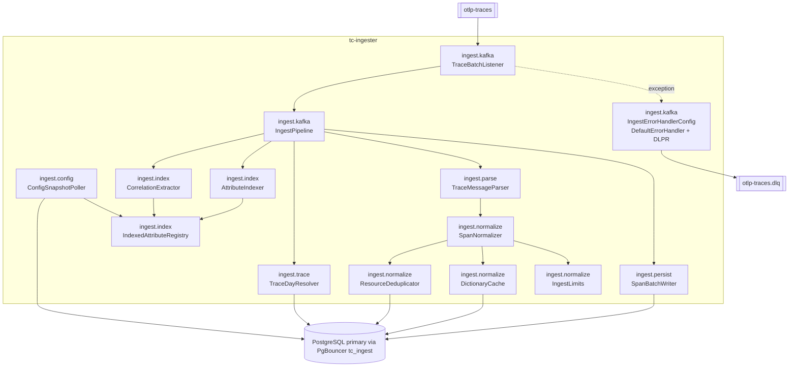
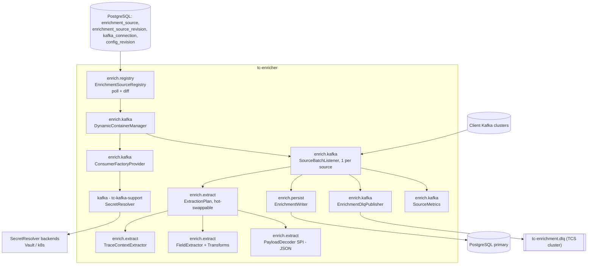
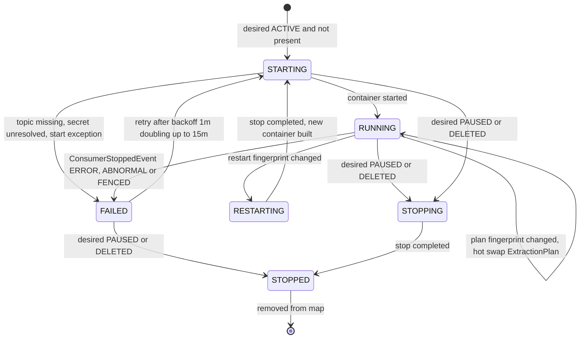
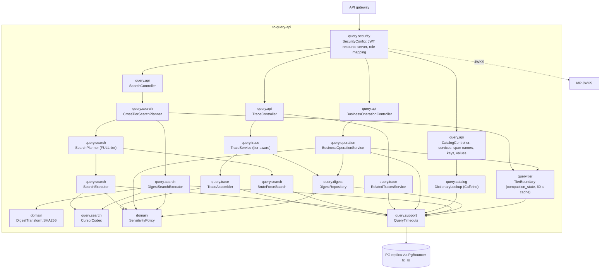
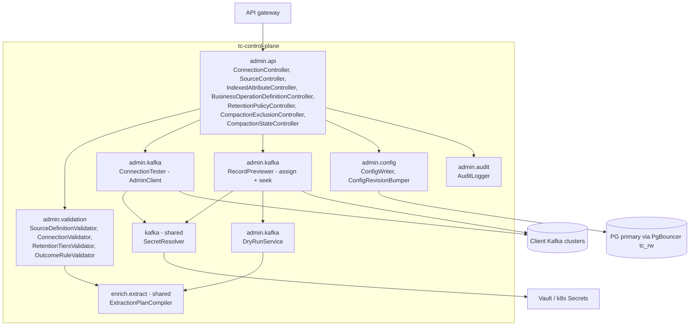
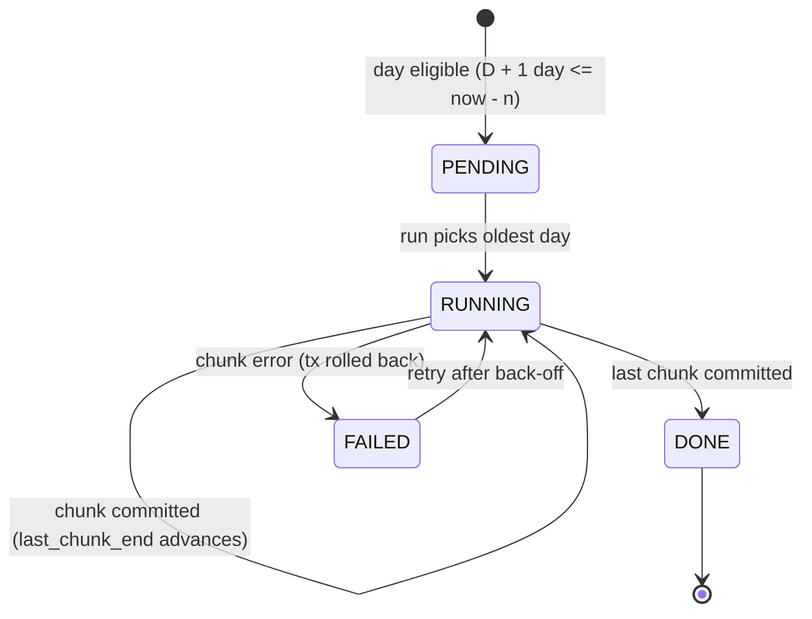

# 03 — Trace Collector System (TCS): Low-Level Design

**Related documents**

- [01-technology-overview.md](01-technology-overview.md): technology research (Tempo, OTel Collector, Jaeger, Promscale, SigNoz, stack versions)
- [02-high-level-design.md](02-high-level-design.md): requirements, C4 L1/L2, ADRs, deployment
- [03-low-level-design.md](03-low-level-design.md): this document
- [04-storage-design.md](04-storage-design.md): DDL, partitioning, sizing, benchmark plan
- [05-domain-model.md](05-domain-model.md): domain model
- [06-use-cases.md](06-use-cases.md): UC-01 … UC-23
- [07-sequence-diagrams.md](07-sequence-diagrams.md): sequence diagrams
- [08-er-diagrams.md](08-er-diagrams.md): ER diagrams

Names of tables, columns, topics, endpoints and use-case IDs follow the design brief exactly. The canonical DDL is in 04-storage-design.md. This document shows the SQL the services *execute*.

---

## 1. Conventions

| Item | Convention |
|---|---|
| Repository | Maven multi-module `trace-collector`, parent `org.springframework.boot:spring-boot-starter-parent:4.1.3` |
| Base package | `ru.aasmc.tracing.collector` (abbreviated below as `…collector`) |
| Java | 25 (`maven.compiler.release=25`). Records, sealed interfaces and pattern-matching `switch` are used freely. No preview features. |
| JSON | Jackson 3.1 (`tools.jackson.core`, `tools.jackson.databind`). Exceptions are unchecked (`tools.jackson.core.JacksonException`). |
| SQL access | `JdbcClient` and `JdbcTemplate` for statements. PgJDBC `CopyManager` for bulk. Spring Data repositories only in `tc-control-plane` (optional). |
| Time | All DB sessions run with `TimeZone=UTC`. Partition bounds are UTC. |
| Metrics prefix | `tc_` (Micrometer, Prometheus registry) |
| SQL schema | `tc`, always schema-qualified in statements |

Kafka properties appear both as Spring Boot keys (`spring.kafka.consumer.max-poll-records`) and as raw client keys under `spring.kafka.consumer.properties[...]` when Boot has no dedicated key. For example, `fetch.min.bytes` is `spring.kafka.consumer.fetch-min-size`, and `isolation.level` is `spring.kafka.consumer.isolation-level`.

---

## 2. `tc-ingester`

### 2.1 Responsibilities

1. Consume `otlp-traces` with a **batch** listener (consumer group `tc-ingester`) (UC-01).
2. Parse `TraceMessage` v1 bytes with Jackson 3 streaming. Validate, normalise and enforce limits.
3. Resolve dictionaries (service, span name, attribute key, resource, scope) and the stable `trace_day` per trace.
4. Write `span`, `trace_summary`, `trace_attribute`, `span_link` and `trace_correlation` in **one PostgreSQL transaction per poll batch**, replay-safe (UC-02, UC-18).
5. Route poison records to `otlp-traces.dlq` (UC-03).
6. Back off indefinitely while PostgreSQL is unavailable (UC-17).
7. Refresh the indexed-attribute and correlation configuration every 10 s (`ConfigSnapshotPoller`) (UC-07, UC-08).

### 2.2 Component diagram (C4 Level 3)



### 2.3 Packages and classes

| Package (`…collector.`) | Class | Responsibility |
|---|---|---|
| `ingest.kafka` | `TraceBatchListener` | `@KafkaListener(id="tc-ingester", batch="true")`; delegates to `IngestPipeline` |
| | `IngestPipeline` | Orchestrates parse → normalize → index → resolve day → persist; poison handling with `BatchListenerFailedException` |
| | `IngestErrorHandlerConfig` | `DefaultErrorHandler`, `ExponentialBackOff`, `DeadLetterPublishingRecoverer` to `otlp-traces.dlq` |
| | `TopicGuard` | On `ApplicationReadyEvent`, checks with `Admin.describeTopics` that `otlp-traces` and `otlp-traces.dlq` exist, otherwise fails readiness |
| `ingest.parse` | `TraceMessageParser` | Jackson 3 streaming parser: bytes → `ParsedFragment` or `ParseResult.Poison` |
| | `AttributeJsonWriter` | Writes canonical attribute jsonb text while parsing (streaming copy) |
| `ingest.normalize` | `SpanNormalizer` | Ids, times, kinds, status, flags, truncation, `\u0000` sanitising |
| | `ResourceDeduplicator` | xxHash64 over the canonical resource/scope; insert-if-absent |
| | `DictionaryCache` | `service`, `span_name`, `attribute_key` caches with insert-if-absent |
| | `IngestLimits` | Limits: 50 000 spans per trace, 4 KiB attribute value, 8 MiB fragment, time bounds |
| `ingest.index` | `IndexedAttributeRegistry` | Immutable snapshot: indexed keys by origin scope, correlation keys, retention |
| | `AttributeIndexer` | Produces `trace_attribute` staging rows (in-batch deduplication plus a recent-rows filter) |
| | `CorrelationExtractor` | Produces `trace_correlation` staging rows |
| `ingest.trace` | `TraceDayResolver` | traceId → `trace_day`: Caffeine cache, DB probe, or computed |
| `ingest.persist` | `SpanBatchWriter` | Temp staging tables, COPY, writable CTE, one transaction |
| | `CopyTextEncoder` | COPY text-format encoder (escaping, `\N`) |
| | `SqlStateClassifier` | Classifies a `SQLException` as TRANSIENT or DATA_REJECTED |
| `ingest.config` | `ConfigSnapshotPoller` | `@Scheduled(fixedDelay=10s)`: compares `config_revision.revision` and reloads the snapshot |

### 2.4 Key types (Java 25 sketches)

> **Deviation (implementation, 2026-11-22).** The ingester uses the domain types of `tc-domain` (05 §3) instead of the local `TraceId` and `AttrValue` sketched below: `TraceId.parse`, `SpanId.parseParent`, the sealed `AttributeValue` with `StringValue.of(raw, maxBytes)`, `Span`, `TraceSummary` and the configurable `IngestLimits`. The parser types (`ParseResult`, `ParsedFragment`, …) are designed in Phase 3.

```java
package ru.aasmc.tracing.collector.ingest.parse;

public sealed interface ParseResult permits ParseResult.Ok, ParseResult.Poison {
    record Ok(ParsedFragment fragment) implements ParseResult {}
    record Poison(PoisonReason reason, String detail) implements ParseResult {}
}

public enum PoisonReason {
    MALFORMED_JSON, UNSUPPORTED_SCHEMA_VERSION, INVALID_TRACE_ID, TRACE_ID_MISMATCH,
    FRAGMENT_TOO_LARGE, FUTURE_TIMESTAMP, DB_REJECTED
}

/** One Kafka record = one fragment of one trace. */
public record ParsedFragment(
        TraceId traceId, int partition, long offset, long recordTimestampMs,
        List<ParsedSpan> spans) {}

public record ParsedSpan(
        long spanId, Long parentSpanId,              // null for root ("0000000000000000")
        long startEpochNanos, long endEpochNanos,
        String name, SpanKind kind, StatusCode statusCode, String statusMessage,
        int traceFlags, String traceState,
        Attributes attributes,                       // typed, ordered, already truncated
        String attributesJson,                       // canonical jsonb text
        String eventsJson, String linksJson, String droppedCountsJson,
        List<ParsedLink> links,
        ResourceRef resource, ScopeRef scope,
        int flags) {}
```

```java
package ru.aasmc.tracing.collector.domain;

/** 128-bit W3C trace id; stored as PostgreSQL uuid. */
public record TraceId(long high, long low) {
    public static TraceId parseHex(String hex) {
        if (hex == null || hex.length() != 32) throw new IllegalArgumentException("trace id must be 32 hex");
        long hi = Long.parseUnsignedLong(hex, 0, 16, 16);
        long lo = Long.parseUnsignedLong(hex, 16, 32, 16);
        if (hi == 0 && lo == 0) throw new IllegalArgumentException("all-zero trace id is invalid");
        return new TraceId(hi, lo);
    }
    public java.util.UUID toUuid() { return new java.util.UUID(high, low); }
    public String toHex() { return "%016x%016x".formatted(high, low); }
}

/** Typed attribute values; LONG never goes through double. */
public sealed interface AttrValue {
    record Str(String v) implements AttrValue {}
    record Bool(boolean v) implements AttrValue {}
    record Lng(long v) implements AttrValue {}
    record Dbl(double v) implements AttrValue {}
    record Arr(AttrType elementType, List<AttrValue> values) implements AttrValue {}
}
public enum AttrType { STRING, BOOLEAN, LONG, DOUBLE, STRING_ARRAY, BOOLEAN_ARRAY, LONG_ARRAY, DOUBLE_ARRAY }
```

Span ids: `Long.parseUnsignedLong(hex, 16)`, stored in `bigint` as a signed value and rendered back with `"%016x".formatted(id)`.

### 2.5 Configuration

```yaml
spring:
  application:
    name: tc-ingester
  threads:
    virtual:
      enabled: false            # 8 long-lived, CPU-bound consumer threads per pod; platform threads are fine
  lifecycle:
    timeout-per-shutdown-phase: 60s
  datasource:
    url: jdbc:postgresql://tc-pgbouncer:6432/tc_ingest?ApplicationName=tc-ingester&prepareThreshold=5&options=-c%20TimeZone=UTC
    username: tc_ingester
    password: ${TC_DB_PASSWORD}
    hikari:
      maximum-pool-size: 10     # concurrency 8 + dictionary/config statements
      minimum-idle: 10
      connection-timeout: 5s
      max-lifetime: 30m
  liquibase:
    enabled: false              # DDL is owned by tc-schema-migrator
  kafka:
    bootstrap-servers: ${TCS_KAFKA_BOOTSTRAP}
    security:
      protocol: SASL_SSL
    admin:
      auto-create: false        # never create topics
    consumer:
      group-id: tc-ingester
      enable-auto-commit: false
      auto-offset-reset: earliest
      isolation-level: read-committed
      max-poll-records: 500
      fetch-min-size: 1MB       # fetch.min.bytes
      fetch-max-wait: 200ms     # fetch.max.wait.ms
      key-deserializer: org.apache.kafka.common.serialization.StringDeserializer
      value-deserializer: org.apache.kafka.common.serialization.ByteArrayDeserializer
      properties:
        allow.auto.create.topics: false
        max.partition.fetch.bytes: 16777216
        fetch.max.bytes: 67108864
        max.poll.interval.ms: 600000
        group.protocol: consumer     # KIP-848, brokers >= 4.0; else partition.assignment.strategy=CooperativeStickyAssignor
    producer:                        # used only by the DLQ recoverer
      acks: all
      compression-type: zstd
      key-serializer: org.apache.kafka.common.serialization.StringSerializer
      value-serializer: org.apache.kafka.common.serialization.ByteArraySerializer
      properties:
        enable.idempotence: true
        max.request.size: 9437184
    listener:
      type: batch
      ack-mode: batch               # offsets committed after the listener returns, i.e. after the DB commit
      concurrency: 8
      missing-topics-fatal: true
      observation-enabled: false
management:
  server:
    port: 8081
  endpoints:
    web:
      exposure:
        include: health,info,prometheus
  tracing:
    sampling:
      probability: 0.0              # ADR-12: no self-tracing into otlp-traces
tc:
  ingest:
    topic: otlp-traces
    dlq-topic: otlp-traces.dlq
    max-spans-per-trace: 50000
    max-attribute-value-bytes: 4096
    max-fragment-bytes: 8388608
    future-tolerance: P1D           # start > now + 1 day -> DLQ FUTURE_TIMESTAMP
    trace-day-cache:
      maximum-size: 2000000
      expire-after-access: PT2H
    config-poll-interval: PT10S
    recent-index-filter-size: 1000000
```

The value deserializer is `ByteArrayDeserializer`, so deserialization can never fail inside the consumer and no `ErrorHandlingDeserializer` is needed. All validation happens in `TraceMessageParser`, where the record index is known. The starter's `JacksonJsonSerializer` may add a `__TypeId__` header, which the ingester ignores.

### 2.6 Threading model

- One `ConcurrentMessageListenerContainer` with concurrency 8 per pod. Each child container owns one `KafkaConsumer` and one platform thread. With 3 pods that gives 24 threads for 24 partitions.
- Fragments of one trace always land in the same partition, so **no two threads ever process the same trace concurrently**, except briefly during a rebalance (see 2.10).
- All work for a batch runs on the consumer thread: parse, normalize, dictionary I/O, DB transaction. There is no hand-off, so back-pressure is natural: a slow DB means slower polls, and Kafka buffers.
- `max.poll.interval.ms=600000` gives a batch up to 10 minutes before the member is evicted. Normal batches take less than 2 s.
- Caffeine caches (`DictionaryCache`, `ResourceDeduplicator`, `TraceDayResolver`) are shared by all threads in the pod and are thread-safe.

### 2.7 Processing pipeline per poll batch

```text
onBatch(records: List<ConsumerRecord<String, byte[]>>):
  snapshot  = configSnapshots.current()                 // immutable; same config for the whole batch
  now       = clock.instant()
  fragments = []
  for i in 0 ..< records.size:
      r = records[i]
      if r.value.length > maxFragmentBytes:          poison(i, FRAGMENT_TOO_LARGE)
      result = parser.parse(r)                          // streaming; validates schemaVersion, ids, key == traceId
      if result is Poison p:                            poison(i, p.reason)
      frag = result.fragment
      if any span.start > now + futureTolerance:       poison(i, FUTURE_TIMESTAMP)
      fragments.add(frag)

  poison(i, reason):
      if fragments not empty: persist(fragments)        // commit everything before index i
      throw new BatchListenerFailedException(reason, new PoisonMessageException(reason), i)
      // DefaultErrorHandler: commits offsets < i, recovers record i to otlp-traces.dlq (not retryable),
      // commits i, then seeks so records > i are re-polled.

  persist(fragments)                                    // normal path
  // listener returns -> container commits the offsets of the whole batch (AckMode.BATCH)

persist(fragments):
  spans = normalize(fragments)                          // ids, times, truncation; drop expired spans (metric)
  dedupe spans in memory by (traceId, spanId, startTime)  // invariant: staging has no duplicate PK
  dictionaries.resolveAll(spans)                        // short autocommit statements, sorted keys (SD-2)
  resources.resolveAll(spans)                           // xxHash64 ids, insert-if-absent
  dayByTrace = traceDayResolver.resolve(spans grouped by traceId)   // cache, DB probe, or computed
  enforce maxSpansPerTrace using dayByTrace state (drop excess, metric)
  attrRows   = attributeIndexer.rows(spans, snapshot)  // indexed keys only; deduped (traceId, keyId, value)
  linkRows   = spans.links where linked context valid
  corrRows   = correlationExtractor.rows(spans, snapshot)
  try:
      result = spanBatchWriter.write(spans, dayByTrace, attrRows, linkRows, corrRows)   // ONE tx
  catch SQLException e:
      switch sqlStateClassifier.classify(e):
        TRANSIENT     -> throw new TransientPersistenceException(e)        // whole-batch retry, infinite back-off
        DATA_REJECTED -> persistOneByOne(fragments)                        // isolates the bad record
  traceDayResolver.commit(dayByTrace, result.insertedCountsPerTrace)       // only after commit
  attributeIndexer.markCommitted(attrRows)
  metrics.record(result)

persistOneByOne(fragments):
  for (index, f) in fragments:
      try: persist([f])
      catch DATA_REJECTED: throw new BatchListenerFailedException("DB_REJECTED", new DbRejectedException(e), index)
```

`SqlStateClassifier` rules (PostgreSQL SQLSTATE classes):

| SQLSTATE | Meaning | Class |
|---|---|---|
| `08***`, `57P01`, `57P02`, `57P03`, `53***`, `40001`, `40P01`, `25006` (read-only after failover), `55P03` (lock not available) | connection, shutdown, resources, serialization, failover | TRANSIENT |
| `23514` with message "no partition of relation … found for row" | maintenance did not pre-create a partition | TRANSIENT (alert; never DLQ, since it is not the record's fault) |
| `22***` (data exception, e.g. invalid jsonb or `\u0000`), `23***` other than the above, `54000` (row too big) | the data itself is unacceptable | DATA_REJECTED |
| everything else | unknown | TRANSIENT (safe default: no data loss, alert on retries) |

### 2.8 Parsing and normalisation

**Streaming parse.**
- `TraceMessageParser` uses a single shared `JsonMapper` (Jackson 3) built with `StreamReadConstraints`: max nesting depth 64, max string length 8 MiB, max number length 64.
- It reads tokens from `mapper.createParser(byte[])`.
- It expects `schemaVersion` before `spans`, which is the record component order the starter emits. If `spans` comes first, it falls back to a tree parse for that record.
- `schemaVersion != 1` → `UNSUPPORTED_SCHEMA_VERSION` (v2 is added later under its own branch).
- Top-level `traceId` must equal the Kafka key, and every `spanContext.traceId` must equal it as well; otherwise `TRACE_ID_MISMATCH`.

**Field mapping.**

| `TraceMessage.Span` field | Column / handling |
|---|---|
| `spanId` (16 hex) | `span_id bigint` via `parseUnsignedLong`. Duplicates in `spanContext` are ignored except `traceFlags`, `traceState`, `remote`. |
| `parentSpanId` | `"0000000000000000"` → `NULL`, otherwise `bigint` |
| `startEpochNanos`, `endEpochNanos` (strings) | `Long.parseLong`. `start_time = floorDiv(start, 1000)` µs as `timestamptz`. `duration_ns = end − start`. If end < start → 0 and flag `NOT_ENDED`. |
| `kind` (enum name) | `kind smallint`: INTERNAL 1, SERVER 2, CLIENT 3, PRODUCER 4, CONSUMER 5 (OTLP numbering; 0 = unspecified) |
| `status.code` | `status_code smallint`: UNSET 0, OK 1, ERROR 2. `status.description` → `status_message`; empty string → `NULL`. |
| `spanContext.traceFlags` (signed byte) | `trace_flags = b & 0xFF` |
| `spanContext.traceState` (map) | `trace_state` W3C list `k1=v1,k2=v2`; empty → `NULL` |
| `attributes` | typed parse (below) → `attributes jsonb` |
| `events` | `events jsonb` = `[{"name", "time", "attributes", "dropped"}]` (`time` = epoch-nanos string, `dropped` only if > 0; encoding per 04 §5.5); empty → `NULL` |
| `links` | `links jsonb` = `[{"traceId", "spanId", "traceState", "attributes"}]` (04 §5.5) plus `span_link` rows when the linked context is valid |
| `dropped*Count` | `dropped_counts jsonb` `{"attributes":n,"events":n,"links":n}` only if any > 0 |
| `hasEnded=false` | flag bit `0x02` |
| `resource`, `instrumentationScope` | `resource_id`, `scope_id` (2.9) |
| `resource.attributes["service.name"]` | `service_id` (dictionary). A missing value → `"unknown_service"`, the OTel SDK default. |
| `name` | `name_id` (dictionary, ≤ 5 000 per service) or `name_overflow` |

`span.flags` bits (canonical table in 04 §5.5): `0x01` attribute value truncated, `0x02` not ended, `0x04` parent context remote, `0x08` events or links truncated (≥ 128 events kept), `0x10` negative duration clamped, `0x20` indexed value truncated to 512 B.

**Attribute values.** `AttributeValue{type, value}` is parsed by `type`:

| type | Parse | jsonb form |
|---|---|---|
| `STRING` | text; truncated at 4 KiB on a UTF-8 code-point boundary (+ flag `0x01`); `\u0000` → `�` (PostgreSQL text/jsonb reject NUL) | JSON string |
| `BOOLEAN` | boolean token | `true`/`false` |
| `LONG` | **`JsonParser.getLongValue()` on an integer token**, never `getDoubleValue()`; BigInteger overflow → string | JSON integer. jsonb stores `numeric`, so there is no precision loss above 2^53 |
| `DOUBLE` | `getDoubleValue()`; NaN/Infinity → string | JSON number always written with a fraction or exponent (`1.0`). jsonb `numeric` keeps the scale, so LONG and DOUBLE stay distinguishable |
| `*_ARRAY` | element-wise, as above; arrays > 1 000 elements truncated (+ flag) | JSON array |

The canonical `attributes jsonb` is a flat object `{key: value}` with keys in the producer's order. The type is recoverable from the JSON value as described above, so no `{type, value}` wrapper is stored. That saves about 25 bytes per attribute.

### 2.9 `ResourceDeduplicator` and `DictionaryCache`

**Canonical resource hash.**

The id is computed by the domain's `ResourceHasher.resourceId(schemaUrl, attributes)`: xxHash64 (seed 0, pure Java) of a length-prefixed encoding in which every text is written as `<UTF-8 byte length> ':' <bytes>` and every array carries its size, so two different contents never share an encoding (04 §5.6). `ResourceDeduplicator` only caches the ids it has already written:

```java
public final class ResourceDeduplicator {
    private final Cache<ResourceId, Boolean> known = Caffeine.newBuilder().maximumSize(200_000).build();
}
```

The `scope_id` is computed the same way over `(name, version, schemaUrl, sorted attributes)` by `ResourceHasher.instrumentationScopeId`.

**Insert-if-absent** runs for cache misses only, in one autocommit statement per kind and batch, with ids sorted ascending to keep lock order deterministic:

```sql
-- resources (unnest of parallel arrays, sorted by id)
INSERT INTO tc.resource (id, service_id, schema_url, attributes, first_seen, last_seen)
SELECT r.id, r.service_id, r.schema_url, r.attributes::jsonb, now(), now()
FROM unnest(?::bigint[], ?::int[], ?::text[], ?::text[]) AS r(id, service_id, schema_url, attributes)
ON CONFLICT (id) DO NOTHING
RETURNING id;
```

**Collision check.**
- For ids **not** returned (they already existed and are not in the cache), the deduplicator re-selects `attributes` once and compares them with the canonical form.
- A mismatch is a 64-bit collision (probability ≈ n²/2⁶⁵, about 3·10⁻⁸ for 1 M resources). It is logged, counted in `tc_ingest_resource_hash_collisions_total`, and handled by storing the span with `resource_id` of the **existing** row plus the colliding resource attributes merged into `span.attributes` under prefix `resource.`.
- Hits are cached.
- `last_seen` is refreshed at most hourly per id: `UPDATE tc.resource SET last_seen = now() WHERE id = ANY(?) AND last_seen < now() - interval '1 hour'`. `DictionaryGc` relies on it.

**Dictionaries** (`service`, `span_name`, `attribute_key`) use the same pattern: `ON CONFLICT DO NOTHING RETURNING`, then re-select the missing ones.

```sql
INSERT INTO tc.attribute_key (key, value_type, first_seen)
SELECT k, t, now() FROM unnest(?::text[], ?::text[]) AS u(k, t) ORDER BY k
ON CONFLICT (key) DO NOTHING
RETURNING id, key;

SELECT id, key FROM tc.attribute_key WHERE key = ANY(?);      -- keys not returned above (inserted concurrently)
```

**Rules.**
- `attribute_key` is resolved only for keys that need an id. That means indexed keys and correlation keys; ordinary span attributes stay as text inside `attributes jsonb`. This keeps the dictionary small.
- **Cardinality guard for `span_name`:**
  - `DictionaryCache` keeps `countByService` (loaded with `SELECT service_id, count(*) FROM tc.span_name GROUP BY 1` at startup and incremented on insert).
  - When a service reaches 5 000 names, new names are not inserted: `name_id = NULL`, `name_overflow = name`, metric `tc_ingest_span_name_overflow_total{service}`.
  - The guard is soft: concurrent pods may overshoot by a few names.
- Caches: Caffeine, `maximumSize` 10 000 services, 1 000 000 span names, 100 000 attribute keys. Entries are never invalidated, because ids are immutable.

### 2.10 `TraceDayResolver`

All fragments of a trace must update **the same** `trace_summary` row, whose partition key is `trace_day`. A trace is assigned the day of its first observed fragment and keeps it.

```java
public final class TraceDayResolver {
    public record TraceState(LocalDate traceDay, int spanCount) {}

    private final Cache<TraceId, TraceState> cache;   // maximumSize 2M, expireAfterAccess 2h
    private final JdbcClient jdbc;

    /** Called on the consumer thread; returns the day for every trace in the batch. */
    public Map<TraceId, TraceState> resolve(Map<TraceId, List<NormalizedSpan>> byTrace) {
        var result = new HashMap<TraceId, TraceState>(byTrace.size());
        var misses = new ArrayList<TraceId>();
        byTrace.keySet().forEach(t -> {
            var s = cache.getIfPresent(t);
            if (s != null) result.put(t, s); else misses.add(t);
        });
        if (!misses.isEmpty()) {
            // candidate days = {d-1, d, d+1} where d = UTC date of min(start) of the trace's spans in this batch
            var days = misses.stream().flatMap(t -> candidateDays(byTrace.get(t))).distinct().toList();
            jdbc.sql("""
                    SELECT trace_id, trace_day, span_count
                    FROM tc.trace_summary
                    WHERE trace_id = ANY(?) AND trace_day = ANY(?)
                    """)
                .params(uuidArray(misses), dateArray(days))
                .query((rs, n) -> Map.entry(rs.getObject(1, UUID.class),
                        new TraceState(rs.getObject(2, LocalDate.class), rs.getInt(3))))
                .list()
                .forEach(e -> result.merge(TraceId.of(e.getKey()), e.getValue(),
                        (a, b) -> a.traceDay().isBefore(b.traceDay()) ? a : b));   // earliest existing row wins
            for (var t : misses) {
                result.computeIfAbsent(t, k -> new TraceState(utcDate(minStart(byTrace.get(k))), 0));
            }
        }
        return result;
    }

    /** After COMMIT only: remember the day and the new span count. */
    public void commit(Map<TraceId, TraceState> resolved, Map<TraceId, Integer> insertedPerTrace) { … }
}
```

**Algorithm.**
1. Cache hit → use it. Because key = traceId pins the trace to one consumer thread, the hit rate is very high: all fragments of a live trace hit the same pod.
2. Miss → probe `trace_summary` for `trace_id = ANY(:ids) AND trace_day = ANY(:days)`.
   - The candidate days are `d−1, d, d+1` around the fragment's earliest start `d`. This covers "today and yesterday" for live traffic, plus a root fragment that starts before midnight while its children were seen after midnight.
   - Runtime partition pruning limits the probe to at most 3 daily partitions, i.e. 3 PK index probes per distinct day.
3. No row found → `trace_day = UTC date(min(start_time) of the fragment)`.
4. Result: `trace_day ∈ {date(trace start), date(trace start)+1}` for traces shorter than a day. The query side therefore filters `trace_day BETWEEN date(from) AND date(to) + 1`.

**Known edge cases.**
- **Long-running traces** (more than 1 day, or idle longer than the 2 h cache TTL and outside ±1 day) may get a **second** `trace_summary` row in another day. `GET /traces/{id}` merges all rows of a trace, and search de-duplicates by `trace_id`.
- **Rebalance overlap:** with the cooperative or KIP-848 protocol a revoked partition stops before the new owner starts, so this is rare. The outcome is the same as for long traces.
- The **span limit** (50 000) uses `TraceState.spanCount` (from the cache or the probe) plus the in-batch count. Excess spans are dropped with `tc_ingest_spans_dropped_total{reason="TRACE_SPAN_LIMIT"}`. The read side reports a trace as truncated when `span_count >= 50000`.

### 2.11 `AttributeIndexer` and `CorrelationExtractor`

For each normalized span, using the immutable `IndexedAttributeRegistry` snapshot:

| Source of value | Condition | `trace_attribute` row |
|---|---|---|
| span attribute `k` | `k` indexed with `origin_scope IN ('ANY','SPAN')` | `ts = span.start_time`, `origin = 1` |
| resource attribute `k` | `origin_scope IN ('ANY','RESOURCE')` | `origin = 2` |
| built-in `service.name` | always | value = service name, `origin = 2` |
| built-in `span.name` | root spans only (`parent_span_id IS NULL`) | value = span name, `origin = 4` (DERIVED) |
| built-in `status` | `status_code = ERROR` only | value `ERROR`, `origin = 4` |

**Value encoding.**
- `value_str` = canonical text (LONG as a decimal string, BOOLEAN as `true`/`false`, DOUBLE via `Double.toString`), cut to **512 bytes** for the index. A B-tree entry must stay under ~2.7 KB; longer values are matched by prefix and flagged as truncated in the response.
- `value_num` = numeric value when `indexed_attribute.numeric = true` and the value parses as a number.
- Array values produce one row per distinct element.

**De-duplication.**
- Within a batch, rows are unique on `(trace_id, key_id, value_str)`; the earliest `ts` wins.
- Across batches, a per-pod Caffeine `RecentIndexFilter` (1 M entries, 30 min) of committed `(trace_id, key_id, value_str)` suppresses most repeats. For example, `service.name` is repeated in every fragment of a service.
- Duplicates that remain are tolerated (brief §5) and removed by `DISTINCT` at query time.

`CorrelationExtractor`: for every attribute (span or resource) whose `key_id` belongs to an ACTIVE `business_operation_definition` through `correlation_key`, it emits `(observed_at = span.start_time, operation_definition_id, correlation_key_id, value, trace_id, origin)`, de-duplicated per `(trace_id, correlation_key_id, value)` in the batch.

Example (IdP), trace T2:
- `idp.auth_session_id=as-777` → business operation definition `idp.login`, PRIMARY key.
- `oauth.authorization_code=code-abc` → the same type, ALIAS key.
- `auth.factor=SMS` → `trace_attribute` only, if indexed.

### 2.12 `SpanBatchWriter`: staging, COPY and the writable CTE

Everything below runs in **one transaction** (`TransactionTemplate`, `DataSourceTransactionManager`) on one connection.

**Step 1: staging tables (idempotent DDL, executed at the start of every transaction).**

```sql
CREATE TEMP TABLE IF NOT EXISTS stg_span (
    trace_id uuid, span_id bigint, parent_span_id bigint, start_time timestamptz, duration_ns bigint,
    service_id int, name_id int, name_overflow text, kind smallint, status_code smallint,
    status_message text, resource_id bigint, scope_id bigint, trace_flags smallint, trace_state text,
    attributes jsonb, events jsonb, links jsonb, dropped_counts jsonb, flags smallint,
    trace_day date, fragment_seq int
) ON COMMIT DELETE ROWS;

CREATE TEMP TABLE IF NOT EXISTS stg_attr (
    trace_id uuid, span_id bigint, start_time timestamptz,
    ts timestamptz, key_id int, value_str text, value_num double precision, origin smallint
) ON COMMIT DELETE ROWS;

CREATE TEMP TABLE IF NOT EXISTS stg_link (
    trace_id uuid, span_id bigint, start_time timestamptz,
    linked_trace_id uuid, linked_span_id bigint, attributes jsonb
) ON COMMIT DELETE ROWS;

CREATE TEMP TABLE IF NOT EXISTS stg_corr (
    trace_id uuid, span_id bigint, start_time timestamptz, observed_at timestamptz,
    operation_definition_id int, correlation_key_id int, value text, origin smallint
) ON COMMIT DELETE ROWS;
```

Why these choices:
- **Temp tables** are not WAL-logged, so COPY into them is cheap.
- **`ON COMMIT DELETE ROWS`** empties them at every commit, so no `TRUNCATE` is needed and a reused server connection starts clean.
- **`IF NOT EXISTS`** makes the statements correct even if PgBouncer hands the client a different server connection between transactions. The `tc_ingest` pool uses session mode anyway (02 §8.1).

`stg_attr`, `stg_link` and `stg_corr` carry the owning span's PK `(trace_id, span_id, start_time)`, so derived rows can be filtered to **inserted spans only**.

**Step 2: COPY.**

```java
var copy = connection.unwrap(PGConnection.class).getCopyAPI();          // org.postgresql.copy.CopyManager
copy.copyIn("COPY stg_span FROM STDIN (FORMAT text)", spanEncoder.stream(spans));
copy.copyIn("COPY stg_attr FROM STDIN (FORMAT text)", attrEncoder.stream(attrRows));
copy.copyIn("COPY stg_link FROM STDIN (FORMAT text)", linkEncoder.stream(linkRows));
copy.copyIn("COPY stg_corr FROM STDIN (FORMAT text)", corrEncoder.stream(corrRows));
```

`CopyTextEncoder` writes tab-separated UTF-8 into a reusable per-thread buffer:
- escapes `\\`, `\t`, `\n`, `\r`
- writes `NULL` as `\N`
- writes uuids in canonical text form and timestamps as `2026-11-21 14:03:07.123456+00`

**Step 3: the writable CTE (one statement).**

```sql
WITH ins AS (
    INSERT INTO tc.span AS s (
        trace_id, span_id, parent_span_id, start_time, duration_ns, service_id, name_id, name_overflow,
        kind, status_code, status_message, resource_id, scope_id, trace_flags, trace_state,
        attributes, events, links, dropped_counts, flags)
    SELECT trace_id, span_id, parent_span_id, start_time, duration_ns, service_id, name_id, name_overflow,
           kind, status_code, status_message, resource_id, scope_id, trace_flags, trace_state,
           attributes, events, links, dropped_counts, flags
    FROM stg_span
    ON CONFLICT (trace_id, span_id, start_time) DO NOTHING
    RETURNING s.trace_id, s.span_id, s.start_time, s.parent_span_id, s.duration_ns,
              s.service_id, s.name_id, s.status_code
),
ins_x AS (                                   -- attach trace_day / fragment_seq, which are not span columns
    SELECT i.*, st.trace_day, st.fragment_seq
    FROM ins i
    JOIN stg_span st USING (trace_id, span_id, start_time)
),
agg AS (
    SELECT trace_id, trace_day,
           min(start_time)                                                          AS start_time,
           max(start_time + (duration_ns / 1000) * interval '1 microsecond')        AS end_time,
           (array_agg(service_id ORDER BY start_time) FILTER (WHERE parent_span_id IS NULL))[1] AS root_service_id,
           (array_agg(name_id    ORDER BY start_time) FILTER (WHERE parent_span_id IS NULL))[1] AS root_name_id,
           (array_agg(span_id    ORDER BY start_time) FILTER (WHERE parent_span_id IS NULL))[1] AS root_span_id,
           count(*)::int                                                            AS span_count,
           (count(*) FILTER (WHERE status_code = 2))::int                           AS error_count,
           array_agg(DISTINCT service_id ORDER BY service_id)                       AS service_ids,
           count(DISTINCT fragment_seq)::int                                        AS fragment_count
    FROM ins_x
    GROUP BY trace_id, trace_day
),
summ AS (
    INSERT INTO tc.trace_summary AS t (
        trace_id, trace_day, start_time, end_time, duration_ns, root_service_id, root_name_id,
        root_span_id, span_count, error_count, service_ids, fragment_count,
        first_ingested_at, last_ingested_at)
    SELECT trace_id, trace_day, start_time, end_time,
           (extract(epoch FROM end_time - start_time) * 1000000000)::bigint,
           root_service_id, root_name_id, root_span_id, span_count, error_count, service_ids,
           fragment_count, now(), now()
    FROM agg
    ON CONFLICT (trace_id, trace_day) DO UPDATE SET
        start_time       = LEAST(t.start_time, EXCLUDED.start_time),
        end_time         = GREATEST(t.end_time, EXCLUDED.end_time),
        duration_ns      = (extract(epoch FROM GREATEST(t.end_time, EXCLUDED.end_time)
                                          - LEAST(t.start_time, EXCLUDED.start_time)) * 1000000000)::bigint,
        root_service_id  = COALESCE(EXCLUDED.root_service_id, t.root_service_id),
        root_name_id     = COALESCE(EXCLUDED.root_name_id, t.root_name_id),
        root_span_id     = COALESCE(EXCLUDED.root_span_id, t.root_span_id),
        span_count       = t.span_count + EXCLUDED.span_count,
        error_count      = t.error_count + EXCLUDED.error_count,
        service_ids      = ARRAY(SELECT DISTINCT u FROM unnest(t.service_ids || EXCLUDED.service_ids) AS u ORDER BY u),
        fragment_count   = t.fragment_count + EXCLUDED.fragment_count,
        last_ingested_at = EXCLUDED.last_ingested_at
    RETURNING t.trace_id
),
attr AS (
    INSERT INTO tc.trace_attribute (ts, key_id, value_str, value_num, trace_id, origin)
    SELECT DISTINCT ON (a.trace_id, a.key_id, a.value_str)
           a.ts, a.key_id, a.value_str, a.value_num, a.trace_id, a.origin
    FROM stg_attr a
    JOIN ins i USING (trace_id, span_id, start_time)
    ORDER BY a.trace_id, a.key_id, a.value_str, a.ts
    RETURNING 1
),
lnk AS (
    INSERT INTO tc.span_link (trace_id, span_id, start_time, linked_trace_id, linked_span_id, attributes)
    SELECT l.trace_id, l.span_id, l.start_time, l.linked_trace_id, l.linked_span_id, l.attributes
    FROM stg_link l
    JOIN ins i USING (trace_id, span_id, start_time)
    RETURNING 1
),
cor AS (
    INSERT INTO tc.trace_correlation (observed_at, operation_definition_id, correlation_key_id, value, trace_id, origin)
    SELECT DISTINCT ON (c.trace_id, c.correlation_key_id, c.value)
           c.observed_at, c.operation_definition_id, c.correlation_key_id, c.value, c.trace_id, c.origin
    FROM stg_corr c
    JOIN ins i USING (trace_id, span_id, start_time)
    ORDER BY c.trace_id, c.correlation_key_id, c.value, c.observed_at
    RETURNING 1
)
SELECT (SELECT count(*) FROM ins)  AS spans_inserted,
       (SELECT count(*) FROM summ) AS traces_upserted,
       (SELECT count(*) FROM attr) AS attributes_inserted,
       (SELECT count(*) FROM lnk)  AS links_inserted,
       (SELECT count(*) FROM cor)  AS correlations_inserted;
```

**Why this is replay-safe (UC-02, UC-18).**
- `ins` returns only rows that were actually inserted. A replayed fragment conflicts on the PK and returns nothing.
- `agg`, `summ`, `attr`, `lnk` and `cor` are all derived from `ins`, so a replay changes **no** counter and appends **no** derived row.
- Partially duplicated fragments add only their new spans.
- PostgreSQL executes every data-modifying CTE exactly once, even when the final `SELECT` does not reference it. All sub-statements see the same snapshot, which is why `ins_x` joins `stg_span` (the temp table) and never `tc.span`.

**Invariants the Java side guarantees before COPY.**
1. `stg_span` has no duplicate `(trace_id, span_id, start_time)`; otherwise `ins_x` would double-count.
2. `agg` has one row per `(trace_id, trace_day)`; otherwise `ON CONFLICT DO UPDATE` would hit the same row twice and raise a cardinality violation.
3. Every `start_time` falls inside an existing partition: newer than `now − retention + 1 h` and not after `now + 1 day`.

**Transaction settings.**
- `SET LOCAL synchronous_commit` is **not** changed (it stays `on`; see the brief §7 trade-off).
- `SET LOCAL lock_timeout = '10s'`, so a stuck partition DDL cannot block ingestion indefinitely. A timeout is TRANSIENT.

**Size of one transaction.** About 500 records × ~8 spans = ~4 000 spans, ~1.9 MB of heap tuples, ~5–15 ms of COPY and 50–200 ms of CTE on NVMe (assumption; benchmark).

### 2.13 Error handling and DLQ

```java
@Configuration(proxyBeanMethods = false)
class IngestErrorHandlerConfig {

    @Bean
    KafkaTemplate<String, byte[]> dlqTemplate(ProducerFactory<String, byte[]> pf) {
        return new KafkaTemplate<>(pf);
    }

    @Bean
    DeadLetterPublishingRecoverer ingestDlqRecoverer(KafkaTemplate<String, byte[]> dlqTemplate,
                                                     @Value("${tc.ingest.dlq-topic}") String dlqTopic) {
        // default would be "<topic>-dlt"; negative partition -> Kafka partitioner chooses (DLQ has 6 partitions, source 24)
        var recoverer = new DeadLetterPublishingRecoverer(dlqTemplate,
                (record, ex) -> new TopicPartition(dlqTopic, -1));
        recoverer.setHeadersFunction((record, ex) -> new RecordHeaders(new Header[] {
                new RecordHeader("tc-error-reason", reasonOf(ex).name().getBytes(StandardCharsets.UTF_8))}));
        recoverer.setFailIfSendResultIsError(true);      // offset is not committed unless the DLQ write is acked
        return recoverer;
    }

    @Bean
    DefaultErrorHandler ingestErrorHandler(DeadLetterPublishingRecoverer recoverer) {
        var backOff = new ExponentialBackOff(500L, 2.0);
        backOff.setMaxInterval(60_000L);
        backOff.setMaxElapsedTime(Long.MAX_VALUE);       // infinite: DB outage must never lead to DLQ
        var handler = new DefaultErrorHandler(recoverer, backOff);
        handler.addNotRetryableExceptions(PoisonMessageException.class, DbRejectedException.class);
        handler.setLogLevel(KafkaException.Level.WARN);
        return handler;     // picked up by Boot's ConcurrentKafkaListenerContainerFactoryConfigurer
    }
}
```

| Situation | Exception thrown by the listener | Error-handler behaviour |
|---|---|---|
| Poison record at index *i* | `BatchListenerFailedException(…, PoisonMessageException, i)` | Commits offsets < *i*. Cause is not retryable, so the recoverer publishes record *i* to `otlp-traces.dlq` with the original key/value plus `kafka_dlt-*` headers and `tc-error-reason`. Commits *i* and re-seeks the rest (UC-03). |
| Data rejected by the DB | found by `persistOneByOne` → `BatchListenerFailedException(…, DbRejectedException, i)` | Same as above, reason `DB_REJECTED` |
| DB unavailable / transient | `TransientPersistenceException` (not a BLFE) | "Retry complete batch" fallback: the consumer is paused (heartbeats continue, partitions stay assigned) and the batch is retried with `ExponentialBackOff` 0.5 s → 60 s, forever. Lag grows in Kafka (UC-17). |
| Rebalance during back-off | — | The retry loop stops for revoked partitions. The new owner re-reads from the last committed offset. |

Spring Kafka's batch fallback re-polls with paused partitions, so `max.poll.interval.ms` is not violated during long outages. This fallback is incompatible with Kafka transactions, which we do not use.

### 2.14 Back-pressure, limits and graceful shutdown

| Limit | Value | Behaviour |
|---|---|---|
| Max fragment bytes | 8 MiB (topic `max.message.bytes` matches) | DLQ `FRAGMENT_TOO_LARGE` |
| Max attribute value | 4 KiB | truncated + `span.flags` bit `0x01` |
| Max spans per trace | 50 000 | excess dropped + metric |
| Future start | > now + 1 day | DLQ `FUTURE_TIMESTAMP` (whole record) |
| Expired start | older than oldest retained `span` partition | span dropped + `tc_ingest_spans_dropped_total{reason="EXPIRED"}` |
| Max events per span | 128 kept | flag `0x08` |
| Max poll | 500 records, ≤ 64 MiB fetch | — |

**Back-pressure.**
- The listener runs synchronously on the consumer thread, so a slow DB directly slows polling. Kafka (3-day retention) is the buffer. There is no in-process queue that could grow without bound.
- During catch-up after an outage the ingester runs at DB speed. To protect the read path, operators may lower `spring.kafka.listener.concurrency` with a rolling restart.

**Graceful shutdown.**
- Kubernetes sends SIGTERM. Spring stops the `KafkaListenerEndpointRegistry` (SmartLifecycle) within `spring.lifecycle.timeout-per-shutdown-phase=60s`.
- Each consumer finishes the batch in flight, including its DB commit. The container commits offsets and leaves the group.
- `terminationGracePeriodSeconds: 90` > 60 s. Anything not committed is simply re-delivered and de-duplicated.

### 2.15 Metrics

| Metric | Tags |
|---|---|
| `tc_ingest_records_total` | `result=ok\|dlq` |
| `tc_ingest_dlq_total` | `reason` |
| `tc_ingest_spans_total` | `result=inserted\|duplicate\|dropped_expired\|dropped_limit` |
| `tc_ingest_batch_seconds` (histogram) | `stage=parse\|dictionaries\|copy\|cte\|commit` |
| `tc_ingest_batch_spans` (distribution summary) | — |
| `tc_ingest_db_errors_total` | `class=transient\|data` |
| `tc_ingest_trace_day_cache` | Caffeine stats (`CaffeineCacheMetrics`) |
| `tc_ingest_config_revision` | gauge |
| Kafka client metrics (`kafka_consumer_*`, incl. `records_lag_max`) | Boot's `MicrometerConsumerListener` |

---

## 3. `tc-enricher`

### 3.1 Responsibilities

1. Keep one runtime Kafka listener container per ACTIVE `enrichment_source` on every `tc-enricher` replica. Kafka group balancing spreads partitions across the replicas, using consumer group `tc-enricher.<sourceName>` (UC-05).
2. Converge with the control-plane configuration within ≤ 30 s: start, stop, restart or hot-swap containers.
3. For each event (UC-06):
   1. Apply the filter.
   2. Extract the trace context.
   3. Extract and transform the mapped fields.
   4. Write `trace_enrichment` idempotently, plus `trace_attribute` (indexed keys) and `trace_correlation` (correlation keys).
4. Publish failed events to `tc-enrichment.dlq` in the TCS cluster with the headers `tc-source-id` and `tc-error`.
5. Isolate sources from each other (NFR-09).

### 3.2 Component diagram (C4 Level 3)



### 3.3 Packages and classes

| Package | Class | Responsibility |
|---|---|---|
| `enrich.registry` | `EnrichmentSourceRegistry` | `@Scheduled(fixedDelay = 10s)`. Reads `config_revision`; on change, loads the desired set and calls `DynamicContainerManager.reconcile(desired)`. Also runs a full reconcile every 5 min as a safety net. |
| | `SourceSpec` (record) | Desired state of one source: id, name, status, revision, compiled definition, connection, `restartFingerprint`, `planFingerprint` |
| `enrich.kafka` | `DynamicContainerManager` | Owns `Map<Long, ManagedSource>`. Applies the state machine (3.5) and implements `SmartLifecycle`. |
| | `ManagedSource` | Holds the container, `AtomicReference<ExtractionPlan>`, state, failure count and next retry |
| | `ConsumerFactoryProvider` | One `DefaultKafkaConsumerFactory<byte[],byte[]>` per `(connection_id, connection.updated_at)` |
| | `SourceBatchListener` | `BatchMessageListener<byte[],byte[]>`; per-record extraction; one DB transaction per poll |
| | `EnrichmentDlqPublisher` | Wraps a `DeadLetterPublishingRecoverer` on the TCS-cluster `KafkaTemplate` |
| | `SourceErrorHandlerFactory` | One `DefaultErrorHandler` per source (infinite back-off for DB errors) |
| `enrich.extract` (module `tc-kafka-support`, SD-4) | `ExtractionPlanCompiler`, `ExtractionPlan`, `TraceContextExtractor` and its 3 strategies, `FieldExtractor`, `ValueTransform`, `PayloadDecoder`, `JsonPayloadDecoder` | Pure functions, shared with `tc-control-plane` |
| `enrich.persist` | `EnrichmentWriter` | Idempotent writable CTE (3.8) |
| `kafka` (`tc-kafka-support`) | `SecretResolver`, `KafkaClientPropertiesBuilder` | Builds client properties from `kafka_connection` plus the resolved secrets |

### 3.4 Why a direct `ConcurrentMessageListenerContainer` with our own registry map

The design uses **direct container creation plus an internal map**, not `KafkaListenerEndpointRegistry`:

1. **Different consumer factory per source.** Every `kafka_connection` (another cluster, other credentials) needs its own `ConsumerFactory`. The registry's `registerListenerContainer(endpoint, factory, start)` would require building a separate `ConcurrentKafkaListenerContainerFactory` per connection anyway, so the registry would add an indirection without a benefit.
2. **Explicit lifecycle.** `KafkaListenerEndpointRegistry.unregisterListenerContainer(id)` only removes the container from the registry and does **not** stop it. We must stop it ourselves regardless. Keeping our own `Map<Long, ManagedSource>` makes the order explicit: **`stop()` first, then remove**.
3. **No id clashes and no context coupling.** Registry ids must be unique, and duplicates throw `IllegalStateException`. Registry containers also take part in the context's `SmartLifecycle` start, which we do not want for data-driven containers.
4. **Per-source settings.** `max.poll.records`, `fetch.max.bytes`, concurrency, error handler, `authExceptionRetryInterval`, and a virtual-thread listener executor are all set per source.

```java
ConcurrentMessageListenerContainer<byte[], byte[]> build(SourceSpec spec, ManagedSource ms) {
    var cf = consumerFactories.get(spec.connection());                       // per connection
    var props = new ContainerProperties(spec.topic());
    props.setGroupId("tc-enricher." + spec.name());
    props.setClientId("tc-enricher-" + podName + "-" + spec.name());
    props.setAckMode(ContainerProperties.AckMode.BATCH);
    props.setMessageListener(new SourceBatchListener(spec, ms.plan(), writer, dlq, metrics));
    props.setKafkaConsumerProperties(perSourceOverrides(spec));                // max.poll.records, fetch.max.bytes,
                                                                               // auto.offset.reset from startFrom
    props.setAuthExceptionRetryInterval(Duration.ofSeconds(60));               // do not stop on auth errors
    props.setListenerTaskExecutor(virtualThreadExecutor("tce-" + spec.name()));
    props.setShutdownTimeout(30_000L);
    var c = new ConcurrentMessageListenerContainer<>(cf, props);
    c.setConcurrency(spec.concurrency());                                      // default 1, max 4
    c.setCommonErrorHandler(errorHandlers.forSource(spec));
    c.setBeanName("enrich-" + spec.id());
    c.setApplicationEventPublisher(eventPublisher);                            // ConsumerStoppedEvent, etc.
    c.setAutoStartup(false);
    return c;
}
```

**Per-source consumer properties** come from the optional `definition.consumer` object (added detail; defaults shown):

| Property | Value |
|---|---|
| `max.poll.records` | 200 (≤ 1 000) |
| `fetch.max.bytes` | 8 MiB |
| `max.partition.fetch.bytes` | 2 MiB |
| `isolation.level` | `read_committed` (client topics may be transactional) |
| `enable.auto.commit` | `false` |
| `allow.auto.create.topics` | `false` |
| `auto.offset.reset` | `earliest`/`latest` from `definition.startFrom` (applies only when the group has no committed offset) |
| key/value deserializer | `ByteArrayDeserializer` |

The connection's allow-listed `client_properties` are merged first. The keys above always win.

### 3.5 `DynamicContainerManager` lifecycle



**Fingerprints.**
- `restartFingerprint = hash(connection.id, connection.updated_at, topic, startFrom, consumer overrides)`.
- `planFingerprint = hash(source.current_revision)`.
- A new revision that changes only mappings, filter, trace-context strategy, scope or transforms swaps `AtomicReference<ExtractionPlan>` between polls. There is no rebalance and no gap. Rows written afterwards carry the new `source_revision`.

**Reconcile (registry diff) algorithm.** It runs on a single scheduler thread, so there are no concurrent reconciles.

```text
reconcile(desired: Map<sourceId, SourceSpec>):
  for id in managed.keys where id not in desired or desired[id].status != ACTIVE:
      stopAndRemove(id)
  for (id, spec) in desired where spec.status == ACTIVE:
      ms = managed.get(id)
      if ms == null:                                          start(spec)
      elif ms.restartFingerprint != spec.restartFingerprint:  restart(ms, spec)      // stop() then start()
      elif ms.planFingerprint != spec.planFingerprint:        ms.plan.set(compile(spec)); ms.planFingerprint = spec.planFingerprint
      elif ms.state == FAILED and now >= ms.nextRetry:        restart(ms, spec)

start(spec):
  plan = compiler.compile(spec.definition)       // validated again; failure -> FAILED(CONFIG_INVALID)
  admin(spec.connection).describeTopics([topic]) // never creates; missing -> FAILED(TOPIC_NOT_FOUND)
  c = build(spec, ms); c.start(); managed.put(spec.id, ms with state RUNNING)

stopAndRemove(id):
  ms.state = STOPPING
  ms.container.stop()                            // blocks until consumers leave the group (<= shutdownTimeout)
  managed.remove(id); ms.state = STOPPED
```

**Desired-state query** (executed only when `config_revision` changes, plus every 5 min):

```sql
SELECT s.id, s.name, s.status, s.topic, s.current_revision, r.definition,
       c.id AS connection_id, c.bootstrap_servers, c.security_protocol, c.sasl_mechanism,
       c.credentials_secret_ref, c.truststore_secret_ref, c.client_properties,
       c.updated_at AS connection_updated_at
FROM tc.enrichment_source s
JOIN tc.enrichment_source_revision r ON r.source_id = s.id AND r.revision = s.current_revision
JOIN tc.kafka_connection c ON c.id = s.connection_id
WHERE s.status IN ('ACTIVE', 'PAUSED');
```

**PAUSED** stops the container rather than calling `container.pause()`. That frees resources and partitions, and the committed group offsets remain on the client cluster. Caveat: if a source stays paused longer than the broker's `offsets.retention.minutes` (7 days by default), its committed offsets expire and `startFrom` applies again. The UI warns about this.

**Shutdown.** `DynamicContainerManager` is a `SmartLifecycle` with a high phase, so it stops before the DataSource. It stops all containers in parallel and waits up to 30 s.

**Failure events.** Containers publish `ConsumerStoppedEvent` (with a reason), `ConsumerFailedToStartEvent` and `NonResponsiveConsumerEvent`. The manager listens for these with `@EventListener`, filters them by container bean name `enrich-<id>`, and moves the source to FAILED.

### 3.6 Extraction pipeline

> **Deviation (implementation, 2026-11-22).** The per-event rules below (trace context, field reading, transforms, type conversion, required fields) are implemented in the domain as `EnrichmentSourceDefinition.extract(EnrichmentEvent, maxValueBytes)`, returning `Extraction` (`Enriched` / `NoTraceContext` / `Rejected`). `tc-kafka-support` only adapts a Kafka record and its JSON payload to `EnrichmentEvent`; the strategy classes and the second `TraceContext` named in this section are not built. Size check, filter, timestamp checks and DLQ publishing stay in the enricher as described.

```text
for record in batch:
  if record.value.length > definition.maxRecordBytes (default 1 MiB):      dlq(PAYLOAD_TOO_LARGE); continue
  payload = lazy { decoder.decode(record.value, record.headers) }           // parsed at most once, only if needed
  if plan.filter present and payload.at(filter.jsonPointer) != filter.equals:   metric FILTERED; continue
  ctx = plan.traceContext.extract(record, payload)
  if ctx empty:
      onMissingTraceContext == DLQ ? dlq(NO_TRACE_CONTEXT) : metric DROPPED; continue
  observedAt = Instant.ofEpochMilli(record.timestamp())        // deterministic on replay
  if observedAt > now + 1 day: dlq(FUTURE_TIMESTAMP); continue
  if observedAt older than trace_enrichment retention: metric EXPIRED; continue
  values = []
  for f in plan.fields:
      raw = f.extractRaw(record, payload)                       // PAYLOAD / HEADER / RECORD_KEY / RECORD_TIMESTAMP
      if raw missing:
          if f.required: dlq(MISSING_REQUIRED_FIELD, f.targetKey); continue outer
          else: continue
      v = coerce(f.transform.apply(raw), f.valueType)           // failure -> dlq(TRANSFORM_FAILED | TYPE_MISMATCH)
      values += EnrichmentValue(f.keyId, v, scope == SPAN ? ctx.spanId : null)
  rows += values (with observedAt, partition, offset)
writer.write(sourceId, revision, rows)                          // one tx per poll
```

**Trace context strategies** (sealed interface, Java 25):

```java
package ru.aasmc.tracing.collector.enrich.extract;

public record TraceContext(TraceId traceId, Long spanId) {}

public sealed interface TraceContextExtractor
        permits TraceparentHeaderExtractor, RawHeaderExtractor, PayloadPointerExtractor {

    Optional<TraceContext> extract(ConsumerRecord<byte[], byte[]> record, Supplier<JsonNode> payload);

    static TraceContextExtractor of(TraceContextDef def) {
        return switch (def.strategy()) {
            case TRACEPARENT_HEADER -> new TraceparentHeaderExtractor(
                    def.headerName() == null ? "traceparent" : def.headerName());
            case RAW_HEADER         -> new RawHeaderExtractor(def.headerName());
            case PAYLOAD_POINTER    -> new PayloadPointerExtractor(JsonPointer.compile(def.jsonPointer()));
        };
    }
}

/** W3C Trace Context: version-traceid-parentid-flags, e.g. 00-4bf92f3577b34da6a3ce929d0e0e4736-00f067aa0ba902b7-01 */
public record TraceparentHeaderExtractor(String headerName) implements TraceContextExtractor {

    @Override
    public Optional<TraceContext> extract(ConsumerRecord<byte[], byte[]> r, Supplier<JsonNode> payload) {
        var h = r.headers().lastHeader(headerName);
        return h == null ? Optional.empty() : parse(new String(h.value(), StandardCharsets.US_ASCII).strip());
    }

    static Optional<TraceContext> parse(String v) {
        if (v.length() < 55 || v.charAt(2) != '-' || v.charAt(35) != '-' || v.charAt(52) != '-') return Optional.empty();
        var version = v.substring(0, 2);
        if (version.equals("ff") || !Hex.isLowerHex(version)) return Optional.empty();
        if (version.equals("00") && v.length() != 55) return Optional.empty();   // v00 is exactly 55 chars
        if (v.length() > 55 && v.charAt(55) != '-') return Optional.empty();       // higher versions may append fields
        try {
            var traceId = TraceId.parseHex(v.substring(3, 35));                    // rejects all-zero
            long parent = Long.parseUnsignedLong(v, 36, 52, 16);
            return parent == 0 ? Optional.empty()                                   // all-zero parent-id is invalid
                               : Optional.of(new TraceContext(traceId, parent));
        } catch (IllegalArgumentException e) {
            return Optional.empty();
        }
    }
}

/** Header holds a bare 32-hex trace id (for example "X-Trace-Id"); upper case is normalised. */
public record RawHeaderExtractor(String headerName) implements TraceContextExtractor {
    @Override
    public Optional<TraceContext> extract(ConsumerRecord<byte[], byte[]> r, Supplier<JsonNode> payload) {
        var h = r.headers().lastHeader(headerName);
        if (h == null) return Optional.empty();
        return TraceId.tryParseHex(new String(h.value(), StandardCharsets.US_ASCII).strip().toLowerCase(Locale.ROOT))
                      .map(t -> new TraceContext(t, null));
    }
}

/** Trace id (32 hex) or a full traceparent string located in the payload by an RFC 6901 JSON Pointer. */
public record PayloadPointerExtractor(JsonPointer pointer) implements TraceContextExtractor {
    @Override
    public Optional<TraceContext> extract(ConsumerRecord<byte[], byte[]> r, Supplier<JsonNode> payload) {
        JsonNode n = payload.get().at(pointer);
        if (n.isMissingNode() || !n.isString()) return Optional.empty();
        var s = n.asString().strip();
        return s.length() == 32
                ? TraceId.tryParseHex(s.toLowerCase(Locale.ROOT)).map(t -> new TraceContext(t, null))
                : TraceparentHeaderExtractor.parse(s);
    }
}
```

**Note:** in Jackson 3 the textual-node accessors are `isString()`/`asString()`, replacing Jackson 2's `isTextual()`/`asText()`. `JsonNode.at(JsonPointer)` keeps RFC 6901 semantics: a missing path returns a `MissingNode`, never `null`. Verify the exact accessor names against the Jackson 3.1 Javadoc when implementing.

**Field extraction and transforms.**

```java
public enum FieldSource   { PAYLOAD, HEADER, RECORD_KEY, RECORD_TIMESTAMP }
public enum ValueType     { STRING, LONG, DOUBLE, BOOLEAN }
public enum TransformKind { NONE, LOWERCASE, UPPERCASE, TRIM, SHA256, MASK, REGEX_EXTRACT }

public record CompiledField(int keyId, String targetKey, FieldSource source, JsonPointer pointer,
                            String headerName, ValueType valueType, ValueTransform transform, boolean required) {

    Optional<String> extractRaw(ConsumerRecord<byte[], byte[]> r, Supplier<JsonNode> payload) {
        return switch (source) {
            case PAYLOAD -> {
                JsonNode n = payload.get().at(pointer);
                yield (n.isMissingNode() || n.isNull()) ? Optional.empty()
                        : Optional.of(n.isValueNode() ? n.asString() : n.toString());  // objects/arrays as JSON text
            }
            case HEADER -> Optional.ofNullable(r.headers().lastHeader(headerName))
                                   .map(h -> new String(h.value(), StandardCharsets.UTF_8));
            case RECORD_KEY -> Optional.ofNullable(r.key()).map(k -> new String(k, StandardCharsets.UTF_8));
            case RECORD_TIMESTAMP -> Optional.of(Instant.ofEpochMilli(r.timestamp()).toString());
        };
    }
}

public sealed interface ValueTransform {
    String apply(String in);

    record None()  implements ValueTransform { public String apply(String s) { return s; } }
    record Lower() implements ValueTransform { public String apply(String s) { return s.toLowerCase(Locale.ROOT); } }
    record Upper() implements ValueTransform { public String apply(String s) { return s.toUpperCase(Locale.ROOT); } }
    record Trim()  implements ValueTransform { public String apply(String s) { return s.strip(); } }

    /** lowercase hex of SHA-256(pepper || UTF-8 value); pepper resolved via SecretResolver from transformArg. */
    record Sha256(byte[] pepper) implements ValueTransform {
        public String apply(String s) {
            try {
                var md = MessageDigest.getInstance("SHA-256");
                md.update(pepper);
                return HexFormat.of().formatHex(md.digest(s.getBytes(StandardCharsets.UTF_8)));
            } catch (NoSuchAlgorithmException e) { throw new IllegalStateException(e); }
        }
    }

    /** Keeps the last N characters (transformArg, default 4): "79161234567" -> "*******4567". */
    record Mask(int keepLast) implements ValueTransform {
        public String apply(String s) {
            int keep = Math.min(keepLast, s.length());
            return "*".repeat(s.length() - keep) + s.substring(s.length() - keep);
        }
    }

    /** RE2J pattern with exactly one capture group; linear time, no catastrophic backtracking. */
    record RegexExtract(com.google.re2j.Pattern pattern) implements ValueTransform {
        public String apply(String s) {
            var m = pattern.matcher(s);
            if (!m.find()) throw new TransformException("REGEX_EXTRACT: no match");
            return m.group(1);
        }
    }
}
```

**Coercion to `valueType`:**

| `valueType` | Rule | Stored as |
|---|---|---|
| `LONG` | `Long.parseLong` | jsonb number; `value_num` |
| `DOUBLE` | `Double.parseDouble`, must be finite | jsonb number; `value_num` |
| `BOOLEAN` | `true`/`false`, case-insensitive | jsonb boolean |
| `STRING` | cut to 4 KiB | jsonb string |

`trace_attribute.value_str` is always the canonical string (cut to 512 bytes, as in the ingester).

**`PayloadDecoder` SPI.** v1 ships only JSON. Avro and Protobuf can be added later as Spring beans, matched by `definition.payloadFormat`, without touching the pipeline.

```java
public interface PayloadDecoder {
    String format();                                         // "JSON"
    JsonNode decode(byte[] payload, Headers headers);        // throws PayloadDecodeException
}
```

`JsonPayloadDecoder` uses a `JsonMapper` with `StreamReadConstraints` (depth 64, max document length = `maxRecordBytes`).

**Worked example** (source `sms-delivery-reports`, topic `sms-gateway.delivery-reports` in another cluster).

The record arrives with header `traceparent: 00-<T2>-<span of idp-otp-service>-01` and payload `{"messageId":"m-1","status":"DELIVERED","provider":"smsc-1","deliveredAt":"…"}`. The source has `scope=TRACE` and these mappings:
- `/status` → `sms.delivery.status` (STRING, required). This key is indexed.
- `/provider` → `sms.provider` (STRING).

Result:
- 2 `trace_enrichment` rows for T2.
- 1 `trace_attribute` row: `key=sms.delivery.status`, `value_str=DELIVERED`, `origin=3`, `ts = record timestamp`.

### 3.7 Error handling and per-source isolation

| Failure | Handling |
|---|---|
| Extraction / validation failure of one event | `EnrichmentDlqPublisher` calls the shared `DeadLetterPublishingRecoverer` **inline** (SD-1). The destination resolver returns `TopicPartition("tc-enrichment.dlq", -1)`. The record carries headers `tc-source-id`, `tc-error` (reason code + short message, never payload values) and the standard `kafka_dlt-*` coordinates. Publication is synchronous (`failIfSendResultIsError`) and happens **before** the DB commit, so the offset commit follows both. The batch continues. |
| `onMissingTraceContext = DROP` | counted as `tc_enrich_events_total{result="no_trace_context"}`, no DLQ |
| DB transient error | the listener throws, and the per-source `DefaultErrorHandler` with `ExponentialBackOff(1 s, ×2, max 60 s, unlimited)` pauses and retries only this container |
| DB data rejected | per-record fallback, as in the ingester; the failing record goes to the DLQ with `DB_REJECTED` |
| Auth / authorization failure on the client cluster | `authExceptionRetryInterval = 60 s` keeps the container alive. The state shows FAILED (from events), with metric and alert. |
| Topic deleted or missing | `describeTopics` at start → FAILED(TOPIC_NOT_FOUND). Retried with back-off; nothing is created (`allow.auto.create.topics=false`). |
| DLQ cluster unavailable | the recoverer throws and the batch is retried with back-off (no loss, no skipping) |

**Isolation mechanisms** (NFR-09).
1. A container, consumer, consumer group and error handler per source.
2. Per-source `max.poll.records`, `fetch.max.bytes` and `maxRecordBytes`, so one source cannot inflate heap usage.
3. A per-source DB `Semaphore(2)`, so a burst source cannot take the whole Hikari pool (pool size 16).
4. RE2J regexes and `StreamReadConstraints` bound CPU per event.
5. Virtual-thread listener executors, so many sources do not need many platform threads.
6. Optional auto-pause: when `definition.consumer.autoPauseOnErrorRate` (for example 0.5 over 5 min) is exceeded, the manager stops the container locally and raises an alert. The status in the DB stays ACTIVE until an admin acts.

### 3.8 `EnrichmentWriter`: idempotent SQL

One transaction per poll and source. The inputs are parallel arrays for:
- `v`: the values
- `a`: the subset whose key is indexed
- `c`: the correlation rows; a key can belong to several business operation definitions

`a` and `c` are keyed by `(kafka_partition, kafka_offset, key_id)`.

```sql
WITH v AS (
    SELECT * FROM unnest(?::timestamptz[], ?::uuid[], ?::bigint[], ?::int[], ?::text[], ?::int[], ?::bigint[])
        AS v(observed_at, trace_id, span_id, key_id, value_json, kafka_partition, kafka_offset)
),
ins AS (
    INSERT INTO tc.trace_enrichment (observed_at, trace_id, span_id, source_id, source_revision, key_id, value,
                                     kafka_partition, kafka_offset)
    SELECT observed_at, trace_id, span_id, ?, ?, key_id, value_json::jsonb, kafka_partition, kafka_offset
    FROM v
    ON CONFLICT (source_id, kafka_partition, kafka_offset, key_id, observed_at) DO NOTHING
    RETURNING observed_at, trace_id, key_id, kafka_partition, kafka_offset
),
a AS (
    SELECT * FROM unnest(?::int[], ?::bigint[], ?::int[], ?::text[], ?::float8[])
        AS a(kafka_partition, kafka_offset, key_id, value_str, value_num)
),
attr AS (
    INSERT INTO tc.trace_attribute (ts, key_id, value_str, value_num, trace_id, origin)
    SELECT i.observed_at, a.key_id, a.value_str, a.value_num, i.trace_id, 3
    FROM a JOIN ins i USING (kafka_partition, kafka_offset, key_id)
    RETURNING 1
),
c AS (
    SELECT * FROM unnest(?::int[], ?::bigint[], ?::int[], ?::int[], ?::int[], ?::text[])
        AS c(kafka_partition, kafka_offset, key_id, operation_definition_id, correlation_key_id, value)
),
cor AS (
    INSERT INTO tc.trace_correlation (observed_at, operation_definition_id, correlation_key_id, value, trace_id, origin)
    SELECT i.observed_at, c.operation_definition_id, c.correlation_key_id, c.value, i.trace_id, 3
    FROM c JOIN ins i USING (kafka_partition, kafka_offset, key_id)
    RETURNING 1
)
SELECT (SELECT count(*) FROM ins)  AS values_inserted,
       (SELECT count(*) FROM attr) AS attributes_inserted,
       (SELECT count(*) FROM cor)  AS correlations_inserted;
```

- **Replay safety (UC-18):** derived rows are produced only for rows returned by `ins`, exactly as in the ingester. A replay through a consumer-group offset reset writes nothing new. A replay **with a newer revision** adds only the newly mapped keys.
- **Event before spans (UC-06):** nothing special is needed. Rows exist under `trace_id`, and the trace view shows them as soon as spans arrive. Search uses the enrichment-indexed value immediately, but the result row appears only once `trace_summary` exists, because search joins it.
- `attribute_key` ids for target keys are resolved at plan compile time (insert-if-absent), not per event.

### 3.9 Configuration

```yaml
spring:
  application:
    name: tc-enricher
  threads:
    virtual:
      enabled: true
  datasource:
    url: jdbc:postgresql://tc-pgbouncer:6432/tc_rw?ApplicationName=tc-enricher&options=-c%20TimeZone=UTC
    username: tc_enricher
    password: ${TC_DB_PASSWORD}
    hikari:
      maximum-pool-size: 16
  liquibase:
    enabled: false              # DDL is owned by tc-schema-migrator
  kafka:                         # Boot's KafkaProperties configure only the TCS cluster (DLQ producer)
    bootstrap-servers: ${TCS_KAFKA_BOOTSTRAP}
    admin:
      auto-create: false
    producer:
      acks: all
      compression-type: zstd
      key-serializer: org.apache.kafka.common.serialization.ByteArraySerializer
      value-serializer: org.apache.kafka.common.serialization.ByteArraySerializer
      properties:
        enable.idempotence: true
management:
  tracing:
    sampling:
      probability: 0.0
tc:
  enrich:
    dlq-topic: tc-enrichment.dlq
    registry-poll-interval: PT10S
    full-reconcile-interval: PT5M
    defaults:
      max-poll-records: 200
      fetch-max-bytes: 8MB
      max-record-bytes: 1MB
      concurrency: 1
      max-concurrency: 4
      db-permits-per-source: 2
    restart-backoff:
      initial: PT1M
      max: PT15M
    secret-resolver:
      vault:
        uri: https://vault.internal:8200
        kv-mount: secret
      kubernetes:
        enabled: true
        namespace: tcs
        label-selector: tcs.aasmc.ru/kafka-credentials=true
```

### 3.10 `SecretResolver`

```java
public interface SecretResolver {
    /** ref examples: "vault:kv/tcs/kafka/sms-cluster#password", "k8s:tcs/sms-cluster-kafka#password" */
    Secret resolve(String ref);

    record Secret(byte[] value, Instant expiresAt) {}
}
```

**Implementations.**
- `VaultSecretResolver`: Spring Vault `VaultTemplate`, Kubernetes auth method, KV v2.
- `KubernetesSecretResolver`: Kubernetes API with RBAC limited to the label selector.

**How secrets are used.**
- The resolved values build `sasl.jaas.config` (SCRAM: `org.apache.kafka.common.security.scram.ScramLoginModule required username="…" password="…";`).
- A PEM truststore is set with `ssl.truststore.type=PEM` and `ssl.truststore.certificates=<pem>` (inline PEM support, KIP-651).
- Values are kept only in memory, in the consumer-factory configuration, and are never logged.
- Rotation: when a secret's `expiresAt` passes, or a Vault lease renewal fails, the connection's `restartFingerprint` changes and the affected containers restart.

### 3.11 Metrics

| Metric | Tags |
|---|---|
| `tc_enrich_events_total` | `source`, `result=ok\|filtered\|dlq\|dropped\|no_trace_context\|expired` |
| `tc_enrich_dlq_total` | `source`, `reason` |
| `tc_enrich_values_total` | `source`, `result=inserted\|duplicate` |
| `tc_enrich_batch_seconds` | `source` |
| `tc_enrich_source_state` | `source`, `state`; gauge 1/0 |
| `tc_enrich_source_lag` | `source`. Taken from the client metric `records-lag-max` through a per-source `MicrometerConsumerListener` added to each consumer factory with tag `source`. Boot registers this listener only on its own factory. |
| `tc_enrich_reconcile_total` | `action=start\|stop\|restart\|hotswap\|fail` |

---

## 4. `tc-query-api`

### 4.1 Responsibilities

The REST read API (`/api/v1`) for `tc-ui` and for automation:
- trace by id (UC-11)
- search (UC-12, UC-13)
- autocomplete (UC-15)
- related traces (UC-20)
- business operations (UC-14)
- PII masking (UC-19)
- the DIGEST tier (ADR-13, UC-22): trace digest by id, search across tiers, historical business operations (§4.13)

It reads from the synchronous replica through the PgBouncer `tc_ro` pool (ADR-11).

### 4.2 Component diagram (C4 Level 3)



### 4.3 Endpoints

| Method and path | Purpose | Timeout (`statement_timeout`) | UC |
|---|---|---|---|
| `GET /api/v1/traces/{traceId}?start=&end=` | Full trace: summary + span tree + resources + enrichments + links + correlations, `tier = FULL`. Falls back to `trace_digest`: `{tier: DIGEST, spansExpired: true, digest}` (§4.13) | 5 s | UC-11, UC-22 |
| `POST /api/v1/traces/search` | Indexed search (or `scanMode: BRUTE_FORCE`, FULL tier only) across both tiers; items carry `tier`, response carries `warnings` | 10 s (indexed, per tier part), 30 s (brute force) | UC-12, UC-13, UC-22 |
| `GET /api/v1/search/attributes?from&to` | Indexed keys (status, value type, numeric) | 2 s | UC-15 |
| `GET /api/v1/search/attributes/{key}/values?prefix&from&to&limit` | Value autocomplete | 2 s | UC-15 |
| `GET /api/v1/services` | Services | cache | UC-15 |
| `GET /api/v1/services/{service}/span-names` | Span names of a service | cache | UC-15 |
| `GET /api/v1/traces/{traceId}/related` | Linked traces (both directions) + same business operations. For a DIGEST trace: same business operation only, plus warning `DIGEST_TIER_NO_SPAN_LINKS` | 5 s | UC-20, UC-22 |
| `GET /api/v1/business-operations?type=&value=&outcome=&from=&to=&cursor=&limit=` | Find operations in `business_operation` (FULL) + `business_operation_digest` (DIGEST); items carry `tier` and `outcome` | 5 s | UC-14, UC-22 |
| `GET /api/v1/business-operations/{id}` | Operation with ordered timeline and outcome; falls back to `business_operation_digest` (timeline from `steps`) | 5 s | UC-14, UC-22 |

Errors use RFC 9457 `ProblemDetail` (Spring MVC built-in), with `type` URIs such as `/problems/non-indexed-attribute` and `/problems/window-too-large`. A timeout returns `503` + `Retry-After` and problem type `/problems/query-timeout`.

### 4.4 DTOs (Java records)

```java
package ru.aasmc.tracing.collector.query.api;

public enum StatusFilter { ERROR, OK, UNSET }
public enum AttrOp { EQ, NEQ, IN, PREFIX, GT, GTE, LT, LTE }
public enum ScanMode { INDEXED, BRUTE_FORCE }
public enum Tier { FULL, DIGEST }                                // ADR-13
public enum TraceOutcome { OK, ERROR }                           // trace_digest.outcome 1, 2
public enum OperationOutcome { UNKNOWN, SUCCESS, FAILED, INCOMPLETE }   // smallint 0..3 (tc-domain)

/** code: DIGEST_TIER_UNSUPPORTED_PREDICATE | DIGEST_TIER_NO_SPAN_LINKS | OUTCOME_FILTER_PARTIAL ... */
public record SearchWarning(String code, String key) {}

public record AttributePredicate(@NotBlank String key, @NotNull AttrOp op, String value, List<String> values) {}

public record TraceSearchRequest(
        @NotNull Instant from, @NotNull Instant to,            // to - from <= 7 d if it touches FULL, <= 31 d if DIGEST only
        String serviceName, String spanName,
        @PositiveOrZero Long minDurationMs, @PositiveOrZero Long maxDurationMs,
        StatusFilter status,
        @Size(max = 10) List<@Valid AttributePredicate> attributes,
        @Min(1) @Max(500) Integer limit,                       // default 50
        String cursor,
        ScanMode scanMode) {}                                  // default INDEXED

public record TraceSummaryDto(String traceId, Tier tier, Instant startTime, double durationMs, String rootService,
                              String rootName, int spanCount, int errorCount, List<String> services,
                              Map<String, List<String>> matchedAttributes) {}   // DIGEST: from trace_digest.attributes

public record SearchStats(String driverKey, long candidatesScanned, boolean budgetExhausted, long elapsedMs) {}

public record TraceSearchResponse(List<TraceSummaryDto> traces, String nextCursor, SearchStats stats,
                                  List<SearchWarning> warnings) {}          // empty list when none

public record SpanDto(String spanId, String parentSpanId, int depth, String service, String name, String kind,
                      Instant startTime, long durationNs, String statusCode, String statusMessage,
                      Map<String, Object> attributes, List<EventDto> events, List<LinkDto> links,
                      String resourceId, String scopeId, int flags, boolean orphan) {}

public record EnrichmentDto(String source, int sourceRevision, String spanId, String key, Object value,
                            Instant observedAt) {}

public record CorrelationDto(String operationDefinition, String key, String role, String stepLabel, String value,
                             UUID businessOperationId) {}

public enum IncompleteReason { NO_ROOT, RECENTLY_UPDATED, ORPHAN_SPANS, SPAN_LIMIT_REACHED, PARTIALLY_EXPIRED }

/** tier = FULL: digest == null, spansExpired == false.
    tier = DIGEST: spansExpired == true, digest != null; spans/resources/scopes/enrichments/links/correlations are
    null and omitted (@JsonInclude(NON_NULL)). */
public record TraceDto(String traceId, Tier tier, boolean spansExpired,
                       Instant startTime, Instant endTime, long durationNs,
                       int spanCount, int errorCount, int fragmentCount, List<String> services,
                       boolean complete, Set<IncompleteReason> incompleteReasons,
                       List<SpanDto> spans,                      // DFS order with depth: the tree
                       Map<String, ResourceDto> resources, Map<String, ScopeDto> scopes,
                       List<EnrichmentDto> enrichments, List<LinkDto> links,
                       List<CorrelationDto> correlations,
                       TraceDigestDto digest) {}

public record TraceDigestDto(String traceId, LocalDate traceDay, Instant startTime, long durationNs,
                             String rootService, String rootName, int spanCount, int errorCount,
                             TraceOutcome outcome, List<String> services, UUID businessOperationId,
                             Map<String, List<String>> attributes,     // retained keys, transformed values
                             Instant compactedAt, LocalDate expiresOn) {}   // expiresOn = traceDay + n + m

public record TimelineEntryDto(String traceId, Tier tier, Instant startTime, double durationMs, String rootService,
                               String rootName, String stepLabel, String linkedBy /* key = value; null in DIGEST */,
                               TraceOutcome outcome) {}

public record BusinessOperationDto(UUID id, Tier tier, String operationDefinition, String displayValue,
                                   Instant firstSeen, Instant lastSeen, int traceCount,
                                   OperationOutcome outcome, String outcomeDetail,
                                   Map<String, List<String>> attributes,   // DIGEST: union of retained attributes
                                   List<TimelineEntryDto> timeline) {}

public record BusinessOperationSummaryDto(UUID id, Tier tier, String operationDefinition, String displayValue,
                                          Instant firstSeen, Instant lastSeen, int traceCount,
                                          OperationOutcome outcome) {}

public record BusinessOperationSearchResponse(List<BusinessOperationSummaryDto> operations, String nextCursor,
                                              List<SearchWarning> warnings) {}
```

`spans` is a flat list in depth-first order with `depth`. The UI renders the waterfall directly from it, and deep traces cause no JSON recursion.

### 4.5 Search planner (UC-12)

This section describes the **FULL-tier** planner. `CrossTierSearchPlanner` (§4.13) first splits the request at the tier boundary and calls this planner only for the FULL part.

**Inputs and normalisation.**
1. Validate the window: `to − from ≤ 7 d` when the range touches the FULL tier (Tempo's search default `max_duration` is also 168 h), `≤ 31 d` when it lies entirely in the DIGEST tier (§4.13). For brute force, `≤ 1 h` and FULL tier only.
2. Turn the high-level filters into predicates:
   - `serviceName` → `service.name EQ` (built-in indexed).
   - `spanName` → `span.name EQ` (built-in, root span only).
   - `status=ERROR` → `status EQ ERROR`.
   - `status=OK|UNSET`, duration bounds → **summary predicates** applied on `trace_summary`: `error_count = 0` and `duration_ns` bounds.
3. Resolve each `attributes[].key` to `key_id` through the cached `indexed_attribute` view (status ACTIVE or BACKFILLING).
   - Not indexed and `scanMode != BRUTE_FORCE` → `400 /problems/non-indexed-attribute`.
   - BACKFILLING keys are accepted. The response adds a `Warning` header: "results may be incomplete before <indexed_since>".
4. Each predicate becomes SQL over `trace_attribute`:

| op | SQL | Index use |
|---|---|---|
| `EQ` | `value_str = :v` | (key_id, value_str, ts DESC) |
| `IN` | `value_str = ANY(:vs)` | same |
| `PREFIX` | `value_str >= :p AND value_str < :pNext` (`pNext` = `p` with its last code point incremented) | range on value_str; index-friendly under the C collation recommended for `value_str` in 04 |
| `GT/GTE/LT/LTE` | `value_num > :n` … (key must be `numeric=true`) | partial (key_id, value_num, ts DESC) WHERE value_num IS NOT NULL |
| `NEQ` | not a driver; applied as `NOT EXISTS` on the candidate set | — |

**Selectivity choice.** The planner estimates the cardinality of each positive predicate with a **bounded probe**. Probes run concurrently on virtual threads, each with `statement_timeout = 300 ms`:

```sql
SELECT count(*) FROM (
    SELECT 1 FROM tc.trace_attribute
    WHERE key_id = :k AND value_str = :v                         -- or the op-specific form
      AND ts >= :from AND ts < :to_plus
    LIMIT 5001
) s;
```

- `:to_plus = to + tc.query.trace-span-tolerance` (default 1 h). A trace that starts inside the window can have spans (and therefore attribute rows) after `to`.
- The predicate with the smallest count becomes the **driver**.
- If a probe times out, it counts as 5001 (unselective).
- If all probes time out, the static order is EQ < IN < PREFIX < range.
- The counts come from index-only scans on the covering index, so they are cheap. This is more accurate than `pg_stats` for the combined `(key_id, value_str)` selectivity, which the planner otherwise estimates assuming independence.

**Mode A: exact intersect.** Used when driver count ≤ 5 000, or when there are no attribute predicates at all.

```sql
WITH d AS (                     -- driver
    SELECT DISTINCT trace_id FROM tc.trace_attribute
    WHERE key_id = :k1 AND value_str = :v1 AND ts >= :from AND ts < :to_plus
),
m AS (
    SELECT trace_id FROM d
    INTERSECT
    SELECT trace_id FROM tc.trace_attribute
    WHERE key_id = :k2 AND value_str = ANY(:v2) AND ts >= :from AND ts < :to_plus
    -- one INTERSECT branch per further positive predicate
),
f AS (                          -- negative predicates
    SELECT m.trace_id FROM m
    WHERE NOT EXISTS (SELECT 1 FROM tc.trace_attribute x
                      WHERE x.key_id = :k3 AND x.value_str = :v3 AND x.trace_id = m.trace_id
                        AND x.ts >= :from AND x.ts < :to_plus)
)
SELECT DISTINCT ON (s.trace_id)
       s.trace_id, s.start_time, s.duration_ns, s.root_service_id, s.root_name_id,
       s.span_count, s.error_count, s.service_ids
FROM f
JOIN tc.trace_summary s
  ON s.trace_id = f.trace_id
 AND s.trace_day BETWEEN :from_day AND :to_day_plus_1        -- partition pruning (see 2.10)
WHERE s.start_time >= :from AND s.start_time < :to
  AND (:min_dur IS NULL OR s.duration_ns >= :min_dur)
  AND (:max_dur IS NULL OR s.duration_ns <= :max_dur)
  AND (:ok_only IS FALSE OR s.error_count = 0)
  AND (s.start_time, s.trace_id) < (:cursor_start, :cursor_trace)   -- keyset; omitted on the first page
ORDER BY s.trace_id, s.start_time                                    -- DISTINCT ON: earliest row per trace
```

The outer query wraps this with `ORDER BY start_time DESC, trace_id DESC LIMIT :limit + 1`.

The `NOT EXISTS` probe scans the `(key_id, value_str, ts)` range and filters on `trace_id`. It is bounded because the candidate set is small (≤ 5 000) and the `(k3, v3)` range is in the same window.

**No attribute predicates** (only time, service via `root_service_id`, duration or status). The query reads `trace_summary` directly:

```sql
SELECT … FROM tc.trace_summary s
WHERE s.trace_day BETWEEN :from_day AND :to_day_plus_1
  AND s.start_time >= :from AND s.start_time < :to
  AND (s.start_time, s.trace_id) < (:cursor_start, :cursor_trace)
ORDER BY s.start_time DESC, s.trace_id DESC
LIMIT :limit + 1;                                     -- index (start_time DESC) per daily partition, Merge Append
```

**Mode B: windowed intersect.** Used when the driver is unselective (> 5 000 matches, for example `client_id=bookstore-web` over 24 h). The planner walks the driver in `ts DESC` chunks of 2 000 rows using keyset `(ts, trace_id)`. For each chunk it verifies the other predicates only within the chunk's time window, widened by the span tolerance:

```sql
-- chunk of driver candidates
SELECT ts, trace_id FROM tc.trace_attribute
WHERE key_id = :k1 AND value_str = :v1 AND ts >= :from AND ts < :to_plus
  AND (ts, trace_id) < (:chunk_ts, :chunk_trace)
ORDER BY ts DESC, trace_id DESC
LIMIT 2000;

-- verification of predicate k2 for that chunk only
SELECT DISTINCT trace_id FROM tc.trace_attribute
WHERE key_id = :k2 AND value_str = :v2
  AND ts >= :chunk_min_ts - :tolerance AND ts < :chunk_max_ts + :tolerance
  AND trace_id = ANY(:chunk_trace_ids);
```

- The loop stops when `limit + 1` traces have been collected, the scan budget (default 200 000 driver rows or 8 s) is exhausted, or the driver runs out.
- If the budget runs out, the response contains the matches found so far, `stats.budgetExhausted = true` and a cursor, so the user can continue.
- Mode B orders by the driver's `ts`, not by `trace_summary.start_time`. Its cursor therefore encodes the driver position.

**Cursor encoding.**

```java
public record SearchCursor(int v, Mode mode, long startMicros, UUID traceId,
                           long driverTsMicros, UUID driverTraceId, long requestHash) {}
// token = base64url( json(cursor) ) + "." + base64url( HMAC-SHA256(serverKey, json) )[0..16]
```

`requestHash` is a hash of the normalised request without `cursor` and `limit`. A cursor reused with different filters → `400 /problems/cursor-mismatch`. The HMAC prevents tampering, such as forging a cursor that widens the window.

**`matchedAttributes`.** After the page is selected, one query fetches the matched values for the page's traces:

```sql
SELECT DISTINCT trace_id, key_id, value_str
FROM tc.trace_attribute
WHERE trace_id = ANY(:page) AND key_id = ANY(:keys) AND ts >= :from AND ts < :to_plus;
```

The values then go through `SensitivityPolicy.displayValue`.

### 4.6 Brute-force mode (UC-13)

Brute force is allowed only with `scanMode = BRUTE_FORCE`, a window ≤ 1 h (configurable `tc.query.brute-force.max-window`, default PT1H), and a free per-pod semaphore permit (2 concurrent per pod). It has two variants:

1. **Hybrid:** at least one indexed predicate exists. The indexed predicates produce candidates (Mode A or B). The non-indexed predicates are verified on the candidates' spans by PK lookups, which is cheap:

```sql
SELECT DISTINCT sp.trace_id
FROM tc.span sp
WHERE sp.trace_id = ANY(:candidates)
  AND sp.start_time >= :from AND sp.start_time < :to_plus
  AND sp.attributes @> :containment::jsonb;            -- EQ, e.g. '{"order.id":"o-1"}'
```

2. **Pure scan:** no indexed predicate. A parallel sequential scan of the 1–2 hourly `span` partitions in the window:

```sql
SELECT DISTINCT sp.trace_id
FROM tc.span sp
WHERE sp.start_time >= :from AND sp.start_time < :to
  AND (sp.attributes ->> :key) = :value                -- or @> for EQ; >>, LIKE 'p%', numeric casts for others
  AND (:resource_ids IS NULL OR sp.resource_id = ANY(:resource_ids))
LIMIT :limit + 1;
```

- Resource-scope keys first resolve the matching resources: `SELECT id FROM tc.resource WHERE attributes @> :c` (a small table). The span scan is then restricted to those resource ids.
- Capacity note (profile M): one hour of spans is ~72 M rows / ~35 GB (04 §7.4). A full scan of one hour needs a parallel seq scan on the replica (`max_parallel_workers_per_gather = 8`). It is **expected to hit the 30 s timeout unless results are found early**, because `LIMIT` stops the scan as soon as enough traces match.
- The UI therefore defaults brute-force windows to 15 minutes and encourages the hybrid form.
- The statement uses `set_config('statement_timeout', '30s', true)` and `set_config('max_parallel_workers_per_gather', '8', true)` inside a read-only transaction.

### 4.7 Trace assembly (UC-11)

```text
getTrace(traceId, start?, end?):
  1. summaries = SELECT * FROM tc.trace_summary WHERE trace_id = :id
                 [AND trace_day BETWEEN date(start) - 1 AND date(end) + 1]    -- with hints: 1-3 partitions
                 -- without hints: PK probe in each retained daily partition (<= n + 3 ≈ 10 probes, ~ms each)
     if empty -> TraceService falls back to trace_digest (§4.13); 404 only if that is empty too
     merged = (min start_time, max end_time, sum span_count, sum error_count, union service_ids,
               max last_ingested_at, first non-null root fields)
  2. spans = SELECT * FROM tc.span
             WHERE trace_id = :id AND start_time >= :min_start AND start_time <= :max_end
             ORDER BY start_time
             -- pruning limits it to the hourly partitions in [min_start, max_end]; PK (trace_id, ...) lookup each
             LIMIT 50000
  3. resources/scopes: SELECT ... FROM tc.resource WHERE id = ANY(:ids)   (Caffeine-cached by id)
  4. enrichments: SELECT ... FROM tc.trace_enrichment
                  WHERE trace_id = :id AND observed_at >= :min_start - interval '1 day'
                  -- index (trace_id) per daily partition; source names from a cached dictionary
  5. links: outgoing = SELECT ... FROM tc.span_link WHERE trace_id = :id AND start_time >= :min_start - 1 day
            incoming = (only in /related)
  6. correlations: SELECT c.*, cv.operation_id FROM tc.trace_correlation c
                   LEFT JOIN tc.correlation_value cv USING (operation_definition_id, value)
                   WHERE c.trace_id = :id AND c.observed_at >= :min_start - interval '1 day'
  7. tree:  index spans by spanId; for each span: parent = map[parentSpanId]
            roots = spans with parentSpanId null; orphans = spans whose parent is absent (flag orphan = true,
            rendered as extra roots); DFS from roots ordered by start_time, assign depth; detect cycles
            (visited set) and break them as orphans
  8. completeness:
       NO_ROOT            if no span has parentSpanId == null
       RECENTLY_UPDATED   if now - last_ingested_at < 60 s
       ORPHAN_SPANS       if orphans not empty
       SPAN_LIMIT_REACHED if merged span_count >= 50000
       PARTIALLY_EXPIRED  if min_start < now - span retention (hourly span partitions of the trace's first hours
                          already dropped while its daily trace_summary partition is still held by the drop gate)
       complete = reasons.isEmpty()
  9. masking: `SensitivityPolicy.displayValue` over span attributes, resource attributes, enrichment values, correlation values
```

Steps 3–6 run in parallel on virtual threads (`Executors.newVirtualThreadPerTaskExecutor()`), each on its own pooled connection. The whole request is bounded by the 5 s timeout.

### 4.8 Related traces (UC-20) and business operations (UC-14)

```sql
-- linked from this trace (outgoing)
SELECT DISTINCT linked_trace_id, linked_span_id, span_id FROM tc.span_link
WHERE trace_id = :id AND start_time >= :min_start - interval '1 day' AND start_time <= :max_end;

-- linking to this trace (incoming): index (linked_trace_id), bounded to retained daily partitions
SELECT DISTINCT trace_id, span_id, linked_span_id FROM tc.span_link
WHERE linked_trace_id = :id AND start_time >= :min_start - interval '1 day';

-- same business operations
SELECT DISTINCT cv.operation_id
FROM tc.trace_correlation c
JOIN tc.correlation_value cv USING (operation_definition_id, value)
WHERE c.trace_id = :id AND c.observed_at >= :min_start - interval '1 day';
```

**Business-operation timeline.** First resolve the operation, following `merged_into` to the survivor (at most 8 hops):

```sql
SELECT id, first_seen, last_seen, operation_definition_id, display_value, trace_count, merged_into
FROM tc.business_operation WHERE id = :id;                          -- probes the ~2 monthly partitions (FULL tier ≤ ~38 days, §6.2)
```

Then fetch the timeline:

```sql
WITH vals AS (
    SELECT operation_definition_id, value FROM tc.correlation_value WHERE operation_id = :op
),
tr AS (
    SELECT c.trace_id, min(c.observed_at) AS first_obs,
           (array_agg(ck.step_label ORDER BY c.observed_at))[1]       AS step_label,
           (array_agg(ak.key || ' = ' || c.value ORDER BY c.observed_at))[1] AS linked_by
    FROM tc.trace_correlation c
    JOIN vals v USING (operation_definition_id, value)
    JOIN tc.correlation_key ck ON ck.id = c.correlation_key_id
    JOIN tc.attribute_key ak ON ak.id = ck.key_id
    WHERE c.observed_at >= :op_first_seen - interval '1 day' AND c.observed_at <= :op_last_seen + interval '1 day'
    GROUP BY c.trace_id
)
SELECT tr.trace_id, tr.step_label, tr.linked_by, s.start_time, s.duration_ns, s.root_service_id, s.root_name_id
FROM tr
JOIN LATERAL (SELECT * FROM tc.trace_summary s
              WHERE s.trace_id = tr.trace_id
                AND s.trace_day BETWEEN (tr.first_obs - interval '1 day')::date AND (tr.first_obs + interval '1 day')::date
              ORDER BY s.trace_day LIMIT 1) s ON true
ORDER BY s.start_time
LIMIT 1000;
```

For the IdP example this yields T1 (`password`, step label from `idp.auth_session_id`), T2 (`sms`), and T3 (`token`, linked by `oauth.authorization_code = code-abc`).

`GET /business-operations?type=&value=` resolves `correlation_value (type, value)` → operation id and follows `merged_into`. With only `type` + `from/to`, it lists operations from `business_operation` by `first_seen` range. Both forms also search `business_operation_digest` when the range reaches the DIGEST tier, and `GET /business-operations/{id}` falls back to it (§4.13).

### 4.9 Catalog / autocomplete (UC-15)

```sql
-- values by prefix (default window: last 1 h when from/to are absent)
SELECT value_str, count(*) AS hits FROM (
    SELECT value_str FROM tc.trace_attribute
    WHERE key_id = :k AND value_str >= :p AND value_str < :pNext AND ts >= :from AND ts < :to
    LIMIT 20000
) s
GROUP BY value_str ORDER BY hits DESC, value_str LIMIT :limit;      -- limit <= 100
```

- Services: `SELECT id, name FROM tc.service`. Span names: `SELECT name FROM tc.span_name WHERE service_id = ?`. Both are cached in Caffeine (`expireAfterWrite` 60 s).
- Indexed keys: `indexed_attribute JOIN attribute_key`, cached 30 s.
- **Values of PII keys are never autocompleted** for callers without `TC_PII`. The response is empty with `X-TC-Masked: true`.

### 4.10 Timeouts, connections, caching

```java
@Component
class QueryTimeouts {
    private final JdbcClient jdbc;
    /** Must be called inside a @Transactional(readOnly = true) method: set_config(..., true) is transaction-local,
        which is what PgBouncer transaction pooling requires. */
    void apply(QueryKind kind) {
        jdbc.sql("SELECT set_config('statement_timeout', ?, true)").param(kind.timeout()).query().singleValue();
    }
}
enum QueryKind { TRACE("5s"), SEARCH("10s"), BRUTE_FORCE("30s"), CATALOG("2s"), PROBE("300ms") … }
```

**Connections.**
- Hikari pool of 20 per pod. With `spring.threads.virtual.enabled=true`, Tomcat request handling runs on virtual threads, so concurrency is bounded by the pool rather than a thread pool.
- Queries cancelled by a recovery conflict on the hot standby (SQLSTATE `40001` with a "conflict with recovery" message) are retried once.

**Caching (Caffeine).**

| Cache | Size | Expiry |
|---|---|---|
| `service` by id/name | 10 k | 60 s |
| `span_name` by id | 200 k | 10 min (immutable) |
| `attribute_key` | 100 k | 10 min |
| `resource` by id | 50 k | 10 min (immutable content) |
| indexed keys / PII policy | — | 30 s |

There is no result caching: data changes continuously, and the replica is the cache.

**Configuration.**

```yaml
spring:
  application:
    name: tc-query-api
  threads:
    virtual:
      enabled: true
  datasource:
    url: jdbc:postgresql://tc-pgbouncer:6432/tc_ro?ApplicationName=tc-query-api&readOnly=true&options=-c%20TimeZone=UTC
    username: tc_query
    hikari:
      maximum-pool-size: 20
  security:
    oauth2:
      resourceserver:
        jwt:
          issuer-uri: https://idp.example.org/realms/main
          audiences: tcs-api
  mvc:
    problemdetails:
      enabled: true
  liquibase:
    enabled: false              # DDL is owned by tc-schema-migrator
management:
  tracing:
    sampling:
      probability: 0.0
tc:
  query:
    max-window: P7D
    trace-span-tolerance: PT1H
    probe-cap: 5000
    chunk-size: 2000
    scan-budget-rows: 200000
    brute-force:
      max-window: PT1H
      permits-per-pod: 2
    cursor-hmac-key: ${TC_CURSOR_KEY}
  pii:
    keys: [user_id, "*.phone", "*.email", "enduser.id"]
    mask-style: KEEP_LAST_4
```

### 4.11 Security and PII masking (UC-19)

**Authorities.** `SecurityConfig` maps JWT claims to authorities:
- the roles claim (configurable path, for example `realm_access.roles`) → `ROLE_TC_VIEWER` and `ROLE_TC_ADMIN`
- the scope `TC_PII` → `SCOPE_TC_PII`

All `/api/v1/**` endpoints require `TC_VIEWER` or `TC_ADMIN`.

**Masking (`SensitivityPolicy`, domain).**
- Applies to attribute maps, enrichment values, correlation values, `matchedAttributes` and `business_operation.display_value`. The policy classifies each key (exact key or `*` pattern, from `tc.security.pii.keys`): SECRET values are always masked, PERSONAL values when the caller lacks `SCOPE_TC_PII`.
- A masked value keeps its first two characters and gets `***` appended (`u-42` → `u-***`), the same `DigestTransform.MASK` used for the digest; numbers are masked as their text.
- Search with `EQ` on a PII key is allowed, because the caller already knows the value. `PREFIX`, value autocomplete and brute force on PII keys are rejected with `403 /problems/pii-scope-required`.

**Audit.** Every trace view and every search that touches a PII key is logged to `tc.audit` (user, traceId or predicate keys, never the values).

### 4.12 OpenAPI

- `springdoc-openapi` (the release line that supports Spring Boot 4; verify the version at implementation time) exposes `/v3/api-docs` and Swagger UI on the management port only.
- Records are annotated with `@Schema` for enums and examples.
- `tc-ui` generates its TypeScript client from the published specs (8.6).
- CI runs an OpenAPI diff (`oasdiff breaking`) to block unannounced breaking changes. The ADR-13 fields (`tier`, `spansExpired`, `digest`, `warnings`, `outcome`) are additive.

### 4.13 Tier-aware reads: the DIGEST tier (ADR-13, UC-22)

Data older than n = `fullDataDays` days (default 7) exists only as `trace_digest` and `business_operation_digest` rows, kept until n + m days (default 97). The query API hides the split where it can and reports it where it cannot.

**Tier boundary (`TierBoundary`).**
- Nominal boundary: `now − n days`. `n` comes from the cached `retention_policy` snapshot (FULL rows), refreshed on `config_revision` change.
- Effective boundary **B** = start of the oldest `trace_day` that is **not** DONE in `compaction_state` (cached 60 s):

```sql
SELECT coalesce(min(trace_day), :nominal_boundary_day) AS first_not_done
FROM tc.compaction_state
WHERE status <> 'DONE';
```

- Everything with `start_time ≥ B` is read from the FULL tier. The drop gate (§6.2) guarantees that FULL data of non-DONE days still exists, even when it is older than `now − n days` because compaction lags. Everything older than B is read from the DIGEST tier.
- When `digestDays = 0`, there is no DIGEST tier: B = nominal boundary and older ranges return empty results with warning `DIGEST_TIER_DISABLED`.

**Trace by id (`TraceService`).**

```java
@Service
class TraceService {
    private final TraceAssembler assembler;      // §4.7, FULL tier
    private final DigestRepository digests;
    private final RetentionTiers tiers;          // n, m from the retention_policy snapshot

    @Transactional(readOnly = true)
    public TraceDto get(TraceId id, Optional<Instant> start, Optional<Instant> end, Caller caller) {
        var full = assembler.assemble(id, start, end, caller);          // empty when no trace_summary row
        if (full.isPresent()) return full.get();                       // tier = FULL, spansExpired = false
        return digests.findTrace(id, start, end)                        // PK probes, see below
                .map(d -> TraceDto.digestOnly(d, tiers.expiresOn(d.traceDay()), caller))  // SensitivityPolicy applied
                .orElseThrow(() -> new TraceNotFound(id));              // 404 /problems/trace-not-found
    }
}
```

```sql
-- with start/end hints: 1-3 partitions; without hints: PK (trace_id, trace_day) probe in each of the
-- ≤ n + m daily partitions (~100 index probes, a few ms in total)
SELECT trace_day, trace_id, start_time, duration_ns, root_service_id, root_name_id, span_count, error_count,
       outcome, service_ids, business_operation_id, attributes, compacted_at
FROM tc.trace_digest
WHERE trace_id = :id
  [AND trace_day BETWEEN date(:start) - 1 AND date(:end) + 1]
ORDER BY trace_day;          -- a long trace may have two rows (ADR-04); merged like trace_summary rows
```

The DIGEST response is `{"traceId": "…", "tier": "DIGEST", "spansExpired": true, "digest": {…}}`: no spans, resources, enrichments, links or correlations. `complete`/`incompleteReasons` are not evaluated. `digest.attributes` goes through `SensitivityPolicy` like any attribute map; SHA256 values are shown as stored (hex) and MASK values are already masked.

**Search across tiers (`CrossTierSearchPlanner`).**

1. **Window.** If `to > B` (touches FULL): `to − from ≤ tc.query.max-window` (P7D). If `to ≤ B` (DIGEST only): `to − from ≤ tc.query.digest.max-window` (P31D). Otherwise `400 /problems/window-too-large`. `scanMode = BRUTE_FORCE` with `from < B` → `400 /problems/brute-force-full-tier-only`.
2. **Split** at B, pinned on the first page and carried in the cursor, so a moving boundary never duplicates or skips rows between pages:
   - FULL part: `[max(from, B), to)` → §4.5 (Mode A or B) or §4.6.
   - DIGEST part: `[from, min(to, B))` → `DigestSearchExecutor`.
3. **Translate predicates** for the DIGEST part (`DigestPredicateTranslator`):

| Request filter | DIGEST-tier SQL on `trace_digest d` | Index |
|---|---|---|
| attribute `EQ` on a retained key | `d.attributes @> :j::jsonb`, all EQ predicates in one object, e.g. `{"user_id":["<sha256 hex>"],"auth.factor":["SMS"]}` | GIN `jsonb_path_ops` |
| attribute `IN` on a retained key | `(d.attributes @> :j1 OR d.attributes @> :j2 …)` | GIN (BitmapOr) |
| attribute `NEQ` on a retained key | `NOT (d.attributes @> :j)` (filter only) | — |
| `serviceName` | `(d.root_service_id = :sid OR d.service_ids @> ARRAY[:sid])` | `(root_service_id, start_time DESC)` for the first branch; filter otherwise |
| `spanName` (root) | `d.root_name_id = ANY(:name_ids)` (all `span_name` ids with that name, for the service if given) | filter |
| `minDurationMs` / `maxDurationMs` | `d.duration_ns >= :min AND d.duration_ns <= :max` | filter |
| `status` | `ERROR` → `d.outcome = 2`; `OK`/`UNSET` → `d.outcome = 1` | filter |
| key not retained (`retain_in_digest = false`), or op `PREFIX`/`GT`/`GTE`/`LT`/`LTE`, or a `MASK` key | not translatable: **the whole DIGEST part is skipped** and `warnings += {code: "DIGEST_TIER_UNSUPPORTED_PREDICATE", key}` | — |

4. **Hashing.** For a retained key with `digest_transform = SHA256`, `DigestTransform.SHA256.apply` replaces every query value by `HexFormat.of().formatHex(SHA-256(value.getBytes(UTF_8)))`, which is exactly what the compactor stored (`encode(sha256(convert_to(v, 'UTF8')), 'hex')`, §6.7). EQ on a PII key remains allowed (§4.11); the audit log records the key, never the value or its hash.
5. **Execute** FULL first (newer rows), then DIGEST, in one request until `limit + 1` rows are collected:

```sql
SELECT d.trace_id, d.start_time, d.duration_ns, d.root_service_id, d.root_name_id,
       d.span_count, d.error_count, d.service_ids, d.outcome, d.attributes
FROM tc.trace_digest d
WHERE d.trace_day BETWEEN :from_day AND :to_day_plus_1                 -- pruning: ≤ 32 daily partitions
  AND d.start_time >= :from AND d.start_time < :digest_to              -- digest_to = min(to, B)
  AND d.attributes @> :attr_eq::jsonb                                  -- omitted when no attribute predicates
  AND (:sid IS NULL OR d.root_service_id = :sid OR d.service_ids @> ARRAY[:sid])
  AND (:min_dur IS NULL OR d.duration_ns >= :min_dur)
  AND (:max_dur IS NULL OR d.duration_ns <= :max_dur)
  AND (:outcome IS NULL OR d.outcome = :outcome)
  AND (d.start_time, d.trace_id) < (:cursor_start, :cursor_trace)      -- keyset; omitted on the first DIGEST page
ORDER BY d.start_time DESC, d.trace_id DESC
LIMIT :limit + 1;
```

   - Without attribute predicates PostgreSQL walks `(start_time DESC)` per partition (Merge Append) and stops at the limit. With them it uses the GIN bitmap per partition. Unselective containment over 31 days (`client_id=bookstore-web`) can hit the 10 s timeout → `503 /problems/query-timeout`; the UI suggests a shorter window.
   - `matchedAttributes` for DIGEST rows come from `d.attributes` (no extra query), restricted to the requested keys.
6. **Merged keyset cursor.** `SearchCursor` gains `Tier tier` and `long boundaryMicros`:

```java
public record SearchCursor(int v, Tier tier, Mode mode, long startMicros, UUID traceId,
                           long driverTsMicros, UUID driverTraceId, long boundaryMicros, long requestHash) {}
```

   - `tier = FULL`: continue the FULL part (its Mode A keyset or Mode B driver position); when the FULL part is exhausted the same page continues into DIGEST.
   - `tier = DIGEST`: FULL is done; continue DIGEST with keyset `(start_time, trace_id)`. Because every FULL row is newer than B and every DIGEST row older, the combined order `(start_time DESC, trace_id DESC)` is preserved across the tier switch (Mode B FULL pages are ordered by driver `ts`, as in §4.5).
   - The cursor's HMAC covers `boundaryMicros`, so it cannot be forged to widen the DIGEST part.
7. **Warnings** are returned on every page (`warnings` in the body) and summarised in a `Warning` header. Each result item carries `tier`.

**Business operations across tiers (`BusinessOperationService`).**
- `GET /business-operations/{id}`: look in `business_operation` (follow `merged_into`, §4.8). If absent, probe `business_operation_digest` by PK `(operation_id, op_day)` over ≤ n + m daily partitions. The timeline is built from `steps` (`stepLabel`, `traceId`, `startTime`, `durationMs`, `outcome`); trace links open the digest view (`tier = DIGEST`). An id of an operation that was merged into another is not digested separately; in the DIGEST tier it returns `404`, and the UI navigates by survivor ids.
- `GET /business-operations?type=&value=&outcome=&from=&to=`: split at B like the trace search.
  - FULL part: §4.8 queries; `outcome` is computed on read by the shared `OutcomeRule.evaluate` (tc-domain, same rules as §6.7) for at most `tc.query.operations.outcome-scan-budget` (default 2 000) candidates; if the budget is exhausted, `warnings += OUTCOME_FILTER_PARTIAL`.
  - DIGEST part:

```sql
SELECT operation_id, op_day, operation_definition_id, display_value, first_seen, last_seen, trace_count,
       outcome, outcome_detail
FROM tc.business_operation_digest
WHERE op_day BETWEEN :from_day AND :to_day
  AND operation_definition_id = :type
  AND (:value IS NULL OR display_value = :value_t        -- index (operation_definition_id, display_value)
       OR attributes @> :value_json::jsonb)               -- alias values, only if that key is retained
  AND (:outcome IS NULL OR outcome = :outcome)          -- index (operation_definition_id, outcome, first_seen DESC)
  AND first_seen >= :from AND first_seen < :digest_to
  AND (first_seen, operation_id) < (:cursor_first_seen, :cursor_op)
ORDER BY first_seen DESC, operation_id DESC
LIMIT :limit + 1;
```

  - `:value_t` / `:value_json` apply the PRIMARY key's `digest_transform` to the query value (SHA256 → hex hash), because the compactor stores `display_value` transformed the same way (§6.7). A value of a non-retained ALIAS key cannot be found in the DIGEST tier (`warnings += DIGEST_TIER_UNSUPPORTED_PREDICATE`).

**Configuration additions.**

```yaml
tc:
  query:
    digest:
      max-window: P31D
      boundary-cache-ttl: PT60S
    operations:
      outcome-scan-budget: 2000
```

---

## 5. `tc-control-plane`

### 5.1 Responsibilities

The admin REST API (`/api/v1/admin`, role `TC_ADMIN`) for:
- Kafka connections and enrichment sources (UC-04, UC-05)
- indexed attributes (UC-07)
- business operation definitions (UC-08), including the business-operation `outcomeRule` (ADR-13)
- retention policies (UC-16) and the retention tiers `fullDataDays` / `digestDays` (ADR-13, UC-23)
- retained attributes (`retainInDigest`, `digestTransform`) and compaction exclusions (UC-23)

It also validates definitions, tests connections, runs dry-run tests and previews. Every mutation and the `config_revision` bump happen in **one transaction**. Mutations are audited.

### 5.2 Component diagram (C4 Level 3)



### 5.3 Endpoints

| Method and path | Description |
|---|---|
| `GET/POST /kafka-connections`, `GET/PUT/DELETE /kafka-connections/{id}` | CRUD. DELETE is refused while non-DELETED sources reference the connection. |
| `POST /kafka-connections/{id}/test` | AdminClient `describeCluster` (+ optional topic list visibility) |
| `GET/POST /enrichment-sources`, `GET/PUT/DELETE /enrichment-sources/{id}` | POST creates a DRAFT with revision 1. PUT creates revision n+1 (`If-Match: "<current_revision>"`). DELETE sets status DELETED. |
| `GET /enrichment-sources/{id}/revisions[/{rev}]` | Revision history (immutable) |
| `POST /enrichment-sources/{id}/activate` | DRAFT/PAUSED → ACTIVE. Requires a successful connection + topic check. |
| `POST /enrichment-sources/{id}/pause` | ACTIVE → PAUSED |
| `POST /enrichment-sources/{id}/test` | Dry-run on a sample payload, headers, key and timestamp (optionally with an unsaved `definition`) |
| `POST /enrichment-sources/{id}/preview?limit=N` | Reads the last N (≤ 50) records of the topic with assign + seek (no group, no commit) and runs the dry-run on each |
| `GET/POST /indexed-attributes`, `PATCH /indexed-attributes/{keyId}` (status `DISABLED`/`ACTIVE`; `retainInDigest`, `digestTransform`; creates the indexed attribute when `retainInDigest = true` on a non-indexed key, §5.9) | UC-07, UC-23 |
| `GET/POST /business-operation-definitions`, `GET/PUT /business-operation-definitions/{id}` (incl. `outcomeRule`, §5.9), `POST /business-operation-definitions/{id}/keys`, `DELETE /business-operation-definitions/{id}/keys/{keyId}` | UC-08, UC-23 |
| `GET /retention-policies`, `PUT /retention-policies/{tableName}` (`precreate`, `partition_granularity` only) | UC-16 |
| `GET/PUT /retention-policies/tiers` — body `{"fullDataDays":7,"digestDays":90}` (§5.9) | UC-23 |
| `GET/POST /compaction-exclusions`, `GET/PUT/DELETE /compaction-exclusions/{id}` (§5.9) | UC-23 |
| `GET /compaction-state?from=&to=` — per-day compaction status and lag (§5.9) | UC-21 |
| `GET /config-revision` | Current revision (UI shows "applied by services" using service metrics) |

### 5.4 Validation rules (`SourceDefinitionValidator`)

> **Deviation (implementation, 2026-11-22).** The rules that need no I/O are checked by the domain records when the request is mapped to them (05 §4.7): `Names` and `EnrichmentLimits` (V1), `EnrichmentSource` (V2), `JsonPointer` (V3), `TraceContextSource` (V4), `EnrichmentSourceDefinition` and `FieldMapping` (V5–V7, V10), `Transform` (V9). Where this table differs, the domain wins: the name length, mapping count, target-key length, mask argument and regex length are configured limits; a regex needs at least one group (the first is used); only a `traceparent` header yields a span id, so SPAN scope needs `TRACEPARENT_HEADER`. V8, V11 and V12 stay in the validator.

| # | Rule | Error code |
|---|---|---|
| V1 | `name` matches `^[a-z0-9][a-z0-9._-]{2,62}$`. It becomes part of the consumer group `tc-enricher.<sourceName>`, so it is immutable after the first activation. | `INVALID_NAME` |
| V2 | `topic` is a legal Kafka topic name (`[a-zA-Z0-9._-]{1,249}`, not `.` or `..`) | `INVALID_TOPIC` |
| V3 | Every `jsonPointer` is RFC 6901 syntax: empty, or starts with `/`, and `~` is only followed by `0` or `1`. Compiled with `JsonPointer.compile` (Jackson 3), which throws on invalid input. | `INVALID_JSON_POINTER` |
| V4 | `traceContext.strategy` ∈ {TRACEPARENT_HEADER, RAW_HEADER, PAYLOAD_POINTER}. RAW_HEADER requires `headerName`. PAYLOAD_POINTER requires `jsonPointer`. | `INVALID_TRACE_CONTEXT` |
| V5 | `fieldMappings` has 1..50 entries. Each `source` ∈ {PAYLOAD, HEADER, RECORD_KEY, RECORD_TIMESTAMP}. PAYLOAD needs `jsonPointer`; HEADER needs `headerName`. | `INVALID_MAPPING` |
| V6 | `targetKey` matches `^[a-z][a-z0-9_.-]{0,127}$` and is **unique within the source** | `DUPLICATE_TARGET_KEY` |
| V7 | `targetKey` must not use reserved prefixes or names: `tc.`, `otel.`, `telemetry.`, `service.`, and the built-ins `span.name`, `status` | `RESERVED_KEY` |
| V8 | If `attribute_key(targetKey)` already exists with a different `value_type`, reject (a key has one type) | `VALUE_TYPE_CONFLICT` |
| V9 | `transform` ∈ {NONE, LOWERCASE, UPPERCASE, TRIM, SHA256, MASK, REGEX_EXTRACT}. REGEX_EXTRACT: `transformArg` compiles with RE2J, has exactly one capture group, ≤ 256 chars. MASK: `transformArg` is an integer 0..16. SHA256: `transformArg` absent or a secret ref. | `INVALID_TRANSFORM` |
| V10 | `scope` ∈ {TRACE, SPAN}. SPAN requires a strategy that yields a span id (TRACEPARENT_HEADER, or PAYLOAD_POINTER pointing to a traceparent). | `INVALID_SCOPE` |
| V11 | `startFrom` ∈ {LATEST, EARLIEST}. `onMissingTraceContext` ∈ {DLQ, DROP}. `payloadFormat` has a registered `PayloadDecoder` (v1: JSON). | `INVALID_OPTION` |
| V12 | `filter`, if present: a valid pointer plus a scalar `equals` | `INVALID_FILTER` |
| V13 | Optional `consumer` overrides are within bounds: maxPollRecords 1..1 000, fetchMaxBytes ≤ 16 MiB, concurrency 1..4, maxRecordBytes ≤ 4 MiB | `INVALID_CONSUMER_OPTIONS` |
| V14 | Connection: `security_protocol` ∈ {SSL, SASL_SSL} in production profiles (PLAINTEXT only with `tc.admin.allow-plaintext=true`). `sasl_mechanism` ∈ {SCRAM-SHA-256, SCRAM-SHA-512, PLAIN, OAUTHBEARER}. Secret refs match `^(vault|k8s):.+`. | `INVALID_CONNECTION` |
| V15 | `client_properties` keys are on an allow-list (`client.dns.lookup`, `request.timeout.ms`, `ssl.endpoint.identification.algorithm`, `socket.connection.setup.timeout.ms`, `metadata.max.age.ms`, …). Explicitly forbidden: `sasl.jaas.config`, `group.id`, `enable.auto.commit`, `*.deserializer`, `allow.auto.create.topics`, `interceptor.classes`. | `FORBIDDEN_CLIENT_PROPERTY` |

Validation runs the same `ExtractionPlanCompiler` that `tc-enricher` uses (SD-4), so a definition that passes here always compiles there.

### 5.5 Connection test (no side effects)

```java
ConnectionTestResult test(KafkaConnection conn, Optional<String> topic) {
    var props = clientProps.build(conn, secretResolver);           // same builder as the enricher
    props.put(AdminClientConfig.REQUEST_TIMEOUT_MS_CONFIG, 10_000);
    try (Admin admin = Admin.create(props)) {                       // raw Admin; Spring's KafkaAdmin is not used
        var cluster = admin.describeCluster();
        String clusterId = cluster.clusterId().get(10, SECONDS);
        int brokers = cluster.nodes().get(10, SECONDS).size();
        TopicDescription td = null;
        if (topic.isPresent()) {
            td = admin.describeTopics(List.of(topic.get())).allTopicNames().get(10, SECONDS).get(topic.get());
        }                                                           // UnknownTopicOrPartitionException -> TOPIC_NOT_FOUND
        return ConnectionTestResult.ok(clusterId, brokers, td == null ? null : td.partitions().size());
    } catch (ExecutionException e) {
        return ConnectionTestResult.failed(classify(e.getCause()));   // AUTH_FAILED, TOPIC_AUTHZ_FAILED, TIMEOUT, ...
    }
}
```

`describeCluster` and `describeTopics` are read-only metadata calls. They create nothing, even on brokers with `auto.create.topics.enable=true`, because they are not producer or consumer metadata requests.

### 5.6 Dry-run (`/test`) and preview (`/preview`)

**Dry-run.** The request body is `{definition?, sample: {payload (string|object), headers {name: string}, key?, timestamp?}}`. `DryRunService`:
1. builds a synthetic `ConsumerRecord<byte[],byte[]>`
2. compiles the plan (the unsaved definition, or the current revision)
3. runs exactly the enricher pipeline (3.6) with a recording writer instead of `EnrichmentWriter`

It returns:

```json
{
  "filtered": false,
  "traceContext": {"traceId": "4bf92f3577b34da6a3ce929d0e0e4736", "spanId": "00f067aa0ba902b7"},
  "fields": [
    {"targetKey": "sms.delivery.status", "value": "DELIVERED", "valueType": "STRING", "status": "OK",
     "indexed": true, "operationDefinitions": []},
    {"targetKey": "sms.provider", "value": "smsc-1", "valueType": "STRING", "status": "OK",
     "indexed": false, "operationDefinitions": []}
  ],
  "outcome": "WOULD_WRITE",
  "dlqReason": null
}
```

**Preview** reads real records without touching consumer groups:

```java
List<ConsumerRecord<byte[], byte[]>> lastRecords(KafkaConnection conn, String topic, int n) {
    var props = clientProps.build(conn, secretResolver);
    props.remove(ConsumerConfig.GROUP_ID_CONFIG);                      // no group: assign() works without group.id
    props.put(ConsumerConfig.ENABLE_AUTO_COMMIT_CONFIG, false);
    props.put(ConsumerConfig.ALLOW_AUTO_CREATE_TOPICS_CONFIG, false);
    props.put(ConsumerConfig.ISOLATION_LEVEL_CONFIG, "read_committed");
    props.put(ConsumerConfig.MAX_POLL_RECORDS_CONFIG, n);
    try (var consumer = new KafkaConsumer<>(props, new ByteArrayDeserializer(), new ByteArrayDeserializer())) {
        var parts = consumer.partitionsFor(topic, Duration.ofSeconds(10)).stream()
                .map(p -> new TopicPartition(topic, p.partition())).toList();
        consumer.assign(parts);
        var end = consumer.endOffsets(parts, Duration.ofSeconds(10));
        var begin = consumer.beginningOffsets(parts, Duration.ofSeconds(10));
        int perPartition = Math.max(1, (int) Math.ceil((double) n / parts.size()));
        parts.forEach(tp -> consumer.seek(tp, Math.max(begin.get(tp), end.get(tp) - perPartition)));   // "seekToEnd - N"
        var out = new ArrayList<ConsumerRecord<byte[], byte[]>>();
        var deadline = Instant.now().plusSeconds(5);
        while (out.size() < n && Instant.now().isBefore(deadline)) {
            consumer.poll(Duration.ofMillis(500)).forEach(out::add);
        }
        out.sort(Comparator.comparingLong(ConsumerRecord<byte[], byte[]>::timestamp).reversed());
        return out.subList(0, Math.min(n, out.size()));
    }                                                                   // commitSync is never called
}
```

**Preview response and access.**
- Each record's dry-run result is returned. The raw payload is truncated to 4 KiB.
- Preview exposes raw client data, so it requires `TC_ADMIN`, is rate-limited (1 request/10 s per user), and is audited (topic, count, user, without payloads).
- Values of PII-policy target keys are masked unless the caller has `TC_PII`.

### 5.7 Write path, `config_revision` bump and audit

```java
@Transactional
public SourceView updateDefinition(long id, int expectedRevision, EnrichmentSourceDefinition def, String user) {
    var src = sources.lockById(id);                    // SELECT ... FOR UPDATE
    if (src.currentRevision() != expectedRevision) throw new PreconditionFailed();   // 412 for a stale If-Match
    validator.validate(def).throwIfInvalid();
    keys.ensureTargetKeys(def);                        // attribute_key insert-if-absent, value_type
    int rev = src.currentRevision() + 1;
    jdbc.sql("""
        INSERT INTO tc.enrichment_source_revision (source_id, revision, definition, created_by, created_at)
        VALUES (?, ?, ?::jsonb, ?, now())""").params(id, rev, json(def), user).update();
    jdbc.sql("UPDATE tc.enrichment_source SET current_revision = ?, updated_at = now() WHERE id = ?")
        .params(rev, id).update();
    long cfgRev = revisionBumper.bump();               // UPDATE tc.config_revision SET revision = revision + 1,
                                                       //   updated_at = now() WHERE id = 1 RETURNING revision
    audit.log("SOURCE_REVISED", user, Map.of("sourceId", id, "revision", rev, "configRevision", cfgRev));
    return view(id);
}
```

**Rules.**
- **Every** mutation of `kafka_connection`, `enrichment_source(_revision)`, `indexed_attribute`, `business_operation_definition`, `correlation_key`, `retention_policy` and `compaction_exclusion` calls `revisionBumper.bump()` in the same transaction. Consumers (ingester, enricher, query-api caches) therefore see either all of a change or none of it.
- The `config_revision` single row serialises concurrent admin transactions, which is acceptable because admin traffic is tiny.
- Indexed attribute creation: insert `attribute_key` if absent, then `INSERT INTO tc.indexed_attribute (key_id, origin_scope, numeric, status, indexed_since, created_by, created_at) VALUES (…, 'BACKFILLING', now(), …)`. With `backfill=false` the status is `ACTIVE` immediately. The ingester picks the change up within 10 s; `AttributeBackfill` covers older data (UC-07).
- Business operation definition creation: keys must reference `attribute_key` rows (created if absent). At least one PRIMARY key is required, and `merge_window` must be between 1 min and `fullDataDays` − 1 day (6 d with the default n = 7, rule O5). The optional `outcomeRule` is validated by O1–O4 (§5.9).
- Retention policy: retention values are set per tier only (§5.9); all FULL-tier tables share n, so `trace_summary` retention always equals `span` retention, which the trace-by-id lookup depends on. `precreate` must be ≥ 1 day. Changing `partition_granularity` applies only to partitions created afterwards.

**Audit.** `AuditLogger` writes JSON lines to logger `tc.audit` (shipped to the SIEM): `{ts, user, roles, action, entity, id, before_revision, after_revision, config_revision, client_ip}`. Definitions are versioned immutably, so the audit log plus the revision tables give full history.

### 5.8 Configuration (excerpt)

```yaml
spring:
  application:
    name: tc-control-plane
  threads:
    virtual:
      enabled: true
  datasource:
    url: jdbc:postgresql://tc-pgbouncer:6432/tc_rw?ApplicationName=tc-control-plane
    username: tc_admin
  security:
    oauth2:
      resourceserver:
        jwt:
          issuer-uri: https://idp.example.org/realms/main
          audiences: tcs-api
  kafka:
    admin:
      auto-create: false
  liquibase:
    enabled: false              # DDL is owned by tc-schema-migrator
tc:
  admin:
    preview:
      max-records: 50
      timeout: PT5S
      rate-limit-per-user: 1/10s
    allow-plaintext: false
```

### 5.9 Two-tier retention administration (ADR-13, UC-23)

All endpoints below require `TC_ADMIN`, run in one transaction with `revisionBumper.bump()`, and are audited (`RETENTION_TIERS_UPDATED`, `DIGEST_RETENTION_CHANGED`, `OUTCOME_RULE_CHANGED`, `COMPACTION_EXCLUSION_*`).

**Retention tiers — `PUT /retention-policies/tiers`.**

```json
{"fullDataDays": 7, "digestDays": 90}
```

| # | Rule | Error code |
|---|---|---|
| R1 | `fullDataDays` is an integer ≥ 2 | `FULL_DATA_DAYS_TOO_SMALL` |
| R2 | the largest `business_operation_definition.merge_window` ≤ `fullDataDays` − 1 day (traces are linked while their full data exists) | `FULL_DATA_DAYS_BELOW_MERGE_WINDOW` |
| R3 | `digestDays` is an integer ≥ 0 (0 = digest disabled; the drop gate is then skipped) | `INVALID_DIGEST_DAYS` |

```java
@Transactional
public RetentionTiersView updateTiers(RetentionTiers req, String user) {
    validator.validate(req).throwIfInvalid();                              // R1-R3
    var before = tiers.current();
    jdbc.sql("UPDATE tc.retention_policy SET retention = make_interval(days => ?), updated_at = now() WHERE tier = 'FULL'")
        .param(req.fullDataDays()).update();
    jdbc.sql("UPDATE tc.retention_policy SET retention = make_interval(days => ?), updated_at = now() WHERE tier = 'DIGEST'")
        .param(req.fullDataDays() + req.digestDays()).update();              // DIGEST rows store the total age n + m
    long cfgRev = revisionBumper.bump();
    audit.log("RETENTION_TIERS_UPDATED", user, Map.of("before", before, "after", req, "configRevision", cfgRev));
    return view(req, cfgRev);
}
```

- DIGEST rows store the **total age** n + m, so `PartitionManager`'s per-row algorithm (§6.2) is unchanged.
- The response includes consequences for the UI to confirm: lowering `fullDataDays` triggers a compaction burst for the newly eligible days (FULL data stays until compacted); lowering n + m drops digest partitions at the next `PartitionManager` run; raising either is not retroactive for already-dropped data.
- `GET /retention-policies/tiers` returns `{fullDataDays, digestDays}` derived from the rows. `PUT /retention-policies/{tableName}` can still change `precreate` and `partition_granularity`; a `retention` that differs from the tier value is rejected with `409 /problems/retention-managed-by-tier`.

**Retained attributes — `PATCH /indexed-attributes/{keyId}`.**

```json
{"retainInDigest": true, "digestTransform": "SHA256", "originScope": "SPAN", "acknowledgePii": false}
```

- `keyId` is the `attribute_key` id (`indexed_attribute.key_id` references it). If no `indexed_attribute` row exists and `retainInDigest = true`, the control plane **creates it** with status `BACKFILLING` (`originScope` required, else `ORIGIN_SCOPE_REQUIRED`) in the same transaction; `AttributeBackfill` then indexes the retained FULL-tier data, so days not yet compacted still get the key. `POST /indexed-attributes` accepts the same two fields.
- Validation:
  - `digestTransform` ∈ {NONE, SHA256, MASK} → `INVALID_DIGEST_TRANSFORM`.
  - PII classes come from the PII policy (`tc.pii.keys`, classes PERSONAL / SECRET, see 05 §7.3). A **PERSONAL** key with `retainInDigest = true` and `NONE` requires `acknowledgePii = true` → `PERSONAL_DATA_RETAINED_IN_CLEAR`. A **SECRET** key with `NONE` is always refused → `SECRET_RETAINED_IN_CLEAR`.
  - Changing `digestTransform` of a key that is already retained requires `force = true` → `409 /problems/digest-transform-change`: digests compacted before the change keep the old form, so DIGEST-tier equality search finds only one form.
  - `status = DISABLED` while `retain_in_digest = true` → `409 /problems/retained-key-must-be-indexed` (unset the flag first, or in the same request).
- The flag is not retroactive: days already DONE are not re-compacted.

**Outcome rule on business operation definitions.** `POST /business-operation-definitions` and `PUT /business-operation-definitions/{id}` accept an optional `outcomeRule` (stored in `business_operation_definition.outcome_rule`):

```json
{"outcomeKey": "business.outcome", "successValues": ["SUCCESS"], "failureValues": ["FAILED", "DENIED"],
 "finalStepLabel": "token-exchange"}
```

| # | Rule | Error code |
|---|---|---|
| O1 | All fields optional; unknown fields rejected | `INVALID_OUTCOME_RULE` |
| O2 | `outcomeKey`, if set, is an indexed key (status ACTIVE or BACKFILLING): the compactor reads it from `trace_attribute`. Saving the rule automatically sets that key to `retain_in_digest = true` with `digest_transform = NONE` if it is not retained yet (04 §6), so the outcome value also appears in the digest. Outcome values should be business codes, not identifiers | `OUTCOME_KEY_NOT_INDEXED` |
| O3 | `successValues` / `failureValues`: ≤ 50 strings each, ≤ 512 chars, disjoint; they require `outcomeKey` | `INVALID_OUTCOME_VALUES` |
| O4 | `finalStepLabel`, if set, equals the `step_label` of one of the type's `correlation_key` rows | `UNKNOWN_STEP_LABEL` |
| O5 | `merge_window` (existing rule, now bounded by the tiers): between 1 min and `fullDataDays` − 1 day | `INVALID_MERGE_WINDOW` |

A rule change applies to operations compacted afterwards; existing `business_operation_digest` rows are not re-evaluated.

**Compaction exclusions — `/compaction-exclusions`.**

| Method and path | Description |
|---|---|
| `GET /compaction-exclusions` | List (seed row: `root_name_pattern = 'GET /actuator/%'`, any service) |
| `POST /compaction-exclusions` | Body `{serviceName?, rootNamePattern, description}`; `created_by` from the JWT |
| `GET/PUT/DELETE /compaction-exclusions/{id}` | Read, replace, delete |

- `rootNamePattern` is a SQL `LIKE` pattern, 1..256 chars; `%`, `%%` or patterns that match every root name are rejected (`PATTERN_TOO_BROAD`). `serviceName`, if set, is a `service.name` value (unknown names are accepted with a warning, because the service may not have reported yet).
- Exclusions never apply to traces that belong to a business operation, and they are not retroactive.

**Compaction status — `GET /compaction-state?from=&to=`** (for the UI ops page): rows of `compaction_state` (status, `last_chunk_end`, counters, timings, `error`) plus the current `lagDays`, read on the primary through `tc_rw`.

---

## 6. `tc-maintenance`

### 6.1 Responsibilities and scheduling

Scheduled jobs run on two replicas. Each job is guarded by ShedLock (`JdbcTemplateLockProvider`, table `tc.shedlock`, `usingDbTime()`), so exactly one replica executes a given job at a time. The service connects **directly** to the Patroni primary, because `DETACH … CONCURRENTLY` cannot run inside a transaction block and session-level `SET` is used.

| Job | Schedule | ShedLock name | lockAtMostFor / lockAtLeastFor | UC |
|---|---|---|---|---|
| `PartitionManager` | cron `0 */15 * * * *` (every 15 min) | `tc.partition-manager` | 14 min / 1 min | UC-16 |
| `CorrelationResolver` | `fixedDelay = 10 s` | `tc.correlation-resolver` | 5 min / 5 s | UC-09, UC-10 |
| `DigestCompactor` (§6.7) | cron `0 */5 * * * *` (every 5 min) | `digest-compactor` | 30 min (extended per chunk) / 1 min | UC-21 |
| `AttributeBackfill` | `fixedDelay = 60 s` | `tc.attribute-backfill` | 30 min / 10 s | UC-07 |
| `DictionaryGc` | cron `0 30 3 * * *` (daily 03:30 UTC) | `tc.dictionary-gc` | 2 h / 5 min | UC-16 |
| `StatsRefresher` | cron `0 5 * * * *` (hourly at :05) | `tc.stats-refresher` | 50 min / 1 min | UC-16 |

```java
@Scheduled(fixedDelayString = "${tc.maintenance.resolver.delay:10s}")
@SchedulerLock(name = "tc.correlation-resolver", lockAtMostFor = "PT5M", lockAtLeastFor = "PT5S")
void resolveCorrelations() { resolver.runOnce(); }
```

**Long jobs.** `AttributeBackfill` processes one partition per transaction and calls `LockExtender.extendActiveLock(Duration.ofMinutes(30), Duration.ZERO)` between partitions. If the leader dies, the other replica takes over after `lockAtMostFor`.

### 6.2 `PartitionManager`

The partition DDL builder lives in `tc-persistence` (`persistence.partition.PartitionDdl`), so `tc-schema-migrator` can bootstrap the initial partitions with the same code (§7).

**Algorithm (per `retention_policy` row).**

```text
for policy in SELECT * FROM tc.retention_policy:
   g       = policy.partition_granularity                     // HOUR | DAY | MONTH
   desired = buckets(floor_g(now - policy.retention), floor_g(now + policy.precreate))
   existing = partitions of tc.<table> from pg_inherits + pg_class + pg_get_expr(relpartbound)
   finalize any partition with pg_inherits.inhdetachpending = true      // interrupted DETACH CONCURRENTLY
   for b in desired - existing where b.from >= floor_g(now):           // never back-create old partitions
       createPartition(table, b)                                       // lock_timeout 3 s, retried next run
   for p in existing where p.to <= now - policy.retention:            // fully expired
       if policy.tier == 'FULL' and not dropGate.allows(table, p):      // ADR-13, see below
           gauge tc_maintenance_partitions_held{table} += 1; continue   // keep: not yet compacted
       if table == 'business_operation': deleteCorrelationValues(p)     // see below
       detachConcurrently(table, p); dropTable(p)
   gauge tc_maintenance_partition_ahead_hours{table} = (max(existing.to) - now) in hours
```

**DDL.** Partition names are `span_p2026112114` (hourly, `yyyyMMddHH`), `trace_summary_p20261121` (daily) and `business_operation_p202611` (monthly). Bounds are UTC.

For tables **without** identity columns (`span`, `trace_attribute`, `span_link`, `trace_summary`), use create-then-attach. That avoids the `ACCESS EXCLUSIVE` lock on the parent that `CREATE TABLE … PARTITION OF` takes; `ATTACH PARTITION` needs only `SHARE UPDATE EXCLUSIVE` on the parent.

```sql
SET lock_timeout = '3s';
CREATE TABLE IF NOT EXISTS tc.span_p2026112414
    (LIKE tc.span INCLUDING DEFAULTS INCLUDING CONSTRAINTS INCLUDING STORAGE INCLUDING COMPRESSION)
    WITH (fillfactor = 100,
          autovacuum_vacuum_insert_scale_factor = 0.05,
          autovacuum_vacuum_insert_threshold = 100000);
          -- optional: toast_tuple_target = 128 to force lz4 compression of attributes (measure first, see 04)
ALTER TABLE tc.span_p2026112414
    ADD CONSTRAINT span_p2026112414_bounds
    CHECK (start_time >= '2026-11-24 14:00:00+00' AND start_time < '2026-11-24 15:00:00+00');
ALTER TABLE tc.span ATTACH PARTITION tc.span_p2026112414
    FOR VALUES FROM ('2026-11-24 14:00:00+00') TO ('2026-11-24 15:00:00+00');
-- indexes defined on the parent are created on the (empty) partition during ATTACH: instant
ALTER TABLE tc.span_p2026112414 DROP CONSTRAINT span_p2026112414_bounds;   -- redundant after attach
```

For tables **with** identity columns (`trace_enrichment.id`, `trace_correlation.id`), the partition must share the parent's identity sequence, so use `PARTITION OF` with a short lock timeout. These are daily, created 3 days ahead, and the lock is held for milliseconds:

```sql
SET lock_timeout = '3s';
CREATE TABLE IF NOT EXISTS tc.trace_correlation_p20261124 PARTITION OF tc.trace_correlation
    FOR VALUES FROM ('2026-11-24 00:00:00+00') TO ('2026-11-25 00:00:00+00')
    WITH (fillfactor = 100, autovacuum_vacuum_insert_scale_factor = 0.05);
```

`business_operation` (monthly) is created the same way, because its rows are updated (`last_seen`, `trace_count`, `merged_into`). It uses `fillfactor = 90` for HOT updates.

**Drop.**

```sql
-- autocommit; cannot run in a transaction block; not allowed with a DEFAULT partition (we have none)
ALTER TABLE tc.span DETACH PARTITION tc.span_p2026110713 CONCURRENTLY;
DROP TABLE tc.span_p2026110713;

-- recovery of an interrupted detach (found via pg_inherits.inhdetachpending)
ALTER TABLE tc.span DETACH PARTITION tc.span_p2026110713 FINALIZE;
```

The `correlation_value` cleanup runs before a `business_operation` month partition is dropped. It deletes in batches of 10 000:

```sql
DELETE FROM tc.correlation_value
WHERE ctid = ANY (ARRAY(
    SELECT ctid FROM tc.correlation_value
    WHERE operation_first_seen >= :partition_from AND operation_first_seen < :partition_to
    LIMIT 10000));
```

**Drop gate (ADR-13).** For FULL-tier rows (`retention_policy.tier = 'FULL'`), a partition `[p.from, p.to)` whose upper bound is ≤ now − n days is dropped only if compaction no longer needs it. The gate is skipped when `digestDays = 0`. DIGEST-tier tables (`trace_digest`, `business_operation_digest`) have no gate and are dropped at n + m days.

```sql
-- every trace_day D whose compaction read window [D - 1 h, D + 1 day + 6 h) overlaps the partition is DONE
SELECT count(*) FILTER (WHERE cs.status = 'DONE') = count(*) AND count(*) > 0
FROM generate_series((:p_from - interval '30 hours')::date, (:p_to + interval '1 hour')::date, interval '1 day') g(d)
LEFT JOIN tc.compaction_state cs ON cs.trace_day = g.d::date
WHERE g.d::date + interval '1 day' + interval '6 hours' > :p_from
  AND g.d::date - interval '1 hour' < :p_to;
```

Additional per-table conditions:
- `trace_correlation`: also `p.to ≤ now − n days − max(merge_window) − 1 day`, so the operation pass (§6.7) still finds the step labels of operations that ended up to one merge window after the partition. A few extra hours to a day of a small table.
- `business_operation` (monthly): the whole month is older than n days **and** compacted: no row in it with `merged_into IS NULL` lacks a `business_operation_digest` row. Effectively ≤ ~38 days of age.
- A held partition is logged once per run and counted in `tc_maintenance_partitions_held{table}`; the disk alert and `tc_compaction_lag_days > 1` fire long before space runs out.

**Safety.**
- Never drop a partition whose upper bound is newer than `now − retention`.
- Never drop a FULL-tier partition that the drop gate holds (uncompacted data).
- Never create partitions in the past.
- A missing future partition triggers the alert `tc_maintenance_partition_ahead_hours < 24`.

pg_partman 5.5.1 (`create_parent` with `p_premake`, plus the retention settings in `part_config`) is a drop-in alternative if the team prefers an extension.

### 6.3 `CorrelationResolver` (linking traces one at a time)

**Goal.** Maintain `business_operation` and `correlation_value`, so that all traces sharing correlation values (directly or transitively through ALIAS keys) belong to one operation (UC-09, UC-10).

**Watermark with lag.**
- Identity values can commit out of order: transaction A takes id 100 but commits after transaction B commits id 101.
- The resolver therefore reads `id > last_processed_id` each run, but **persists** only a lagged watermark: the maximum id seen by runs that started ≥ 120 s ago. Ingester and enricher transactions are far shorter than that.
- Re-reading the most recent 120 s is harmless, because processing is idempotent. An in-memory set of processed ids (bounded by the lag window) skips the actual work for rows already handled.

```sql
SELECT id, observed_at, operation_definition_id, correlation_key_id, value, trace_id
FROM tc.trace_correlation
WHERE id > :watermark
ORDER BY id
LIMIT 50000;                       -- uses index (id) in each daily partition (Merge Append)
```

**Algorithm per run.**

```text
rows = new rows (above)                                   // e.g. T1:{as-777}, T2:{as-777, code-abc}, T3:{code-abc}
group rows by (operation_definition_id, trace_id)
// 1. siblings: values the same traces carried in earlier runs (PRIMARY may arrive before ALIAS)
siblings = SELECT DISTINCT operation_definition_id, value, trace_id FROM tc.trace_correlation
           WHERE trace_id = ANY(:traceIds) AND operation_definition_id = ANY(:types)
             AND observed_at >= :min_observed - interval '1 day'
// 2. existing mappings of every value involved
existing = SELECT cv.operation_definition_id, cv.value, cv.operation_id, cv.operation_first_seen,
                  bo.last_seen, bo.merged_into, bo.trace_count
           FROM tc.correlation_value cv
           JOIN tc.business_operation bo ON bo.id = cv.operation_id AND bo.first_seen = cv.operation_first_seen
           WHERE (cv.operation_definition_id, cv.value) IN (SELECT * FROM unnest(:types, :values))
// 3. OperationLinker.link(LinkingInput(definition, rows, siblings, existing live operations)), per definition:
//    the traces of the batch are linked one at a time, in the order of their earliest new observation, on a working
//    copy, exactly as if each came in a run of its own. For each trace:
//      a value can join its operation if the trace carried it within the merge window; outside the window it was
//      recycled (first time on this trace: treated like a new value) or taken over by a newer operation (carried by
//      this trace in an earlier run: left out, so a late fragment never takes a value from the operation using it now);
//      no operation -> create; one -> extend; several -> merge into the survivor (named first, then earlier
//      first_seen, then smaller id as unsigned), unless the merged operation would exceed
//      OperationMergePolicy.maxTracesPerOperation: then nothing is merged, each of the operations counts the trace,
//      and a RefusedMerge is reported
//      (metric tc_correlation_merge_refused_total);
//      the trace's values are mapped to the resulting operation; trace_count + 1 unless the trace is already held
// 4. write the LinkingResult: created, updated, merged (operations created and merged in the same run are never
//    written), changed correlation_value rows, and the other values of merged operations repointed to the survivor
// 6. persist lagged watermark into correlation_resolver_state
```

All writes of a run happen in **one transaction**:

```sql
INSERT INTO tc.business_operation (id, first_seen, last_seen, operation_definition_id, display_value, trace_count)
VALUES (uuidv7(), :first_seen, :last_seen, :type, :display, 0)
RETURNING id, first_seen;

UPDATE tc.business_operation SET merged_into = :survivor, last_seen = GREATEST(last_seen, :ls)
WHERE id = ANY(:losers);                                              -- prunes nothing; small (~2 partitions)

INSERT INTO tc.correlation_value (operation_definition_id, value, operation_id, operation_first_seen, updated_at)
SELECT * FROM unnest(:types, :values, :ops, :op_first_seen, :now_arr)
ON CONFLICT (operation_definition_id, value) DO UPDATE
   SET operation_id = EXCLUDED.operation_id,
       operation_first_seen = EXCLUDED.operation_first_seen,
       updated_at = EXCLUDED.updated_at
WHERE tc.correlation_value.operation_id IS DISTINCT FROM EXCLUDED.operation_id;

UPDATE tc.correlation_value SET operation_id = :survivor, operation_first_seen = :survivor_first_seen,
       updated_at = now()
WHERE operation_id = ANY(:losers);

UPDATE tc.business_operation bo SET trace_count = x.cnt, last_seen = GREATEST(bo.last_seen, x.last_obs)
FROM (SELECT cv.operation_id, count(DISTINCT c.trace_id) AS cnt, max(c.observed_at) AS last_obs
      FROM tc.correlation_value cv
      JOIN tc.trace_correlation c USING (operation_definition_id, value)
      WHERE cv.operation_id = ANY(:touched) AND c.observed_at >= :window_start
      GROUP BY cv.operation_id) x
WHERE bo.id = x.operation_id;

UPDATE tc.correlation_resolver_state SET last_processed_id = :lagged_watermark, updated_at = now() WHERE id = 1;
```

**Merge rules (summary).**
1. Values carried by the same trace belong to the same operation, within one business operation definition.
2. Each value maps to at most one live operation (`correlation_value` PK).
3. When a component touches several operations, the oldest (`first_seen`, then `id`) survives. The others get `merged_into = survivor`, and their values are re-pointed. Merges are never undone automatically.
4. An existing mapping older than `merge_window` (by `last_seen`) is not used to merge. The value starts a new operation, which protects against reused codes or ids.
5. Size guard: no merge beyond 1 000 traces per operation. This protects against a misconfigured key such as `client_id`.
6. `display_value` prefers the PRIMARY key's value.

**IdP walk-through.**
1. A run sees T1 `(idp.login, as-777)` → new operation O1. The mapping `as-777→O1` is stored.
2. T2 `(as-777, code-abc)` → the component {as-777, code-abc} touches O1, so `code-abc→O1`.
3. T3 `(code-abc)` → the component touches O1, so nothing new is created and `trace_count = 3`.

If T3 had been processed before T2:
- T3 creates O2 (display `code-abc`, an ALIAS).
- T2 then unions `as-777` (O1) and `code-abc` (O2). O1 is older and survives, O2 gets `merged_into = O1`, and `code-abc` is re-pointed to O1.

### 6.4 `AttributeBackfill` (UC-07)

**Trigger.** `SELECT key_id, origin_scope, numeric, indexed_since FROM tc.indexed_attribute WHERE status = 'BACKFILLING'`.

**Bound.** The ingester indexes the key from at most 10 s after `indexed_since`, plus consumer lag. The backfill therefore covers span partitions whose range starts before `indexed_since + 10 min`. Overlap only creates duplicate rows, which are tolerated.

**Order.** Newest partition first, so the most useful data becomes searchable soonest. **Resume:** a partition fully before `indexed_since` that already contains rows for the key was completed earlier (one transaction per partition). It is skipped after this probe:

```sql
SELECT EXISTS (SELECT 1 FROM tc.trace_attribute
               WHERE key_id = :k AND ts >= :part_from AND ts < :part_to LIMIT 1);
```

**Per-partition insert for span-scope keys** (scalars and arrays):

```sql
SET LOCAL statement_timeout = '15min';
INSERT INTO tc.trace_attribute (ts, key_id, value_str, value_num, trace_id, origin)
SELECT min(s.start_time), :k, v.val, CASE WHEN :numeric THEN tc.try_float8(v.val) END, s.trace_id, 1
FROM tc.span_p2026112014 s
CROSS JOIN LATERAL (
    SELECT left(e.val, 512) AS val
    FROM (SELECT CASE jsonb_typeof(s.attributes -> :key)
                   WHEN 'array' THEN NULL ELSE s.attributes ->> :key END AS val
          UNION ALL
          SELECT x FROM jsonb_array_elements_text(
                   CASE WHEN jsonb_typeof(s.attributes -> :key) = 'array' THEN s.attributes -> :key
                        ELSE '[]'::jsonb END) AS x) e
    WHERE e.val IS NOT NULL
) v
WHERE s.attributes ? :key
GROUP BY s.trace_id, v.val;
```

`tc.try_float8(text)` is an immutable helper function (04 §4.1, changelog 001) that returns NULL on cast failure.

- **Resource-scope keys:** first `SELECT id FROM tc.resource WHERE attributes ? :key`, then the same insert with `WHERE s.resource_id = ANY(:ids)`, the value taken from the resource, and `origin = 2`.
- **Enrichment-scope keys:** insert from `trace_enrichment` (daily partitions) with `origin = 3`.

When all partitions are done: `UPDATE tc.indexed_attribute SET status = 'ACTIVE' WHERE key_id = :k`, followed by a `config_revision` bump.

Backfill uses the primary's I/O. It is throttled with `tc.maintenance.backfill.pause-between-partitions` (default 5 s) and paused automatically while `tc-ingester` lag > 5 min, read from the broker-side lag metric (fed through Prometheus) or from a lag probe with `Admin.listConsumerGroupOffsets`.

### 6.5 `DictionaryGc` and `StatsRefresher`

**`DictionaryGc`.**
- Resources and scopes are no longer referenced once every span partition that could contain them is gone:

```sql
DELETE FROM tc.resource
WHERE ctid = ANY (ARRAY(
    SELECT ctid FROM tc.resource
    WHERE last_seen < now() - (SELECT retention FROM tc.retention_policy WHERE table_name = 'span') - interval '1 day'
    LIMIT 10000));
```

  Repeated until 0 rows. A resource seen again later is simply re-inserted by the ingester (ids are content hashes).
- `instrumentation_scope` has no `last_seen`, so it is collected by anti-join against the span partitions of the last 2 hours plus a 30-day age check. Volume is negligible.
- Service, span name and attribute key dictionaries are never deleted: they are small, and their ids are referenced by `trace_summary`, `trace_digest` (`root_service_id`, `root_name_id`, `service_ids`) and indexes.

**`StatsRefresher`.**
- `ANALYZE` the just-closed hourly partitions of `span` and `trace_attribute`, and the previous day's daily partitions.
- `ANALYZE` the partitioned **parents** daily. Autovacuum does not process partitioned parent tables, so their statistics would otherwise never exist.
- Publishes table and partition size gauges (`pg_total_relation_size`) as `tc_storage_bytes{table}`.

### 6.6 Configuration (excerpt)

```yaml
spring:
  application:
    name: tc-maintenance
  datasource:
    url: jdbc:postgresql://tc-pg-primary:5432/tracing?ApplicationName=tc-maintenance&options=-c%20TimeZone=UTC
    username: tc_maintenance
    hikari:
      maximum-pool-size: 6
  liquibase:
    enabled: false              # DDL is owned by tc-schema-migrator
  task:
    scheduling:
      pool:
        size: 4
tc:
  maintenance:
    resolver:
      delay: 10s
      batch-size: 50000
      watermark-lag: PT2M
      max-traces-per-operation: 1000
    backfill:
      pause-between-partitions: PT5S
      max-ingest-lag-to-run: PT5M
    partition:
      lock-timeout: 3s
    digest:                    # DigestCompactor, full list in §6.7
      cron: "0 */5 * * * *"
      chunk: PT1H
      chunk-statement-timeout: 15min
```

### 6.7 `DigestCompactor` (ADR-13, UC-21)

**Goal.** Condense FULL-tier data older than n = `fullDataDays` days into `trace_digest` (one row per trace) and `business_operation_digest` (one row per ended business operation) before `PartitionManager` drops it. Compaction never reads `span`; it reads `trace_summary`, `trace_attribute` (retained keys only), `trace_correlation`, `correlation_value` and `business_operation`.

**Schedule and lock.** Cron `0 */5 * * * *` (every 5 min), ShedLock name **`digest-compactor`**, `lockAtMostFor = 30 min`, `lockAtLeastFor = 1 min`. Between chunks the job calls `LockExtender.extendActiveLock(Duration.ofMinutes(30), Duration.ZERO)`, so a day that takes longer than one lock period keeps its leader. If the leader dies, the other replica takes over after `lockAtMostFor` and resumes from `compaction_state.last_chunk_end`. It runs on the primary (direct connection, like the other jobs).

**Unit of work and state.**
- Unit = one `trace_day` D. D is **eligible** when the whole day is older than n days: `D + 1 day ≤ now − n days`.
- Each run first inserts a `PENDING` row into `compaction_state` for every eligible day that has none (`INSERT … ON CONFLICT (trace_day) DO NOTHING`), back to the oldest `trace_summary` partition still present.
- Days are processed **oldest first**: `PENDING`, `RUNNING` (resumed) and `FAILED` older than `retry-failed-after`. At most `max-days-per-run` days per run.
- Within D, 1-hour chunks of `trace_summary.start_time`. The first chunk has no lower bound and the last no upper bound, so `trace_summary` rows of `trace_day = D` whose `start_time` lies just outside D (ADR-04) are included.
- One transaction per chunk: the digest `INSERT` **and** the `compaction_state` update (`last_chunk_end`, counters). A crash rolls back both, so resume is exact; `ON CONFLICT DO NOTHING` makes manual re-runs harmless.



**Java 25 sketch.**

```java
package ru.aasmc.tracing.collector.maintenance.digest;

@Component
class DigestCompactor {
    private static final Duration LOCK_EXTENSION = Duration.ofMinutes(30);

    private final CompactionStateRepository state;      // tc.compaction_state
    private final RetainedKeyRepository retainedKeys;   // indexed_attribute WHERE retain_in_digest
    private final RetentionTiers tiers;                 // fullDataDays / digestDays from retention_policy
    private final DigestChunkWriter chunks;             // SQL below
    private final OperationDigestWriter operations;     // business_operation_digest
    private final TransactionTemplate tx;
    private final DigestProperties props;
    private final CompactionMetrics metrics;
    private final Clock clock;

    @Scheduled(cron = "${tc.maintenance.digest.cron:0 */5 * * * *}")
    @SchedulerLock(name = "digest-compactor", lockAtMostFor = "PT30M", lockAtLeastFor = "PT1M")
    void run() {
        var t = tiers.current();
        if (t.digestDays() == 0) { metrics.lagDays(0); return; }           // digest disabled; drop gate skipped
        Instant now = clock.instant();
        LocalDate newestEligible = LocalDate.ofInstant(now.minus(Duration.ofDays(t.fullDataDays())), UTC).minusDays(1);
        state.ensurePending(newestEligible);
        var keys = retainedKeys.snapshot();                                 // key_id, key, digest_transform
        int days = 0;
        for (LocalDate d : state.daysToProcess(newestEligible, now.minus(props.retryFailedAfter()))) {
            if (days++ == props.maxDaysPerRun()) break;
            try {
                compactDay(d, keys);
            } catch (DataAccessException e) {
                state.markFailed(d, SqlStateClassifier.summary(e));         // status FAILED, error text
                metrics.dayFailed();
                log.warn("digest compaction of {} failed; retry after {}", d, props.retryFailedAfter(), e);
            }
            LockExtender.extendActiveLock(LOCK_EXTENSION, Duration.ZERO);
        }
        operations.compactEnded(now.minus(Duration.ofDays(t.fullDataDays())), props.operationBatchSize());
        state.deleteOlderThan(LocalDate.ofInstant(now, UTC).minusDays(t.fullDataDays() + t.digestDays() + 7L));
        metrics.lagDays(state.countNotDoneUpTo(newestEligible));            // tc_compaction_lag_days
    }

    private void compactDay(LocalDate d, List<RetainedKey> keys) {
        Instant dayStart = d.atStartOfDay(UTC).toInstant();
        Instant dayEnd = dayStart.plus(Duration.ofDays(1));
        Instant cursor = state.start(d).lastChunkEnd().orElse(dayStart);   // RUNNING, started_at kept on resume
        while (cursor.isBefore(dayEnd)) {
            Instant from = cursor, to = cursor.plus(props.chunk());
            ChunkResult r = metrics.timeChunk(() -> tx.execute(_ -> {
                chunks.setLocalTimeout(props.chunkStatementTimeout());     // SET LOCAL statement_timeout = '15min'
                var res = chunks.insert(d, from.equals(dayStart) ? null : from, to.equals(dayEnd) ? null : to,
                                        from, to, keys);
                state.chunkDone(d, to, res.digested(), res.excluded());    // last_chunk_end = to, counters +=
                return res;
            }));
            metrics.traces(r.digested(), r.excluded());
            cursor = to;
            LockExtender.extendActiveLock(LOCK_EXTENSION, Duration.ZERO);
        }
        state.markDone(d);                                                  // status DONE, finished_at = now()
    }
}

record RetainedKey(int keyId, String key, DigestTransform transform) {}
enum DigestTransform { NONE, SHA256, MASK }
record ChunkResult(long digested, long excluded) {}
```

**Per-chunk SQL (`DigestChunkWriter`).** One set-based statement; `:lo`/`:hi` are the chunk bounds (NULL = open), `:win_from`/`:win_to` the attribute read window of the chunk, `[chunk_from − 1 h, chunk_to + 6 h)`, which is the chunk-sized part of the day window `[D − 1 h, D + 1 day + 6 h)`:

```sql
SET LOCAL statement_timeout = '15min';
WITH chunk AS (
    SELECT s.trace_day, s.trace_id, s.start_time, s.duration_ns, s.root_service_id, s.root_name_id,
           s.span_count, s.error_count, s.service_ids
    FROM tc.trace_summary s
    WHERE s.trace_day = :d                                             -- one daily partition
      AND (:lo IS NULL OR s.start_time >= :lo) AND (:hi IS NULL OR s.start_time < :hi)
),
rk AS (SELECT * FROM unnest(:key_ids::int[], :keys::text[], :transforms::text[]) AS t(key_id, key, transform)),
attr AS (                                                              -- retained values, transformed
    SELECT ta.trace_id, rk.key,
           jsonb_agg(DISTINCT to_jsonb(CASE rk.transform
                WHEN 'SHA256' THEN encode(sha256(convert_to(ta.value_str, 'UTF8')), 'hex')
                WHEN 'MASK'   THEN left(ta.value_str, 2) || '***'
                ELSE ta.value_str END)) AS vals
    FROM tc.trace_attribute ta
    JOIN rk ON rk.key_id = ta.key_id                                   -- index (key_id, value_str, ts)
    WHERE ta.ts >= :win_from AND ta.ts < :win_to                       -- hourly partitions of the window only
      AND ta.trace_id IN (SELECT trace_id FROM chunk)
    GROUP BY ta.trace_id, rk.key
),
attrs AS (SELECT trace_id, jsonb_object_agg(key, vals) AS attributes FROM attr GROUP BY trace_id),
ops AS (                                                               -- earliest business operation of the trace
    SELECT DISTINCT ON (c.trace_id) c.trace_id, tc.operation_root(cv.operation_id) AS operation_id
    FROM tc.trace_correlation c
    JOIN tc.correlation_value cv USING (operation_definition_id, value)
    WHERE c.observed_at >= :win_from AND c.observed_at < :win_to
      AND c.trace_id IN (SELECT trace_id FROM chunk)
    ORDER BY c.trace_id, c.observed_at
),
ins AS (
    INSERT INTO tc.trace_digest (trace_day, trace_id, start_time, duration_ns, root_service_id, root_name_id,
                                 span_count, error_count, outcome, service_ids, business_operation_id,
                                 attributes, compacted_at)
    SELECT ch.trace_day, ch.trace_id, ch.start_time, ch.duration_ns, ch.root_service_id, ch.root_name_id,
           ch.span_count, ch.error_count, CASE WHEN ch.error_count > 0 THEN 2 ELSE 1 END,
           ch.service_ids, o.operation_id, coalesce(a.attributes, '{}'::jsonb), now()
    FROM chunk ch
    LEFT JOIN attrs a USING (trace_id)
    LEFT JOIN ops o USING (trace_id)
    LEFT JOIN tc.service sv ON sv.id = ch.root_service_id
    LEFT JOIN tc.span_name sn ON sn.id = ch.root_name_id
    WHERE o.operation_id IS NOT NULL                                   -- operations are never excluded
       OR NOT EXISTS (SELECT 1 FROM tc.compaction_exclusion e
                      WHERE (e.service_name IS NULL OR e.service_name = sv.name)
                        AND sn.name LIKE e.root_name_pattern)
    ON CONFLICT (trace_id, trace_day) DO NOTHING
    RETURNING 1
)
SELECT (SELECT count(*) FROM ins) AS digested, (SELECT count(*) FROM chunk) AS seen;   -- excluded = seen - digested
```

- `tc.operation_root(uuid)` (SQL function, changelog 005) follows `business_operation.merged_into` to the survivor, at most 8 hops; normally `correlation_value` already points at the survivor (§6.3).
- A trace correlated to several operations (different business operation definitions) records the earliest one.
- `attributes` holds only keys with `retain_in_digest = true` at the time of compaction. Values arriving in `trace_attribute` outside the read window are not captured (documented trade-off).
- Chunk cost at M: ≈ 3.6 M `trace_summary` rows plus the retained-key range of `trace_attribute`; target ≤ 2 min per chunk, ≈ 20–40 min per day (ASSUMPTION, benchmark in 04).

**Business operations (`OperationDigestWriter`).** After the day loop, in batches of `operation-batch-size` (default 5 000), one transaction per batch:

1. Candidates: `business_operation` rows with `merged_into IS NULL`, `last_seen < now − n days`, no `business_operation_digest` row yet, and every member day DONE, i.e. all of `[first_seen::date − 1, last_seen::date + 1]` DONE in `compaction_state`.
2. Members: `trace_digest` rows with `business_operation_id = op.id` (partial index), ordered by `start_time`. Step labels: `trace_correlation → correlation_key.step_label` of the member traces (earliest per trace). `trace_correlation` partitions are held long enough for this by the drop gate (§6.2).
3. Outcome (`OutcomeRule.evaluate`, shared with tc-query-api), per the type's `outcome_rule`:
   1. `outcomeKey` set and a value found in any member (latest member by `start_time`): read from `trace_attribute`; if those partitions are gone and the key is retained with `NONE`, from the member's `trace_digest.attributes` → `SUCCESS` if in `successValues`, `FAILED` if in `failureValues`, else `UNKNOWN`; raw value → `outcome_detail`.
   2. else any member has `error_count > 0` → `FAILED`;
   3. else `finalStepLabel` set: a member reached that step → `SUCCESS`, otherwise `INCOMPLETE`;
   4. else (no rule) → `SUCCESS`.
4. `INSERT INTO tc.business_operation_digest (op_day, operation_id, operation_definition_id, display_value, first_seen, last_seen, trace_count, outcome, outcome_detail, steps, attributes, compacted_at) SELECT … FROM unnest(…) ON CONFLICT (operation_id, op_day) DO NOTHING`, with `op_day = first_seen::date` (UTC), `steps = [{"stepLabel","traceId","startTime","durationMs","outcome"}]`, `attributes` = union of the members' digest attributes, and `display_value` transformed with the PRIMARY key's `digest_transform` when that key is retained with SHA256/MASK.
5. `compaction_state.operations_digested += n` for the day of `last_seen`.

**Configuration.**

```yaml
tc:
  maintenance:
    digest:
      cron: "0 */5 * * * *"
      chunk: PT1H
      chunk-statement-timeout: 15min
      attribute-window-before: PT1H        # read window [chunk_from - 1 h, chunk_to + 6 h)
      attribute-window-after: PT6H
      max-days-per-run: 2
      retry-failed-after: PT30M
      operation-batch-size: 5000
      pause-while-ingest-lag-above: PT15M  # yield to ingestion catch-up (same lag probe as AttributeBackfill)
```

**Metrics.**

| Metric | Type | Meaning |
|---|---|---|
| `tc_compaction_lag_days` | gauge | Eligible days not DONE. Alert > 1: disk grows, the drop gate holds the FULL data |
| `tc_compaction_traces_total{result=digested\|excluded}` | counter | Traces written to / skipped from `trace_digest` |
| `tc_compaction_chunk_seconds` | timer | Duration of one chunk transaction; p99 alert > 10 min (timeout 15 min) |
| `tc_compaction_operations_total` | counter | Rows written to `business_operation_digest` |
| `tc_compaction_days_failed_total` | counter | Days set to FAILED |
| `tc_maintenance_partitions_held{table}` | gauge | Expired FULL-tier partitions kept by the drop gate |
| `tc_maintenance_job_last_success_timestamp{job="digest-compactor"}` | gauge | Shared job metric |

**Error handling.**
- Chunk failure (statement timeout, serialization or deadlock error, unexpected data): the chunk transaction rolls back, the day becomes `FAILED` with `error`, later days continue, and the day is retried after `retry-failed-after`. The drop gate keeps the day's FULL data, so a failure costs disk only.
- Transient DB errors (primary failover, `57P01`): the run aborts; the next scheduled run resumes from `last_chunk_end`.
- `retain_in_digest` keys or exclusions changed during a day: the snapshot is taken per run; chunks processed later use the new configuration (not retroactive).
- Ingest catch-up has priority: while `tc-ingester` lag exceeds `pause-while-ingest-lag-above`, the run exits after the current chunk.

---

## 7. `tc-schema-migrator`

### 7.1 Responsibilities

- Own **all** DDL. Liquibase 5.0.4 (managed by Spring Boot 4.1.3) with formatted-SQL changelogs (04 §4.0). Runs as a Kubernetes Job (Helm `pre-install,pre-upgrade` hook, or Argo CD sync wave −1) before any service rollout.
- On first install and after every migration, **ensure partitions**: call `PartitionDdl` (shared with `tc-maintenance`) to create partitions for `[now − 1 h, now + precreate]`. Services can then start before the first `PartitionManager` run.
- Seed the configuration rows:
  - `config_revision(id=1, revision=0)`
  - `correlation_resolver_state(id=1, last_processed_id=0)`
  - the default `retention_policy` rows (ADR-13; n = `tc.retention.full-days` = 7, m = `tc.retention.digest-days` = 90; precreate 3 d):
    - tier FULL, retention n = 7 d: span HOUR, trace_attribute HOUR, span_link DAY, trace_summary DAY, trace_enrichment DAY, trace_correlation DAY, business_operation MONTH (`correlation_value` follows `business_operation`, §6.2)
    - tier DIGEST, retention n + m = 97 d (total age): trace_digest DAY, business_operation_digest DAY
  - built-in `attribute_key` / `indexed_attribute` rows for `service.name`, `span.name`, `status`
  - the default `compaction_exclusion` row (`root_name_pattern = 'GET /actuator/%'`, any service)
  - `compaction_state` rows are not seeded; `DigestCompactor` creates them (§6.7)

### 7.2 Layout and rules

```text
tc-schema-changelog/src/main/resources/db/changelog/     # authoritative list and DDL: 04 §4 (packaged into tc-schema-migrator)
  db.changelog-master.yaml                -- includes the files below in order
  changes/001-control-plane-and-dictionaries.sql
                                          -- configuration tables, dictionaries, operational tables
                                          --   (config_revision, correlation_resolver_state, shedlock), correlation_value,
                                          --   tc.try_float8(text)
  changes/002-partitioned-data-tables.sql -- span, trace_summary, trace_attribute, span_link, trace_enrichment,
                                          --   trace_correlation, business_operation (parents + parent indexes only)
  changes/003-seed.sql                    -- built-in keys, retention defaults, singleton rows
  changes/004-grants.sql                  -- privileges for tc_* application roles (runOnChange:true)
  changes/005-two-tier-retention.sql      -- ADR-13: retention_policy.tier, indexed_attribute.retain_in_digest /
                                          --   digest_transform, business_operation_definition.outcome_rule, trace_digest,
                                          --   business_operation_digest (parents + indexes incl. GIN), compaction_exclusion,
                                          --   compaction_state, tc.operation_root(uuid); re-seeds retention rows
                                          --   from the ${fullDataDays}/${digestDays} changelog parameters
```

**Migration rules.**
1. **Expand/contract only.** New columns are nullable or have a constant default (metadata-only since PG 11). Never change a partition key; never rewrite a big table.
2. **New indexes on partitioned tables** go through a new changelog file whose changesets use `runInTransaction:false` (04 §4.6), which avoids long locks:
   1. `CREATE INDEX … ON ONLY tc.span (…)` creates an invalid parent index.
   2. For each partition: `CREATE INDEX CONCURRENTLY …`, then `ALTER INDEX parent_idx ATTACH PARTITION child_idx`.
   3. The parent index becomes valid when every partition is attached.
3. Every DDL changeset starts with `SET LOCAL lock_timeout = '5s'`. Liquibase serialises concurrent migrator runs through its `databasechangeloglock` table; a lock left behind by a killed Job is released with the documented runbook step (`liquibase releaseLocks`, or `UPDATE tc.databasechangeloglock SET locked = false` after confirming no migrator runs). Applied changesets are immutable (checksums are validated on every run).
4. Services do **not** run Liquibase: they do not have it on the classpath, and `spring.liquibase.enabled=false` is set defensively. Each service has a `SchemaVersionGuard`. At startup it runs `SELECT 1 FROM tc.databasechangelog WHERE author = 'tc' AND id = :required` and refuses readiness if the changeset the build requires (`tc.schema.required-changeset`, e.g. `005-40-grants-digest`) has not been applied.

```yaml
spring:
  main:
    web-application-type: none
  liquibase:
    enabled: true
    change-log: classpath:db/changelog/db.changelog-master.yaml
    default-schema: tc
    liquibase-schema: tc             # databasechangelog / databasechangeloglock live in tc (schema pre-created by IaC)
    parameters:
      fullDataDays: ${tc.retention.full-days}
      digestDays: ${tc.retention.digest-days}
  datasource:
    url: jdbc:postgresql://tc-pg-primary:5432/tracing
    username: tc_migrator
    hikari:
      maximum-pool-size: 2
      connection-init-sql: SET ROLE tc_owner   # every object is owned by tc_owner (04 §4)
tc:
  migrator:
    ensure-partitions: true
  retention:                   # seed values only (changelog 005); at runtime use PUT /retention-policies/tiers
    full-days: 7
    digest-days: 90
```

---

## 8. `tc-ui`

### 8.1 Architecture

| Concern | Choice |
|---|---|
| Framework | React 19 + TypeScript 5 (strict), Vite build, served by nginx (non-root image) |
| Routing | React Router (data router, `createBrowserRouter`); lazy route modules for code splitting |
| Server state | TanStack Query: caching, retries, `keepPreviousData`-style placeholders for pagination, infinite queries for search pages |
| Local state | React state + URL search params. **The search form state lives in the URL** (shareable links). No global store library. |
| Auth | OIDC Authorization Code + PKCE via `oidc-client-ts` (`UserManager`, `react-oidc-context`). Tokens in memory, refresh via refresh token / silent renew. No tokens in `localStorage`. |
| API client | Generated from `tc-query-api` and `tc-control-plane` OpenAPI (`openapi-typescript` types + `openapi-fetch`), wrapped in TanStack Query hooks |
| Large lists | TanStack Virtual for the span waterfall (up to 50 000 rows) and the search results |
| Forms | React Hook Form + Zod schemas (mirroring the server validation codes V1–V15) |
| Code editor | Monaco (lazy-loaded) for JSON payload samples in test/preview |
| Styling | CSS modules + design tokens; accessible components (keyboard navigation in the waterfall) |
| Testing | Vitest + React Testing Library, MSW for API mocks, Playwright end-to-end against a docker-compose stack |

### 8.2 Routes and pages

| Route | Page | Main API calls | UC |
|---|---|---|---|
| `/` → `/search` | — | — | — |
| `/search?from&to&service&span&status&minMs&maxMs&attr=key:op:value…&mode` | **Search**: time-range picker (presets + absolute; ranges older than n days allowed up to 31 d, marked "digest only"), service/span-name selects with autocomplete, attribute predicate builder (key autocomplete from indexed keys; op; value autocomplete; keys not retained in the digest are flagged when the range reaches the DIGEST tier), brute-force toggle (warns, max 1 h, FULL tier only), results table (start, root, duration, spans, errors, services, matched attributes, **tier badge** FULL/DIGEST) with "load more" via `nextCursor`; **warnings banner** listing `DIGEST_TIER_UNSUPPORTED_PREDICATE` keys ("older results not searched for: user.email") | `POST /traces/search`, `GET /services`, `GET /services/{s}/span-names`, `GET /search/attributes`, `GET /search/attributes/{k}/values` | UC-12, UC-13, UC-15 |
| `/traces/:traceId?start&end` | **Trace view**: header (duration, services, completeness badge with reasons, auto-refresh while `RECENTLY_UPDATED`), **waterfall/timeline** (virtualized, collapsible tree, service colors, error markers, critical-path highlight), **span details** drawer (attributes, events, links, resource, scope, flags), **enrichment panel** (grouped by source and revision, span-level or trace-level), **correlations** (business-operation chips), **related traces** tab | `GET /traces/{id}`, `GET /traces/{id}/related` | UC-11, UC-20, UC-06 |
| `/traces/:traceId` with `tier = DIGEST` | **Digest trace view**: banner "Span details expired — digest only (kept until <expiresOn>)", header (root service and name, duration, span and error counts, outcome, services), retained attributes table (SHA256 values shown as `sha256:…` with a copy button, masked values as stored), business-operation chip linking to the timeline; no waterfall, enrichment or links tabs | `GET /traces/{id}` | UC-22 |
| `/operations?type&value&outcome&from&to` | **Business operation search**: outcome filter, tier badge and outcome chip per row, warnings banner | `GET /business-operations` | UC-14, UC-22 |
| `/operations/:id` | **Business operation timeline**: outcome chip (+ `outcomeDetail`), ordered traces with step labels, gaps between steps, link to each trace (DIGEST entries open the digest trace view), merged-from info (FULL only), tier badge | `GET /business-operations/{id}` | UC-14, UC-22 |
| `/admin/connections`, `/admin/connections/:id` | Kafka connections list/editor + **Test connection** | `/admin/kafka-connections`, `…/{id}/test` | UC-04 |
| `/admin/sources`, `/admin/sources/new`, `/admin/sources/:id` | **Enrichment source editor**: connection + topic, trace-context strategy, filter, field-mapping table (source, pointer/header, target key, type, transform, required), consumer options. **Test** panel (paste payload + headers → per-field results). **Preview** panel (last N records → per-record results). Revision history with diff. Activate/Pause. Live state from enricher metrics (via the control-plane) | `/admin/enrichment-sources/**` | UC-04, UC-05 |
| `/admin/indexed-attributes` | List keys with status (BACKFILLING progress), add key (scope, numeric), disable; **"Retain in digest"** toggle + transform select (NONE/SHA256/MASK) per key, PII acknowledgement dialog for PII keys with NONE, "not retroactive" hint | `/admin/indexed-attributes` | UC-07, UC-23 |
| `/admin/business-operation-definitions`, `/admin/business-operation-definitions/:id` | Business operation definition editor: keys with role PRIMARY/ALIAS and step labels, merge window (max `fullDataDays` − 1 day); **outcome rule editor** (outcome key from indexed keys, success/failure value chips, final step label select from the type's step labels; validation O1–O5) | `/admin/business-operation-definitions/**` | UC-08, UC-23 |
| `/admin/retention` | **Retention tiers form** (`fullDataDays`, `digestDays`, computed total n + m, confirmation of consequences returned by the API) and the per-table policies (tier, granularity, precreate; retention read-only) | `/admin/retention-policies`, `/admin/retention-policies/tiers` | UC-16, UC-23 |
| `/admin/compaction-exclusions` | Compaction exclusions list/editor (service, root-name `LIKE` pattern, description) | `/admin/compaction-exclusions` | UC-23 |
| `/admin/ops` | **Operations status**: compaction lag (days), per-day `compaction_state` table (status, progress by `last_chunk_end`, traces digested/excluded, operations digested, duration, error), FAILED days highlighted | `/admin/compaction-state` | UC-21 |

Admin routes render only when the token contains `TC_ADMIN` (guard component). The server enforces the same rule independently.

### 8.3 Component tree

```mermaid
flowchart TB
    App["App"] --> AuthProvider["AuthProvider (react-oidc-context)"]
    AuthProvider --> QueryProvider["QueryClientProvider"]
    QueryProvider --> Router["RouterProvider"]
    Router --> Layout["AppLayout: TopNav, UserMenu, TimeZoneToggle"]
    Layout --> SearchPage["SearchPage"]
    Layout --> TracePage["TracePage"]
    Layout --> OpsPage["OperationPage"]
    Layout --> AdminLayout["AdminLayout (RequireRole TC_ADMIN)"]
    SearchPage --> SearchForm["SearchForm"]
    SearchForm --> TimeRangePicker["TimeRangePicker"]
    SearchForm --> PredicateBuilder["AttributePredicateBuilder"]
    PredicateBuilder --> ValueAutocomplete["ValueAutocomplete"]
    SearchPage --> ResultsTable["TraceResultsTable (virtualized)"]
    TracePage --> TraceHeader["TraceHeader + CompletenessBadge"]
    TracePage --> Waterfall["SpanWaterfall (virtualized)"]
    Waterfall --> SpanRow["SpanRow"]
    TracePage --> SpanDrawer["SpanDetailsDrawer"]
    TracePage --> EnrichPanel["EnrichmentPanel"]
    TracePage --> CorrPanel["CorrelationChips"]
    TracePage --> Related["RelatedTracesTab"]
    TracePage --> DigestView["DigestTraceView + ExpiredBanner"]
    SearchPage --> TierBadge["TierBadge"]
    SearchPage --> WarnBanner["SearchWarningsBanner"]
    OpsPage --> Timeline["OperationTimeline + OutcomeChip"]
    AdminLayout --> ConnPages["ConnectionsPages"]
    AdminLayout --> SourceEditor["SourceEditor"]
    SourceEditor --> MappingTable["FieldMappingTable"]
    SourceEditor --> TestPanel["DryRunPanel (Monaco)"]
    SourceEditor --> PreviewPanel["PreviewPanel"]
    AdminLayout --> IdxPage["IndexedAttributesPage + RetainInDigestToggle"]
    AdminLayout --> CorrTypePage["BusinessOperationDefinitionsPage"]
    CorrTypePage --> OutcomeEditor["OutcomeRuleEditor"]
    AdminLayout --> RetentionPage["RetentionPage"]
    RetentionPage --> TiersForm["RetentionTiersForm"]
    AdminLayout --> ExclPage["CompactionExclusionsPage"]
    AdminLayout --> OpsStatus["OpsStatusPage: CompactionLagPanel"]
```



### 8.4 Data fetching patterns

```ts
// src/api/queries.ts
export const traceQuery = (traceId: string, hint?: { start?: string; end?: string }) =>
  queryOptions({
    queryKey: ['trace', traceId, hint],
    queryFn: () => api.GET('/api/v1/traces/{traceId}', { params: { path: { traceId }, query: hint } })
                      .then(unwrap),
    staleTime: 30_000,
    // keep polling while the trace is still receiving fragments
    refetchInterval: (q) => q.state.data?.incompleteReasons?.includes('RECENTLY_UPDATED') ? 5_000 : false,
  });
// TracePage renders <DigestTraceView/> when data.tier === 'DIGEST' (data.spansExpired === true),
// otherwise the waterfall. Search pages render data.warnings in <SearchWarningsBanner/>.

export const useTraceSearch = (req: TraceSearchRequest) =>
  useInfiniteQuery({
    queryKey: ['search', req],
    queryFn: ({ pageParam }) => api.POST('/api/v1/traces/search', { body: { ...req, cursor: pageParam } })
                                   .then(unwrap),
    initialPageParam: undefined as string | undefined,
    getNextPageParam: (last) => last.nextCursor ?? undefined,
  });
```

- **401 handling:** the fetch middleware attaches `Authorization: Bearer <access_token>`. On a 401 it triggers `signinSilent()` once, then redirects to login.
- **Problem details** (`application/problem+json`) are mapped to inline form errors. For example, `/problems/non-indexed-attribute` offers a "Try brute force (≤ 1 h)" action.
- **Times** are shown in local time with a UTC toggle. Durations are formatted adaptively (µs/ms/s).

### 8.5 Auth configuration

`/config.json` is served by nginx, so the same image works in every environment:

```json
{
  "oidc": {
    "authority": "https://idp.example.org/realms/main",
    "client_id": "tc-ui",
    "redirect_uri": "https://tcs.example.org/auth/callback",
    "scope": "openid profile tcs-api TC_PII",
    "response_type": "code"
  },
  "apiBase": "/api/v1"
}
```

**Security headers and token audience.**
- nginx sets a strict CSP (`default-src 'self'`; `connect-src` for the API and the IdP), `X-Content-Type-Options` and `Referrer-Policy`.
- The SPA is a public client: PKCE is mandatory and there is no client secret.
- Access tokens are requested for audience `tcs-api`, which matches `spring.security.oauth2.resourceserver.jwt.audiences`.
- `TC_PII` is requested but granted by the IdP only to entitled users.

### 8.6 API client generation

- CI fetches `/v3/api-docs` from both services (from the build artifacts, without running services, via the springdoc Maven plugin in the integration-test phase).
- It commits the generated `src/api/generated/{query,admin}.d.ts` with `openapi-typescript`.
- `openapi-fetch` gives typed calls.
- A CI check fails when the generated types differ from the committed ones, so API drift breaks the UI build.

---

## 9. Cross-cutting

### 9.1 Shared libraries

| Module | Packages | Content |
|---|---|---|
| `tc-domain` | `…collector.domain` | Pure Java value objects, aggregates, policies and state machines (package list in 05): ids and spans, attributes and their limits, `ResourceHasher`, `EnrichmentSourceDefinition` (`TraceContextSource`, `FieldMapping`, `Transform`, `extract`), `IndexedAttribute`, `SensitivityPolicy`, `DigestTransform`, `BusinessOperationDefinition`, `OutcomeRule` (`evaluate`, shared by `tc-maintenance` and `tc-query-api`), `OperationLinker`, `RetentionTiers`, `DigestProgress`. No Spring dependencies. |
| `tc-persistence` | `…collector.persistence.{config,dictionary,partition,sql}` | JDBC repositories (`JdbcClient`) for config tables, `ConfigRevisionRepository`, `ConfigSnapshotLoader` (shared by ingester/enricher/query), `PartitionDdl` + `PartitionCatalog` (shared by maintenance/migrator), `SchemaVersionGuard`, SQL constants, PG array helpers, `SqlStateClassifier` |
| `tc-kafka-support` | `…collector.kafka`, `…collector.enrich.extract` | `KafkaClientPropertiesBuilder` (connection + secrets → client props, allow-list), `SecretResolver` SPI + Vault/k8s implementations, `TopicGuard`, DLQ helpers (`DlqHeaders`, reason enums), and the **extraction engine** (`ExtractionPlanCompiler`, `TraceContextExtractor` strategies, `FieldExtractor`, `ValueTransform`, `PayloadDecoder` SPI) shared by `tc-enricher` and `tc-control-plane` (SD-4) |

### 9.2 Maven multi-module layout

The reactor is built in the workspace root (09 §1.6); `trace-collector` is the artifactId of the root POM.

```text
trace-collector/
├── pom.xml                         (parent: spring-boot-starter-parent 4.1.3; java.version 25;
│                                    dependencyManagement: caffeine, shedlock 7.x, zero-allocation-hashing,
│                                    re2j, springdoc, testcontainers BOM (via Boot), archunit)
├── tc-domain/
├── tc-persistence/                 (depends: tc-domain; spring-boot-starter-jdbc, postgresql)
├── tc-kafka-support/               (depends: tc-domain; spring-kafka, jackson 3, re2j, spring-vault-core)
├── tc-ingester/                    (depends: tc-persistence, tc-kafka-support; spring-boot-starter-kafka,
│                                    spring-boot-starter-jdbc, spring-boot-starter-actuator, caffeine)
├── tc-enricher/                    (depends: tc-persistence, tc-kafka-support)
├── tc-query-api/                   (depends: tc-persistence; spring-boot-starter-webmvc,
│                                    spring-boot-starter-oauth2-resource-server, springdoc)
├── tc-control-plane/               (depends: tc-persistence, tc-kafka-support; webmvc, oauth2-resource-server)
├── tc-maintenance/                 (depends: tc-persistence; shedlock-spring, shedlock-provider-jdbc-template)
├── tc-schema-changelog/            (resources only: db/changelog/**; see 09 §1.6 for why it is a separate module)
├── tc-schema-migrator/             (depends: tc-persistence, tc-schema-changelog; spring-boot-starter-liquibase)
├── tc-test-infra/                  (test scope only: Testcontainers, WireMock, clock, probes; 09 §1.3)
├── tc-ui/                          (npm project; built by frontend-maven-plugin or a separate CI job; nginx image)
├── tc-e2e-tests/                   (Testcontainers end-to-end: starter -> Kafka -> ingester -> PG -> query-api)
└── deploy/
    ├── helm/trace-collector/       (one chart, sub-templates per deployable, Job hook for migrator)
    └── kafka/topics.yaml           (declarative topic definitions for the platform team: Strimzi KafkaTopic or JulieOps)
```

ArchUnit tests enforce the module boundaries:
- `tc-domain` has no Spring dependencies.
- `ingest.*` does not depend on `query.*`.
- Only `tc-schema-migrator` contains DDL strings outside `persistence.partition`.

### 9.3 Testing strategy

> **Superseded for implementation:** [09-implementation-plan.md](09-implementation-plan.md) §0.3 requires every Java test outside `tc-domain` to be a full-context `@SpringBootTest` integration test (Testcontainers for PostgreSQL and Kafka, WireMock for external HTTP); `tc-domain` is tested with plain JUnit 5. The "Unit" and "Slice" rows below describe *what* to test; 09 defines *how* (as integration tests) and in which order.

| Level | Scope | Tools |
|---|---|---|
| Unit | Parser (golden `TraceMessage` JSON files incl. LONG > 2^53, unicode, `\u0000`, missing fields, unknown `schemaVersion`), `SpanNormalizer`, `ResourceDeduplicator` (hash stability across key order), `TraceDayResolver` (midnight crossing, cache miss), traceparent parsing (W3C test vectors: version `ff`, all-zero ids, uppercase, future versions), transforms, `SearchPlanner` (predicate classification, cursor HMAC), `OperationLinker` (IdP orderings T1→T2→T3 and T3→T2→T1, merge window, size limit), `OutcomeRule.evaluate` (rule order 1–4), `DigestTransform.SHA256` (same hex as PostgreSQL `sha256`), cross-tier cursor (no duplicates or gaps across the boundary) | JUnit 5, AssertJ |
| Slice | Controllers (`@WebMvcTest` + `spring-security-test` JWT), validation codes V1–V15, ProblemDetail payloads | Spring Boot test slices |
| Integration (DB) | `SpanBatchWriter` writable CTE against **PostgreSQL 18** (counters after replay, duplicate fragments, partial duplicates, missing partition → TRANSIENT), PartitionManager DDL (create/attach/detach concurrently/finalize) and the drop gate (held while a day is not DONE), CorrelationResolver SQL, `DigestCompactor` chunk SQL (resume after a killed chunk, exclusions, transforms, operation outcome), backfill SQL, search SQL plans (`EXPLAIN` assertions: partition pruning, index-only scans) | Testcontainers `postgres:18` + `@ServiceConnection`, Liquibase changelogs from `tc-schema-migrator` |
| Integration (Kafka) | Ingester end-to-end with poison records → `otlp-traces.dlq` headers; DB outage simulation (pause PG container) → no offset commit, no DLQ; enricher dynamic containers (activate/pause/hot-swap/restart, missing topic, wrong credentials), preview creates no consumer group (`Admin.listConsumerGroups` before/after) and no topics (`listTopics` before/after) | Testcontainers Kafka (`apache/kafka` image, KRaft) with `auto.create.topics.enable=false` |
| **Contract** | Producer → TCS contract: the test depends on `ru.aasmc:otlp-kafka-export-tracing-starter` (test scope), builds an OTel `SdkTracerProvider` with the starter's `KafkaSpanExporter` + `BatchSpanProcessor` pointing at the Testcontainers Kafka, emits spans (incl. links, events, all attribute types, `@TraceAttribute` values), and asserts the rows in PG. Golden JSON samples produced this way are committed and reused by parser unit tests; a CI job re-generates them on every starter version bump and fails on diff. | Testcontainers, OTel SDK |
| Performance | Benchmark plan of 04-storage-design.md: synthetic producer at profile M (20 k spans/s, 60 k peak), measure spans/s per vCPU, tx latency, WAL rate, replica lag, query latencies | k6 / custom Java load generator, `pg_stat_statements` |
| UI | Unit (Vitest/RTL), MSW-mocked pages, Playwright end-to-end (login with a test IdP, e.g. Keycloak container) | — |

### 9.4 Build and runtime

**Java and JVM.** Java 25 (Temurin or Liberica).
- Ingester: `-XX:+UseG1GC -Xmx2560m -XX:MaxGCPauseMillis=200`.
- Others: `-XX:MaxRAMPercentage=70`.
- Optional: Java 25 AOT cache / CDS (`-XX:AOTCache`) for faster start, measured before adoption.

**Images.**
- Default: Cloud Native Buildpacks via `spring-boot:build-image` (Paketo, `BP_JVM_VERSION=25`), non-root, SBOM included.
- Alternative: Jib (`jib-maven-plugin`, `eclipse-temurin:25-jre` base) for daemonless CI.
- `tc-ui`: multi-stage Dockerfile (node build → `nginxinc/nginx-unprivileged`).

**Health and lifecycle.**
- `management.endpoint.health.probes.enabled=true`.
- Readiness includes the DB, `TopicGuard` (ingester) and `SchemaVersionGuard`.
- The ingester's liveness does **not** include the DB, so a PG outage must not cause restart loops.
- Graceful shutdown: `server.shutdown=graceful` (web services) and `spring.lifecycle.timeout-per-shutdown-phase=60s`.

**Versions** (verified 2026-11-21; see 01): Spring Boot 4.1.3, Spring Framework 7.0.11, Spring Kafka 4.1.3, kafka-clients 4.2.2, Jackson 3.1.8, Liquibase 5.0.4, PgJDBC 42.7.14, HikariCP 7.0.2, PostgreSQL 18.7, PgBouncer 1.26.1, Patroni 4.1.5. The upgrade path is Spring Boot 4.2.x (Framework 7.1, Spring Kafka 4.2) and PostgreSQL 19 after its first minor releases.

**CI pipeline.**
1. Build and unit tests.
2. Integration tests (Testcontainers).
3. Contract test against the starter.
4. OpenAPI diff.
5. Images.
6. Helm lint.
7. Deploy to staging, which runs the migrator Job first.
8. Smoke test: produce one trace with the demo app (`opentelemetry-demo` `GET /hello`) and fetch it through the query API.
