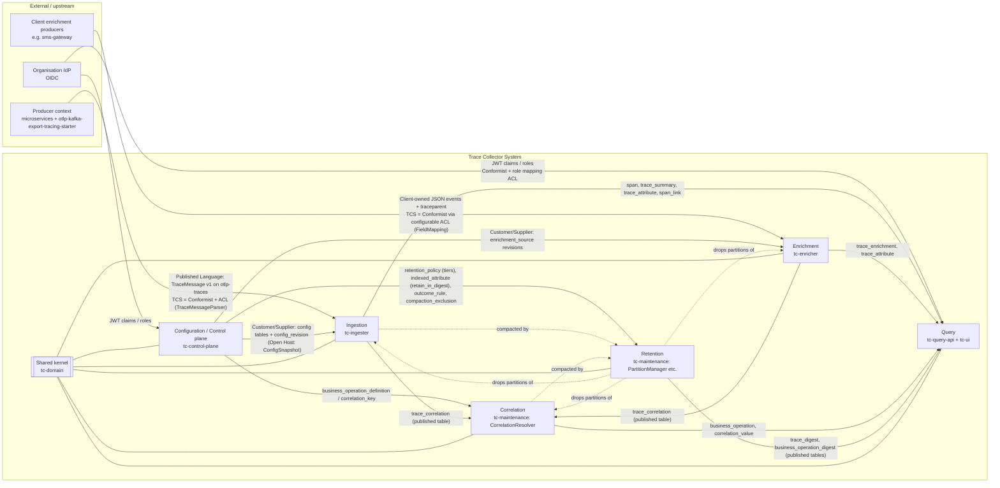
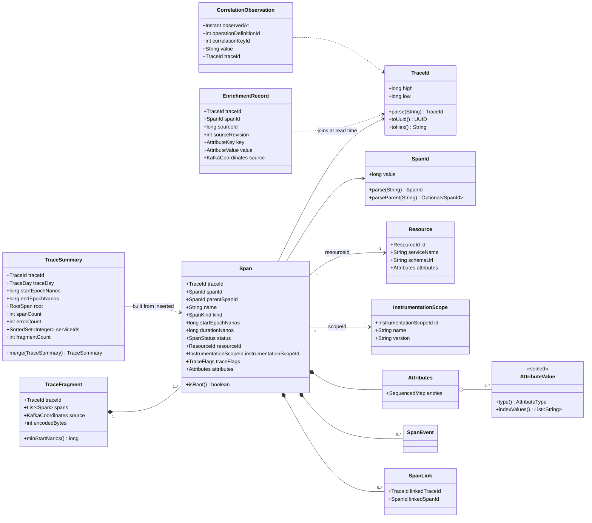
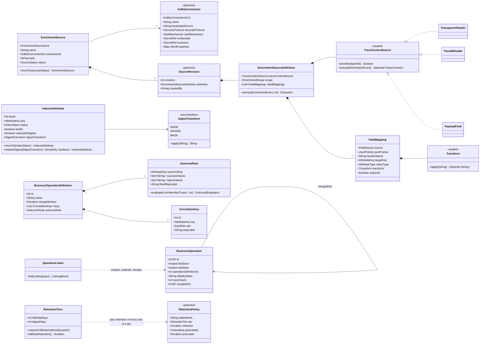
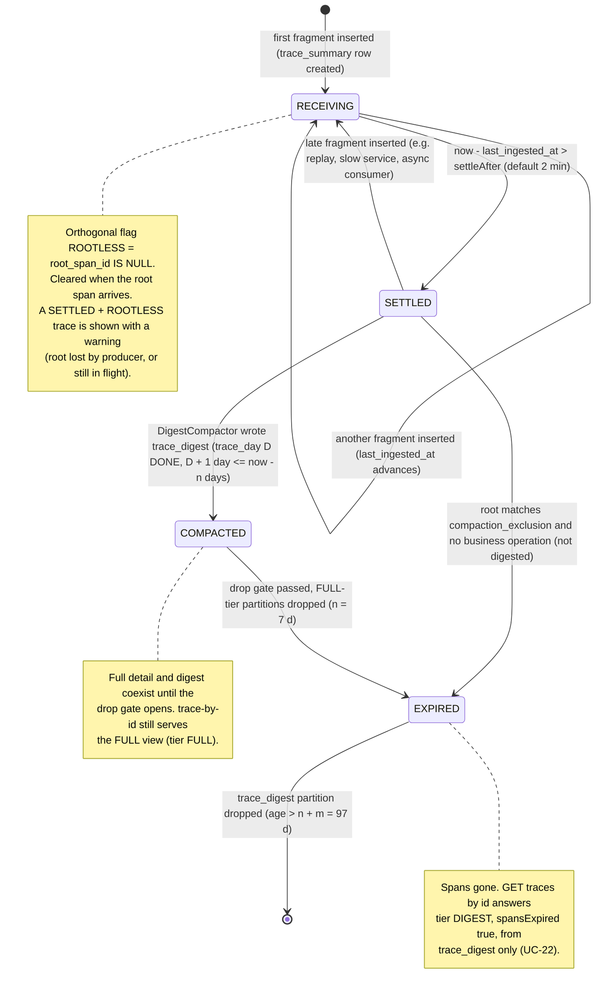
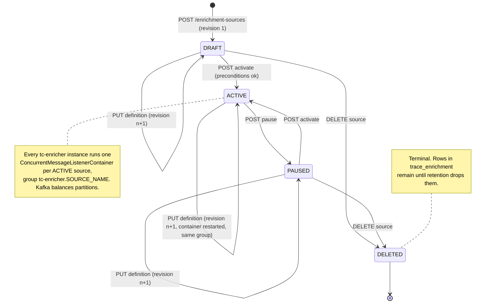
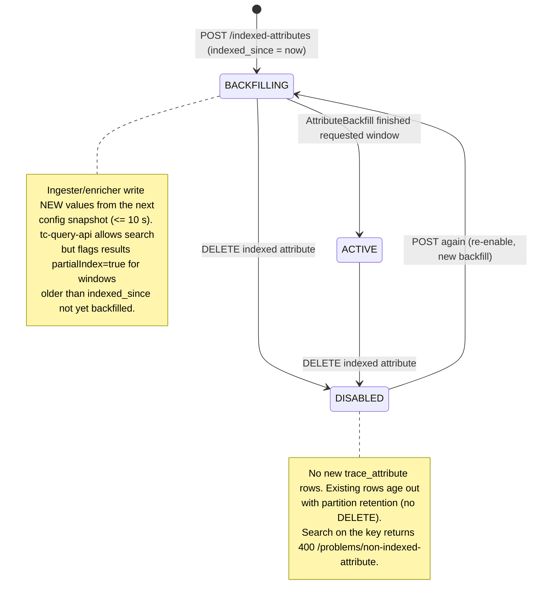
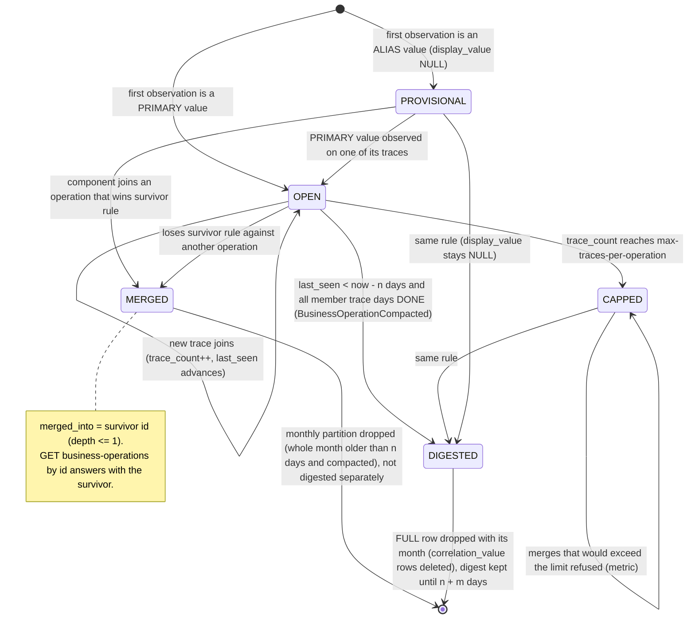
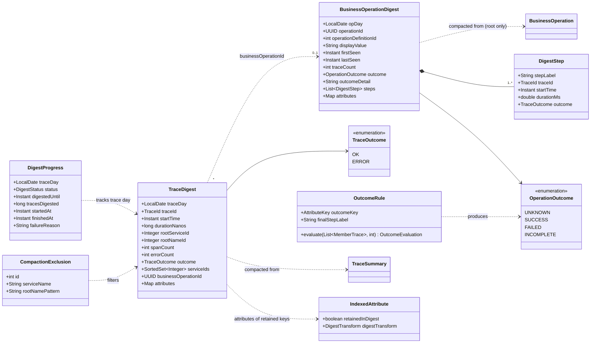

# 05 — Domain Model of the Trace Collector System (TCS)

**Related documents**

- [01 — Technology overview (Tempo, OpenTelemetry, Jaeger, ...)](01-technology-overview.md)
- [02 — High-level design (C4, ADRs)](02-high-level-design.md)
- [03 — Low-level design of the services](03-low-level-design.md)
- [04 — Storage design (PostgreSQL, capacity)](04-storage-design.md)
- **05 — Domain model (this document)**
- [06 — Use cases](06-use-cases.md)
- [07 — Sequence diagrams](07-sequence-diagrams.md)
- [08 — ER diagrams](08-er-diagrams.md)

This document gives TCS one vocabulary and a model that every service shares. It covers:

- the ubiquitous language;
- the bounded contexts and how they relate;
- aggregates, entities and value objects as Java 25 code with their invariants;
- the state machines;
- the internal domain events;
- the exact mapping from the producer's wire format (`TraceMessage` v1) to the domain and to the PostgreSQL schema `tc`.

Code lives in the shared-kernel module `tc-domain` (base package `ru.aasmc.tracing.collector.domain`). That module is pure Java with no Spring, JDBC or Kafka dependencies. Persistence code (`tc-persistence`) and Kafka code (`tc-kafka-support`) depend on `tc-domain`, never the reverse.

> **Implementation status (2026-11-22).** Phase 1 built the domain types the first use cases need; their contracts below are summaries of the code, which is the reference (Javadoc in `tc-domain`). Types marked *planned* are still design: they are added by the phase that first needs them, and their code sketches may change then. Deviations from the original design are listed in [09 §2.6](09-implementation-plan.md#26-phase-1a1b-results-revised-2026-11-22).

**Error model.** A broken rule throws `DomainViolationException(ViolationCode, message)`, built with `DomainViolationException.require(condition, code, message)`; the REST layer maps the `ViolationCode` to a stable error code. A broken *configured limit* or a programming error (e.g. a negative count) throws a plain `IllegalArgumentException`. State machines (`SourceStatus`, `IndexStatus`, `DigestStatus`) answer `transitionTo(target)` with the sealed `Transition` (`Changed`, `Unchanged`, `Rejected`); the aggregates throw the rejection.

**Limits are configuration.** Every size, count, length and time limit lives in a limits record with a `DEFAULT` that the application overrides from properties: `AttributeLimits`, `IngestLimits`, `EnrichmentLimits`, `CorrelationLimits`, `OperationMergePolicy`. Records keep only rules that never change (not null, not blank, syntax, ordering); `requireWithin(...)` checks the limits. Only external formats stay fixed (W3C ids and `traceparent`, Kafka topic names, RFC 6901 JSON Pointer, UUIDv7).

Package layout of `tc-domain` (*planned* types in italics):

| Package | Contents |
|---|---|
| base | `DomainViolationException`, `DomainViolation`, `ViolationCode`, `Transition`, `Names` (naming rule of admin-created things) |
| `domain.trace` | `TraceId`, `SpanId`, `Traceparent`, `TraceFlags`, `EpochNanos`, `TimeRange`, `TraceDay`, `Span`, `SpanKind`, `SpanStatus`, `StatusCode`, `SpanEvent`, `SpanLink`, `DroppedCounts`, `SpanFlag`, `TraceSummary`, `RootSpan`, `IngestLimits`, `SpanTimeVerdict`, *`TraceFragment`*, *`KafkaCoordinates`*, *`Completeness`* |
| `domain.attribute` | `AttributeKey`, `AttributeType`, `AttributeValue` (sealed), `Attributes`, `AttributeLimits`, `TruncatedText`, `IndexedAttribute`, `IndexStatus`, `DigestTransform`, `Sensitivity`, `SensitivityPolicy`, *`AttributeOrigin`* |
| `domain.resource` | `ResourceHasher`, `ResourceId`, `InstrumentationScopeId`, *`Resource`*, *`InstrumentationScope`*, *`ServiceId`*, *`SpanNameId`* |
| `domain.enrichment` | `EnrichmentSource`, `EnrichmentSourceId`, `KafkaConnectionId`, `SourceStatus`, `EnrichmentSourceDefinition`, `EnrichmentScope`, `TraceContextSource` (sealed), `TraceContext`, `FieldMapping`, `FieldSource`, `Transform` (sealed), `JsonPointer`, `JsonScalar`, `EnrichmentEvent`, `Extraction` (sealed), `ExtractionFailure`, `EnrichmentLimits`, *`KafkaConnection`*, *`SourceRevision`*, *`EnrichmentRecord`* |
| `domain.correlation` | `BusinessOperationDefinition`, `CorrelationKey`, `KeyRole`, `CorrelationLimits`, `OutcomeRule`, `MemberTrace`, `OutcomeEvaluation`, `OperationOutcome`, `CorrelationObservation`, `BusinessOperation`, `OperationMergePolicy`, `OperationLinker`, `LinkingInput`, `LinkingResult`, `RefusedMerge` |
| `domain.config` | `RetentionTiers`, *`RetentionPolicy`*, *`RetentionTier`*, *`ConfigRevision`*, *`ConfigSnapshot`* |
| `domain.digest` | `DigestProgress`, `DigestStatus`, *`TraceDigest`*, *`BusinessOperationDigest`*, *`DigestStep`*, *`TraceOutcome`*, *`CompactionExclusion`* |
| *`domain.event`* | *`DomainEvent` (sealed) and its records* |
| *`domain.dlq`* | *`DeadLetterReason`, `DeadLetter`* |

---

## 1. Ubiquitous language

The terms below are used with exactly these meanings in code, API, UI and documentation.

| Term | Definition | Code / storage |
|---|---|---|
| **Trace** | Every span that shares one 128-bit trace id. A trace is never stored or delivered as a single unit. It is assembled at read time from spans, the summary, enrichments, links and correlations. | `TraceId`; `tc.span` rows with the same `trace_id` |
| **Trace Fragment** | One Kafka record on `otlp-traces`: a `TraceMessage` holding the spans of one trace that a single `BatchSpanProcessor` export in a single service instance produced. A trace normally arrives as many fragments, possibly minutes apart and from many services. Every fragment of a trace lands in the same partition, because key = traceId. | `TraceFragment` (transient, never stored as such) |
| **Span** | One timed operation: id, parent, name, kind, start time, duration, status, attributes, events and links. Spans are **immutable** once stored. | `Span`; `tc.span` |
| **Root span** | A span with no parent (wire `parentSpanId = "0000000000000000"`). A trace normally has exactly one. | `Span.isRoot()` |
| **Orphan span** | A span whose parent id is not, or not yet, present among the stored spans of its trace. | read-model concept |
| **Resource** | The entity that produced telemetry, described by attributes such as `service.name`, `service.instance.id` or `host.name`. The wire repeats it in every span. TCS stores it once, identified by a content hash. | `Resource`, `ResourceId`; `tc.resource` |
| **Instrumentation Scope** | The library that created the span (name, version, schema URL, attributes). Deduplicated by content hash. | `InstrumentationScope`; `tc.instrumentation_scope` |
| **Service** | The value of the resource attribute `service.name`. It is dictionary-encoded. | `ServiceId`; `tc.service` |
| **Span Name** | Dictionary entry for a span name within one service. There is a cardinality guard of 5 000 names per service; overflowing names go to `span.name_overflow`. | `SpanNameId`; `tc.span_name` |
| **Trace Summary** | The trace-level header: min start, max end, root service and name, span and error counts, services, fragment count and ingest timestamps. It is built incrementally and commutatively from the spans that were actually inserted. | `TraceSummary`; `tc.trace_summary` |
| **Trace Day** | The UTC date a trace's summary row is filed under, which is the partition key of `trace_summary`. It is fixed when the trace is first seen (`TraceDayResolver`) and then reused for later fragments. | `TraceDay`; `trace_summary.trace_day` |
| **Trace Completeness** | The derived state of a trace: `RECEIVING` while fragments may still arrive, `SETTLED` after an idle period. There is also a `ROOTLESS` flag. It is never stored. | `Completeness` |
| **Attribute** | A typed key/value pair. The types are OTel's: STRING, BOOLEAN, LONG, DOUBLE and their arrays. | `AttributeKey`, `AttributeValue` |
| **Attribute Origin** | Where an attribute value came from: `SPAN` (1), `RESOURCE` (2), `ENRICHMENT` (3) or `DERIVED` (4, computed by TCS, e.g. `status=ERROR`). | `AttributeOrigin`; `origin smallint` |
| **Indexed Attribute** | An attribute key registered for search. Only these keys are written to the inverted index `trace_attribute`. Built-in keys are `service.name`, `span.name` (root only) and `status`. | `IndexedAttribute`; `tc.indexed_attribute`, `tc.trace_attribute` |
| **Brute-force scan** | Bounded search on non-indexed keys by scanning `span.attributes`. The window is at most 1 h and a statement timeout applies. | UC-13 |
| **Kafka Connection** | How to reach a client's Kafka cluster: bootstrap servers, security protocol and SASL mechanism, plus secret *references* (never the secrets). | `KafkaConnection`; `tc.kafka_connection` |
| **Enrichment Source** | A client-defined Kafka topic whose events carry trace context. TCS turns those events into additional trace attributes. It is configured as data, not code. | `EnrichmentSource`; `tc.enrichment_source` |
| **Source Revision** | An immutable, numbered version of a source's definition. Running containers always process exactly one revision. | `SourceRevision`; `tc.enrichment_source_revision` |
| **Enrichment Source Definition** | The content of a revision: where the trace context is found, the scope and the field mappings (later also payload format, filter, start position and missing-context policy). | `EnrichmentSourceDefinition`; `definition jsonb` |
| **Trace Context Source** | Where an enrichment event names its trace (and optionally span): a `traceparent` header, a header with a bare trace id, or a payload field. | `TraceContextSource` (sealed: `TraceparentHeader`, `TraceIdHeader`, `PayloadField`) |
| **Field Mapping** | A rule taking one field from the event (payload JSON Pointer, header, record key or record timestamp), applying a **Transform**, and producing one attribute `targetKey` of a declared type. | `FieldMapping`, `Transform` |
| **Enrichment Record** | One attribute value derived from one enrichment event. It is append-only, carries the Kafka record coordinates, and is idempotent on them. | `EnrichmentRecord`; `tc.trace_enrichment` |
| **Business Operation Definition** | A named business-operation family (e.g. `idp.login`). It declares the attribute keys whose values identify an operation, plus a merge window. | `BusinessOperationDefinition`; `tc.business_operation_definition` |
| **Correlation Key** | An attribute key that belongs to a business operation definition. Its role is `PRIMARY` (the natural business id, used as the display value) or `ALIAS` (a secondary id that bridges traces, e.g. an authorization code). It may carry a step label. | `CorrelationKey`; `tc.correlation_key` |
| **Correlation Observation** | One fact: "trace X carries value V for correlation key K". It is appended synchronously by the ingester or the enricher. | `CorrelationObservation`; `tc.trace_correlation` |
| **Correlation Value** | The current mapping from (business operation definition, value) to business operation, maintained by the resolver. | `CorrelationValue`; `tc.correlation_value` |
| **Business Operation** | The set of traces that represent one business action (one IdP login) and are connected through shared correlation values. It can be merged into another operation. | `BusinessOperation`; `tc.business_operation` |
| **Merge** | Joining two business operations when a later observation shows they share a value. The loser points to the survivor through `merged_into`. | `OperationLinker`, `OperationMergePolicy` |
| **Span Link** | A native OTel link from a span to a span of another trace, indexed in both directions. | `SpanLink`; `tc.span_link` |
| **Retention Policy** | Per table: its retention **tier** (`FULL` or `DIGEST`), how long data is kept, the partition granularity, and how far ahead partitions are pre-created. Durations are set per tier, not per table (ADR-13). | `RetentionPolicy`; `tc.retention_policy` |
| **Full tier** | All detailed trace data: `span`, `trace_attribute`, `span_link`, `trace_summary`, `trace_enrichment`, `trace_correlation`, `correlation_value`, `business_operation`. Kept `fullDataDays` = n days (default 7, min 2). Span-level detail, brute-force search and every search operator exist only here. | `RetentionTier.FULL`; `retention_policy.tier = 'FULL'` |
| **Digest tier** | The compact history kept after the full tier ends: `trace_digest` and `business_operation_digest`. Kept `digestDays` = m days (default 90) **after** the full tier, so a digest day is dropped when it is older than n + m days (default 97). `digestDays = 0` disables the tier. | `RetentionTier.DIGEST`; `retention_policy.tier = 'DIGEST'` |
| **Trace Digest** | One row per trace in the digest tier: start, duration, root service and name, span and error counts, services, trace outcome, business operation id, and the retained attributes. No spans, events, links or enrichment lineage. About 0.5 KB per trace (capacity in 04 §9). | `TraceDigest`; `tc.trace_digest` |
| **Business Operation Digest** | One row per root business operation in the digest tier: type, display value, first/last seen, trace count, **operation outcome**, ordered steps (one per member trace) and the union of the members' retained attributes. | `BusinessOperationDigest`; `tc.business_operation_digest` |
| **Retained attribute** | An indexed attribute key flagged `retain_in_digest = true`. Its values are copied from `trace_attribute` into `trace_digest.attributes` at compaction. A retained key must be indexed: compaction never reads spans. Flagging a key is **not retroactive** for already-compacted days. | `IndexedAttribute.retainedInDigest`; `indexed_attribute.retain_in_digest` |
| **Digest transform** | How a retained value is stored in the digest: `NONE` (as is), `SHA256` (lowercase hex of SHA-256 over the UTF-8 value) or `MASK` (first 2 chars + `***`). It lets PII stay joinable (SHA256) or recognisable (MASK) without keeping the raw value for n + m days. | `DigestTransform`; `indexed_attribute.digest_transform` |
| **Outcome rule** | Per business operation definition, optional: how to derive the outcome of a business operation at compaction from `outcomeKey` + `successValues` / `failureValues`, member errors, and `finalStepLabel`. Evaluated in a fixed order (§4.10). | `OutcomeRule`; `business_operation_definition.outcome_rule jsonb` |
| **Operation outcome** | Result of the outcome rule for one business operation: `UNKNOWN` (0), `SUCCESS` (1), `FAILED` (2), `INCOMPLETE` (3). The trace-level counterpart is the **trace outcome**: `OK` (1, `error_count = 0`) or `ERROR` (2). | `OperationOutcome`, `TraceOutcome`; `business_operation_digest.outcome`, `trace_digest.outcome` |
| **Compaction** | The batch job (`DigestCompactor` in `tc-maintenance`) that turns one whole trace day of full-tier data, older than n days, into digest rows with set-based `INSERT ... SELECT` statements, in 1-hour chunks, resumably and idempotently. It never reads `span`. | `DigestProgress`; `tc.compaction_state` |
| **Compaction exclusion** | A configured pattern (`service_name`, `root_name_pattern` as SQL LIKE) for traces that are **not** digested, e.g. health checks `GET /actuator/%`, unless the trace belongs to a business operation. | `CompactionExclusion`; `tc.compaction_exclusion` |
| **Drop gate** | The rule in `PartitionManager` that a full-tier partition may be dropped only if it is older than n days **and** every trace day whose compaction read window overlaps it is `DONE`. Uncompacted data is never dropped; if compaction lags, full-tier data is kept longer. | `PartitionManager`; `compaction_state.status` |
| **Config Revision** | A single monotonically increasing counter that `tc-control-plane` bumps in the same transaction as any config change. Data-plane services poll it every 10 s and reload their snapshot when it changes. | `ConfigRevision`; `tc.config_revision` |
| **Config Snapshot** | An immutable, in-memory copy of all config tables at one config revision. | `ConfigSnapshot` |
| **DLQ record** | A Kafka record that could not be processed. It is copied byte-for-byte to `otlp-traces.dlq` or `tc-enrichment.dlq` with diagnostic headers. | `DeadLetter`, `DeadLetterReason` |
| **Watermark** | The resolver's position in `trace_correlation` (`correlation_resolver_state.last_processed_id`). | `correlation_resolver_state` |
| **Sensitivity** | How sensitive the values of an attribute key are (`NONE`, `PERSONAL` or `SECRET`). It drives masking in the Query context and the transforms allowed for retained keys. | `Sensitivity`, `SensitivityPolicy` |

Words that are deliberately **not** used:

- "Message" for a span. A message is a Kafka record, i.e. a fragment.
- "Tag" for an attribute. "Tag" appears only when quoting Micrometer and Spring property names.
- "Session" for a business operation. A session is just one possible correlation key (`idp.auth_session_id`).

---

## 2. Bounded contexts

### 2.1 Contexts and their responsibilities

| Context | Owner deployable(s) | Core concepts | Owns tables (writes) |
|---|---|---|---|
| **Ingestion** | `tc-ingester` | TraceFragment, Span, TraceSummary, Resource, InstrumentationScope, dictionaries, TraceDay | `span`, `trace_summary`, `resource`, `instrumentation_scope`, `service`, `span_name`, `attribute_key` (insert of new keys), `span_link`; appends to `trace_attribute` and `trace_correlation` |
| **Enrichment** | `tc-enricher` | EnrichmentSource runtime, TraceContextSource, FieldMapping, EnrichmentRecord | `trace_enrichment`; appends to `trace_attribute` and `trace_correlation` |
| **Correlation** | `tc-maintenance` (CorrelationResolver). The extraction half runs inside Ingestion and Enrichment. | BusinessOperationDefinition, CorrelationObservation, CorrelationValue, BusinessOperation | `business_operation`, `correlation_value`, `correlation_resolver_state` |
| **Query** | `tc-query-api`, `tc-ui` | TraceView, TraceSummaryView, TraceDigestView, BusinessOperationView, SearchCriteria (split at the tier boundary), SensitivityPolicy | none (read replica only); reads both tiers |
| **Configuration (control plane)** | `tc-control-plane` | KafkaConnection, EnrichmentSource definition and lifecycle, IndexedAttribute (incl. retainedInDigest, digestTransform), BusinessOperationDefinition (incl. OutcomeRule), RetentionPolicy / RetentionTiers, CompactionExclusion, ConfigRevision | `kafka_connection`, `enrichment_source`, `enrichment_source_revision`, `indexed_attribute`, `business_operation_definition`, `correlation_key`, `retention_policy`, `compaction_exclusion`, `config_revision`; inserts into `attribute_key` |
| **Retention** | `tc-maintenance` (PartitionManager, **DigestCompactor**, AttributeBackfill, DictionaryGc, StatsRefresher) | RetentionPolicy enforcement, Partition, **Compaction** (TraceDigest, BusinessOperationDigest, OutcomeRule evaluation, DigestProgress), Drop gate | DDL on partitioned tables; `trace_digest`, `business_operation_digest`, `compaction_state`; `indexed_attribute.status` (BACKFILLING to ACTIVE); `resource` GC; `correlation_value` cleanup |

`tc-schema-migrator` is not a context. It is infrastructure that owns the DDL migrations for all contexts.

**Retention now owns compaction (ADR-13).** Before two-tier retention, the Retention context only dropped partitions. It now also **produces** data: `DigestCompactor` reads the full tier (`trace_summary`, `trace_attribute`, `trace_correlation`, `correlation_value`, `business_operation`, `correlation_key`) and writes the digest tier. Retention is the only writer of `trace_digest`, `business_operation_digest` and `compaction_state`, and the only reader of the outcome rule at runtime. Compaction and dropping live in the same context on purpose: the drop gate needs `compaction_state`, and keeping both in one deployable (`tc-maintenance`) means the "never drop uncompacted data" invariant is enforced without cross-service coordination.

### 2.2 Context map



### 2.3 Relationships explained

1. **Producer to Ingestion: Published Language plus Conformist plus Anti-Corruption Layer.**
   - The producer starter defines the language, `TraceMessage` with `schemaVersion = 1`. TCS cannot change it and conforms.
   - `TraceMessageParser` (`ingest.parse`) and `SpanNormalizer` (`ingest.normalize`) form the ACL:
     - the wire's redundant, stringly-typed structure becomes typed value objects;
     - ids, times and enums are normalised;
     - duplicated contexts are dropped;
     - resources are deduplicated.
   - Unknown `schemaVersion` values are not interpreted. They go to the DLQ (UC-03).
   - A future `schemaVersion = 2` (resource hoisted to message level, `exportedAt`, `messageId`; see 02) would get a second parser behind the same ACL interface.
2. **Client enrichment producers to Enrichment: Conformist through configurable ACL.**
   - TCS does not dictate the payload format of client topics. It requires only a trace context.
   - The translation is data (field mappings), not code, so each `SourceRevision` is effectively a small, versioned ACL.
3. **Configuration to the data-plane contexts: Customer/Supplier with an Open Host.**
   - The control plane is the only writer of config tables.
   - Consumers read a consistent `ConfigSnapshot` keyed by `config_revision`. That snapshot is the "open host" protocol: a versioned read model that every data-plane service loads the same way (`ConfigSnapshotPoller` in `tc-ingester`, `EnrichmentSourceRegistry` in `tc-enricher`).
4. **Ingestion/Enrichment to Correlation: Customer/Supplier through a published table.**
   - `trace_correlation` is an append-only log of observations. Correlation consumes it asynchronously by watermark.
   - No Kafka topic is used (ADR-01: only pre-created topics, and no new topics). The table is the integration contract.
5. **Shared Kernel `tc-domain`.**
   - Contains `TraceId`, `SpanId`, `AttributeKey`, `AttributeValue`, `Attributes`, `AttributeOrigin`, `ConfigRevision`, `ConfigSnapshot` and the definition records.
   - Changes require agreement of all contexts, because all modules live in one Maven repo, `trace-collector`.
   - The kernel is intentionally small and free of behaviour that belongs to a single context. For example, operation linking is in `domain.correlation` and is used only by the resolver.
6. **Query: Conformist to the persistence schema, with separate read models.**
   - The Query context does not reuse write-side aggregates. It has its own DTOs (`TraceSummaryDto` and others, see 03) and the masking policy.
7. **Retention: Separate Ways with writers, Customer of the full tier for compaction.**
   - Retention removes whole partitions on a schedule and never coordinates with writers per row.
   - The only coordination with writers is that they must never need a partition that is older than retention (n days). Spans older than retention are dropped by the ingester (UC-01, alternative flow).
   - Compaction consumes the full tier as a **published table set**, by time: a trace day D is compacted once D + 1 day ≤ now − n days, when ingestion and correlation no longer touch it. Late values outside the read window `[D − 1 h, D + 1 day + 6 h)` are not captured (accepted, documented).
   - The digest tables are a published read model for the Query context. Query never writes them; Retention never reads Query.

---

## 3. Shared-kernel value objects

All value objects are Java 25 `record`s whose compact constructors validate invariants. They are immutable, have no identity beyond their value, and are safe to share across threads (`tc-ingester` runs listener threads, and `tc-query-api` uses virtual threads).

### 3.1 TraceId

`record TraceId(long high, long low) implements Comparable<TraceId>` (package `domain.trace`):

- 128 bits, never all zeros (W3C Trace Context: an all-zero trace id is invalid) — `INVALID_TRACE_ID`;
- `parse(hex)` accepts 32 hex characters in either case and throws `INVALID_TRACE_ID`; `tryParse(hex)` returns `Optional` instead (used for untrusted input such as `traceparent` headers); hex is parsed strictly (no sign, no whitespace);
- `toHex()` (also `toString()`) gives 32 lowercase hex characters;
- `toUuid()` / `fromUuid(UUID)` are exact inverses: a trace id is stored as PostgreSQL `uuid` with the same 128 bits (ADR-10), not as an RFC 9562 versioned UUID;
- `compareTo` orders as unsigned bytes, the same order PostgreSQL uses for `uuid`, so keyset cursors built in Java agree with `ORDER BY trace_id`.

### 3.2 SpanId

`record SpanId(long value)`:

- 64 bits, never zero — `INVALID_SPAN_ID`;
- stored as signed `bigint` by reinterpreting the 64 bits as two's complement, so ids from `8000000000000000` up become negative longs; the mapping is lossless;
- `parse(hex)` like `TraceId.parse`; `parseParent(hex)` returns empty for the root markers `"0000000000000000"`, `null` and `""`, else parses;
- `toHex()` gives 16 lowercase hex characters.

`record Traceparent(int version, TraceId traceId, SpanId parentSpanId, TraceFlags flags)` parses a W3C `traceparent` with `parse(value)`, which never throws and returns `Optional`: version `ff` is invalid, version `00` has exactly 55 characters, a higher version may append `-…` fields, and all-zero ids are invalid. `TraceFlags(int value)` is one unsigned byte (0..255, else `INVALID_SPAN`); bit `0x01` means sampled, unknown bits are kept.

### 3.3 TimeRange, TraceDay, EpochNanos

- `record TimeRange(Instant from, Instant to)` is the half-open interval `[from, to)` with both ends set and `from < to` (`INVALID_TIME_RANGE`).
- `record TraceDay(LocalDate value) implements Comparable<TraceDay>` is the UTC day a trace is filed under; `ofEpochNanos(nanos)` gives the UTC day of a time.
- `EpochNanos` converts wire times: `parse(text)` reads the decimal string exactly (never through `double`); `toInstant(nanos)` is exact (negative values are before 1970); `toInstantTruncatedToMicros(nanos)` cuts (does not round) to the microseconds PostgreSQL `timestamptz` keeps (ADR-10).

**Trace Day rule.** `TraceDayResolver` in `ingest.trace` uses this order:

1. The Caffeine cache `traceId -> trace_day`.
2. On a miss, `SELECT trace_day FROM tc.trace_summary WHERE trace_id = ? AND trace_day IN (d-1, d, d+1)` where d = UTC date of the fragment's min start.
3. Otherwise `TraceDay.ofEpochNanos(min start of the fragment's spans)`.

Fragments of one trace are serialized on one partition, and therefore on one consumer thread, so two instances race only during a rebalance.

A fragment that arrives more than a day after a trace was first filed, or a race during a rebalance, can produce a **second summary row for the same trace under a different trace_day**. The model accepts this. The PK is `(trace_id, trace_day)`, and the Query context merges the rows with the same `TraceSummary.merge` used on the write path (§4.4). Merge is commutative and associative, so the merged result is identical.

### 3.4 Attributes

- `record AttributeKey(String value)`: not blank (`INVALID_ATTRIBUTE_KEY`); the length limit is `AttributeLimits.maxKeyLength`. Producers may send any key. `allowedAsEnrichmentTarget()` refuses the keys an enrichment mapping must not overwrite: prefixes `service.`, `otel.`, `telemetry.`, `tc.` and the built-in search keys `span.name` and `status`.
- `enum AttributeType`: the eight OTel types `STRING`, `BOOLEAN`, `LONG`, `DOUBLE` and their `_ARRAY` forms.
- `sealed interface AttributeValue` with `StringValue`, `BoolValue`, `LongValue`, `DoubleValue`, `StringArrayValue`, `BoolArrayValue`, `LongArrayValue`, `DoubleArrayValue`:
  - no `null` values or elements, doubles are finite because `jsonb` cannot store NaN or infinity (`INVALID_ATTRIBUTE_TYPE`); arrays are immutable copies;
  - `StringValue.of(raw, maxBytes)` and `StringArrayValue.of(raw, maxBytes)` cut strings to the configured UTF-8 size without splitting a character and record it in `wasTruncated()`;
  - LONG stays `long`, never passing through `double`, so values above 2^53 keep every digit;
  - `indexValues()` gives the index tokens, one per array element; `numericValue()` is present for LONG and DOUBLE only.
- `record Attributes(SequencedMap<AttributeKey, AttributeValue> entries)`: an immutable copy in producer order (kept for display); no `null` keys or values; `empty()`, `anyValueTruncated()`.
- `record AttributeLimits(maxKeyLength, maxValueBytes, maxEntries)`, default 255 characters, 4 KiB, 512 entries; `requireWithin(attributes)` throws `TOO_MANY_ATTRIBUTES` or `INVALID_ATTRIBUTE_KEY`.
- `record TruncatedText(String value, boolean wasTruncated)` with `truncate(text, maxBytes)`: the shared UTF-8 cut used for values and index tokens.

*Planned* (Phase 2, with the storage of `trace_attribute`):

```java
public enum AttributeOrigin {
    SPAN((short) 1), RESOURCE((short) 2), ENRICHMENT((short) 3), DERIVED((short) 4);
    public final short code;
    AttributeOrigin(short code) { this.code = code; }
}
```

**Storage form of attributes.** `span.attributes` is compact jsonb that uses JSON-native values, for example `{"user_id":"u-42","http.response.status_code":200,"ratio":0.5,"tags":["a","b"]}`. It does not use the wire's `{type,value}` envelope.

- The type can be recovered. jsonb keeps `numeric` scale, so `1` (LONG) and `1.0` (DOUBLE) stay distinct. Strings, booleans and arrays are self-describing.
- This halves attribute bytes compared with the wire format. That matters for the ~350 B/span estimate in 04.
- Empty arrays lose their element type. This is accepted and rendered as `[]`.

### 3.5 Resource, InstrumentationScope, dictionaries

```java
package ru.aasmc.tracing.collector.domain.resource;

import ru.aasmc.tracing.collector.domain.attribute.AttributeKey;
import ru.aasmc.tracing.collector.domain.attribute.AttributeValue;
import ru.aasmc.tracing.collector.domain.attribute.Attributes;

// Implemented: ResourceId(long) and InstrumentationScopeId(long), computed by ResourceHasher (below).
// Planned (with ingestion): the dictionary ids and the content records.
public record ServiceId(int value) { public ServiceId { if (value <= 0) throw new IllegalArgumentException(); } }
public record SpanNameId(int value) { public SpanNameId { if (value <= 0) throw new IllegalArgumentException(); } }

public record Resource(ResourceId id, String serviceName, String schemaUrl, Attributes attributes) {
    public static final String UNKNOWN_SERVICE = "unknown_service";

    public Resource {
        if (serviceName == null || serviceName.isBlank()) throw new IllegalArgumentException("serviceName");
        if (!id.equals(ResourceHasher.resourceId(schemaUrl, attributes)))
            throw new IllegalArgumentException("ResourceId does not match content");
    }

    public static Resource of(String schemaUrl, Attributes attributes) {
        String svc = attributes.entries().get(new AttributeKey("service.name"))
                instanceof AttributeValue.StringValue(String name, boolean _) && !name.isBlank()
                ? name
                : UNKNOWN_SERVICE;
        return new Resource(ResourceHasher.resourceId(schemaUrl, attributes), svc, schemaUrl, attributes);
    }
}

public record InstrumentationScope(InstrumentationScopeId id, String name, String version, String schemaUrl,
                                   Attributes attributes) {
    public InstrumentationScope {
        if (name == null) throw new IllegalArgumentException("scope name");
        if (!id.equals(ResourceHasher.instrumentationScopeId(name, version, schemaUrl, attributes)))
            throw new IllegalArgumentException("InstrumentationScopeId does not match content");
    }
}
```

**Canonical encoding** (implemented). `ResourceHasher.resourceId(schemaUrl, attributes)` and `instrumentationScopeId(name, version, schemaUrl, attributes)` encode the content as bytes in which every text is written as `<UTF-8 byte length in decimal> ':' <UTF-8 bytes>`:

1. resource: the text `schemaUrl`; scope: the texts `name`, `version`, `schemaUrl` (`""` for null);
2. the attributes **sorted by key** (`String.compareTo`), each as the text `key`, the text `type` (the `AttributeType` name), the number of index tokens followed by `':'`, and each token as a text.

Example: schema URL `s` with `host.name = "n1"` encodes as `1:s9:host.name6:STRING1:2:n1`. Because every text carries its length and every array its size, two different contents never share an encoding, whatever characters they hold (`[]` and `[""]` encode as `0:` and `1:0:`).

That encoding is hashed with xxHash64, seed 0 (a small pure-Java `XxHash64`, checked against the published test vectors). The encoding is part of the domain contract. Changing it does not corrupt data, but it creates new `resource` rows for the same content. It would therefore be versioned (seed = encoding version) and announced.

A collision between two different resources (probability ≈ n²/2⁶⁵, about 3·10⁻⁸ for 1 M distinct resources) would be accepted silently. The span would point to the first resource seen. This is documented as an accepted risk.

**Why a content hash.** Every service instance can compute the id locally without a DB round-trip. `ResourceDeduplicator` keeps a Caffeine `ResourceId -> known` set. Only unseen ids go into the batch's `INSERT ... ON CONFLICT DO NOTHING`. `last_seen` is refreshed at most once per hour per resource, so the table never becomes a hot spot.

### 3.6 Span

`record Span(traceId, spanId, parentSpanId, name, kind, startEpochNanos, durationNanos, status, resourceId, serviceName, instrumentationScopeId, traceFlags, traceState, attributes, events, links, droppedByProducer, collectorFlags)` is one timed operation, stored once and never updated (fillfactor 100). Rules (`INVALID_SPAN`):

- trace id and span id are set, and a span is not its own parent; `parentSpanId` is `null` for a root span (`isRoot()`);
- `durationNanos >= 0` (the normaliser clamps a negative duration first); `endEpochNanos()` is start plus duration;
- a `null` name becomes `""`; events, links and collector flags are immutable copies;
- if any attribute value was cut, `SpanFlag.ATTRIBUTE_TRUNCATED` is added.

Its parts:

- `SpanKind` (`INTERNAL`, `SERVER`, `CLIENT`, `PRODUCER`, `CONSUMER`), `StatusCode` (`UNSET`, `OK`, `ERROR`), `SpanStatus(code, message)` with `isError()`; the storage codes (OTLP numbers) belong to the persistence layer;
- `SpanEvent(name, epochNanos, attributes, droppedAttributes)` with an absolute time; `SpanLink(linkedTraceId, linkedSpanId, traceState, attributes)`; `DroppedCounts(attributes, events, links)`, each `>= 0`, `NONE` for no drops;
- `SpanFlag`: what the collector noticed — `ATTRIBUTE_TRUNCATED`, `NOT_ENDED`, `PARENT_REMOTE`, `EVENTS_OR_LINKS_TRUNCATED`, `NEGATIVE_DURATION_CLAMPED`, `INDEX_VALUE_TRUNCATED` (bit values of `span.flags` in 04 §5.5).

`IngestLimits(maxSpansPerTrace, maxFragmentBytes, futureTolerance, maxIndexValueBytes, attributes)`, default 50 000 spans, 8 MiB, 1 day, 512 bytes and `AttributeLimits.DEFAULT`, holds the configurable ingest rules: `spansToStore(alreadyStored, incoming)`, `isFragmentTooLarge(bytes)`, `judgeSpanStart(start, now, retention)` → `SpanTimeVerdict` (`ACCEPT`, `FUTURE`, `EXPIRED`) and `truncateIndexValue(value)`.

Invariants enforced by `SpanNormalizer` before construction:

1. `spanContext.traceId == message.traceId`. Otherwise the record is poison, reason `TRACE_ID_MISMATCH`.
2. `spanId == spanContext.spanId`.
3. `end < start` gives duration 0 and `NEGATIVE_DURATION_CLAMPED`.
4. A start after `now + futureTolerance` (`FUTURE`) makes the record poison, reason `FUTURE_TIMESTAMP`.
5. A start before `now - retention(span)` (`EXPIRED`) drops the span, increments the metric `tc_ingester_spans_dropped_total{reason="EXPIRED"}`, and lets the rest of the fragment proceed.
6. String values longer than `AttributeLimits.maxValueBytes` are truncated and flagged.
7. A trace already holding `maxSpansPerTrace` spans drops further spans with metric reason `TRACE_TOO_LARGE`. The count comes from `trace_summary.span_count` plus the current batch (`spansToStore`).

### 3.7 TraceFragment

*Planned* (Phase 3, ingest pipeline). The fragment size limit is `IngestLimits.maxFragmentBytes`, checked by the parser before the fragment is built.

```java
package ru.aasmc.tracing.collector.domain.trace;

import java.time.Instant;
import java.util.List;

/** Kafka coordinates of the record a fragment/enrichment came from (idempotency + DLQ). */
public record KafkaCoordinates(String topic, int partition, long offset, Instant timestamp) {
    public KafkaCoordinates {
        if (partition < 0 || offset < 0) throw new IllegalArgumentException("bad coordinates");
    }
}

/** One TraceMessage after parsing + normalisation; transient (lives for one poll batch). */
public record TraceFragment(TraceId traceId, List<Span> spans, KafkaCoordinates source, int encodedBytes) {
    public TraceFragment {
        spans = List.copyOf(spans);
        for (Span s : spans) {
            if (!s.traceId().equals(traceId)) throw new IllegalArgumentException("TRACE_ID_MISMATCH");
        }
        // empty fragments are legal after EXPIRED filtering; they produce no rows but still ack.
    }

    public long minStartNanos() { return spans.stream().mapToLong(Span::startEpochNanos).min().orElseThrow(); }
    public long maxEndNanos() { return spans.stream().mapToLong(Span::endEpochNanos).max().orElseThrow(); }
}
```

---

## 4. Aggregates

### 4.1 Aggregate overview

| Aggregate (root) | Context | Consistency boundary | Persistence | Identity |
|---|---|---|---|---|
| **Span** | Ingestion | single immutable row | `span` (+ `span_link`) | `(trace_id, span_id, start_time)` |
| **TraceSummary** | Ingestion | one row per `(trace_id, trace_day)`, updated by commutative merge in the batch transaction | `trace_summary` | `(trace_id, trace_day)` |
| **Resource / InstrumentationScope** | Ingestion | content-addressed, insert-only (plus `last_seen`) | `resource`, `instrumentation_scope` | xxHash64 |
| **KafkaConnection** | Configuration | one row | `kafka_connection` | `id`, unique `name` |
| **EnrichmentSource** (+ SourceRevision entities) | Configuration (definition); Enrichment (runtime) | source row + its revisions; lifecycle transitions are atomic with a `config_revision` bump | `enrichment_source`, `enrichment_source_revision` | `id`, unique `name` |
| **EnrichmentRecord** | Enrichment | single immutable row | `trace_enrichment` | `(source_id, kafka_partition, kafka_offset, key_id, observed_at)` |
| **IndexedAttribute** | Configuration / Retention (backfill) | one row | `indexed_attribute` | `key_id` |
| **BusinessOperationDefinition** (+ CorrelationKey entities) | Configuration | type + keys | `business_operation_definition`, `correlation_key` | `id`, unique `name` |
| **BusinessOperation** | Correlation | operation + the `correlation_value` rows pointing at it; modified only by the single-leader resolver | `business_operation`, `correlation_value` | `id` uuidv7 (+ `first_seen` for partitioning) |
| **RetentionPolicy** | Configuration / Retention | one row per table; durations changed per tier (`RetentionTiers`) in one transaction | `retention_policy` | `table_name` (+ `tier`) |
| **TraceDigest** | Retention (compaction) | single immutable row, written once by `INSERT ... ON CONFLICT DO NOTHING` | `trace_digest` | `(trace_id, trace_day)` |
| **BusinessOperationDigest** | Retention (compaction) | single immutable row per root operation, written once after all member trace days are compacted | `business_operation_digest` | `(operation_id, op_day)` |
| **DigestProgress** | Retention (compaction) | one row per trace day; modified only by the single-leader `DigestCompactor` | `compaction_state` | `trace_day` |
| **CompactionExclusion** | Configuration | one row | `compaction_exclusion` | `id` |
| **ConfigRevision** | Configuration | singleton | `config_revision` | `id = 1` |

The **Trace** is deliberately *not* an aggregate. At 20 000–60 000 spans/s, with fragments spread over minutes and services, a transactional "trace" boundary would need locking or read-modify-write on hot rows. TCS keeps the consistency units small:

- spans are insert-only;
- the summary is merged commutatively;
- enrichment, attribute index, correlation and links are append-only side tables.

The trace exists only as a **read model**: `TraceView`, assembled by `tc-query-api`.

### 4.2 Class diagram: trace model



### 4.3 Class diagram: configuration, enrichment and correlation

Types marked `<<planned>>` are design only (see the package table).



### 4.4 TraceSummary: commutative, idempotent merge

`TraceSummary` is a **commutative monoid over the set of inserted spans**:

- `ofSpans(S1).merge(ofSpans(S2)) == ofSpans(S1 ∪ S2)` whenever S1 ∩ S2 = ∅;
- merge is associative and commutative, so fragment arrival order does not matter.

Disjointness is guaranteed by the span primary key. The writable CTE in `SpanBatchWriter` feeds the summary upsert **only with the rows `RETURNING`'d by `INSERT ... ON CONFLICT DO NOTHING`**, so a replayed fragment contributes the empty set (the identity element). That is why the counters stay correct under at-least-once delivery (UC-02).

`record TraceSummary(traceId, traceDay, startEpochNanos, endEpochNanos, root, spanCount, errorCount, serviceIds, fragmentCount, firstIngestedAt, lastIngestedAt)`:

- rules (`INVALID_TRACE_SUMMARY`): `spanCount >= 1`; `0 <= errorCount <= spanCount`; `endEpochNanos >= startEpochNanos`; `fragmentCount >= 1`; `lastIngestedAt >= firstIngestedAt`; `serviceIds` is an immutable sorted copy;
- `root` is a `RootSpan(spanId, serviceId, nameId, startEpochNanos)`, `null` while the root has not arrived; `nameId` is `null` when the name is not in the dictionary;
- `ofInsertedSpans(day, inserted, serviceIdOf, nameIdOf, now)` summarises the spans one fragment inserted (`fragmentCount = 1`); `inserted` is not empty and holds one trace;
- `merge(other)` combines two summaries of the same trace: earliest day, start and first insert; latest end and last insert; sums of the counters; union of the services; as root the one that started first, ties broken by the smaller **unsigned** span id. It mirrors the SQL upsert below exactly.

Equivalent SQL semantics for the upsert in the writable CTE (full statement in 03/04):

| Column | On insert | On conflict `(trace_id, trace_day)` |
|---|---|---|
| `start_time` | `min(start_time)` of inserted spans | `LEAST(t.start_time, EXCLUDED.start_time)` |
| `end_time` | `max(start_time + duration)` | `GREATEST(...)` |
| `duration_ns` | `end - start` in ns | recomputed from the merged start and end (µs precision at trace level; exact per span) |
| `root_span_id`, `root_service_id`, `root_name_id` | from an inserted root span, if any | keep existing unless NULL or the new root starts earlier |
| `span_count`, `error_count` | count of inserted spans / of errors | `t.x + EXCLUDED.x` |
| `service_ids` | sorted distinct | sorted distinct union |
| `fragment_count` | number of distinct fragments in the batch that inserted ≥ 1 span (staging carries a batch-local `frag_no`) | `t.fragment_count + EXCLUDED.fragment_count` |
| `first_ingested_at` / `last_ingested_at` | `now()` | `LEAST` / `GREATEST` |

Each poll batch is grouped by `(trace_id, trace_day)` before the upsert. PostgreSQL's `ON CONFLICT DO UPDATE` cannot touch the same row twice in one statement.

`fragment_count` and `last_ingested_at` are the only fields that depend on *delivery* rather than *content*. They are diagnostic, and they are still replay-safe because a replayed fragment inserts zero spans and is not counted.

### 4.5 Trace completeness (derived)

*Planned* (Phase 3, query).

```java
public enum CompletenessState { RECEIVING, SETTLED }

public record Completeness(CompletenessState state, boolean rootless, int orphanSpans) {
    /** settleAfter default PT2M (tc.query.trace-settle-after). Never persisted. */
    public static Completeness of(TraceSummary s, int orphanSpans, Instant now, java.time.Duration settleAfter) {
        var state = s.lastIngestedAt().plus(settleAfter).isBefore(now) ? CompletenessState.SETTLED : CompletenessState.RECEIVING;
        return new Completeness(state, s.rootless(), orphanSpans);
    }
}
```



`COMPACTED` and `EXPIRED` are lifecycle states of the stored data, not of `Completeness` (which is computed only while the trace is in the full tier). They are derived from `compaction_state.status` of the trace day and from which tier answers a lookup; neither is stored per trace. A fragment that arrives after its trace day was compacted is not reflected in the digest (compaction is write-once). This is rare: spans older than n days are dropped at ingest (§3.6 rule 5), and the compaction read window adds 6 h of slack after the day.

TCS, like Tempo's block-builder, has **no notion of "trace finished"**. The producer never signals it (there is no fragment or sequence marker). Completeness is therefore a hint for the UI and for search consumers, never a gate:

- search results include RECEIVING traces;
- the UI labels them "still receiving".

### 4.6 KafkaConnection

*Planned* (Phase 2–3, with the secret resolver). Only `KafkaConnectionId` exists yet, referenced by `EnrichmentSource`. The name will follow `Names` with a configured maximum length, like the other admin-created names.

```java
package ru.aasmc.tracing.collector.domain.enrichment;

import java.util.Map;
import java.util.Set;

public enum SecurityProtocol { PLAINTEXT, SSL, SASL_PLAINTEXT, SASL_SSL }
public enum SaslMechanism { PLAIN, SCRAM_SHA_256, SCRAM_SHA_512, OAUTHBEARER }

/** Reference to a secret held outside the DB (Vault path or k8s secret name/key). Never the secret itself. */
public record SecretRef(String uri) {
    public SecretRef {
        if (uri == null || !(uri.startsWith("vault:") || uri.startsWith("k8s:")))
            throw new IllegalArgumentException("secret ref must be vault:... or k8s:...");
    }
}

public record KafkaConnectionId(long value) {}

public record KafkaConnection(KafkaConnectionId id, String name, String bootstrapServers,
                              SecurityProtocol securityProtocol, SaslMechanism saslMechanism,
                              SecretRef credentials, SecretRef truststore, Map<String, String> clientProperties) {

    /** Properties TCS owns; a client may not override them. */
    static final Set<String> FORBIDDEN = Set.of(
            "group.id", "enable.auto.commit", "key.deserializer", "value.deserializer",
            "allow.auto.create.topics", "sasl.jaas.config", "ssl.keystore.password", "ssl.truststore.password",
            "bootstrap.servers", "security.protocol", "sasl.mechanism");

    public KafkaConnection {
        Names.requireValid(name);
        if (bootstrapServers == null || bootstrapServers.isBlank()) throw new IllegalArgumentException("bootstrap");
        boolean sasl = securityProtocol == SecurityProtocol.SASL_PLAINTEXT || securityProtocol == SecurityProtocol.SASL_SSL;
        if (sasl && (saslMechanism == null || credentials == null))
            throw new IllegalArgumentException("SASL requires mechanism and credentials ref");
        if (!sasl && saslMechanism != null) throw new IllegalArgumentException("mechanism without SASL");
        clientProperties = Map.copyOf(clientProperties);
        for (String k : clientProperties.keySet())
            if (FORBIDDEN.contains(k)) throw new IllegalArgumentException("property not allowed: " + k);
    }
}
```

`SecretResolver` (`enrich.kafka`) turns a `SecretRef` into JAAS config or truststore bytes at container start. Secrets therefore never appear in the DB, in API responses, or in `ConfigSnapshot.toString()`.

### 4.7 EnrichmentSource aggregate

#### 4.7.1 Definition value objects

`record EnrichmentSourceDefinition(TraceContextSource traceContextSource, EnrichmentScope scope, List<FieldMapping> fieldMappings)` says what a source does with each event. Rules: both parts set; SPAN scope needs a trace-context source that provides a span id (`INVALID_SCOPE`); at least one mapping (`INVALID_MAPPING`) with distinct target keys (`DUPLICATE_TARGET_KEY`); the list is an immutable copy.

- **`TraceContextSource`** (sealed) reads the trace context itself, through the domain interface `EnrichmentEvent`:
  - `TraceparentHeader(headerName)` — the default; a blank name means `traceparent`; gives trace id **and** span id;
  - `TraceIdHeader(headerName)` — a bare 32-hex trace id, e.g. `X-Trace-Id`; the name is not blank (`INVALID_TRACE_CONTEXT`);
  - `PayloadField(JsonPointer pointer)` — a payload string holding a trace id or a `traceparent`; only the trace id is used, because whether the field holds a span id is unknown until events arrive.
  `providesSpanId()` is true only for `TraceparentHeader`; `extract(event)` returns `Optional<TraceContext>` (`TraceContext(traceId, spanId)`, span id `null` for a trace-only context).
- **`EnrichmentEvent`** is the read access to one event: `header(name)`, `recordKey()`, `recordTimestamp()`, `payloadValue(JsonPointer)` → `Optional<JsonScalar>` (`StringScalar`, `NumberScalar(BigDecimal)`, `BooleanScalar`; objects, arrays and `null` are not scalars). The domain decides *where* to look; `tc-kafka-support` implements *how* to read a Kafka record and its JSON.
- **`JsonPointer(value)`** is RFC 6901 syntax: `""` or `/a/b~1c` (`INVALID_JSON_POINTER`).
- **`FieldMapping(source, jsonPointer, headerName, targetKey, valueType, transform, required)`** with `FieldSource` `PAYLOAD`, `HEADER`, `RECORD_KEY`, `RECORD_TIMESTAMP`. Rules: PAYLOAD needs a pointer and HEADER a non-blank header name; `valueType` is a scalar type (STRING, BOOLEAN, LONG, DOUBLE) (`INVALID_MAPPING`); RECORD_TIMESTAMP maps to LONG (epoch ms) or STRING (ISO-8601); `targetKey` is `[a-z][a-z0-9_.-]*` (`INVALID_TARGET_KEY`) and allowed as an enrichment target (`RESERVED_KEY`); a transform other than `None` needs STRING (`INVALID_TRANSFORM`); a `null` transform becomes `None`. Reading a value: raw value → STRING is its text, transformed and cut to the attribute value limit (`TRANSFORM_FAILED` if the transform gives nothing); BOOLEAN, LONG and DOUBLE accept a JSON value or text of that type (`TYPE_MISMATCH` otherwise, e.g. `4.5` for LONG) → a missing value fails with `MISSING_REQUIRED_FIELD` only if the mapping is required. A JSON number becomes text through `BigDecimal.toString()` (`1e3` → `1E+3`), so a huge exponent is never expanded.
- **`Transform`** (sealed): `None`, `Lowercase`, `Uppercase`, `Trim`, `Sha256` (lowercase hex), `Mask(keepLastChars)` (all but the last N code points become `*`), `RegexExtract(regex)` (first capturing group of the first match; RE2 syntax, so matching time is linear in the input). `apply(value)` returns `Optional<String>`, empty when a regex does not match. Arguments are checked on creation (`INVALID_TRANSFORM`).
- **`EnrichmentSourceDefinition.extract(event, maxValueBytes)`** applies a definition to one event and returns the sealed **`Extraction`**: `Enriched(TraceContext target, Attributes attributes)`, `NoTraceContext()`, or `Rejected(ExtractionFailure reason, AttributeKey targetKey)` for the first failing mapping. The enricher handles it with an exhaustive `switch`: enriched rows in the poll's transaction, rejections to the DLQ.
- **`EnrichmentLimits(maxNameLength, maxFieldMappings, maxTargetKeyLength, maxMaskKeepLastChars, maxRegexLength)`**, default 63, 50, 128, 16, 256; `requireWithin(source)` and `requireWithin(definition)`.

*Planned* (Phase 3, enricher): payload format (`JSON` only, behind a decoder SPI), an event filter (`JsonPointer` plus expected value), the start position for a new consumer group (`LATEST`/`EARLIEST`) and the policy for events without trace context (`DLQ`/`DROP`). They become further components of `EnrichmentSourceDefinition`.

#### 4.7.2 Root and lifecycle

`record EnrichmentSource(EnrichmentSourceId id, String name, KafkaConnectionId connectionId, String topic, SourceStatus status)`:

- `name` follows `Names` (`INVALID_NAME`: at least 3 characters of `a-z 0-9 . _ -`, starting with a letter or digit; the maximum length is `EnrichmentLimits.maxNameLength`), because it becomes part of the consumer group id;
- `topic` follows Kafka's own rules: 1..249 characters of `a-z A-Z 0-9 . _ -`, not `.` or `..` (`INVALID_TOPIC`);
- `moveTo(target)` follows `SourceStatus.transitionTo`: DRAFT → ACTIVE ⇄ PAUSED; DRAFT or PAUSED → DELETED; DELETED is final. An ACTIVE source is paused before it is deleted, so its consumers stop first. A forbidden step throws `INVALID_SOURCE_TRANSITION`; asking for the current status changes nothing.

*Planned* (Phase 3): revisions (`SourceRevision(sourceId, revision, definition, createdBy, createdAt)` and `currentRevision` on the source), `consumerGroupId()` = `tc-enricher.<name>` (stable across revisions, so offsets are kept) and `containerId()` = `enrichment-source-<id>-r<revision>` (changes with the revision, so the registry restarts the container).

Invariants of the aggregate:

1. **Revisions are immutable.** `enrichment_source_revision` rows are never updated. `current_revision` always points to an existing row.
2. **Topic and connection are part of the source, not the revision.** Changing them would require a new consumer group, because offsets belong to a topic in a cluster. Doing that means creating a new source and deleting the old one. The control plane rejects `PUT` with a changed `topic` or `connection_id` with `409 TOPIC_IMMUTABLE`.
3. **Names are unique for the lifetime of the DB**, including DELETED sources. The consumer group `tc-enricher.<sourceName>` may still hold offsets in the client cluster.
4. **Every lifecycle transition and revision is committed in the same transaction as `UPDATE tc.config_revision SET revision = revision + 1`.** That is how the data plane learns about the change (UC-05).
5. **Activation pre-conditions are checked by the control plane, not the aggregate**, because they need I/O:
   - the connection is reachable;
   - the topic exists (`describeTopics`);
   - TCS has READ + DESCRIBE + group READ ACLs;
   - every `targetKey` exists in `attribute_key` (it is auto-registered on save).



### 4.8 EnrichmentRecord

*Planned* (Phase 3, enricher).

```java
package ru.aasmc.tracing.collector.domain.enrichment;

import java.time.Instant;
import ru.aasmc.tracing.collector.domain.attribute.AttributeKey;
import ru.aasmc.tracing.collector.domain.attribute.AttributeValue;
import ru.aasmc.tracing.collector.domain.trace.KafkaCoordinates;
import ru.aasmc.tracing.collector.domain.trace.SpanId;
import ru.aasmc.tracing.collector.domain.trace.TraceId;

/** One attribute contributed to a trace by one enrichment event. Append-only; never touches tc.span. */
public record EnrichmentRecord(TraceId traceId, SpanId spanId /* null for TRACE scope */,
                               EnrichmentSourceId sourceId, int sourceRevision,
                               AttributeKey key, AttributeValue value, KafkaCoordinates source) {
    public EnrichmentRecord {
        if (traceId == null || key == null || value == null || source == null) throw new IllegalArgumentException();
        if (sourceRevision < 1) throw new IllegalArgumentException("revision");
    }
    /** observed_at = Kafka record timestamp: deterministic on replay => part of the unique key. */
    public Instant observedAt() { return source.timestamp(); }
}
```

The idempotency key is `(source_id, kafka_partition, kafka_offset, key_id, observed_at)`. `observed_at` is included only because a PostgreSQL unique constraint on a partitioned table must contain the partition key. It is deterministic for a given record, so it does not weaken the key.

One event produces one `EnrichmentRecord` per mapping that yielded a value.

### 4.9 IndexedAttribute

`record IndexedAttribute(int keyId, AttributeKey key, IndexStatus status, boolean builtIn, boolean retainedInDigest, DigestTransform digestTransform)`:

- rules: a built-in key is never DISABLED (`BUILT_IN_KEY`); a DISABLED key is never retained, because compaction reads `trace_attribute`, never spans (`RETAINED_KEY_MUST_BE_INDEXED`); a key that is not retained has transform NONE (`INVALID_DIGEST_TRANSFORM`);
- `moveTo(target)` follows `IndexStatus.transitionTo`: BACKFILLING → ACTIVE; any status → DISABLED; DISABLED → BACKFILLING to enable it again (`INVALID_INDEX_TRANSITION`); the record rules above still apply, so a built-in or retained key cannot be disabled;
- `retainInDigest(transform, sensitivity, personalDataAcknowledged)` starts retaining values: a SECRET key never in clear text (`SECRET_RETAINED_IN_CLEAR`), a PERSONAL key in clear text only when the caller acknowledges it (`PERSONAL_DATA_RETAINED_IN_CLEAR`). Not retroactive: it affects compaction of trace days that are not yet DONE.

`enum DigestTransform` with `apply(value)`:

- `NONE` keeps the value;
- `SHA256` gives 64 lowercase hex characters of SHA-256 over UTF-8, equal to PostgreSQL `encode(sha256(convert_to(v,'UTF8')),'hex')`, so equality search works on hashed values (the query value is hashed the same way);
- `MASK` keeps the first two code points and appends `***` (`u-42` → `u-***`), equal to PostgreSQL `left(v, 2) || '***'`, which also counts characters, not UTF-16 units. A masked key cannot be searched in the digest.

*Planned* (Phase 2, with backfill and the index writer): `originScope` (`ANY`, `SPAN`, `RESOURCE`, `ENRICHMENT`), `numeric`, `indexedSince` and the resumable `backfillCursor`.



Backfill progress is stored in `indexed_attribute.backfill_cursor timestamptz`, the lower bound of the oldest span partition already backfilled. This column is an **addition** to the brief's `indexed_attribute` definition. It makes `AttributeBackfill` resumable after a `tc-maintenance` leader change (UC-07, SD-09).

**Retained keys (ADR-13).** `retain_in_digest` and `digest_transform` are new columns of `indexed_attribute` (`boolean NOT NULL DEFAULT false`, `text NOT NULL DEFAULT 'NONE' CHECK IN ('NONE','SHA256','MASK')`). Rules:

- Retaining a key that is not indexed makes the control plane create the `indexed_attribute` row in BACKFILLING first (UC-07, UC-23).
- Enrichment-derived values are covered, because indexed ENRICHMENT keys are already written to `trace_attribute` (origin 3).
- The built-ins (`service.name`, `span.name`, `status`) are not flagged: the digest carries root service, root name, service ids, error count and outcome as columns.
- Typical IdP retained keys: `user_id` (SHA256 or NONE per policy), `client_id`, `auth.factor`, `sms.delivery.status`, `idp.auth_session_id`.
- The transform is applied once, at compaction. Changing it later does not rewrite compacted days, so the digest of one key may mix plain and hashed values across days. The control plane warns about this (UC-23).

Built-in rows (`service.name` with origin RESOURCE, `span.name` with origin DERIVED and written for root spans only, and `status` with origin DERIVED and written only for value `ERROR`) are seeded by `tc-schema-migrator`. They are `ACTIVE` from the start and cannot be disabled.

**Indexing rules for `trace_attribute` rows.** `AttributeIndexer` in `ingest.index` and `EnrichmentWriter` apply these rules:

- one row per `(trace_id, key_id, value token)` per batch, deduplicated in memory;
- arrays produce one row per element;
- `value_str` is the canonical token, cut to `IngestLimits.maxIndexValueBytes` (default 512 bytes, without splitting a character; a btree entry must stay well below the ~2.7 kB limit; prefix search still works on cut values) and flagged `INDEX_VALUE_TRUNCATED`;
- `value_num` is filled only when the key is registered `numeric = true` and the value is LONG or DOUBLE (or a parseable STRING);
- `ts` is the span start (SPAN and RESOURCE origin), the span start of the root (DERIVED), or `observed_at` (ENRICHMENT).

### 4.10 BusinessOperationDefinition and CorrelationKey

```java
package ru.aasmc.tracing.collector.domain.correlation;

public enum KeyRole { PRIMARY, ALIAS }

/** stepLabel: null or not blank (INVALID_OPERATION_DEFINITION); its length is configured in CorrelationLimits. */
public record CorrelationKey(int id, AttributeKey key, KeyRole role, String stepLabel) { ... }

/**
 * name follows Names (INVALID_NAME); mergeWindow is positive (INVALID_MERGE_WINDOW); at least one PRIMARY key, no key id
 * and no attribute twice (INVALID_OPERATION_DEFINITION); the outcome rule's finalStepLabel is the step label of one of
 * the keys (UNKNOWN_STEP_LABEL); outcomeRule null means OutcomeRule.defaultRule().
 * Name length, merge-window bounds, number of keys and outcome-rule sizes are configured in CorrelationLimits
 * (CorrelationLimits.requireWithin), never hard-coded.
 */
public record BusinessOperationDefinition(int id, String name, Duration mergeWindow, List<CorrelationKey> keys,
                                          OutcomeRule outcomeRule) { ... }
```

#### 4.10.1 OutcomeRule

Stored in the new column `business_operation_definition.outcome_rule jsonb NULL`, e.g. `{"outcomeKey":"business.outcome","successValues":["SUCCESS"],"failureValues":["FAILED","DENIED"],"finalStepLabel":"token-exchange"}`. All fields are optional. It is evaluated only by `DigestCompactor`, once per root operation, when the operation is compacted (§4.14).

```java
package ru.aasmc.tracing.collector.domain.correlation;

/**
 * Rules (INVALID_OUTCOME_RULE): null value sets become empty; values are not blank; the sets do not overlap; values
 * need an outcomeKey; finalStepLabel is null or not blank. Sizes are configured in CorrelationLimits.
 */
public record OutcomeRule(AttributeKey outcomeKey, Set<String> successValues, Set<String> failureValues,
                          String finalStepLabel) {

    public static OutcomeRule defaultRule() { ... }   // FAILED if any trace has an error, else SUCCESS

    /**
     * Fixed evaluation order:
     * 1. a member carries a value of outcomeKey: the latest such member (by start, then larger trace id) decides:
     *    SUCCESS if in successValues, FAILED if in failureValues, else UNKNOWN; that value is the deciding value,
     *    cut to maxDecidingValueLength code points (never splitting a character);
     * 2. else any member has errorCount > 0 -> FAILED;
     * 3. else finalStepLabel set: some member carries it -> SUCCESS, otherwise INCOMPLETE;
     * 4. else -> SUCCESS. Without members the outcome is UNKNOWN.
     */
    public OutcomeEvaluation evaluate(List<MemberTrace> members, int maxDecidingValueLength) { ... }
}

/** What compaction knows about one member trace; stepLabels is an immutable copy. */
public record MemberTrace(TraceId traceId, Instant startTime, int errorCount, String outcomeValue /* or null */,
                          Set<String> stepLabels) { ... }

public record OutcomeEvaluation(OperationOutcome outcome, String decidingValue /* or null */) {}
```

IdP example: `idp.login` has the rule `{"finalStepLabel":"token-exchange"}` (no `outcomeKey`, because the IdP services do not emit an outcome attribute). Operation `0193a6f2…` has T1 (`authentication`), T2 (`authentication`, `token-exchange`) and T3 (`token-exchange`), all with `error_count = 0`. Rule 1 is skipped, rule 2 does not fire, rule 3 finds `token-exchange` reached: **SUCCESS**. A login abandoned after the SMS step (T1, T2 without the code key, no T3) would be **INCOMPLETE**; one whose `idp-otp-service` span failed would be **FAILED**.

`outcome_detail` stores the raw `outcomeKey` value. The control plane therefore warns when the outcome key is classified PERSONAL or SECRET (§7.3); outcome values should be business codes, not identifiers.

The roles mean the following:

- **PRIMARY.** The value is the natural identifier of the operation (`idp.auth_session_id = as-777`). The first PRIMARY value attached to an operation becomes its `display_value`.
- **ALIAS.** The value is a secondary identifier that some traces carry instead of the primary one (`oauth.authorization_code = code-abc` on T3). It bridges traces into the same operation.

  An alias observed *before* any primary value still creates a provisional operation with `display_value = NULL`, so the result does not depend on arrival order. The provisional operation is merged later (UC-10).
- **step_label** names the business step evidenced by the key, e.g. `authentication` for the session key and `token-exchange` for the code. The timeline shows the label of the key that linked each trace.
- **merge_window** (default `1 day`). An observation can join an existing operation only if its `observed_at` lies within `[first_seen - window, last_seen + window]` of that operation. Otherwise the value is treated as **reused** (e.g. a recycled session id the next day). A new operation is created and `correlation_value` is repointed to it.
- **Size limit.** A merge is refused when the merged operation would hold more than `OperationMergePolicy.maxTracesPerOperation` traces (configured; default 10 000). This protects against keys misconfigured as correlation keys, e.g. `client_id`, which would otherwise glue millions of traces together. Nothing is merged and the refusal is reported (`RefusedMerge`, metric `tc_correlation_merge_refused_total`). The trace that would have caused the merge carries a value of each operation, so each of them counts it; its values without an operation stay without one, and a later run of the same trace is refused again. The merge count is exact for the trace being linked (the operations that already count it are subtracted); a trace counted by two operations after a refusal is counted twice if another trace merges them later, so a count is never too low. The limit guards merges only: one operation may still grow beyond it by extension.

A single attribute key may belong to several business operation definitions (`UNIQUE (operation_definition_id, key_id)` only).

### 4.11 CorrelationObservation, CorrelationValue, BusinessOperation

```java
package ru.aasmc.tracing.collector.domain.correlation;

/** "trace T carried value V at time t": a row of tc.trace_correlation (append-only). Value length: CorrelationLimits. */
public record CorrelationObservation(Instant observedAt, int operationDefinitionId, int correlationKeyId,
                                     String value, TraceId traceId) { ... }

/**
 * Row of tc.business_operation. Rules (INVALID_BUSINESS_OPERATION): id is a version-7 UUID; firstSeen <= lastSeen;
 * traceCount >= 0; never merged into itself. displayValue null = provisional.
 */
public record BusinessOperation(UUID id, Instant firstSeen, Instant lastSeen, int operationDefinitionId,
                                String displayValue, int traceCount, UUID mergedInto) {
    public BusinessOperation includeObservation(Instant observedAt, String primaryValueOrNull) { ... }
    public BusinessOperation withTraceCount(int traceCount) { ... }
    public BusinessOperation markMergedInto(UUID survivorId) { ... }
}

/**
 * survivor: named beats provisional, then earlier firstSeen, then the smaller id compared as unsigned numbers
 * (the order PostgreSQL gives uuid; Java's UUID.compareTo is signed and would disagree).
 * canJoin: observedAt in [firstSeen - window, lastSeen + window]. allowsMerge: combinedTraceCount <= the limit.
 */
public record OperationMergePolicy(int maxTracesPerOperation) { ... }

/** Stateless: link(LinkingInput) -> LinkingResult; see below. */
public final class OperationLinker { ... }
```

**OperationLinker: linking traces one at a time.** `CorrelationResolver` in `tc-maintenance` runs every 10 s under ShedLock, so only one leader writes. Each tick, per business operation definition, it:

1. Reads `trace_correlation WHERE id > :watermark ORDER BY id LIMIT 10 000`.
2. Loads the `LinkingInput`: the new observations, the earlier observations of the same traces (index `(trace_id)`), and the current live operation of every value involved (`correlation_value` joined to `business_operation`).
3. Calls `OperationLinker.link`. It links the traces of the batch one at a time, in the order of their earliest new observation (ties by value, then trace id), exactly as if each trace came in a run of its own, on a working copy of the input. For each trace:
   - a value **can join** the operation it is mapped to if the trace carried it within that operation's merge window; a value mapped to an operation outside the window that the trace carries for the first time was **recycled** and is treated like a new value; one that the trace already carried in an earlier run was **taken over** by a newer operation since then and is left out, so a late fragment of an old trace never takes a value away from the operation that uses it now;
   - no operation kept: create one; one: extend it; several: merge them into the survivor unless the merged operation would exceed the size limit (then nothing is merged or mapped, every operation that does not count the trace yet counts it, and the refusal is reported);
   - the trace's values are mapped to the resulting operation; `trace_count` grows by 1 unless an earlier observation of the trace already links it to one of the operations, so a replay does not inflate it.
4. Persists the `LinkingResult` in one transaction: created operations, updated operations, operations marked `merged_into = survivor` (an operation created and merged in the same run is never written), changed `correlation_value` rows, and every other `correlation_value` of a merged operation repointed to its survivor, so the persisted forest always has **depth ≤ 1**.
5. Advances `correlation_resolver_state.last_processed_id` in the same transaction.

Storage keeps only the current operation of each value. So when a value was reused and a late fragment of an old trace arrives, the fragment's new values form a separate operation instead of joining the old one (an accepted limitation).

Invariants of the BusinessOperation aggregate:

- **I1.** A `correlation_value` row always points at a root operation (`merged_into IS NULL`).
- **I2.** A merged operation is never un-merged. The API resolves a merged id to its survivor (HTTP 200 with `mergedFrom`).
- **I3.** All values in one operation belong to the same business operation definition. Different types never merge, so an `idp.login` operation and a `payment.checkout` operation stay separate even if they share traces.
- **I4.** `first_seen ≤ last_seen`, and both lie inside the union of the observations' `observed_at`.
- **I5.** The resolver is idempotent. Re-processing a row already applied changes nothing, which is what makes the gap-tolerant watermark safe.

**Note (watermark gaps).** Identity values are assigned at insert time, but transactions commit in a different order. A naive `id > watermark` could therefore skip a row that commits late. The resolver advances the watermark only up to the first id gap younger than `tc.correlation.gap-grace` (30 s). Gaps older than that are treated as rolled-back ids. Because processing is idempotent (I5), re-reading after the grace period is harmless.



`PROVISIONAL`, `OPEN` and `CAPPED` are derived states (from `display_value` and `trace_count`) and are not stored in a status column. `MERGED` is `merged_into IS NOT NULL`. `DIGESTED` means a `business_operation_digest` row with the same id exists (§4.14). The operation stays readable from the full tier until its monthly partition is dropped (effectively ≤ ~38 days with n = 7), and from the digest for n + m days after `first_seen`.

### 4.12 RetentionPolicy and ConfigRevision

`record RetentionTiers(int fullDataDays, int digestDays)` is implemented: full data is kept at least `MIN_FULL_DATA_DAYS` = 2 days, so yesterday is never deleted before it is digested (`FULL_DATA_DAYS_TOO_SMALL`); `digestDays >= 0`, 0 meaning no digest (`INVALID_DIGEST_DAYS`); `requireFullDataOutlives(mergeWindow)` requires `mergeWindow <= fullDataDays - 1 day`, because traces are linked while their full data still exists (`FULL_DATA_DAYS_BELOW_MERGE_WINDOW`); `fullDataRetention()` gives `fullDataDays` as a duration. There is no default in code: the seed migration writes the configured values (`tc.retention.full-days=7`, `tc.retention.digest-days=90`).

*Planned* (Phase 2, partitions; Phase 3, configuration snapshot): `RetentionPolicy`, `RetentionTier`, `Granularity`, `ConfigRevision`, and `RetentionTiers.digestEnabled()` / `digestDropAge()` when the drop gate needs them.

```java
package ru.aasmc.tracing.collector.domain.config;

import java.time.Duration;
import java.util.Map;
import java.util.Set;

public enum Granularity { HOUR, DAY, MONTH }
public enum RetentionTier { FULL, DIGEST }   // retention_policy.tier CHECK IN ('FULL','DIGEST')

public record RetentionPolicy(String tableName, RetentionTier tier, Duration retention, Granularity granularity,
                              Duration precreate) {
    static final Set<String> FULL_TABLES = Set.of("span", "trace_attribute", "span_link", "trace_summary",
            "trace_enrichment", "trace_correlation", "business_operation");
    static final Set<String> DIGEST_TABLES = Set.of("trace_digest", "business_operation_digest");

    public RetentionPolicy {
        boolean full = FULL_TABLES.contains(tableName), digest = DIGEST_TABLES.contains(tableName);
        if (!full && !digest) throw new IllegalArgumentException("not a partitioned table: " + tableName);
        if (tier != (full ? RetentionTier.FULL : RetentionTier.DIGEST))
            throw new IllegalArgumentException(tableName + " belongs to tier " + (full ? "FULL" : "DIGEST"));
        Duration unit = switch (granularity) {
            case HOUR -> Duration.ofHours(1); case DAY -> Duration.ofDays(1); case MONTH -> Duration.ofDays(31);
        };
        if (retention.compareTo(unit) < 0) throw new IllegalArgumentException("retention shorter than one partition");
        if (precreate.compareTo(Duration.ofDays(1)) < 0) throw new IllegalArgumentException("precreate >= 1 day");
    }

    /**
     * Cross-policy invariant, checked by the control plane on every change. Since ADR-13 every row of a tier
     * carries the same retention (set through RetentionTiers), so the older per-table rules hold trivially:
     * trace_summary >= span, trace_attribute <= span, business_operation <= trace_correlation.
     */
    public static void validateSet(Map<String, RetentionPolicy> all, RetentionTiers tiers) {
        for (RetentionPolicy p : all.values()) {
            Duration expected = p.tier() == RetentionTier.FULL ? tiers.fullDataRetention() : tiers.digestDropAge();
            if (p.tableName().equals("business_operation")) continue;   // MONTH grain, dropped by the drop gate
            if (!p.retention().equals(expected))
                throw new IllegalArgumentException(p.tableName() + " must have the retention of tier " + p.tier());
        }
    }
}

public record ConfigRevision(long value) implements Comparable<ConfigRevision> {
    public ConfigRevision { if (value < 0) throw new IllegalArgumentException(); }
    public ConfigRevision next() { return new ConfigRevision(value + 1); }
    @Override public int compareTo(ConfigRevision o) { return Long.compare(value, o.value); }
}
```

Baseline policy rows (seeded by `tc-schema-migrator` from `tc.retention.full-days=7` and `tc.retention.digest-days=90`). Before ADR-13 the values were 14 d (`span`, `trace_attribute`, `span_link`), 30 d (`trace_summary`, `trace_enrichment`) and 90 d (`trace_correlation`, `business_operation`); all full-tier tables now share n.

| table_name | tier | retention | partition_granularity | precreate |
|---|---|---|---|---|
| span | FULL | 7 days (n) | HOUR | 3 days |
| trace_attribute | FULL | 7 days (n) | HOUR | 3 days |
| span_link | FULL | 7 days (n) | DAY | 3 days |
| trace_summary | FULL | 7 days (n) | DAY | 3 days |
| trace_enrichment | FULL | 7 days (n) | DAY | 3 days |
| trace_correlation | FULL | 7 days (n) | DAY | 3 days |
| business_operation | FULL | 7 days (n); a month is dropped only when the whole month is older than n days **and** compacted (effectively ≤ ~38 days) | MONTH | 3 days (i.e. next month created ≥ 3 days before it starts) |
| trace_digest | DIGEST | 97 days (n + m) | DAY | 3 days |
| business_operation_digest | DIGEST | 97 days (n + m) | DAY | 3 days |

`correlation_value` is unpartitioned and is cleaned with its `business_operation` month (UC-16), so it is part of the full tier without a policy row. Every drop of a FULL-tier partition passes the **drop gate** (§4.14.4). Capacity of both tiers is in 04 §9.

Changing `partition_granularity` affects only partitions created *after* the change. Existing partitions keep their bounds. `PartitionManager` creates the new grain starting at the first boundary after the last existing partition.

### 4.13 DLQ record

*Planned* (Phase 2, DLQ publisher). The enrichment reasons are the implemented `Extraction` outcomes: `NoTraceContext` and the `ExtractionFailure` names.

```java
package ru.aasmc.tracing.collector.domain.dlq;

public enum DeadLetterReason {
    // otlp-traces.dlq
    MALFORMED_JSON, UNSUPPORTED_SCHEMA_VERSION, INVALID_TRACE_ID, INVALID_SPAN_ID, TRACE_ID_MISMATCH,
    FUTURE_TIMESTAMP, FRAGMENT_TOO_LARGE, INVALID_ATTRIBUTE_TYPE,
    // tc-enrichment.dlq
    NO_TRACE_CONTEXT, PAYLOAD_DECODE_ERROR, MISSING_REQUIRED_FIELD, TRANSFORM_FAILED, TYPE_MISMATCH
}

/** Original key/value bytes are copied unchanged; diagnostics go to headers. */
public record DeadLetter(String targetTopic, DeadLetterReason reason, String detail, Long sourceId) {}
```

DLQ headers:

- `otlp-traces.dlq` carries the standard Spring `kafka_dlt-original-topic`, `kafka_dlt-original-partition`, `kafka_dlt-original-offset`, `kafka_dlt-original-timestamp`, `kafka_dlt-exception-fqcn` and `kafka_dlt-exception-message`, plus `tc-error-reason` (a `DeadLetterReason` name).
- `tc-enrichment.dlq` carries the same `kafka_dlt-*` headers plus `tc-source-id` and `tc-error`.

Size limits:

- The DLQ topics have 6 partitions, so the destination resolver returns partition `-1` (Kafka chooses) instead of Spring's default "same partition".
- Exception messages are truncated to 1 KiB, and never contain payload fragments (PII).

### 4.14 Digest tier: TraceDigest, BusinessOperationDigest and compaction (ADR-13)

The digest tier keeps a compact history for m days after the n-day full tier: per trace, *what happened* (root, duration, outcome, retained attributes, business operation); per business operation, *its steps and its outcome*. It is produced only by `DigestCompactor` (Retention context) and read only by `tc-query-api`.

#### 4.14.1 Outcomes

`enum OperationOutcome { UNKNOWN, SUCCESS, FAILED, INCOMPLETE }` is implemented in `domain.correlation`, produced by `OutcomeRule.evaluate` (§4.10.1). Its storage codes (`business_operation_digest.outcome` 0..3) belong to the persistence layer.

*Planned* (Phase 3, compaction):

```java
package ru.aasmc.tracing.collector.domain.digest;

/** trace_digest.outcome smallint (1 = OK, 2 = ERROR, mapped by the persistence layer). */
public enum TraceOutcome {
    OK, ERROR;
    public static TraceOutcome ofErrorCount(int errorCount) { return errorCount > 0 ? ERROR : OK; }
}
```

#### 4.14.2 TraceDigest and BusinessOperationDigest

*Planned* (Phase 3, compaction).

```java
package ru.aasmc.tracing.collector.domain.digest;

import java.time.Instant;
import java.time.LocalDate;
import java.util.List;
import java.util.Map;
import java.util.SortedSet;
import java.util.UUID;
import ru.aasmc.tracing.collector.domain.trace.TraceId;

/**
 * Row of tc.trace_digest (PARTITION BY RANGE (trace_day), daily, retention n + m). PK (trace_id, trace_day).
 * attributes: retained key -> distinct values after DigestTransform, e.g. {"auth.factor":["SMS"],"user_id":["16ec52..."]}.
 */
public record TraceDigest(LocalDate traceDay, TraceId traceId, Instant startTime, long durationNanos,
                          Integer rootServiceId, Integer rootNameId, int spanCount, int errorCount,
                          TraceOutcome outcome, SortedSet<Integer> serviceIds, UUID businessOperationId,
                          Map<String, List<String>> attributes, Instant compactedAt) {
    public TraceDigest {
        if (traceDay == null || traceId == null || startTime == null) throw new IllegalArgumentException("identity");
        if (spanCount < 1 || errorCount < 0 || errorCount > spanCount) throw new IllegalArgumentException("counts");
        if (outcome != TraceOutcome.ofErrorCount(errorCount)) throw new IllegalArgumentException("outcome must follow error_count");
        if (durationNanos < 0) throw new IllegalArgumentException("duration");
        serviceIds = java.util.Collections.unmodifiableSortedSet(new java.util.TreeSet<>(serviceIds));
        attributes = Map.copyOf(attributes);           // values are already transformed; never raw PII for SHA256/MASK keys
    }
    /** Same trace_day as the full-tier trace_summary row it was compacted from (a split trace keeps 2 digest rows). */
    public boolean belongsToOperation() { return businessOperationId != null; }
}

/** One element of business_operation_digest.steps, ordered by startTime. */
public record DigestStep(String stepLabel, TraceId traceId, Instant startTime, double durationMs, TraceOutcome outcome) {}

/**
 * Row of tc.business_operation_digest (PARTITION BY RANGE (op_day), daily, retention n + m; op_day = first_seen::date UTC).
 * Only ROOT operations are digested (merged_into IS NULL); their id is the full-tier operation id, so links survive.
 */
public record BusinessOperationDigest(LocalDate opDay, UUID operationId, int operationDefinitionId, String displayValue,
                                      Instant firstSeen, Instant lastSeen, int traceCount,
                                      OperationOutcome outcome, String outcomeDetail, List<DigestStep> steps,
                                      Map<String, List<String>> attributes, Instant compactedAt) {
    public BusinessOperationDigest {
        if (lastSeen.isBefore(firstSeen)) throw new IllegalArgumentException("lastSeen < firstSeen");
        if (!opDay.equals(java.time.LocalDate.ofInstant(firstSeen, java.time.ZoneOffset.UTC)))
            throw new IllegalArgumentException("op_day = first_seen::date (UTC)");
        steps = List.copyOf(steps);
        attributes = Map.copyOf(attributes);           // union of the members' retained attributes
        // outcomeDetail is OutcomeEvaluation.decidingValue, already cut to CorrelationLimits.maxDecidingValueLength
    }
}
```

**Step label of a member trace.** A trace linked by several keys (T2 is linked by `idp.auth_session_id` and `oauth.authorization_code`) gets the label of the key declared **last** in the business operation definition (keys are declared in business order), so T2's step is `token-exchange`. The outcome rule still sees all labels of a trace (`MemberTrace.stepLabels`).

**Built-ins vs retained keys.** Root service, root span name, duration, span/error counts, `service_ids` and `business_operation_id` are always columns. Only keys flagged `retain_in_digest` go into `attributes`. Keys not flagged are lost after n days; this trade-off is stated in ADR-13 (02).

#### 4.14.3 CompactionExclusion and DigestProgress

```java
package ru.aasmc.tracing.collector.domain.digest;

import java.time.Instant;
import java.time.LocalDate;

/** Planned. Row of tc.compaction_exclusion: roots matching it are not digested unless the trace belongs to a business operation. */
public record CompactionExclusion(int id, String serviceName /* null = any service */, String rootNamePattern /* SQL LIKE */,
                                  String description, String createdBy, Instant createdAt) {
    public CompactionExclusion {
        if (rootNamePattern == null || rootNamePattern.isBlank())
            throw new IllegalArgumentException("rootNamePattern required");     // its length limit is configured
        if (rootNamePattern.equals("%") && serviceName == null)
            throw new IllegalArgumentException("excluding every trace: set digestDays = 0 instead");
    }
}

/** Implemented. PENDING -> RUNNING -> DONE; RUNNING -> FAILED -> RUNNING; transitionTo answers a Transition. */
public enum DigestStatus { PENDING, RUNNING, DONE, FAILED }

/**
 * Implemented. Row of tc.compaction_state; written only by the DigestCompactor leader (ShedLock digest-compactor).
 * Rules: tracesDigested >= 0; digestedUntil lies within the day; finishedAt only when DONE, failureReason only when FAILED.
 */
public record DigestProgress(LocalDate traceDay, DigestStatus status, Instant digestedUntil, long tracesDigested,
                             Instant startedAt, Instant finishedAt, String failureReason) {

    public static DigestProgress pending(LocalDate traceDay) { ... }

    /** chunkLength (configured) from digestedUntil or midnight, cut at the end of the day; empty when all is done. */
    public Optional<TimeRange> nextChunk(Duration chunkLength) { ... }

    /** PENDING or FAILED -> RUNNING, or a new leader takes over a RUNNING day; keeps the chunks, startedAt = now. */
    public DigestProgress startOrResume(Instant now) { ... }

    /** Only while RUNNING; chunkEnd lies after the previous chunk's end and traces >= 0: progress only moves forward. */
    public DigestProgress chunkDigested(Instant chunkEnd, long traces) { ... }

    /** RUNNING -> DONE, only when digestedUntil is the end of the day: DONE opens the drop gate. */
    public DigestProgress finish(Instant now) { ... }

    public DigestProgress fail(String reason) { ... }
}
```



```mermaid
stateDiagram-v2
    [*] --> PENDING : row inserted when trace day D becomes eligible (D + 1 day <= now - n days)
    PENDING --> RUNNING : DigestCompactor tick acquires lock digest-compactor
    RUNNING --> RUNNING : 1-hour chunk committed (last_chunk_end advances)
    RUNNING --> RUNNING : a new leader takes over (startedAt = now, chunks kept)
    RUNNING --> DONE : last chunk of D committed (TraceDayCompacted); refused before that
    RUNNING --> FAILED : chunk statement fails or times out (statement_timeout 15 min)
    FAILED --> RUNNING : next tick retries from last_chunk_end
    DONE --> [*] : row kept; drop gate reads it until the FULL partitions of D are gone
    note right of RUNNING
        Leader change mid-day: the new leader
        resumes from last_chunk_end. Re-running a
        chunk is harmless (ON CONFLICT DO NOTHING).
    end note
    note right of FAILED
        Drop gate stays closed for every FULL-tier
        partition overlapping D. tc_compaction_lag_days
        grows; alert above 1 day.
    end note
```

#### 4.14.4 Compaction and drop-gate rules

Invariants enforced by `DigestCompactor` and `PartitionManager`:

- **C1. Unit of work** is one trace day D, processed in 1-hour chunks of `trace_summary.start_time` within D. One set-based `INSERT ... SELECT` per chunk; **no span reads**.
- **C2. Read window.** Retained values are read from `trace_attribute` with `ts` in `[D − 1 h, D + 1 day + 6 h)`. Values outside it (very late enrichment) are not captured.
- **C3. Idempotent and resumable.** `ON CONFLICT DO NOTHING` on the digest PKs, progress in `compaction_state.last_chunk_end`.
- **C4. Exclusions.** A trace whose root matches a `compaction_exclusion` row is not digested unless it belongs to a business operation. It is counted in `traces_excluded`.
- **C5. Business operations** are compacted after D is DONE, for every root operation (`merged_into IS NULL`) with `last_seen < now − n days` whose member trace days are all DONE. Merged operations are represented by their survivor.
- **C6. Drop gate.** A FULL-tier partition may be dropped only if its upper bound ≤ now − n days **and** every trace day D whose read window overlaps the partition is DONE. Never drop uncompacted data. With `digestDays = 0` the gate is skipped and nothing is compacted.
- **C7. Not retroactive.** Flagging a key, changing a transform or an outcome rule affects only days not yet DONE.
- **C8. Digest is write-once.** Digest rows are never updated; they disappear only by partition drop at n + m days.

#### 4.14.5 Class diagram: digest tier



---

## 5. Domain events

*Planned* (each event is added with the service that raises it). Domain events are **internal, in-process facts**. They are published with Spring's `ApplicationEventPublisher` and consumed by `@TransactionalEventListener(phase = AFTER_COMMIT)` handlers. Those handlers:

- update Micrometer metrics;
- write structured logs and audit;
- warm caches, e.g. `TraceDayResolver` after commit;
- trigger in-process reactions, e.g. `DynamicContainerManager` in `tc-enricher`.

They are **not Kafka topics**. ADR-01 forbids new topics, and the cross-service propagation they would provide is already covered by durable state plus polling:

- config changes travel through `config_revision`;
- correlation work travels through `trace_correlation` and its watermark;
- backfill travels through `indexed_attribute.status`.

```java
package ru.aasmc.tracing.collector.domain.event;

import java.time.Instant;
import java.util.List;
import java.util.UUID;

public sealed interface DomainEvent permits
        TraceFragmentIngested, FragmentDeadLettered, SpansDropped,
        EnrichmentApplied, EnrichmentEventRejected,
        CorrelationObserved, BusinessOperationCreated, TraceJoinedBusinessOperation, BusinessOperationMerged,
        EnrichmentSourceActivated, EnrichmentSourcePaused, EnrichmentSourceRevised, EnrichmentSourceDeleted,
        IndexedAttributeRequested, IndexedAttributeActivated, IndexedAttributeDisabled,
        ConfigRevisionBumped, PartitionCreated, PartitionDropped,
        TraceDayCompacted, BusinessOperationCompacted, PartitionDropDeferred, RetentionTiersChanged {
    Instant occurredAt();
}

record TraceFragmentIngested(Instant occurredAt, String traceIdHex, java.time.LocalDate traceDay,
                             int insertedSpans, int duplicateSpans, int partition, long offset) implements DomainEvent {}
record FragmentDeadLettered(Instant occurredAt, String reason, int partition, long offset) implements DomainEvent {}
record SpansDropped(Instant occurredAt, String reason, int count) implements DomainEvent {}       // EXPIRED, TRACE_TOO_LARGE
record EnrichmentApplied(Instant occurredAt, long sourceId, int revision, String traceIdHex, List<String> keys) implements DomainEvent {}
record EnrichmentEventRejected(Instant occurredAt, long sourceId, String reason, boolean deadLettered) implements DomainEvent {}
record CorrelationObserved(Instant occurredAt, int operationDefinitionId, int keyId, String traceIdHex, short origin) implements DomainEvent {}
record BusinessOperationCreated(Instant occurredAt, UUID operationId, int operationDefinitionId, boolean provisional) implements DomainEvent {}
record TraceJoinedBusinessOperation(Instant occurredAt, UUID operationId, String traceIdHex) implements DomainEvent {}
record BusinessOperationMerged(Instant occurredAt, UUID survivorId, List<UUID> mergedIds, int traceCount) implements DomainEvent {}
record EnrichmentSourceActivated(Instant occurredAt, long sourceId, int revision, String actor) implements DomainEvent {}
record EnrichmentSourcePaused(Instant occurredAt, long sourceId, String actor) implements DomainEvent {}
record EnrichmentSourceRevised(Instant occurredAt, long sourceId, int newRevision, String actor) implements DomainEvent {}
record EnrichmentSourceDeleted(Instant occurredAt, long sourceId, String actor) implements DomainEvent {}
record IndexedAttributeRequested(Instant occurredAt, String key, String actor) implements DomainEvent {}
record IndexedAttributeActivated(Instant occurredAt, String key, long rowsBackfilled) implements DomainEvent {}
record IndexedAttributeDisabled(Instant occurredAt, String key, String actor) implements DomainEvent {}
record ConfigRevisionBumped(Instant occurredAt, long revision) implements DomainEvent {}
record PartitionCreated(Instant occurredAt, String table, String partition) implements DomainEvent {}
record PartitionDropped(Instant occurredAt, String table, String partition) implements DomainEvent {}
record TraceDayCompacted(Instant occurredAt, java.time.LocalDate traceDay, long tracesDigested, long tracesExcluded,
                         java.time.Duration elapsed) implements DomainEvent {}
record BusinessOperationCompacted(Instant occurredAt, UUID operationId, int operationDefinitionId, short outcome,
                                  int traceCount) implements DomainEvent {}
record PartitionDropDeferred(Instant occurredAt, String table, String partition,
                             java.time.LocalDate blockingTraceDay) implements DomainEvent {}   // drop gate closed
record RetentionTiersChanged(Instant occurredAt, int fullDataDays, int digestDays, String actor) implements DomainEvent {}
```

| Event | Raised by (service, component) | Typical consumers |
|---|---|---|
| TraceFragmentIngested | `tc-ingester` SpanBatchWriter (after commit) | metrics `tc_ingester_spans_inserted_total`, `..._duplicates_total`; TraceDayResolver cache put |
| FragmentDeadLettered / SpansDropped | `tc-ingester` error handler / SpanNormalizer | metrics, alerting |
| EnrichmentApplied / EnrichmentEventRejected | `tc-enricher` EnrichmentWriter / extractors | per-source metrics `tc_enricher_records_total{source,outcome}` |
| CorrelationObserved | `tc-ingester` CorrelationExtractor, `tc-enricher` EnrichmentWriter | metrics only (the durable fact is the `trace_correlation` row) |
| BusinessOperationCreated / TraceJoined / Merged | `tc-maintenance` CorrelationResolver | metrics, audit log |
| EnrichmentSource* / IndexedAttribute* / ConfigRevisionBumped | `tc-control-plane` services | audit log (who/when/what); `tc-maintenance` AttributeBackfill (polls status, not the event) |
| PartitionCreated / Dropped | `tc-maintenance` PartitionManager | metrics `tc_partitions_ahead_hours`, audit |
| TraceDayCompacted | `tc-maintenance` DigestCompactor (after the last chunk of a day commits) | metrics `tc_compaction_traces_total{result=digested\|excluded}`, `tc_compaction_lag_days`; log |
| BusinessOperationCompacted | `tc-maintenance` DigestCompactor (operation phase) | metrics per definition and outcome; audit not required |
| PartitionDropDeferred | `tc-maintenance` PartitionManager (drop gate closed) | metric `tc_compaction_lag_days`, alert when > 1 day; log naming the blocking trace day |
| RetentionTiersChanged | `tc-control-plane` (UC-23) | audit log; PartitionManager and DigestCompactor read the new values from `retention_policy` on their next run |

Audit events from the control plane are additionally written as structured JSON log lines (`logger tc.audit`) for the organisation's log pipeline. Who changed which source or which PII key is security-relevant.

---

## 6. Mapping: wire `TraceMessage` v1 to the domain and to tables

### 6.1 Message level

| Wire field | Domain | Table.column | Rule |
|---|---|---|---|
| `schemaVersion` | none (routing only) | — | `1` gives `TraceMessageParserV1`; anything else goes to the DLQ (`UNSUPPORTED_SCHEMA_VERSION`). **Dropped** after routing. |
| `traceId` | `TraceFragment.traceId` | `span.trace_id`, `trace_summary.trace_id`, ... (uuid) | Must equal the Kafka record key and every `spanContext.traceId`. A mismatch gives `TRACE_ID_MISMATCH`. |
| (Kafka key) | validated | — | 32 lowercase hex. |
| (Kafka partition, offset, timestamp) | `KafkaCoordinates` | not stored for spans | Used for logs, the DLQ and the batch-local `frag_no`. Span idempotency comes from the PK, not from the offset. |
| `spans[]` | `TraceFragment.spans` | `span` rows | — |

### 6.2 Span level

| Wire field | Domain | Table.column | Rule |
|---|---|---|---|
| `spanId` | `Span.spanId` | `span.span_id` bigint | 16 hex to signed long. |
| `parentSpanId` | `Span.parentSpanId` | `span.parent_span_id` | `"0000000000000000"` → NULL (root). |
| `name` | `Span.name` | `span.name_id` via `span_name(service_id, name)`; `span.name_overflow` | The 5 001st distinct name of a service gives `name_id NULL` and `name_overflow = name`. |
| `kind` | `SpanKind` | `span.kind` smallint | Enum name to OTLP code (INTERNAL 1 ... CONSUMER 5). |
| `startEpochNanos` (string) | `startEpochNanos` long | `span.start_time` timestamptz | `Long.parseLong`, truncated to µs. |
| `endEpochNanos` (string) | `durationNanos = end - start` | `span.duration_ns` | Exact ns. `end < start` gives 0 plus a flag. |
| `spanContext.traceId`, `.spanId` | validated only | — | **Dropped** (duplicates). |
| `spanContext.traceFlags` (signed byte) | `TraceFlags` | `span.trace_flags` smallint | `b & 0xFF`. |
| `spanContext.sampled` | — | — | **Dropped**, derived from `trace_flags & 1`. |
| `spanContext.valid` | validated | — | `false` gives `INVALID_SPAN_ID` (poison). |
| `spanContext.remote` | — | — | **Dropped** (always false for an exported span). |
| `spanContext.traceState` (map) | `Span.traceState` | `span.trace_state` text | Serialised as W3C `k=v,k2=v2` in map order. NULL if empty. |
| `parentSpanContext.*` | `SpanFlag.PARENT_REMOTE` | `span.flags` bit 0x04 | Only `remote` is kept, which tells whether the parent was in another process. The rest is **dropped**: it duplicates `parentSpanId`/`traceId`, and the context is invalid for roots. |
| `status.code` | `StatusCode` | `span.status_code` smallint | UNSET 0, OK 1, ERROR 2. ERROR adds `trace_attribute(status=ERROR, origin DERIVED)` once per trace per batch. |
| `status.description` | `SpanStatus.message` | `span.status_message` | `""` → NULL. |
| `attributes` | `Attributes` | `span.attributes` jsonb (compact) | Indexed keys go to `trace_attribute` (origin SPAN). Correlation keys go to `trace_correlation` (origin SPAN). Strings over `AttributeLimits.maxValueBytes` (default 4 KiB) are truncated and flagged with 0x01. LONG is parsed as long. |
| `events[]` | `SpanEvent` | `span.events` jsonb | `[{"name","time","attributes","dropped"}]` (04 §5.5): `time` is the epoch-nanos string, `dropped` appears only when > 0. More than 128 events are truncated with flag 0x08 (`EVENTS_OR_LINKS_TRUNCATED`). NULL if empty. |
| `events[].totalAttributeCount` | — | — | **Dropped** (equal to size + dropped). |
| `links[]` | `SpanLink` | `span.links` jsonb **and** `span_link` rows | Each link gives a `span_link(trace_id, span_id, start_time, linked_trace_id, linked_span_id, attributes)` row, written only for inserted spans. |
| `links[].spanContext.{sampled,valid,remote,traceFlags}` | — | — | **Dropped**, except `traceState` (kept in the jsonb). |
| `hasEnded` | `SpanFlag.NOT_ENDED` | `span.flags` bit 0x02 when false | Normally true. |
| `totalAttributeCount`, `totalRecordedEvents`, `totalRecordedLinks` | — | — | **Dropped**, derivable as size + dropped. |
| `droppedAttributesCount`, `droppedEventsCount`, `droppedLinksCount` | `DroppedCounts` | `span.dropped_counts` jsonb | `{"attributes":n,"events":n,"links":n}`, **only if any > 0**, else NULL. |
| `resource.schemaUrl`, `resource.attributes` | `Resource` (content hash) | `resource(id, service_id, schema_url, attributes)`; `span.resource_id`; `span.service_id` | Deduplicated. `service.name` gives the `service` dictionary entry (missing gives `unknown_service`). Indexed RESOURCE-scoped keys go to `trace_attribute` (origin RESOURCE), once per trace per batch. |
| `instrumentationScope.*` | `InstrumentationScope` | `instrumentation_scope`; `span.scope_id` | Deduplicated by content hash. |

### 6.3 Derived data

| Derived item | From | Table |
|---|---|---|
| Trace summary | inserted spans | `trace_summary` |
| `trace_day` | TraceDayResolver | `trace_summary.trace_day` |
| `service.name` index | resource | `trace_attribute(key service.name, origin RESOURCE)` |
| `span.name` index | root span name | `trace_attribute(key span.name, origin DERIVED)` |
| `status` index | any span with ERROR | `trace_attribute(key status, value ERROR, origin DERIVED)` |
| New attribute keys | first sighting of a key that is indexed or correlated, or on API demand | `attribute_key(key, value_type, first_seen)` |

`attribute_key` is a dictionary of *known* keys. To keep it small, the ingester registers only keys it needs ids for: indexed keys, correlation keys, and keys of enrichment mappings. Autocomplete over the keys of non-indexed span attributes (UC-15) therefore offers indexed keys only. That is intentional: only those are searchable without brute force.

### 6.4 Full tier to digest tier (compaction, ADR-13)

Written by `DigestCompactor` (§4.14). Wire fields reach the digest only through the full-tier tables; compaction never reads `span`.

| Digest column | Source (full tier) | Rule |
|---|---|---|
| `trace_digest.trace_day`, `trace_id`, `start_time`, `duration_ns`, `root_service_id`, `root_name_id`, `span_count`, `error_count`, `service_ids` | `trace_summary` (same columns) | Copied 1:1 per `(trace_id, trace_day)` row of chunk `[h, h + 1 h)` of day D. |
| `trace_digest.outcome` | `trace_summary.error_count` | 1 = OK (`error_count = 0`), 2 = ERROR. |
| `trace_digest.business_operation_id` | `trace_correlation` → `correlation_value` → `business_operation` (following `merged_into` to the root) | NULL if the trace belongs to no operation. If it belongs to several types, the operation of the lowest `operation_definition_id` is stored (the others still list the trace in their `steps`). |
| `trace_digest.attributes` | `trace_attribute` rows of keys with `retain_in_digest = true`, `ts` in `[D − 1 h, D + 1 day + 6 h)` | `jsonb_object_agg(key, array of DISTINCT transformed value_str)`; transform per `digest_transform`. `'{}'` if none. |
| (filter) | `compaction_exclusion` vs root service / root name | Excluded unless `business_operation_id IS NOT NULL`. |
| `trace_digest.compacted_at` | `now()` | — |
| `business_operation_digest.operation_id`, `operation_definition_id`, `display_value`, `first_seen`, `last_seen`, `trace_count` | `business_operation` (root) | `op_day = first_seen::date` (UTC). |
| `business_operation_digest.outcome`, `outcome_detail` | `OutcomeRule.evaluate` over member `trace_digest` rows + `trace_attribute(outcomeKey)` + linking `correlation_key.step_label` | Order of §4.10.1. |
| `business_operation_digest.steps` | member `trace_digest` rows ordered by `start_time`, step label from `correlation_key` | `[{"stepLabel","traceId","startTime","durationMs","outcome"}]`. |
| `business_operation_digest.attributes` | union of members' `trace_digest.attributes` | jsonb union, distinct values per key. |
| — | `span`, `span_link`, `trace_enrichment` (lineage), `resource`, `instrumentation_scope`, non-retained keys | **Dropped** after n days. Enrichment values survive only if their key is retained (they are in `trace_attribute` with origin 3). |

---

## 7. Cross-cutting domain rules

### 7.1 Enrichment never mutates spans

- `tc.span` is insert-only, with fillfactor 100 and no UPDATE statements in the code base. The schema migrator grants `tc_enricher_role` no UPDATE on `span`.
- Enrichment is stored as `EnrichmentRecord` in `trace_enrichment` and joined at read time by `trace_id` (and `span_id` for SPAN scope).
- Order independence follows directly. An enrichment event that arrives **before** the spans is stored and becomes visible when the spans arrive (UC-06, SD-07). One that arrives **after** is visible immediately (SD-08). There is no pending queue and no expiry.
- Enrichment for a trace whose spans never arrive (e.g. dropped at the producer) remains an "orphan enrichment". `GET /traces/{id}` then returns `404 TRACE_NOT_FOUND` with `"enrichmentOnly": true`, so support staff can see that the event did arrive.

### 7.2 Attribute precedence when the same key comes from a span and from enrichment

TCS **does not resolve conflicts**. It keeps every value with its origin:

1. The span attribute stays in `span.attributes`, origin SPAN.
2. The enrichment value is a `trace_enrichment` row tagged with `source_id` and `source_revision`, origin ENRICHMENT.
3. If the key is indexed, both values appear in `trace_attribute`, with origins 1 and 3. Search with `EQ` matches either, unless the key's `origin_scope` restricts it.
4. The UI shows both. The span panel lists the span value. The "Enrichment" panel lists the enrichment value as `sms.provider = smsc-1 (sms-gateway.delivery-reports r3, 2026-11-21T09:15:09Z)`. When both exist, the trace header shows a "conflicting values" badge.
5. Several enrichment values for the same key and trace (e.g. `SENT` then `DELIVERED`) are all kept. The *current* value is the one with max `(observed_at, kafka_partition, kafka_offset)`. The API returns `current` plus `history`.

### 7.3 Sensitive keys

`enum Sensitivity { NONE, PERSONAL, SECRET }`, from least to most sensitive: NONE is shown to every `TC_VIEWER`; PERSONAL only with scope `TC_PII`; SECRET is always masked, even with `TC_PII`, and usable for `EQ` search and correlation only.

`final class SensitivityPolicy`, built from `Map<String, Sensitivity>` rules whose keys are exact attribute keys (`user_id`) or patterns with `*` for any characters (`*.phone`):

- `sensitivityOf(key)`: an exact rule wins over a pattern; of several matching patterns the most sensitive class wins; keys without a rule are NONE; patterns are compiled once, when the policy is built;
- `displayValue(key, value, callerMaySeePersonalData)`: SECRET values are always masked, PERSONAL values unless the caller may see personal data, others are shown as they are. Masking is `DigestTransform.MASK` (`u-42` → `u-***`).

- The classification is **configuration of the Query context**, not of the data model: property `tc.security.pii.keys` in `tc-query-api`. Masking is a presentation concern and the data stays raw, because correlation and search need it.
- Baseline:
  - `user_id`, `enduser.id`, `phone`, `*.phone`, `email`, `*.email` are `PERSONAL`;
  - `oauth.authorization_code`, `*.token`, `*.password`, `*.secret` are `SECRET`.
- Masking applies to every place a value is returned: span attributes, resource attributes, enrichment values, matched attributes in search results, correlation values and business-operation display values (when the PRIMARY key is PII).
- Viewers without `TC_PII` may still search a PERSONAL key with `EQ` (they already know the value). `PREFIX` and the value-autocomplete endpoint are forbidden for them (`403`), which prevents enumeration.
- **PII in the digest tier (ADR-13).** Retained values live n + m days (default 97) instead of n, so each retained PERSONAL or SECRET key should carry a `digest_transform`: `SHA256` keeps it joinable and searchable by `EQ`/`IN` (`tc-query-api` hashes the query value with `DigestTransform.apply`), `MASK` keeps only a recognisable prefix (`u-***`) and makes the key unsearchable in the digest. Masking by `Sensitivity` still applies on read: a hashed PERSONAL value is shown only with `TC_PII` (otherwise `16***`). `IndexedAttribute.retainInDigest` refuses a PERSONAL key retained with `NONE` unless the admin acknowledges it (`acknowledgePii = true`, else `PERSONAL_DATA_RETAINED_IN_CLEAR`), and always refuses a SECRET key retained with `NONE` (`SECRET_RETAINED_IN_CLEAR`) (UC-23).
- Producers are advised to avoid SECRET values entirely, or to hash them at the source. An enrichment source can apply the `SHA256` transform; a producer can use `@TraceAttribute(key = "oauth.authorization_code", value = "...hash expression...")`. Correlation works equally well on hashes, as long as every producer applies the same hash.

### 7.4 Other invariants worth stating once

- **No self-tracing loop (ADR-12).** TCS services set `management.tracing.export.otlp.enabled=false` and do not depend on the starter. Spans from a service named `tc-*` arriving on `otlp-traces` are dropped with metric reason `SELF_TRACE`.
- **Time.** All domain times are UTC `Instant`. Partition bounds are UTC. `trace_day` is a UTC date.
- **Ids in APIs** are always lowercase hex for traces and spans, and canonical UUID text for business operations.
- **Kafka is the write-ahead log (ADR-02).** No domain state exists only in memory past a commit. Caches (TraceDayResolver, DictionaryCache, ResourceDeduplicator, the config snapshot) can always be rebuilt from PostgreSQL.
