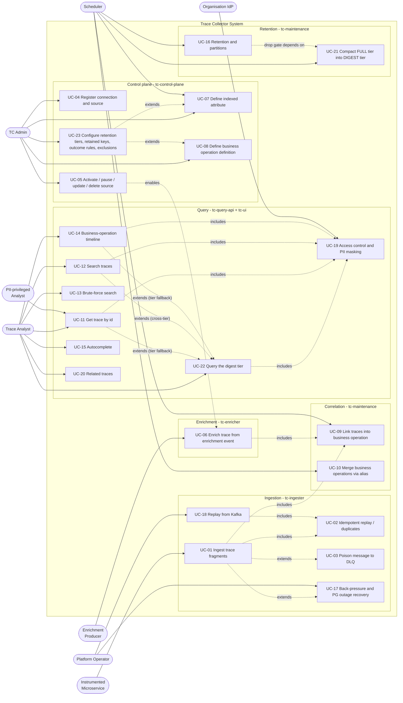

# 06 — Use Cases of the Trace Collector System (TCS)

**Related documents**

- [01 — Technology overview (Tempo, OpenTelemetry, Jaeger, ...)](01-technology-overview.md)
- [02 — High-level design (C4, ADRs)](02-high-level-design.md)
- [03 — Low-level design of the services](03-low-level-design.md)
- [04 — Storage design (PostgreSQL, capacity)](04-storage-design.md)
- [05 — Domain model](05-domain-model.md)
- **06 — Use cases (this document)**
- [07 — Sequence diagrams](07-sequence-diagrams.md)
- [08 — ER diagrams](08-er-diagrams.md)

This document specifies use cases UC-01 to UC-23. UC-21 to UC-23 cover two-tier retention (ADR-13: a FULL tier of n days, default 7, followed by a DIGEST tier of m days, default 90). Every name used here (services, components, topics, tables, endpoints) is canonical and matches 03, 04, 05, 07 and 08.

Wherever possible, one running example is used throughout: the **IdP login**.

**The IdP running example**

| Item | Value |
|---|---|
| Services | `idp-gateway`, `idp-auth-service`, `idp-otp-service`, `idp-token-service` |
| T1 = `4bf92f3577b34da6a3ce929d0e0e4736` | `POST /login/first-factor` at 2026-11-21T09:15:02.114Z. Attributes `user_id=u-42`, `client_id=bookstore-web`, `auth.factor=PASSWORD`, `idp.auth_session_id=as-777` |
| T2 = `7a3c1e9d2b4f60851c2d3e4f5a6b7c8d` | `POST /login/second-factor` at 09:15:31.502Z. Attributes `auth.factor=SMS`, `idp.auth_session_id=as-777`, `oauth.authorization_code=code-abc` |
| T3 = `c0ffee00d15ea5e0123456789abcdef0` | `POST /oauth2/token` at 09:15:33.020Z. Attributes `client_id=bookstore-web`, `oauth.authorization_code=code-abc` |
| Business operation definition `idp.login` | PRIMARY key `idp.auth_session_id` (step label `authentication`); ALIAS key `oauth.authorization_code` (step label `token-exchange`) |
| Enrichment source `sms-gateway.delivery-reports` | Topic `sms-gateway.delivery-reports` in the client cluster `sms-kafka`. Event `{"messageId":"m-1","status":"DELIVERED","provider":"smsc-1","deliveredAt":"2026-11-21T09:15:32.410Z"}` with header `traceparent: 00-7a3c1e9d2b4f60851c2d3e4f5a6b7c8d-5f3a9b2c1d0e4f68-01`, which yields `sms.delivery.status=DELIVERED` and `sms.provider=smsc-1` |
| Indexed keys | `user_id`, `client_id`, `auth.factor`, `sms.delivery.status`, plus the built-ins `service.name`, `span.name`, `status` |
| Retention tiers | `fullDataDays` = 7, `digestDays` = 90. The full tier of 2026-11-21 is compacted on 2026-11-29 (first tick after 00:00Z); its digest partitions are dropped on 2027-02-27 (age > 97 d) |
| Retained keys (digest) | `user_id` (transform `SHA256`: `u-42` → `16ec525b74b75626eb93ecad8acc749885fcf4e83c95b139342769a4ab1828a3`), `client_id`, `auth.factor`, `sms.delivery.status` (`NONE`), and `idp.auth_session_id` (`NONE`, indexed automatically when flagged, UC-23) |
| Outcome rule of `idp.login` | `{"finalStepLabel":"token-exchange"}`. Operation `0193a6f2-6c1e-7b3a-9f10-2d4c5e6f7a80` (T1, T2, T3) is digested with outcome `SUCCESS` |

---

## 1. Actors

| Actor | Kind | Description | Interacts through |
|---|---|---|---|
| **Instrumented Microservice** | System (primary for UC-01) | Any Spring Boot 4 service using `otlp-kafka-export-tracing-starter`, e.g. `idp-auth-service`. It produces fragments to `otlp-traces`. | Kafka `otlp-traces` |
| **Enrichment Producer** | External system | A client system that publishes events carrying trace context to its own topic, e.g. `sms-gateway`. It does not know TCS exists. | Client Kafka topic (e.g. `sms-gateway.delivery-reports`) |
| **TC Admin** | Human, JWT role `TC_ADMIN` | A platform engineer who configures connections, enrichment sources, indexed attributes (including "retain in digest" and its transform), business operation definitions (including the outcome rule), retention tiers and compaction exclusions. | `tc-ui` admin screens, then `tc-control-plane` `/api/v1/admin` |
| **Trace Analyst** | Human, JWT role `TC_VIEWER` | A support or SRE engineer who searches traces, opens trace details and views business operations, in the full tier (n days) and in the digest tier (up to n + m days). | `tc-ui`, then `tc-query-api` `/api/v1` |
| **PII-privileged Analyst** | Human, `TC_VIEWER` plus scope `TC_PII` | Same as Trace Analyst, but sees PERSONAL values unmasked. | same |
| **Platform Operator (SRE)** | Human | Runs replays, watches lag and DLQs, and handles PostgreSQL incidents. | `kafka-consumer-groups.sh`, kubectl, Grafana dashboards |
| **Kafka Administrator** | Human | Pre-creates topics and grants ACLs (ADR-01). | Kafka admin tooling |
| **Scheduler (time)** | System | Triggers `tc-maintenance` jobs (ShedLock-guarded): CorrelationResolver, AttributeBackfill, PartitionManager and DigestCompactor (every 5 min, lock `digest-compactor`). | `tc-maintenance` |
| **Organisation IdP** | External system | OIDC provider for UI login and JWT issuance. | OIDC Authorization Code + PKCE |
| **PostgreSQL / Kafka** | Supporting systems | Not actors of their own, but their failures trigger UC-17. | — |

---

## 2. Use-case diagram



---

## 3. Global non-functional targets

These targets assume capacity profile **M** (1 000 traces/s average, 3 000/s peak, 20 spans/trace) with the sizing from 04. Each use case below refines them.

| ID | Target |
|---|---|
| NFR-ING-1 | Sustained ingest of 20 000 spans/s, and 60 000 spans/s at peak for ≥ 30 min, with 3 × `tc-ingester` (4 vCPU each). |
| NFR-ING-2 | End-to-end visibility (span ended in producer → returned by `GET /traces/{id}`) p95 < 15 s, p99 < 30 s. Budget: BatchSpanProcessor ≤ 5 s, Kafka ≤ 1 s, poll and batch ≤ 2 s, PG transaction ≤ 2 s, replica lag ≤ 1 s, plus slack. |
| NFR-ING-3 | No loss of any record acknowledged by Kafka (at-least-once). No duplicated span rows or counters (effectively-once). |
| NFR-QRY-1 | `GET /traces/{id}` p95 < 1 s for traces ≤ 2 000 spans (p95 < 3 s up to 50 000 spans). |
| NFR-QRY-2 | `POST /traces/search` over 1 h with ≥ 1 indexed attribute predicate: p95 < 2 s. Over 24 h: p95 < 5 s. Over 7 d: p95 < 15 s. |
| NFR-QRY-3 | Autocomplete endpoints p95 < 300 ms. |
| NFR-ENR-1 | Enrichment visible p95 < 15 s after the event is produced, given an ACTIVE source with no lag. |
| NFR-COR-1 | Trace linked to its business operation p95 < 30 s after its correlation row is committed (resolver tick 10 s). |
| NFR-CFG-1 | Config change effective in all data-plane instances ≤ 30 s (poll 10 s plus container start). |
| NFR-AVL-1 | Ingest pipeline survives a PostgreSQL outage of up to 72 h (Kafka retention of `otlp-traces` is 3 days) without data loss, then drains a 1 h backlog in ≤ 45 min. |
| NFR-SEC-1 | Every API call is authenticated (JWT). PII is masked by default. All admin actions are audited. |
| NFR-RET-1 | Compaction keeps up: `tc_compaction_lag_days` < 1 (every eligible trace day is DONE within 1 day of becoming eligible). One day of profile-M data compacts in ≈ 20–40 min (**ASSUMPTION**, to be benchmarked). Uncompacted full-tier data is never dropped. |
| NFR-RET-2 | Storage is bounded by n days of full-tier data plus m days of digest data, plus 25 % headroom. Sizes for S, M and L and for m = 30 / 90 are in 04 §9. |
| NFR-QRY-4 | `POST /traces/search` entirely in the digest tier, ≤ 31 d window, with ≥ 1 retained-attribute or root-service predicate: p95 < 5 s (**ASSUMPTION**, GIN `jsonb_path_ops` on `trace_digest.attributes`, to be benchmarked). |
| NFR-QRY-5 | `GET /traces/{id}` answered from the digest tier (no hints, ≤ n + m daily partitions, PK probes): p95 < 1 s. |

---

## 4. Use-case specifications

### UC-01 — Ingest trace fragments

| Field | Value |
|---|---|
| **Primary actor** | Instrumented Microservice (indirectly via Kafka) |
| **Supporting** | Kafka `otlp-traces`, PostgreSQL primary (via PgBouncer) |
| **Trigger** | `TraceBatchListener` (`ingest.kafka`) receives a poll batch from `otlp-traces` (consumer group `tc-ingester`, batch listener, `max.poll.records` 500, `fetch.min.bytes` 1 MiB, `fetch.max.wait.ms` 200). |
| **Preconditions** | 1. Partitions for the current hour (and 3 days ahead) exist for `span`, `trace_attribute`, `trace_summary`, `span_link` and `trace_correlation` (UC-16). 2. `ConfigSnapshot` is loaded (indexed keys, correlation keys, retention). 3. The ingester is assigned ≥ 1 of the 24 partitions. |
| **Sequence** | [SD-01](07-sequence-diagrams.md#sd-01--uc-01-ingest-one-poll-batch); producer context [SD-00](07-sequence-diagrams.md#sd-00--producer-path-inside-a-microservice-context) |

**Main success scenario**

1. The container delivers `List<ConsumerRecord<String, byte[]>>` (≤ 500 records) to `TraceBatchListener` on a listener thread (virtual threads enabled).
2. For each record, `TraceMessageParser` (`ingest.parse`, Jackson 3 streaming `JsonParser`) does the following:
   - reads `schemaVersion` first; `1` is accepted;
   - parses `traceId` and checks it equals the record key;
   - streams `spans[]`, reading LONG attribute values with `getLongValue()` (never via double) and parsing epoch-nano strings with `Long.parseLong`.
3. `SpanNormalizer` (`ingest.normalize`) does the following:
   - validates ids;
   - maps `"0000000000000000"` to a NULL parent;
   - converts kind and status to codes;
   - truncates strings over 4 KiB and sets flag 0x01;
   - computes `duration_ns`;
   - rejects spans with start beyond now + 1 day (whole record poison, see UC-03);
   - drops spans older than span retention (metric `EXPIRED`).
4. `ResourceDeduplicator` computes `ResourceId` (xxHash64) for each span's resource and scope. Unknown ids are collected for insertion. `DictionaryCache` resolves `service.name` to `service.id` and `(service_id, name)` to `span_name.id`. Misses are batched and inserted with `INSERT ... ON CONFLICT DO NOTHING RETURNING`, followed by a re-select for conflicting rows. The 5 000-names-per-service guard sends overflow to `name_overflow`.
5. `TraceDayResolver` (`ingest.trace`) assigns a `trace_day` to each fragment: cache, then a `trace_summary` lookup for day-1, day and day+1 around the fragment's min start, then UTC date of the fragment's min start.
6. `AttributeIndexer` (`ingest.index`) applies `IndexedAttributeRegistry`:
   - for each span attribute and resource attribute whose key is indexed (status BACKFILLING or ACTIVE, origin scope matching), it emits candidate `trace_attribute` rows, deduplicated in memory per (trace, key, value);
   - it adds the built-ins: `service.name` (RESOURCE), the root `span.name` (DERIVED) and `status=ERROR` (DERIVED).

   `CorrelationExtractor` emits candidate `trace_correlation` rows for attributes whose key belongs to an ACTIVE business operation definition.
7. `SpanBatchWriter` (`ingest.persist`) opens **one transaction** on the primary and runs these steps:
   1. Inserts new `resource`, `instrumentation_scope`, `service`, `span_name` and `attribute_key` rows (ON CONFLICT DO NOTHING).
   2. Uses the per-connection staging table `span_stage` (`CREATE TEMP TABLE IF NOT EXISTS ... ON COMMIT DELETE ROWS`; the session-mode pool `tc_ingest` keeps it on the connection), then streams all spans of the batch with `CopyManager.copyIn("COPY span_stage FROM STDIN (FORMAT binary)")`. The staging table also has `trace_day` and the batch-local `frag_no`.
   3. Runs one **writable CTE**: `INSERT INTO tc.span SELECT ... FROM span_stage ON CONFLICT (trace_id, span_id, start_time) DO NOTHING RETURNING ...`. Its output feeds `INSERT INTO tc.trace_summary ... GROUP BY trace_id, trace_day ON CONFLICT (trace_id, trace_day) DO UPDATE` (merge semantics from 05 §4.4).
   4. Inserts `trace_attribute`, `span_link` and `trace_correlation` rows **joined to the inserted span set** (temp table `inserted_spans` from the CTE's RETURNING), so replays add nothing.
   5. `COMMIT`.
8. The listener returns normally. The container (AckMode `BATCH`) commits the offsets of the batch to Kafka.
9. After commit, `TraceFragmentIngested` events update metrics and put `traceId -> trace_day` into the `TraceDayResolver` cache.

**Alternative and exception flows**

- **1a. Empty poll.** Nothing happens. The container polls again.
- **2a. Unknown `schemaVersion`, malformed JSON, or traceId ≠ key.** Handled by UC-03 (record-level poison).
- **3a. Span start beyond now + 1 day.** The record goes to the DLQ with reason `FUTURE_TIMESTAMP` (UC-03).
- **3b. All spans of a record are older than retention.** The fragment yields no rows and is still acked. Metric `tc_ingester_spans_dropped_total{reason="EXPIRED"}`.
- **3c. The trace has reached 50 000 spans.** Further spans are dropped with metric reason `TRACE_TOO_LARGE`, and the summary is not affected.
- **4a. A service exceeds 5 000 span names.** `name_id = NULL` and `name_overflow = name`. A warning metric is labelled with the service.
- **7a. A duplicate span (same PK) is already stored.** `ON CONFLICT DO NOTHING` skips it, and the summary and indexes ignore it (UC-02).
- **7b. A partition is missing** (e.g. PartitionManager has been down for more than 3 days). The INSERT fails with "no partition of relation found". This is treated as a DB outage (UC-17) with alert `TcPartitionMissing`. **No default partition** exists by design.
- **7c. PostgreSQL is unavailable, or the statement times out.** UC-17.
- **7d. Serialization or deadlock error** (rare: two instances during a rebalance updating the same `trace_summary` row). The whole batch is retried by `DefaultErrorHandler` and succeeds idempotently.

**Postconditions**

- Every span of the batch that is within retention and not previously stored is in `span` exactly once.
- `trace_summary` reflects all spans of the trace stored so far.
- Indexed attributes, links and correlation observations are stored.
- Kafka offsets are committed only after PostgreSQL commit.

**Business rules**

- BR-01-1: One PG transaction per poll batch. Offsets are committed after the DB commit (ADR-02).
- BR-01-2: Spans are immutable. There is no UPDATE on `span`.
- BR-01-3: `trace_summary` counters are derived only from actually-inserted spans.
- BR-01-4: Only registered keys are indexed (ADR-05). There is no GIN on `span.attributes`.
- BR-01-5: Self-traces from `tc-*` services are dropped (ADR-12).

**NFRs**

- NFR-ING-1 and NFR-ING-2.
- Batch transaction p99 < 2 s at 500 records / ~10 000 spans.
- Ingester CPU ≤ 70 % at average load.
- Consumer lag alert when > 60 s for 5 min.

---

### UC-02 — Idempotent replay and duplicate fragments

| Field | Value |
|---|---|
| **Primary actor** | Kafka consumer group mechanics (re-delivery); Platform Operator (deliberate replay, UC-18) |
| **Trigger** | The same Kafka records are delivered again. Causes: (a) crash or rebalance after the PG commit but before the offset commit; (b) an operator offset reset; (c) a producer re-send that produces a duplicate record with different offsets. |
| **Preconditions** | The spans were stored earlier by UC-01. |
| **Sequence** | [SD-02](07-sequence-diagrams.md#sd-02--uc-02-replay-after-a-crash-between-pg-commit-and-offset-commit) |

**Main success scenario**

1. Instance `tc-ingester-1` commits the PG transaction for batch B (offsets 1 000–1 499 of partition 7) and crashes before `commitSync`.
2. The group coordinator detects the missing heartbeat (`session.timeout.ms` 45 s) and assigns partition 7 to `tc-ingester-2`.
3. `tc-ingester-2` starts from the last committed offset (1 000) and receives the same records again.
4. Parsing and normalisation produce identical spans, because the input bytes are the same.
5. `TraceDayResolver` misses its cache (new instance), finds the existing `trace_summary` row (day-1, day or day+1 of the fragment start), and returns the **same** `trace_day`.
6. `SpanBatchWriter` runs `INSERT ... ON CONFLICT DO NOTHING RETURNING`, which returns 0 rows for these spans. The summary upsert gets an empty input. `trace_attribute`, `span_link` and `trace_correlation` get no rows, because they are joined to the inserted set.
7. The transaction commits (no-op) and the offsets are committed.
8. Metric `tc_ingester_spans_duplicate_total` increases by the number of skipped spans.

**Alternative and exception flows**

- **5a. The original trace_day was outside d-1..d+1** (a very late duplicate). A new `trace_day` would be computed. The span PK conflict still prevents duplicate spans (the PK has no `trace_day`). Because zero spans are inserted, **no** second summary row is created.
- **6a. A partial overlap**: some spans of the fragment are new (the producer re-sent a batch with extra spans). Only the new ones are inserted and counted.
- **c. The producer re-sends with a different start time for the same span id** (should not happen in OTel). The PK `(trace_id, span_id, start_time)` treats it as a different row, which shows up as a duplicate in the UI. `tc-query-api` deduplicates by `span_id` when reading, keeping the earliest `start_time`, and sets `"duplicateSpanIds": [...]` in the response.

**Postconditions**

- Database state is identical to the state before the replay (apart from `last_ingested_at`, which is not touched because no span was inserted).

**Business rules**

- BR-02-1: Every derived row (summary delta, attribute, link, correlation) is computed from the RETURNING set of the span insert.
- BR-02-2: `trace_enrichment` has its own idempotency key (UC-06).
- BR-02-3: `trace_attribute` is not unique. Rare duplicates (two instances during a rebalance) are tolerated and removed by `DISTINCT` at query time.

**NFRs**

- Replay throughput is the same as UC-01, since conflicts are cheap (index probe, no heap write).
- A full 3-day replay at profile M takes ≈ 26 h at 60 000 spans/s (5.2 B spans / 60 k).

---

### UC-03 — Poison message to DLQ

| Field | Value |
|---|---|
| **Primary actor** | `tc-ingester` (system) |
| **Trigger** | A record in the batch cannot be turned into a valid `TraceFragment`. |
| **Preconditions** | Topic `otlp-traces.dlq` exists (6 partitions, 14 days). The ingester principal has WRITE on it. |
| **Sequence** | [SD-03](07-sequence-diagrams.md#sd-03--uc-03-poison-record-to-otlp-tracesdlq) |

**Main success scenario**

1. `TraceBatchListener` parses records 0..n-1 of a batch. Record *i* (partition 3, offset 88 412) fails with `TraceMessageParseException(reason = MALFORMED_JSON)`.
2. The listener **first persists records 0..i-1** in one PG transaction via `SpanBatchWriter`, exactly as in UC-01, and commits. This matters: `DefaultErrorHandler` commits the offsets of the records before the failed index, so their data must already be durable.
3. The listener throws `BatchListenerFailedException("poison", cause, i)`.
4. `DefaultErrorHandler` commits offsets up to *i-1*. It classifies the cause as **not retryable** (`addNotRetryableExceptions(TraceMessageParseException.class, UnsupportedSchemaVersionException.class, FragmentRejectedException.class)`) and calls the recoverer immediately.
5. `DeadLetterPublishingRecoverer`, with a custom destination resolver, publishes the original key and value bytes to `otlp-traces.dlq` with partition `-1`. Headers: `kafka_dlt-original-topic/partition/offset/timestamp`, `kafka_dlt-exception-fqcn`, `kafka_dlt-exception-message` (≤ 1 KiB, no payload), and `tc-error-reason=MALFORMED_JSON`.
6. After the DLQ send is acknowledged, the error handler commits offset *i* and seeks the remaining records *i+1..n-1*, which are re-polled and processed by UC-01.
7. Metric `tc_ingester_dlq_total{reason}` increases. Alert `TcIngesterDlqRate` fires if the rate exceeds 1/s for 5 min.

**Alternative and exception flows**

- **1a. Reasons:**
  - `MALFORMED_JSON`;
  - `UNSUPPORTED_SCHEMA_VERSION` (e.g. a producer already on v2 before TCS supports it);
  - `INVALID_TRACE_ID` / `INVALID_SPAN_ID`;
  - `TRACE_ID_MISMATCH` (body traceId ≠ key, or ≠ `spanContext.traceId`);
  - `FUTURE_TIMESTAMP` (start > now + 1 day);
  - `FRAGMENT_TOO_LARGE` (> 8 MiB);
  - `INVALID_ATTRIBUTE_TYPE` (unknown OTel type name).
- **5a. The DLQ publish fails** (DLQ topic unavailable). The recoverer throws, and the error handler retries delivery with the configured back-off. The offset of *i* is **not** committed, so the record is never lost.
- **2a. The DB is unavailable while persisting 0..i-1.** UC-17 applies first. The poison record is handled after recovery.
- **Re-drive.** After a fix (e.g. v2 parser deployed), an operator re-drives DLQ records (UC-18, DLQ re-drive mode).

**Postconditions**

- The poison record is preserved byte-for-byte in `otlp-traces.dlq` for 14 days.
- All other records of the batch are processed.
- The partition is not blocked.

**Business rules**

- BR-03-1: The DLQ topic is pre-created. TCS never creates `otlp-traces-dlt` (Spring's default name). The destination resolver is mandatory.
- BR-03-2: Exception messages in headers must not contain attribute values (PII).
- BR-03-3: Per-span problems that are not structural (expired span, oversize trace, truncated string) never send a record to the DLQ. They are dropped or flagged with metrics.

**NFRs**

- A poison record delays its partition by < 1 s.
- The DLQ is monitored, and its lag and size are shown on the dashboard.

---

### UC-04 — Register Kafka connection and enrichment source (with preview and dry-run)

| Field | Value |
|---|---|
| **Primary actor** | TC Admin |
| **Trigger** | A client team asks to enrich traces with events from their topic. Example: `sms-gateway.delivery-reports`. |
| **Preconditions** | 1. Admin has `TC_ADMIN`. 2. The Kafka Administrator of the client cluster has granted the TCS principal READ + DESCRIBE on the topic and READ on group `tc-enricher.sms-gateway.delivery-reports`. 3. The credentials are stored in Vault at `vault:secret/tcs/kafka/sms-kafka`. |
| **Sequence** | [SD-05](07-sequence-diagrams.md#sd-05--uc-04-register-connection-and-source-with-preview-and-dry-run) |

**Main success scenario**

1. Admin opens *Admin → Kafka connections → New* in `tc-ui` and submits the form:

```http
POST /api/v1/admin/kafka-connections
Content-Type: application/json
Authorization: Bearer <JWT with TC_ADMIN>

{
  "name": "sms-kafka",
  "bootstrapServers": "sms-kafka-1.corp:9093,sms-kafka-2.corp:9093,sms-kafka-3.corp:9093",
  "securityProtocol": "SASL_SSL",
  "saslMechanism": "SCRAM_SHA_512",
  "credentialsSecretRef": "vault:secret/tcs/kafka/sms-kafka#jaas",
  "truststoreSecretRef": "k8s:tcs-truststores/sms-kafka-ca.p12",
  "clientProperties": { "client.dns.lookup": "use_all_dns_ips", "request.timeout.ms": "30000" }
}
```

2. `tc-control-plane` validates the request with the `KafkaConnection` invariants (forbidden client properties, and SASL requires a mechanism and credentials). It resolves the secrets through `SecretResolver` and runs a **connectivity check**: `AdminClient.describeCluster()` with a 10 s timeout. It then inserts `kafka_connection`, bumps `config_revision`, and returns:

```json
HTTP/1.1 201 Created
{
  "id": 3,
  "name": "sms-kafka",
  "bootstrapServers": "sms-kafka-1.corp:9093,sms-kafka-2.corp:9093,sms-kafka-3.corp:9093",
  "securityProtocol": "SASL_SSL",
  "saslMechanism": "SCRAM_SHA_512",
  "credentialsSecretRef": "vault:secret/tcs/kafka/sms-kafka#jaas",
  "truststoreSecretRef": "k8s:tcs-truststores/sms-kafka-ca.p12",
  "connectivity": { "ok": true, "clusterId": "q7Kd0dXcR6m7cH2kO0rS1A", "brokers": 3, "checkedAt": "2026-11-21T08:58:11Z" }
}
```

3. Admin creates the source in DRAFT:

```http
POST /api/v1/admin/enrichment-sources
{
  "name": "sms-gateway.delivery-reports",
  "connectionId": 3,
  "topic": "sms-gateway.delivery-reports",
  "definition": {
    "payloadFormat": "JSON",
    "traceContext": { "strategy": "TRACEPARENT_HEADER", "headerName": "traceparent" },
    "scope": "SPAN",
    "filter": { "jsonPointer": "/status", "equals": null },
    "startFrom": "LATEST",
    "onMissingTraceContext": "DLQ",
    "fieldMappings": [
      { "source": "PAYLOAD", "jsonPointer": "/status",   "targetKey": "sms.delivery.status", "valueType": "STRING", "transform": "UPPERCASE", "required": true },
      { "source": "PAYLOAD", "jsonPointer": "/provider", "targetKey": "sms.provider",        "valueType": "STRING", "transform": "NONE",      "required": false },
      { "source": "PAYLOAD", "jsonPointer": "/messageId","targetKey": "sms.message_id",      "valueType": "STRING", "transform": "NONE",      "required": false },
      { "source": "RECORD_TIMESTAMP",                    "targetKey": "sms.delivery.reported_at_ms", "valueType": "LONG", "transform": "NONE", "required": false }
    ]
  }
}
```

   `filter.equals = null` means "pointer must exist". A non-null value means string equality.

4. `tc-control-plane` validates the `EnrichmentSourceDefinition` invariants:
   - 1..64 mappings;
   - unique target keys;
   - SPAN scope requires TRACEPARENT_HEADER;
   - valid JSON Pointers;
   - transform and type compatibility;
   - no reserved or built-in target key.

   It then:
   - checks topic existence with `AdminClient.describeTopics(["sms-gateway.delivery-reports"])` (DESCRIBE only, no creation);
   - registers the target keys in `attribute_key`;
   - inserts `enrichment_source` (status DRAFT, `current_revision = 1`) and `enrichment_source_revision(1)`;
   - bumps `config_revision`.

   Response: `201` with `{"id": 12, "status": "DRAFT", "currentRevision": 1, "consumerGroup": "tc-enricher.sms-gateway.delivery-reports", "topicPartitions": 6}`.
5. Admin clicks **Preview**:

```http
POST /api/v1/admin/enrichment-sources/12/preview?limit=5
{ "perPartition": true, "timeoutMs": 5000 }
```

   `tc-control-plane` creates a short-lived `KafkaConsumer` **without `group.id`** and with `enable.auto.commit=false` and `allow.auto.create.topics=false`. It calls `assign()` on all partitions, `seek(endOffset - 5)` on each, polls up to 5 s, and runs every record through the **same** extraction pipeline as `tc-enricher` (the shared `tc-kafka-support` classes `TraceContextExtractor` and `FieldExtractor`) **without writing anything**.

```json
HTTP/1.1 200 OK
{
  "sourceId": 12, "revision": 1, "recordsRead": 5,
  "records": [
    {
      "partition": 2, "offset": 551023, "timestamp": "2026-11-21T09:15:32.455Z",
      "headers": { "traceparent": "00-7a3c1e9d2b4f60851c2d3e4f5a6b7c8d-5f3a9b2c1d0e4f68-01" },
      "payload": { "messageId": "m-1", "status": "DELIVERED", "provider": "smsc-1", "deliveredAt": "2026-11-21T09:15:32.410Z" },
      "traceContext": { "traceId": "7a3c1e9d2b4f60851c2d3e4f5a6b7c8d", "spanId": "5f3a9b2c1d0e4f68", "ok": true },
      "attributes": {
        "sms.delivery.status": "DELIVERED",
        "sms.provider": "smsc-1",
        "sms.message_id": "m-1",
        "sms.delivery.reported_at_ms": 1795252532455
      },
      "traceFound": true,
      "warnings": []
    }
  ],
  "summary": { "ok": 4, "noTraceContext": 1, "requiredMissing": 0, "filteredOut": 0 }
}
```

   `traceFound` is a lookup of `trace_summary` on the read replica for today/yesterday. Payloads are shown only to `TC_ADMIN` users with `TC_PII`. Otherwise PII-classified fields are masked.
6. Admin runs a **dry-run** with a hand-crafted sample (e.g. a malformed one):

```http
POST /api/v1/admin/enrichment-sources/12/test
{
  "headers": { "traceparent": "00-7a3c1e9d2b4f60851c2d3e4f5a6b7c8d-5f3a9b2c1d0e4f68-01" },
  "key": "m-1",
  "timestamp": "2026-11-21T09:15:32.455Z",
  "payload": { "messageId": "m-1", "status": "delivered" }
}
```

```json
HTTP/1.1 200 OK
{
  "traceContext": { "strategy": "TRACEPARENT_HEADER", "traceId": "7a3c1e9d2b4f60851c2d3e4f5a6b7c8d", "spanId": "5f3a9b2c1d0e4f68", "ok": true },
  "filter": { "matched": true },
  "attributes": { "sms.delivery.status": "DELIVERED", "sms.delivery.reported_at_ms": 1795252532455, "sms.message_id": "m-1" },
  "missingOptional": ["sms.provider"],
  "errors": [],
  "wouldWrite": { "trace_enrichment": 3, "trace_attribute": 1, "trace_correlation": 0 },
  "outcome": "ENRICH"
}
```

7. Admin proceeds to activation (UC-05).

**Alternative and exception flows**

- **2a. Connectivity check fails** (auth, TLS or DNS). The connection is still saved but marked `connectivity.ok=false`, with error class and message (never secret material). The UI warns, and activation of sources on this connection is refused until a re-check succeeds (`POST /kafka-connections/{id}/test`).
- **4a. The topic does not exist, or DESCRIBE is denied.** `422 TOPIC_NOT_ACCESSIBLE`. TCS never creates it.
- **4b. Invalid definition.** `400` with a list of `{path, code, message}` (e.g. `{"path":"/definition/scope","code":"SPAN_SCOPE_REQUIRES_TRACEPARENT"}`).
- **4c. Name already used** (including by a DELETED source). `409 NAME_TAKEN`.
- **5a. The topic is empty, or timeout.** `records: []` with `summary.recordsRead = 0`.
- **5b. The client cluster denies READ.** `403 TOPIC_READ_DENIED` with a hint about the required ACLs.
- **6a. A required field is missing.** `outcome: "DLQ"`, `errors: [{"mapping":"sms.delivery.status","code":"REQUIRED_FIELD_MISSING"}]`.

**Postconditions**

- The connection and source (DRAFT, revision 1) exist.
- `config_revision` has been incremented. Nothing is consumed yet.
- No consumer-group offsets exist in the client cluster, because preview uses no group.

**Business rules**

- BR-04-1: Secrets are referenced, never stored.
- BR-04-2: Preview and test never write to PostgreSQL data tables and never commit offsets.
- BR-04-3: The topic and connection of a source are immutable (05 §4.7.2).
- BR-04-4: Enrichment target keys are auto-registered in `attribute_key`. Admins decide separately whether to index them (UC-07), e.g. `sms.delivery.status`.

**NFRs**

- Preview p95 < 6 s (bounded by `timeoutMs`).
- Dry-run p95 < 200 ms.
- Control-plane writes p95 < 300 ms.

---

### UC-05 — Activate, pause, update or delete an enrichment source

| Field | Value |
|---|---|
| **Primary actor** | TC Admin |
| **Trigger** | `POST /api/v1/admin/enrichment-sources/{id}/activate`, `POST .../{id}/pause`, `PUT .../{id}` (new revision), or `DELETE .../{id}` |
| **Preconditions** | The source exists. The connection check is OK (for activate). |
| **Sequence** | [SD-06](07-sequence-diagrams.md#sd-06--uc-05-source-lifecycle-to-container-start-stop) |

**Main success scenario (activate)**

1. Admin clicks *Activate* on `sms-gateway.delivery-reports` (id 12).
2. `tc-control-plane` re-validates the preconditions: the connection is reachable, the topic is describable, and the revision exists. In one transaction it:
   - runs `UPDATE enrichment_source SET status='ACTIVE', updated_at=now() WHERE id=12 AND status IN ('DRAFT','PAUSED')`, using an optimistic check on `updated_at` from the `If-Match` header;
   - runs `UPDATE config_revision SET revision = revision + 1, updated_at = now() WHERE id = 1`;
   - commits;
   - emits `EnrichmentSourceActivated`, which writes an audit log line.
3. Within ≤ 10 s, `EnrichmentSourceRegistry` (`enrich.registry`) in each `tc-enricher` instance polls `SELECT revision FROM config_revision`. It sees a change and loads a new snapshot: all ACTIVE sources with their current revision definitions and connections, plus indexed keys and correlation keys.
4. The registry diffs the desired state `{12 → r1}` against the running state `{}` and gets "start 12/r1".
5. `DynamicContainerManager` (`enrich.kafka`) does the following:
   - builds or reuses a `DefaultKafkaConsumerFactory` for connection 3, with secrets from `SecretResolver`, `group.id = tc-enricher.sms-gateway.delivery-reports`, `auto.offset.reset = latest` (from `startFrom`), `enable.auto.commit=false` and `allow.auto.create.topics=false`;
   - creates a `ConcurrentMessageListenerContainer` (concurrency = min(topic partitions, 3)) with a batch listener bound to an `EnrichmentPipeline` for revision 1;
   - sets the container's bean name to `enrichment-source-12-r1`;
   - sets the `DefaultErrorHandler` with the DLQ recoverer to `tc-enrichment.dlq`;
   - calls `start()`.
6. Kafka assigns the topic's 6 partitions across the instances (two `tc-enricher` instances × 3 consumers).
7. Metric `tc_enricher_source_state{source="sms-gateway.delivery-reports",state="RUNNING"} = 1`. The UI shows status ACTIVE and "running on 2/2 instances". This comes from a heartbeat endpoint, `GET /api/v1/admin/enrichment-sources/12/runtime` (a proposed extension, not yet listed in 03 §5.3), which control-plane aggregates from the enricher actuator endpoints.

**Alternative flows**

- **Pause.**
  - Status becomes PAUSED and `config_revision` is bumped.
  - The registry diff gives "stop 12": `container.stop()`, waits for the in-flight batch to commit, then `unregisterListenerContainer` if the registry was used. Note: unregister alone does not stop the container.
  - Offsets stay committed in the client cluster, so on resume consumption continues where it left off.
- **Update (PUT definition).**
  - Inserts `enrichment_source_revision(2)`, sets `current_revision = 2` and bumps `config_revision`.
  - For an ACTIVE source the diff gives "restart 12: r1 → r2": stop `enrichment-source-12-r1`, then start `enrichment-source-12-r2`.
  - The consumer group is the same, so there is no gap and no re-read beyond the uncommitted batch.
  - New records are stamped `source_revision = 2`. Already stored enrichments are **not** re-computed (no retroactive reprocessing). To re-process history, the operator resets the group offsets to an earlier time (UC-18 for enrichment).
- **Delete.**
  - Allowed only from PAUSED or DRAFT (`409 SOURCE_ACTIVE` otherwise). Status becomes DELETED.
  - The container is already stopped. Data remains until retention.
  - The admin may delete the consumer group in the client cluster manually.
- **5a. Container start fails** (authentication error, topic deleted by the client).
  - The registry marks runtime state `FAILED` with the error, retries with back-off (1 min, up to 10 min), and raises alert `TcEnricherSourceFailed`.
  - The DB status stays ACTIVE (desired state). The UI shows "ACTIVE (failing)".
- **3a. An enricher instance starts later** (scale-out). Its first snapshot load starts all ACTIVE sources, and Kafka rebalances.

**Postconditions**

- Every `tc-enricher` instance runs exactly one container per ACTIVE source, at the source's current revision.

**Business rules**

- BR-05-1: Desired state lives in the DB. Runtime converges to it by diffing. The process is level-triggered, not edge-triggered.
- BR-05-2: Each status or revision change is atomic with the `config_revision` bump.
- BR-05-3: Consumer group naming is `tc-enricher.<sourceName>` (no other groups).

**NFRs**

- NFR-CFG-1 (≤ 30 s to effect).
- Restart on revision change causes < 5 s processing pause per source.

---

### UC-06 — Enrich trace from an enrichment event (event before or after spans)

| Field | Value |
|---|---|
| **Primary actor** | Enrichment Producer (`sms-gateway`) |
| **Trigger** | A record appears on an ACTIVE source's topic, e.g. the SMS delivery report for T2. |
| **Preconditions** | Source 12 is ACTIVE with revision r1 (or later). Partitions of `trace_enrichment`, `trace_attribute` and `trace_correlation` exist. |
| **Sequence** | [SD-07](07-sequence-diagrams.md#sd-07--uc-06-enrichment-event-arrives-before-the-spans) (event before spans), [SD-08](07-sequence-diagrams.md#sd-08--uc-06-enrichment-event-arrives-after-the-spans) (event after spans) |

**Main success scenario**

1. The source's container delivers a batch of records to the `EnrichmentPipeline` (r1).
2. `PayloadDecoder` (JSON) parses the value into a Jackson `JsonNode`. If a `filter` is defined, `node.at("/status")` must be present (or equal the configured value). Otherwise the record is skipped (metric `filteredOut`) and acked.
3. `TraceContextExtractor` (`enrich.extract`, strategy TRACEPARENT_HEADER) reads `headers().lastHeader("traceparent")`: `00-7a3c1e9d2b4f60851c2d3e4f5a6b7c8d-5f3a9b2c1d0e4f68-01`. It validates the version (`00`, not `ff`), the 32-hex non-zero trace id and the 16-hex non-zero parent id. Result: `TraceId T2`, `SpanId 5f3a9b2c1d0e4f68`. Because scope is SPAN, `span_id` is kept.
4. `FieldExtractor` evaluates each `FieldMapping`:
   - `/status` → `"DELIVERED"` → UPPERCASE → `sms.delivery.status=DELIVERED`;
   - `/provider` → `sms.provider=smsc-1`;
   - `/messageId` → `sms.message_id=m-1`;
   - record timestamp → `sms.delivery.reported_at_ms=1795252532455`.

   Values are coerced to `valueType`. A STRING over 4 KiB is truncated.
5. `EnrichmentWriter` (`enrich.persist`), in one PG transaction per batch:
   1. `INSERT INTO tc.trace_enrichment (observed_at, trace_id, span_id, source_id, source_revision, key_id, value, kafka_partition, kafka_offset) ... ON CONFLICT (source_id, kafka_partition, kafka_offset, key_id, observed_at) DO NOTHING RETURNING trace_id, key_id, value, observed_at`.
   2. For returned rows whose key is indexed with origin scope ANY or ENRICHMENT (here `sms.delivery.status`): `INSERT INTO tc.trace_attribute (ts = observed_at, key_id, value_str = 'DELIVERED', value_num = NULL, trace_id = T2, origin = 3)`.
   3. For returned rows whose key is a correlation key: `INSERT INTO tc.trace_correlation (observed_at, operation_definition_id, correlation_key_id, value, trace_id, origin = 3)`. There is none in this example.
   4. `COMMIT`. Then the container commits the offsets in the client cluster.
6. **Case A, the event arrives before the spans of T2** (e.g. the SMS gateway is faster than the IdP's BatchSpanProcessor). Nothing special happens: the rows are keyed by `trace_id` only. When UC-01 later stores T2's spans and summary, `GET /traces/{T2}` joins `trace_enrichment` by `trace_id` and shows the enrichment. Search on `sms.delivery.status=DELIVERED` finds T2 as soon as its `trace_summary` row exists, because search joins `trace_attribute` to `trace_summary`.
7. **Case B, the event arrives after the spans.** The enrichment is visible on the next read. Nothing in `span` or `trace_summary` changes.

**Alternative and exception flows**

- **3a. No `traceparent` header**, or it is malformed:
  - `onMissingTraceContext = DLQ`: publish to `tc-enrichment.dlq` with headers `tc-source-id=12` and `tc-error=NO_TRACE_CONTEXT`;
  - `DROP`: count `tc_enricher_records_total{outcome="no_trace_context"}` and ack.
- **2a. Payload is not JSON.** `PAYLOAD_DECODE_ERROR` goes to the DLQ (non-retryable).
- **4a. A required mapping yields no value.** `REQUIRED_FIELD_MISSING` goes to the DLQ. Optional mappings that yield nothing are skipped.
- **4b. Type coercion fails** (e.g. `"abc"` for LONG). `VALUE_TYPE_MISMATCH`. The DLQ is used if the mapping is required. Otherwise the field is skipped and a warning metric is recorded.
- **5a. Replay or rebalance re-delivers the record.** `ON CONFLICT DO NOTHING` returns nothing, so no duplicate attribute or correlation rows are written.
- **5b. PG unavailable.** Same back-pressure as UC-17. The container stays assigned and its lag grows in the client cluster.
- **6a. The spans never arrive.** The enrichment stays orphaned until retention. `GET /traces/{id}` returns `404` with `"enrichmentOnly": true`.
- **Late event older than `trace_enrichment` retention** (`observed_at` < now − n days, default 7 d, e.g. an EARLIEST start on an old topic). The row is skipped with metric `EXPIRED`, because no partition exists for it.

**Postconditions**

- Enrichment values are stored append-only with source and revision lineage.
- The indexed values are searchable.
- Spans are untouched.

**Business rules**

- BR-06-1: Enrichment never mutates spans (05 §7.1).
- BR-06-2: Order independence. No pending queue and no expiry window.
- BR-06-3: Idempotency key `(source_id, kafka_partition, kafka_offset, key_id, observed_at)`.
- BR-06-4: If the same key also exists as a span attribute, both are kept with their origin, and the UI shows both (05 §7.2).

**NFRs**

- NFR-ENR-1.
- Throughput ≥ 5 000 events/s per `tc-enricher` instance (2 vCPU) for flat JSON payloads of < 2 KiB.

---

### UC-07 — Define an indexed attribute (with backfill)

| Field | Value |
|---|---|
| **Primary actor** | TC Admin |
| **Supporting** | Scheduler: `tc-maintenance` AttributeBackfill |
| **Trigger** | Analysts need to search by a key that is not yet indexed, e.g. `auth.factor`. |
| **Preconditions** | The key is not indexed, or is DISABLED. |
| **Sequence** | [SD-09](07-sequence-diagrams.md#sd-09--uc-07-define-indexed-attribute-and-backfill); retained-key variant in [SD-23](07-sequence-diagrams.md#sd-23--uc-23-configure-retention-tiers-retained-attribute-and-outcome-rule) |

**Main success scenario**

1. Admin submits:

```http
POST /api/v1/admin/indexed-attributes
{ "key": "auth.factor", "originScope": "SPAN", "numeric": false, "backfillWindow": "P1D",
  "retainInDigest": true, "digestTransform": "NONE" }
```

   `retainInDigest` (default `false`) and `digestTransform` (`NONE`, `SHA256` or `MASK`, default `NONE`) are optional (ADR-13). They control whether the key's values are copied into `trace_digest.attributes` when its trace day is compacted (UC-21).

2. `tc-control-plane` upserts `attribute_key('auth.factor', 'STRING')` and inserts `indexed_attribute(key_id, origin_scope='SPAN', numeric=false, status='BACKFILLING', indexed_since=now(), retain_in_digest=true, digest_transform='NONE', created_by)`. It bumps `config_revision` and returns `201 {"key":"auth.factor","status":"BACKFILLING","indexedSince":"2026-11-21T10:00:00Z","retainInDigest":true,"digestTransform":"NONE"}`.
3. Within ≤ 10 s, `ConfigSnapshotPoller` in every `tc-ingester` and `EnrichmentSourceRegistry` in every `tc-enricher` reload the snapshot. From now on new spans with `auth.factor` produce `trace_attribute` rows.
4. `AttributeBackfill` in `tc-maintenance` (ShedLock lock `attribute-backfill`, runs every minute) picks up keys in BACKFILLING. For each hourly `span` partition from `indexed_since + 30 s` backwards to `indexed_since - backfillWindow` (newest first, so recent searches benefit first) it does the following:
   - reads from the **read replica**: `SELECT trace_id, start_time, attributes->'auth.factor' FROM tc.span_pYYYYMMDDHH WHERE attributes ? 'auth.factor'`, a sequential scan of one partition;
   - deduplicates per (trace, value);
   - writes to the primary through `COPY` into `trace_attribute` (origin 1), in chunks of 50 000 rows, one transaction per chunk;
   - records progress (`backfill_cursor`, see note) after each partition;
   - throttles to `tc.backfill.max-mb-per-second` (default 100 MB/s of scanned heap).
5. When the window is covered, `IndexedAttribute.backfillCompleted()` runs: `UPDATE indexed_attribute SET status='ACTIVE'`, `config_revision` is bumped, and `IndexedAttributeActivated` is emitted.
6. Search on `auth.factor` with `from ≥ indexed_since − backfillWindow` returns complete results. Older windows return `partialIndex: true` (UC-12).

**Alternative and exception flows**

- **1a. `originScope = ENRICHMENT`.** Backfill scans `trace_enrichment` partitions (`WHERE key_id = ?`) instead of `span`. This is cheap.
- **1b. `originScope = RESOURCE`.** Backfill first finds `resource.id`s that carry the key (small table), then scans span partitions filtered by `resource_id = ANY(?)`. It is still a sequential scan, but with cheaper rows.
- **1c. `numeric = true`.** `value_num` is filled for LONG and DOUBLE values (and parseable strings). Range operators (GT/GTE/LT/LTE) become available.
- **1d. `backfillWindow = "PT0S"`.** No backfill. Status becomes ACTIVE immediately, and older windows remain `partialIndex`.
- **4a. A `tc-maintenance` leader failover mid-backfill.** The new leader resumes from `backfill_cursor`. Duplicates from the partially written partition are tolerated (deduplicated at query time).
- **4b. Disable during backfill.** `PATCH /indexed-attributes/{keyId}` with `{"status":"DISABLED"}` (03 §5.3) sets DISABLED. Backfill stops at the next partition boundary.
- **Cardinality guard.** If more than 5 M distinct values per day are observed for the key (sampled by the ingester), a warning is shown. Indexing user-unique ids is fine; indexing request ids at 1 000/s would create 86 M rows/day.
- **1e. Retain an already indexed key.** `PATCH /indexed-attributes/{keyId}` with `{"retainInDigest":true,"digestTransform":"SHA256"}` (UC-23). No backfill is needed: compaction reads `trace_attribute`, which already holds the key. Takes effect for trace days not yet DONE (not retroactive).
- **1f. PERSONAL key retained with `NONE`.** Refused with `400 PERSONAL_DATA_RETAINED_IN_CLEAR` unless the request sets `acknowledgePii = true` ("the raw value is kept n + m days; consider SHA256"). A SECRET key retained with `NONE` is always refused with `400 SECRET_RETAINED_IN_CLEAR` (05 §7.3).
- **4c. Disable a retained key.** `DISABLED` also clears `retain_in_digest` (05 §4.9): without `trace_attribute` rows there is nothing to copy. Digest rows already written keep the key until their partition is dropped.

**Postconditions**

- The key is ACTIVE and searchable over the backfilled window and all new data.

**Business rules**

- BR-07-1: Built-in keys cannot be disabled.
- BR-07-2: No index DDL is ever needed. Indexing a key means adding rows, never altering tables.
- BR-07-3: The backfill window is bounded by `trace_attribute` retention (n = 7 d, FULL tier). Backfill never writes to the digest tier; compacted days are not re-compacted.
- BR-07-4: A retained key must be indexed. Keys that are not retained are lost after n days (ADR-13 trade-off).

**NFRs**

- New data is indexed ≤ 10 s after the request.
- Backfill of 24 h at profile M scans ≈ 0.9 TB of span heap. At 100 MB/s throttle that is ≈ 2.5 h. This is documented and shown as a progress bar.

**Note.** Backfill progress is persisted in a column `indexed_attribute.backfill_cursor timestamptz`, added to the brief's `indexed_attribute` table as a pure addition. Without it, a leader failover would restart the backfill.

---

### UC-08 — Define a business operation definition

| Field | Value |
|---|---|
| **Primary actor** | TC Admin |
| **Trigger** | Business wants IdP logins (first factor, second factor, token exchange) grouped into one operation. |
| **Preconditions** | The keys exist or will be auto-registered in `attribute_key`. |
| **Sequence** | Control-plane write and propagation as in [SD-06](07-sequence-diagrams.md#sd-06--uc-05-source-lifecycle-to-container-start-stop). Runtime effect in [SD-10](07-sequence-diagrams.md#sd-10--uc-09-idp-login-t1-t2-t3-linked-into-one-business-operation). |

**Main success scenario**

1. Admin submits:

```http
POST /api/v1/admin/business-operation-definitions
{
  "name": "idp.login",
  "description": "One end-user login at the IdP: password, second factor, code-to-token exchange",
  "mergeWindow": "PT24H",
  "keys": [
    { "key": "idp.auth_session_id",      "role": "PRIMARY", "stepLabel": "authentication" },
    { "key": "oauth.authorization_code", "role": "ALIAS",   "stepLabel": "token-exchange" }
  ],
  "outcomeRule": { "finalStepLabel": "token-exchange" }
}
```

   `outcomeRule` is optional (ADR-13). It decides the outcome stored in `business_operation_digest` when the operation is compacted (UC-21). Full form: `{"outcomeKey":"business.outcome","successValues":["SUCCESS"],"failureValues":["FAILED","DENIED"],"finalStepLabel":"token-exchange"}`; evaluation order in 05 §4.10.1.

2. `tc-control-plane` validates the `BusinessOperationDefinition` invariants:
   - name pattern;
   - ≥ 1 PRIMARY key;
   - unique keys;
   - merge window in [1 min, 30 d], and shorter than `fullDataDays` of the retention tiers (in days, rounded up), otherwise `400 INVALID_MERGE_WINDOW`;
   - outcome rule: `finalStepLabel` is the step label of one of the type's keys; `outcomeKey`, if set, is an indexed key; success and failure values are disjoint.

   It also checks the hub-risk heuristic: for each key it queries the read replica for the number of distinct traces per value over the last hour (if the key is indexed) and warns if the p99 exceeds 1 000.
3. In one transaction it upserts `attribute_key` rows, inserts `business_operation_definition(status='ACTIVE')` and two `correlation_key` rows, and bumps `config_revision`.

```json
HTTP/1.1 201 Created
{
  "id": 1,
  "name": "idp.login",
  "description": "One end-user login at the IdP: password, second factor, code-to-token exchange",
  "mergeWindow": "PT24H",
  "status": "ACTIVE",
  "keys": [
    { "id": 1, "key": "idp.auth_session_id",      "role": "PRIMARY", "stepLabel": "authentication" },
    { "id": 2, "key": "oauth.authorization_code", "role": "ALIAS",   "stepLabel": "token-exchange" }
  ],
  "outcomeRule": { "outcomeKey": null, "successValues": [], "failureValues": [], "finalStepLabel": "token-exchange" },
  "warnings": [
    { "code": "SECRET_KEY_AS_CORRELATION", "message": "oauth.authorization_code is classified SECRET; values are masked in UI. Consider hashing at the producer." }
  ],
  "effectiveFrom": "within 10 s (config_revision 418)"
}
```

4. Within ≤ 10 s, `CorrelationExtractor` in `tc-ingester` and `EnrichmentWriter` in `tc-enricher` start appending `trace_correlation` rows for these keys. `CorrelationResolver` picks the new type up on its next tick.

**Alternative and exception flows**

- **2a. No PRIMARY key.** `400 PRIMARY_KEY_REQUIRED`.
- **2b. Key already used in this type.** `400 DUPLICATE_KEY`.
- **2c. `finalStepLabel` matches no key's step label.** `400 UNKNOWN_STEP_LABEL`.
- **2d. `outcomeKey` is not indexed.** `400 OUTCOME_KEY_NOT_INDEXED`, with the hint to index it first (UC-07). The outcome is read from `trace_attribute` at compaction, never from spans. When the rule is saved, the control plane also flags `outcomeKey` as `retain_in_digest` (transform `NONE`) if it is not retained yet, because operation outcomes are evaluated from `trace_digest.attributes` (04 §6).
- **2e. Outcome rule changed later** (`PUT /business-operation-definitions/1` with a new `outcomeRule`, UC-23). Applies to operations compacted after the change; existing `business_operation_digest` rows keep their outcome (not retroactive).
- **Update.**
  - `PUT /business-operation-definitions/1` can add or remove keys and change step labels and the window.
  - Removing a key stops future observations. Existing operations are not recomputed.
  - Changing roles affects only future resolver decisions.
- **Disable.** `status = 'DISABLED'` stops extraction and resolution. Existing operations remain readable until retention.
- **Historical linking.** Observations are extracted only from data ingested after the type exists. There is no automatic backfill. An optional admin action (proposed extension, not yet listed in 03 §5.3) `POST /business-operation-definitions/1/backfill {"window":"P1D"}` scans `span` like UC-07 and appends `trace_correlation` rows.

**Postconditions**

- The business operation definition is ACTIVE and observations flow.

**Business rules**

- BR-08-1: Correlation is configuration, not code (FR3 is generic, not IdP-specific).
- BR-08-2: Recommended producer practice is to propagate the business id as W3C Baggage (`management.tracing.baggage.remote-fields=idp.auth_session_id` plus `management.tracing.baggage.tag-fields=idp.auth_session_id`), or to set it with `@TraceAttribute`.
- BR-08-3: Without an outcome rule an operation is `FAILED` if any member trace has errors, otherwise `SUCCESS` (rules 2 and 4 of 05 §4.10.1).

**NFRs**

- NFR-CFG-1.

---

### UC-09 — Link traces into a business operation automatically

| Field | Value |
|---|---|
| **Primary actor** | Scheduler: `tc-maintenance` CorrelationResolver (every 10 s, ShedLock `correlation-resolver`) |
| **Trigger** | New `trace_correlation` rows beyond the watermark. |
| **Preconditions** | Business operation definition `idp.login` is ACTIVE. T1 and T2 have been ingested (UC-01). |
| **Sequence** | [SD-10](07-sequence-diagrams.md#sd-10--uc-09-idp-login-t1-t2-t3-linked-into-one-business-operation) |

**Main success scenario** (IdP: T1, T2, T3 arrive in natural order)

1. **T1 ingested.** `CorrelationExtractor` finds `idp.auth_session_id=as-777` on the `idp-auth-service` span. In the ingest transaction it appends `trace_correlation(id=9001, observed_at=09:15:02.130Z, type=1, key=1, value='as-777', trace_id=T1, origin=1)`.
2. **Resolver tick N.**
   - It reads `last_processed_id` from `correlation_resolver_state` (e.g. 9000).
   - It selects `trace_correlation WHERE id > 9000 ORDER BY id LIMIT 10000`, which returns row 9001.
   - It looks up `correlation_value(1, 'as-777')`: not found.
   - It loads the other observations of T1 of type 1: none.
   - T1's only value `as-777` has no operation, so it creates `business_operation(id=uuidv7() → 0193a6f2-6c1e-7b3a-9f10-2d4c5e6f7a80, first_seen=09:15:02.130Z, last_seen=09:15:02.130Z, operation_definition_id=1, display_value='as-777', trace_count=1, merged_into=NULL)`.
   - It inserts `correlation_value(1, 'as-777', op, op.first_seen, now())`.
   - It sets `last_processed_id = 9001` and commits.
3. **T2 ingested.** It appends rows 9050 (`as-777`, T2, key 1) and 9051 (`code-abc`, T2, key 2).
4. **Resolver tick N+1.**
   - `as-777` maps to op 0193a6f2…; `code-abc` is unknown.
   - Both values occur on T2, and the only operation they keep is 0193a6f2….
   - The `merge_window` check passes: 09:15:31 is within [first_seen − 24 h, last_seen + 24 h].
   - It inserts `correlation_value(1, 'code-abc', 0193a6f2…)`, updates the op to `last_seen=09:15:31.6Z` and `trace_count = 2` (recount: distinct traces over values {as-777, code-abc} = {T1, T2}).
   - It advances the watermark.
5. **T3 ingested.** It appends row 9102 (`code-abc`, T3, key 2).
6. **Resolver tick N+2.** `code-abc` maps to 0193a6f2…, so T3 joins and `trace_count = 3`.
7. The analyst opens the operation (UC-14) and sees the T1 → T2 → T3 timeline.

**Alternative and exception flows**

- **4a. The alias arrives before the primary**, i.e. T3 is processed before T2's rows. Handled by UC-10 (provisional operation, then merge).
- **2a. The value is reused outside the merge window** (e.g. `as-777` reused 3 days later). A new operation is created and `correlation_value(1,'as-777')` is repointed to it. The old operation keeps its historical traces, which are discoverable via `trace_correlation`.
- **2b. Hub guard.** The operation reached 10 000 traces. No further joins happen, and metric plus warning are recorded.
- **2c. Watermark gap** (a concurrent ingest transaction committed out of id order). The watermark stops before the gap for at most 30 s (05 §4.11 note).
- **2d. Resolver leader crash mid-tick.** The transaction rolls back, and the next leader re-processes from the stored watermark. The process is idempotent.
- **Enrichment-origin correlation.** If an enrichment source maps a field to a correlation key, e.g. `/sessionId` → `idp.auth_session_id`, `EnrichmentWriter` appends the observation with origin 3. Resolution is identical.

**Postconditions**

- Each correlation value of an ACTIVE type maps to exactly one root operation.
- Each trace carrying such a value belongs to that operation.

**Business rules**

- BR-09-1: Linking is asynchronous and eventually consistent. Ingestion never blocks on it.
- BR-09-2: The resolver is single-leader (ShedLock), so there are no concurrent merges.
- BR-09-3: Different business operation definitions never merge.

**NFRs**

- NFR-COR-1 (p95 < 30 s).
- Resolver throughput ≥ 20 000 observations/s per tick. Profile M produces ≈ 500 observations/s (0.5 row/trace × 1 000 traces/s).

---

### UC-10 — Merge business operations via alias keys (resolver)

| Field | Value |
|---|---|
| **Primary actor** | Scheduler: CorrelationResolver |
| **Trigger** | The values of one trace keep ≥ 2 root operations of the same business operation definition. |
| **Preconditions** | Two operations exist that later turn out to be one. |
| **Sequence** | [SD-11](07-sequence-diagrams.md#sd-11--uc-10-alias-arrives-first-and-operations-are-merged) |

**Main success scenario** (IdP: T3 processed before T2)

1. T1 is processed. Operation **A** (`display_value='as-777'`, first_seen 09:15:02) is created as in UC-09.
2. T2's fragment carrying `oauth.authorization_code` is delayed: `idp-otp-service`'s BatchSpanProcessor flushed late, or that partition's ingester lagged. T3's row (`code-abc`, T3) is committed first.
3. **Tick N+1.** `code-abc` is unknown, and T3 has no other observations of type 1. The resolver creates **provisional** operation **B** (`display_value=NULL`, first_seen 09:15:33) and maps `code-abc → B`.
4. T2's rows arrive: (`as-777`, T2) and (`code-abc`, T2).
5. **Tick N+2.**
   - T2's values keep {`as-777` → A, `code-abc` → B}: two roots.
   - Both pass the `merge_window` check, and the merged operation (1 + 1 + 1 = 3 traces) is within the size limit.
   - The survivor rule picks **A**: it has a display value, beating the provisional B.
   - In one transaction:
     - `UPDATE business_operation SET merged_into = A WHERE id = B`;
     - `UPDATE business_operation SET merged_into = A WHERE merged_into = B` (path compression, depth ≤ 1);
     - `UPDATE correlation_value SET operation_id = A, operation_first_seen = A.first_seen WHERE operation_id = B`;
     - recount A's `trace_count = 3`, `last_seen = max(...)`;
     - advance the watermark.
   - It emits `BusinessOperationMerged(survivor=A, merged=[B], traceCount=3)`.
6. A client that bookmarked B (`GET /business-operations/{B}`) is served A, with `"mergedFrom": ["B"]`.

**Alternative and exception flows**

- **5a. Both operations have display values** (e.g. two sessions `as-777` and `as-778` bridged by one code). The earlier `first_seen` wins. `display_value` stays that of the survivor, and the UI lists all PRIMARY values in `keys[].values`.
- **5b. One operation is outside the merge window.** No merge. The alias value stays with the operation inside the window, and a metric is recorded.
- **5c. Merge would exceed the hub cap.** Refused, with metric and log entry. Both operations remain.
- **5d. Operations in different monthly partitions of `business_operation`.** The update addresses rows by `(id, first_seen)`, so both partitions are touched. That is fine.

**Postconditions**

- Exactly one root operation for the component.
- Losers point to it, and all values map to it.

**Business rules**

- BR-10-1: Deterministic survivor rule (05 §4.11). The result is independent of processing order.
- BR-10-2: Merges are irreversible. A wrong business-operation-definition design is fixed by disabling the type, creating a corrected one and backfilling.

**NFRs**

- Merge latency is the same as NFR-COR-1.
- A merge transaction touching ≤ 100 values takes < 50 ms.

---

### UC-11 — Get trace by id

| Field | Value |
|---|---|
| **Primary actor** | Trace Analyst |
| **Trigger** | The analyst pastes a trace id (e.g. from a log line or a support ticket) or clicks a search result. |
| **Preconditions** | Authenticated with `TC_VIEWER` (UC-19). |
| **Sequence** | [SD-12](07-sequence-diagrams.md#sd-12--uc-11-get-trace-by-id); digest-tier fallback in [SD-22](07-sequence-diagrams.md#sd-22--uc-22-cross-tier-search-and-trace-by-id-fallback) |

**Main success scenario**

1. `tc-ui` calls:

```http
GET /api/v1/traces/7a3c1e9d2b4f60851c2d3e4f5a6b7c8d
Authorization: Bearer <JWT TC_VIEWER>
```

   With an optional hint `?start=2026-11-21T09:00:00Z&end=2026-11-21T10:00:00Z` (search results always pass hints).

2. `TraceController` validates the id (`TraceId.parse`, giving 400 on bad input) and converts it to uuid.
3. `TraceQueryService` reads `trace_summary` on the replica:
   - with hints: `WHERE trace_id = ? AND trace_day BETWEEN date(start) - 1 AND date(end)`;
   - without hints: `WHERE trace_id = ?` over all retained daily partitions (≤ n = 7 PK index probes, plus the partition being filled).

   Multiple rows (split trace_day) are merged with `TraceSummary.merge`.
4. It reads the spans: `SELECT ... FROM tc.span WHERE trace_id = ? AND start_time BETWEEN :summary.start_time AND :summary.end_time`. Hourly partitions are pruned to the trace's span, usually 1–2 partitions, one PK probe each.
5. In parallel on virtual threads (`StructuredTaskScope`):
   - resources and scopes by id (Caffeine cache, then `resource`/`instrumentation_scope`);
   - `trace_enrichment WHERE trace_id = ?` (index `(trace_id)`, ≤ 7 daily partitions);
   - `span_link` both directions;
   - `trace_correlation WHERE trace_id = ?`, then `correlation_value` and `business_operation` (root).
6. `TraceAssembler` does the following:
   - builds the span tree from `parent_span_id`;
   - puts orphans under a synthetic "missing parent" node;
   - deduplicates `span_id` (UC-02 c);
   - expands dictionary ids to names;
   - attaches SPAN-scoped enrichments to spans and TRACE-scoped ones to the trace;
   - computes `Completeness` (settleAfter 2 min).
7. `PiiMaskingPolicy` masks PERSONAL values for viewers without `TC_PII`, and SECRET values for everyone (UC-19).
8. Response (abridged):

```json
{
  "traceId": "7a3c1e9d2b4f60851c2d3e4f5a6b7c8d",
  "tier": "FULL",
  "summary": {
    "startTime": "2026-11-21T09:15:31.502Z", "endTime": "2026-11-21T09:15:31.911Z", "durationMs": 409.2,
    "rootService": "idp-gateway", "rootName": "POST /login/second-factor",
    "spanCount": 14, "errorCount": 0, "services": ["idp-gateway", "idp-auth-service", "idp-otp-service"],
    "fragmentCount": 3, "traceDays": ["2026-11-21"]
  },
  "completeness": { "state": "SETTLED", "rootless": false, "orphanSpans": 0 },
  "spans": [
    {
      "spanId": "1a2b3c4d5e6f7081", "parentSpanId": null, "service": "idp-gateway", "name": "POST /login/second-factor",
      "kind": "SERVER", "startTime": "2026-11-21T09:15:31.502113Z", "durationNs": 409200000,
      "status": { "code": "OK" }, "resourceId": "-4377815338459873821",
      "attributes": { "http.request.method": "POST", "url.path": "/login/second-factor", "http.response.status_code": 200 },
      "children": ["5f3a9b2c1d0e4f68", "..."]
    },
    {
      "spanId": "5f3a9b2c1d0e4f68", "parentSpanId": "9c8b7a6d5e4f3021", "service": "idp-otp-service", "name": "send-sms-otp",
      "kind": "CLIENT", "startTime": "2026-11-21T09:15:31.640004Z", "durationNs": 81234567,
      "status": { "code": "OK" },
      "attributes": { "auth.factor": "SMS", "idp.auth_session_id": "as-777", "user_id": "u-**" },
      "enrichments": [
        { "key": "sms.delivery.status", "current": "DELIVERED", "source": "sms-gateway.delivery-reports", "revision": 1, "observedAt": "2026-11-21T09:15:32.455Z", "history": [] },
        { "key": "sms.provider", "current": "smsc-1", "source": "sms-gateway.delivery-reports", "revision": 1, "observedAt": "2026-11-21T09:15:32.455Z", "history": [] }
      ]
    }
  ],
  "resources": { "-4377815338459873821": { "service.name": "idp-gateway", "service.instance.id": "idp-gateway-7d9f-2", "deployment.environment.name": "prod" } },
  "traceEnrichments": [],
  "links": { "outgoing": [], "incoming": [] },
  "businessOperations": [
    { "id": "0193a6f2-6c1e-7b3a-9f10-2d4c5e6f7a80", "type": "idp.login", "displayValue": "as-777", "traceCount": 3,
      "linkedBy": [ { "key": "idp.auth_session_id", "stepLabel": "authentication" }, { "key": "oauth.authorization_code", "stepLabel": "token-exchange" } ] }
  ],
  "masking": { "applied": true, "maskedKeys": ["user_id", "oauth.authorization_code"] }
}
```

**Alternative and exception flows**

- **2a. Malformed id.** `400 INVALID_TRACE_ID`.
- **3a. No summary row (full tier).** `TraceQueryService` falls back to the digest tier: `SELECT ... FROM trace_digest WHERE trace_id = ?` (PK probes over ≤ n + m daily partitions, or `trace_day BETWEEN date(start) - 1 AND date(end)` with hints). If a row exists, the answer is `200` with `"tier": "DIGEST"`, `"spansExpired": true` and `digest` (no spans, enrichments or links), see UC-22. Only if there is no digest row either: `404 TRACE_NOT_FOUND`; if `trace_enrichment` rows exist, the body includes `"enrichmentOnly": true` and the enrichment list.
- **3b. Summary exists but the spans have expired.** Since ADR-13 all full-tier tables share n days, so this only happens in the short interval between dropping the last span partition and the daily summary partition (the drop gate releases them in the same PartitionManager run). `200` with the summary, `spans: []`, `"tier": "FULL"` and `"spansExpired": true`.
- **3c. Trace excluded from compaction** (root matches `compaction_exclusion`, e.g. `GET /actuator/health`, and no business operation). After n days the trace is gone from both tiers: plain `404 TRACE_NOT_FOUND`, because no row records the exclusion.
- **4a. More than 50 000 spans**, which cannot happen because of the ingest cap. A trace over 10 000 spans is returned with `?spanLimit` paging: `nextSpanCursor`.
- **5a. Replica lag over 5 s** (`now() - pg_last_xact_replay_timestamp()`). The header `X-TC-Replica-Lag-Ms` is set and the UI shows "data may be a few seconds stale".
- **Timeout.** `statement_timeout = 5 s`. On timeout the API returns `503` + `Retry-After` with problem type `/problems/query-timeout` (03 §4.3).

**Postconditions**

- None (read only). An audit line is written if PII was unmasked.

**Business rules**

- BR-11-1: Read from the replica (ADR-11).
- BR-11-2: Enrichment is joined at read time.
- BR-11-3: Masking is always applied server-side, never only in the UI.
- BR-11-4: Every response carries `"tier"`. The UI shows the banner "span details expired — digest only" for `DIGEST`.

**NFRs**

- NFR-QRY-1 (p95 < 1 s for ≤ 2 000 spans).
- Hints reduce p95 to < 300 ms.

---

### UC-12 — Search traces by time range and indexed attributes

| Field | Value |
|---|---|
| **Primary actor** | Trace Analyst |
| **Trigger** | Example question: "Show me all SMS-factor logins of user u-42 into bookstore-web during the last 24 h." |
| **Preconditions** | `user_id`, `client_id` and `auth.factor` are indexed (ACTIVE). |
| **Sequence** | [SD-13](07-sequence-diagrams.md#sd-13--uc-12-search-traces); cross-tier search in [SD-22](07-sequence-diagrams.md#sd-22--uc-22-cross-tier-search-and-trace-by-id-fallback) |

**Main success scenario**

1. `tc-ui` sends:

```http
POST /api/v1/traces/search
{
  "from": "2026-11-20T10:00:00Z",
  "to":   "2026-11-21T10:00:00Z",
  "serviceName": "idp-auth-service",
  "status": null,
  "minDurationMs": null,
  "attributes": [
    { "key": "user_id",     "op": "EQ", "value": "u-42" },
    { "key": "client_id",   "op": "EQ", "value": "bookstore-web" },
    { "key": "auth.factor", "op": "IN", "values": ["SMS", "PUSH"] }
  ],
  "limit": 50
}
```

2. `SearchService` validates the request:
   - `to - from ≤ 7 d` when the range touches the FULL tier (`to > now − n days`), `≤ 31 d` when it lies entirely in the DIGEST tier (ADR-13);
   - if `from < now − n days`, the range is split at the tier boundary and the older part is answered from `trace_digest` (UC-22). The steps below describe the FULL part;
   - `limit ≤ 500`;
   - every key exists in `attribute_key` and is indexed (ACTIVE or BACKFILLING). Otherwise `400 /problems/non-indexed-attribute`, with the hint to use `scanMode: BRUTE_FORCE` for a window ≤ 1 h (UC-13).

   `serviceName` is translated to an `EQ` predicate on `service.name`.
3. `SelectivityEstimator` issues capped probe counts in parallel on virtual threads, one per predicate: `SELECT count(*) FROM (SELECT 1 FROM tc.trace_attribute WHERE key_id=? AND value_str=? AND ts >= ? AND ts < ? LIMIT 10001) x`. Results: `user_id=u-42` → 37, `client_id=bookstore-web` → 10 001 (capped), `auth.factor IN (...)` → 10 001, `service.name` → 10 001. It picks `user_id` as the **driving** predicate.
4. It runs the search SQL (shape):

```sql
WITH drv AS (
  SELECT DISTINCT trace_id
  FROM tc.trace_attribute
  WHERE key_id = :user_id AND value_str = 'u-42' AND ts >= :from AND ts < :to
)
SELECT s.trace_id, s.start_time, s.duration_ns, s.root_service_id, s.root_name_id,
       s.span_count, s.error_count, s.service_ids
FROM drv
JOIN tc.trace_summary s
  ON s.trace_id = drv.trace_id
 AND s.trace_day BETWEEN (:from)::date - 1 AND (:to)::date
WHERE s.start_time >= :from AND s.start_time < :to
  AND EXISTS (SELECT 1 FROM tc.trace_attribute a WHERE a.trace_id = drv.trace_id AND a.key_id = :client_id
              AND a.value_str = 'bookstore-web' AND a.ts >= :from AND a.ts < :to)
  AND EXISTS (SELECT 1 FROM tc.trace_attribute a WHERE a.trace_id = drv.trace_id AND a.key_id = :auth_factor
              AND a.value_str = ANY('{SMS,PUSH}') AND a.ts >= :from AND a.ts < :to)
  AND EXISTS (SELECT 1 FROM tc.trace_attribute a WHERE a.trace_id = drv.trace_id AND a.key_id = :service_name
              AND a.value_str = 'idp-auth-service' AND a.ts >= :from AND a.ts < :to)
  AND (s.start_time, s.trace_id) < (:cursorStart, :cursorTraceId)   -- only with cursor
ORDER BY s.start_time DESC, s.trace_id DESC
LIMIT :limit + 1;
```

   The EXISTS probes use the `(key_id, value_str, ts DESC) INCLUDE (trace_id)` index. When the driving set is large (> 5 000), the planner may switch to hash semi-joins. `statement_timeout = 10 s`.
5. For the page, it fetches `matchedAttributes` for the returned trace ids (one query on `trace_attribute` for the predicate keys) and maps dictionary ids to names.
6. It masks PII (UC-19) and builds `nextCursor = base64url({"t":"2026-11-21T09:15:02.114Z","id":"4bf9...","h":"<filterHash>"})` if `limit + 1` rows came back.

```json
{
  "traces": [
    {
      "traceId": "7a3c1e9d2b4f60851c2d3e4f5a6b7c8d",
      "tier": "FULL",
      "startTime": "2026-11-21T09:15:31.502Z", "durationMs": 409.2,
      "rootService": "idp-gateway", "rootName": "POST /login/second-factor",
      "spanCount": 14, "errorCount": 0,
      "services": ["idp-gateway", "idp-auth-service", "idp-otp-service"],
      "matchedAttributes": { "user_id": "u-**", "client_id": "bookstore-web", "auth.factor": "SMS", "service.name": "idp-auth-service" }
    }
  ],
  "nextCursor": null,
  "partialIndex": false,
  "warnings": [],
  "stats": { "drivingKey": "user_id", "candidates": 37, "elapsedMs": 412 }
}
```

   `client_id` on T2 comes from the `idp-auth-service` span in T2 (the auth service tags every span it creates with `client_id`). If only T1 carried it, T2 would not match. This is deliberate: search semantics are "all predicates true within the same trace", not within the same operation. Operation-level questions use UC-14.

**Alternative and exception flows**

- **2a. Range longer than 7 d while touching the FULL tier, or longer than 31 d in the DIGEST tier.** `400 RANGE_TOO_LARGE`.
- **2f. Range reaches into the DIGEST tier** (`from < now − n days`). Handled by UC-22: the digest part runs on `trace_digest`; predicates it cannot answer skip that part with a `warnings[]` entry `DIGEST_TIER_UNSUPPORTED_PREDICATE`.
- **2g. `scanMode: BRUTE_FORCE` with a range in the DIGEST tier.** `400 /problems/window-too-large` (brute force is FULL tier only, UC-13).
- **2b. Only time range and filters on summary fields** (duration, status, root service). The search drives from the `trace_summary (start_time DESC)` or `(root_service_id, duration_ns)` index, without `trace_attribute`.
- **3a. Key is BACKFILLING** and `from` is earlier than the covered window. Results are returned with `"partialIndex": true` and `"indexedFrom": "..."`.
- **3b. ENRICHMENT-origin key.** The ts window for that predicate is widened by `tc.query.enrichment-lag` (default 1 h), i.e. `ts < :to + 1h`, because enrichment `ts = observed_at` can lie after the trace start. The final filter stays on `trace_summary.start_time`.
- **3c. Numeric operator** (GT etc.) on a key with `numeric = true` uses the partial `value_num` index. On a non-numeric key: `400 KEY_NOT_NUMERIC`.
- **3d. `PREFIX`.** `value_str >= 'abc' AND value_str < 'abd'` (btree range). Forbidden on PERSONAL keys without `TC_PII`.
- **3e. `NEQ`.** Cannot drive. It is applied as `NOT EXISTS`, and at least one positive predicate or a summary filter is required.
- **4a. Timeout.** `503` + `Retry-After` (`/problems/query-timeout`) with `"hint":"narrow the time range or add a more selective attribute"`.
- **Cursor tampering** (filter hash mismatch). `400 CURSOR_MISMATCH`.

**Postconditions**

- None.

**Business rules**

- BR-12-1: Every search is time-bounded: ≤ 7 d when it touches the FULL tier, ≤ 31 d entirely in the DIGEST tier.
- BR-12-4: Each result item carries `"tier"`; the keyset cursor on `(start_time, trace_id)` spans both tiers, FULL first (newer).
- BR-12-2: Results are deterministic, ordered by `start_time DESC, trace_id DESC`. This contrasts with Tempo's "first N found".
- BR-12-3: Keyset pagination only, with no OFFSET.

**NFRs**

- NFR-QRY-2: 1 h p95 < 2 s, 24 h p95 < 5 s, 7 d p95 < 15 s, all with ≥ 1 indexed predicate.
- Driving-set target ≤ 50 000 candidate rows. Above that the response sets `"truncatedCandidates": true` (results are still correct for the page, but `totalEstimate` is approximate).

---

### UC-13 — Bounded brute-force search on non-indexed attributes

| Field | Value |
|---|---|
| **Primary actor** | Trace Analyst |
| **Trigger** | The analyst needs to filter on a key that is not indexed, e.g. `idp.risk.score_reason = "NEW_DEVICE"`, during an incident. |
| **Preconditions** | Window ≤ 1 h (configurable `tc.query.brute-force.max-window`, default `PT1H`). |
| **Sequence** | [SD-14](07-sequence-diagrams.md#sd-14--uc-13-bounded-brute-force-search) |

**Main success scenario**

1. Request:

```http
POST /api/v1/traces/search
{
  "from": "2026-11-21T09:00:00Z", "to": "2026-11-21T09:30:00Z",
  "serviceName": "idp-auth-service",
  "attributes": [ { "key": "idp.risk.score_reason", "op": "EQ", "value": "NEW_DEVICE" } ],
  "scanMode": "BRUTE_FORCE",
  "limit": 50
}
```

2. `SearchService` validates the request:
   - the window is ≤ 1 h;
   - the caller holds a `BruteForceBulkhead` permit (semaphore, 2 concurrent per `tc-query-api` instance), otherwise `429 BRUTE_FORCE_BUSY` with `Retry-After: 10`.
3. It runs the query on the replica in a transaction with `SET LOCAL statement_timeout = '30s'` and `SET LOCAL max_parallel_workers_per_gather = 8`:

```sql
SELECT DISTINCT ON (trace_id) trace_id, start_time
FROM tc.span
WHERE start_time >= :from AND start_time < :to
  AND service_id = :idpAuthServiceId
  AND attributes @> '{"idp.risk.score_reason":"NEW_DEVICE"}'
ORDER BY trace_id, start_time
LIMIT 5000;
```

   Indexed predicates, if present, are applied first as an EXISTS filter on `trace_attribute`. The results are joined to `trace_summary` and paginated as in UC-12.
4. Response as in UC-12, plus `"scanMode":"BRUTE_FORCE"`, `"scannedPartitions":["span_p2026112109"]` and `"complete": true`.

**Alternative and exception flows**

- **2a. Window over 1 h.** `400 /problems/window-too-large`.
- **2b. No `scanMode`** but a non-indexed key. `400 /problems/non-indexed-attribute`, with a suggestion to index the key (UC-07) or use brute force.
- **3a. Statement timeout.** Partial results are not possible with a single statement. The service therefore scans **in 5-minute slices** from newest to oldest and stops when `limit` is reached or 30 s have elapsed. It returns `"complete": false` and `"scannedUntil": "2026-11-21T09:12:00Z"`.
- **3b. Operator `PREFIX` or a numeric comparison.** Uses `attributes->>'k' LIKE 'abc%'` or `(attributes->>'k')::numeric > ?`. A cast error is caught and returned as `400`.

**Business rules**

- BR-13-1: Brute force is a safety valve, not a primary path (ADR-05). Sustained use of a key gives an admin hint: "key X brute-forced 50× in 24 h — index it?".
- BR-13-2: It never runs on the primary.

**NFRs**

- Best effort, p95 < 30 s for a 1 h window at profile M. One hourly span partition is ≈ 37 GB heap, and at ~2 GB/s parallel scan on NVMe that is ≈ 20 s.
- Concurrency limit protects the replica.

---

### UC-14 — View business-operation timeline

| Field | Value |
|---|---|
| **Primary actor** | Trace Analyst |
| **Trigger** | A user complains "I couldn't log in to the bookstore at 09:15". The analyst looks up the login by session id, or clicks a business-operation chip in a trace. |
| **Preconditions** | Business operation definition `idp.login` is ACTIVE, and the operation has been resolved (UC-09/10). |
| **Sequence** | [SD-15](07-sequence-diagrams.md#sd-15--uc-14-business-operation-timeline-from-the-ui); digest-tier fallback in [SD-22](07-sequence-diagrams.md#sd-22--uc-22-cross-tier-search-and-trace-by-id-fallback) |

**Main success scenario**

1. Lookup by value:

```http
GET /api/v1/business-operations?type=idp.login&value=as-777&from=2026-11-21T00:00:00Z&to=2026-11-22T00:00:00Z
```

   `BusinessOperationService` resolves `business_operation_definition.name` to id, then `correlation_value (1,'as-777')` to `operation_id`, then `business_operation` by `(id, operation_first_seen)`, following `merged_into` if needed (depth ≤ 1). It returns a list containing a single item.

   If `value` is omitted, it lists operations of the type in `[from, to]` from `business_operation` partitions (`WHERE operation_definition_id = ? AND first_seen BETWEEN ? AND ? AND merged_into IS NULL ORDER BY first_seen DESC`, keyset).
2. The UI opens the details:

```http
GET /api/v1/business-operations/0193a6f2-6c1e-7b3a-9f10-2d4c5e6f7a80
```

3. The service does the following:
   - loads the operation;
   - loads all `correlation_value` rows for it (index on `operation_id`);
   - loads `trace_correlation` rows for those values: `WHERE operation_definition_id=1 AND value = ANY(?)`, restricted to `observed_at` within `[first_seen − merge_window, last_seen + merge_window]`;
   - takes the distinct trace ids and their linking key and step label;
   - joins `trace_summary` (trace_day near `observed_at`);
   - adds the indexed attributes of each trace for display (`auth.factor`, `client_id`, `user_id`);
   - orders by `start_time`.
4. Response:

```json
{
  "id": "0193a6f2-6c1e-7b3a-9f10-2d4c5e6f7a80",
  "type": "idp.login",
  "displayValue": "as-777",
  "firstSeen": "2026-11-21T09:15:02.130Z",
  "lastSeen": "2026-11-21T09:15:33.044Z",
  "traceCount": 3,
  "mergedFrom": ["0193a6f3-0b2e-7c11-8a55-6e7f8091a2b3"],
  "keys": [
    { "key": "idp.auth_session_id", "role": "PRIMARY", "values": ["as-777"] },
    { "key": "oauth.authorization_code", "role": "ALIAS", "values": ["***"] }
  ],
  "timeline": [
    {
      "traceId": "4bf92f3577b34da6a3ce929d0e0e4736", "startTime": "2026-11-21T09:15:02.114Z", "durationMs": 182.4,
      "rootService": "idp-gateway", "rootName": "POST /login/first-factor", "errorCount": 0,
      "stepLabels": ["authentication"],
      "linkedBy": [ { "key": "idp.auth_session_id", "value": "as-777" } ],
      "attributes": { "auth.factor": "PASSWORD", "client_id": "bookstore-web", "user_id": "u-**" }
    },
    {
      "traceId": "7a3c1e9d2b4f60851c2d3e4f5a6b7c8d", "startTime": "2026-11-21T09:15:31.502Z", "durationMs": 409.2,
      "rootService": "idp-gateway", "rootName": "POST /login/second-factor", "errorCount": 0,
      "stepLabels": ["authentication", "token-exchange"],
      "linkedBy": [ { "key": "idp.auth_session_id", "value": "as-777" }, { "key": "oauth.authorization_code", "value": "***" } ],
      "attributes": { "auth.factor": "SMS", "sms.delivery.status": "DELIVERED" }
    },
    {
      "traceId": "c0ffee00d15ea5e0123456789abcdef0", "startTime": "2026-11-21T09:15:33.020Z", "durationMs": 96.7,
      "rootService": "idp-gateway", "rootName": "POST /oauth2/token", "errorCount": 0,
      "stepLabels": ["token-exchange"],
      "linkedBy": [ { "key": "oauth.authorization_code", "value": "***" } ],
      "attributes": { "client_id": "bookstore-web" }
    }
  ],
  "gaps": [ { "afterTraceId": "4bf92f3577b34da6a3ce929d0e0e4736", "gapMs": 29388 } ]
}
```

   The UI renders a horizontal timeline with three bars, step labels and the gap ("user typed OTP for 29 s"). Clicking a bar opens UC-11 with hints.

**Alternative and exception flows**

- **1a. Value not found.** `200` with an empty list. If the value exists in `trace_correlation` but the resolver has not yet processed it, the response contains `"pendingResolution": true`. This is checked with `trace_correlation.id > correlation_resolver_state.last_processed_id`.
- **2a. Merged id requested.** The survivor is returned with `mergedFrom`.
- **2b. Operation exceeded the hub cap.** The timeline is capped at the first 500 traces, with `"truncated": true`.
- **1b. Lookup older than n days, or with `outcome`.** `GET /business-operations?type=idp.login&value=as-777&outcome=SUCCESS&from&to` searches `business_operation` (FULL) and `business_operation_digest` (by `(operation_definition_id, display_value)` or `(operation_definition_id, outcome, first_seen DESC)`), and each item carries `"tier"` and, for digests, `"outcome"` (UC-22).
- **2c. Operation no longer in the full tier.** `GET /business-operations/{id}` falls back to `business_operation_digest`. The timeline is built from `steps` (step label, trace, start, duration, trace outcome); clicking a bar opens the trace digest (UC-22). Values come from the digest attributes, so only retained keys are shown.
- **3a. Some member traces already compacted, operation still in the full tier.** Since ADR-13 `trace_summary` and `business_operation` share n days, but the monthly `business_operation` partition can outlive the daily `trace_summary` partitions (≤ ~38 days). Such traces are shown from `trace_digest` with `"tier": "DIGEST"`; if a trace was excluded from compaction it is shown as `{"traceId": "...", "expired": true}`.

**Business rules**

- BR-14-1: Values of SECRET keys are always masked (`***`), and PERSONAL values follow UC-19.
- BR-14-2: Lookup by a PERSONAL key value (e.g. if `user_id` were a correlation key) requires `TC_PII`.
- BR-14-3: A business operation is viewable for n + m days after `first_seen` (default 97 d): full timeline for n days, digest timeline with outcome afterwards.

**NFRs**

- `GET /business-operations/{id}` p95 < 1.5 s for ≤ 100 traces.
- Lookup by value p95 < 300 ms.

---

### UC-15 — Autocomplete services, span names, attribute keys and values

| Field | Value |
|---|---|
| **Primary actor** | Trace Analyst (via search form) |
| **Trigger** | The analyst types into the search form fields. |
| **Sequence** | [SD-20](07-sequence-diagrams.md#sd-20--uc-15-autocomplete) |

**Main success scenario**

1. `GET /api/v1/services` returns the names from the `service` dictionary (Caffeine-cached for 60 s), e.g. `["idp-auth-service","idp-gateway","idp-otp-service","idp-token-service"]`.
2. `GET /api/v1/services/idp-gateway/span-names` returns `span_name WHERE service_id = ?`, ordered by name with a limit of 1 000, e.g. `["POST /login/first-factor","POST /login/second-factor","POST /oauth2/token"]`.
3. `GET /api/v1/search/attributes?from=...&to=...` returns the indexed keys with status and numeric flag: `[{"key":"auth.factor","numeric":false,"status":"ACTIVE"},{"key":"client_id",...}]`. `from`/`to` are used to mark keys as `partialIndex` for that window.
4. `GET /api/v1/search/attributes/auth.factor/values?prefix=S&from=2026-11-21T09:00:00Z&to=2026-11-21T10:00:00Z&limit=20` runs:

```sql
SELECT value_str, count(*) AS n
FROM (SELECT value_str FROM tc.trace_attribute
      WHERE key_id = ? AND value_str >= 'S' AND value_str < 'T' AND ts >= ? AND ts < ?
      LIMIT 50000) x
GROUP BY value_str ORDER BY n DESC LIMIT 20;
```

   Response: `[{"value":"SMS","count":18233}]`. The counts are approximate (sampled).

**Alternative and exception flows**

- **4a. PERSONAL key and caller without `TC_PII`.** `403 PII_ENUMERATION_FORBIDDEN`.
- **4b. Window over 24 h.** Clamped to the last 24 h of the requested range (header `X-TC-Window-Clamped`).
- **4c. Non-indexed key.** `404 /problems/non-indexed-attribute`.

**NFRs**

- NFR-QRY-3 (p95 < 300 ms).

---

### UC-16 — Retention and partition management

| Field | Value |
|---|---|
| **Primary actor** | Scheduler: `tc-maintenance` PartitionManager (hourly at minute 5, ShedLock `partition-manager`, lockAtMostFor 30 min) |
| **Preconditions** | `retention_policy` rows exist (with `tier` FULL or DIGEST). A direct (non-PgBouncer) DataSource to the primary is used for DDL. |
| **Sequence** | [SD-16](07-sequence-diagrams.md#sd-16--uc-16-partition-create-and-drop); compaction that opens the drop gate in [SD-21](07-sequence-diagrams.md#sd-21--uc-21-compaction-of-one-trace-day-into-the-digest-tier) |

**Main success scenario**

1. Acquire the ShedLock row `partition-manager` (table `shedlock`).
2. For each `retention_policy` row (`span`: FULL, HOUR, 7 d, 3 d precreate; `trace_digest`: DIGEST, DAY, 97 d, 3 d precreate; etc.):
   1. Compute the desired partitions `[floor(now), now + precreate]` at the table's granularity.
   2. List the existing partitions (`pg_inherits` joined to `pg_class`, bounds via `pg_get_expr(relpartbound)`).
   3. For each missing partition: `CREATE TABLE IF NOT EXISTS tc.span_p2026112415 PARTITION OF tc.span FOR VALUES FROM ('2026-11-24 15:00+00') TO ('2026-11-24 16:00+00') WITH (fillfactor = 100, autovacuum_vacuum_insert_threshold = 100000, autovacuum_vacuum_insert_scale_factor = 0.05)`. Parent-defined indexes are created automatically. Emit `PartitionCreated`.
   4. For each partition whose upper bound ≤ `now − retention`:
      - **Drop gate (FULL tier only, ADR-13).** Find every trace day D whose compaction read window `[D − 1 h, D + 1 day + 6 h)` overlaps the partition's bounds, and require `compaction_state.status = 'DONE'` for all of them. For hourly `span_p2026112114` (14:00–15:00) this is only D = 2026-11-21; the partition of 23:00 also needs the next day, and those of 00:00–06:00 also need the previous day. If any is not DONE, the partition is **kept**, `PartitionDropDeferred` is emitted and the next partition is examined. If `digestDays = 0` the gate is skipped. `business_operation` months are dropped only when the whole month is older than n days and every root operation of the month is digested.
      - DIGEST-tier partitions (`trace_digest`, `business_operation_digest`) have no gate: they are dropped when older than n + m days.
      - Run `ALTER TABLE tc.span DETACH PARTITION tc.span_p2026112114 CONCURRENTLY`, autocommit and outside a transaction block. This is allowed because no DEFAULT partition exists. Then run `DROP TABLE tc.span_p2026112114`. Emit `PartitionDropped`.
3. Post-processing:
   - for `business_operation`, after dropping a month: `DELETE FROM tc.correlation_value WHERE operation_first_seen < :cutoff` in batches of 10 000;
   - StatsRefresher runs `ANALYZE` on the partition of the hour that just closed (stats are good for the planner on fresh partitions);
   - DictionaryGc deletes `resource` rows with `last_seen < now − 8 d` that are no longer referenced by retained spans. The check is `last_seen` older than the span retention (n) + 1 d, which is safe because `resource.last_seen` is refreshed hourly while in use. The `service`, `span_name` and `attribute_key` dictionaries are never garbage-collected: `trace_digest` references `service` and `span_name` ids for n + m days.
4. Update the gauge `tc_partitions_ahead_hours{table}`. Alert if below 48 h. Alert `TcCompactionLag` if `tc_compaction_lag_days` > 1 (FULL-tier data is being held by the drop gate).

**Alternative and exception flows**

- **2.4a. DETACH CONCURRENTLY interrupted** (pod killed). The partition stays in "detach pending" state. The next run detects `pg_inherits.inhdetachpending = true` and runs `ALTER TABLE ... DETACH PARTITION ... FINALIZE`.
- **2.4b. Long-running query on the partition** (e.g. a brute-force search on the replica does not block, but one on the primary would). DETACH CONCURRENTLY waits. `lock_timeout = 60 s`, then retry next hour.
- **2.3a. Lock contention when creating a partition.** CREATE takes a brief ACCESS EXCLUSIVE lock on the parent. Partitions are created ≥ 3 days ahead, never at the hour boundary, so ingest is never blocked waiting for its partition.
- **Retention changed via API.** Durations are set per tier with `PUT /api/v1/admin/retention-policies/tiers {"fullDataDays":7,"digestDays":90}` (UC-23), validated by `RetentionTiers` and `RetentionPolicy.validateSet`. The next run drops more partitions, but only through the drop gate. Shrinking is immediate and irreversible, so the UI shows a confirmation with the estimated freed bytes (`pg_total_relation_size`).
- **2.4c. Compaction lags or failed for a day** (`compaction_state.status` RUNNING or FAILED). The gate keeps every overlapping FULL-tier partition. Disk usage grows by about one day of full-tier data per day of lag (04 §9). Never drop uncompacted data; the operator fixes the compaction (UC-21) instead. In an emergency (disk full) the operator may set `digestDays = 0` (UC-23), which disables the gate and loses the digest of the affected days; this is an audited decision.

**Business rules**

- BR-16-1: DROP partitions only, never DELETE (except the small `correlation_value` and `resource` tables).
- BR-16-2: No DEFAULT partitions.
- BR-16-3: Optionally replaceable by pg_partman 5.5.1 (03 discusses this). This UC describes the built-in PartitionManager. pg_partman has no drop gate, so with ADR-13 the built-in PartitionManager is required for FULL-tier tables.
- BR-16-4: No FULL-tier partition is dropped before its data is compacted (drop gate, 05 §4.14.4 C6).

**NFRs**

- A run completes in < 5 min.
- At least 48 h of partitions always exist ahead.
- Disk usage stays ≤ 80 % (alert at 75 %).

---

### UC-17 — Back-pressure and PostgreSQL outage recovery

| Field | Value |
|---|---|
| **Primary actor** | `tc-ingester` (system); Platform Operator (observer) |
| **Trigger** | `SpanBatchWriter` fails with a connection or availability error: `CannotGetJdbcConnectionException`, `DataAccessResourceFailureException`, `QueryTimeoutException`, or a missing partition. |
| **Preconditions** | Kafka is healthy. |
| **Sequence** | [SD-04](07-sequence-diagrams.md#sd-04--uc-17-postgresql-outage-and-back-pressure) |

**Main success scenario**

1. A batch fails with a non-`BatchListenerFailedException`. The transaction rolls back (or never started).
2. `DefaultErrorHandler` (configured with `ExponentialBackOff(initial 1 s, multiplier 2, maxInterval 60 s, maxElapsedTime = unlimited)`) treats it as "retry complete batch":
   - offsets are not committed;
   - the consumer is **paused** for the back-off interval, but keeps polling so it stays in the group (no `max.poll.interval.ms` violation);
   - the batch is re-delivered from memory.
3. Health: `/actuator/health/readiness` reports `DOWN` for the `postgres` indicator. Kubernetes does **not** restart the pod, because liveness stays UP. Readiness gates only traffic, and the ingester serves none.
4. Kafka buffers. Lag grows at about 1 000 records/s (20 000 spans/s) at profile M. Alert `TcIngesterLagHigh` fires after 5 min.
5. Producers are unaffected. Starter exports keep succeeding because Kafka is up.
6. PostgreSQL recovers: Patroni failover (~30 s) or a restart. The next retry succeeds. The back-off resets because the next batch succeeds.
7. Catch-up:
   - the ingesters process at maximum rate (bounded by PG write capacity, target 60 000 spans/s);
   - the net drain rate at average load is 40 000 spans/s, so a 1 h backlog (72 M spans) drains in ≈ 30 min;
   - `max.poll.records` and the COPY batch size are unchanged, since batching already amortises.
8. Enrichers behave identically for their sources. CorrelationResolver and PartitionManager simply fail their ticks and resume.

**Alternative and exception flows**

- **6a. Outage longer than Kafka retention** (3 days). Data older than retention is lost from Kafka before ingestion. Alert `TcIngesterLagNearRetention` fires when the oldest unconsumed record is older than 48 h. The mitigation is an operator-raised `retention.ms` on `otlp-traces` (Kafka admin action).
- **6b. Patroni failover to the replica with asynchronous replication.** The last few hundred ms of committed transactions may be lost on PG while their offsets are already committed in Kafka. This is the residual RPO. To close it, either:
  - use `synchronous_commit = remote_apply` with a synchronous standby (latency cost); or
  - after a failover with loss, have the operator rewind `tc-ingester` offsets by 5 min (UC-18). This is safe thanks to idempotency.

  The runbook prescribes the rewind.
- **2a. Only some statements fail** (disk full, `could not extend file`). Treated as an outage, with alert `TcPgDiskFull`. The operator frees space by lowering retention (UC-23) or dropping partitions early; the drop gate still applies unless `digestDays = 0`.
- **Partition missing** (7b of UC-01). The same back-off applies. Alert `TcPartitionMissing`. The operator runs PartitionManager manually (`POST /actuator/partitionmanager/run` on `tc-maintenance`).
- **Query side during the outage.** `tc-query-api` reads from the replica. If the replica is up, it serves stale data with header `X-TC-Replica-Lag-Ms`. If not, it returns `503`.

**Postconditions**

- No acknowledged data is lost (within Kafka retention).
- Ordering per trace is preserved because partitions are processed sequentially.

**Business rules**

- BR-17-1: Never skip or drop batches because of DB errors.
- BR-17-2: Never route DB errors to the DLQ. The DLQ is only for record-intrinsic problems.

**NFRs**

- NFR-AVL-1.
- Recovery to lag < 60 s within 45 min after a 1 h outage.

---

### UC-18 — Replay from Kafka

| Field | Value |
|---|---|
| **Primary actor** | Platform Operator |
| **Trigger** | (a) A bug fix requires re-ingesting a time range. (b) Post-failover rewind (UC-17 6b). (c) DLQ re-drive after a parser fix. (d) Re-processing enrichment after a source revision fix. |
| **Preconditions** | The data is still within Kafka retention (`otlp-traces` 3 d; DLQ 14 d; client topics per their retention). |
| **Sequence** | [SD-19](07-sequence-diagrams.md#sd-19--uc-18-replay-from-kafka-and-dlq-re-drive) |

**Main success scenario (a/b: offset reset)**

1. The operator scales `tc-ingester` to 0. An offset reset requires an inactive group.
2. `kafka-consumer-groups.sh --bootstrap-server ... --group tc-ingester --topic otlp-traces --reset-offsets --to-datetime 2026-11-21T08:00:00.000 --execute`
3. The operator scales `tc-ingester` back to 3. The ingesters re-consume. UC-02 guarantees no duplicates. Only previously missing spans are inserted, which repairs gaps.
4. The dashboard shows `spans_duplicate_total` rising, and `spans_inserted_total` showing only the repaired volume.

**Alternative flow (c: DLQ re-drive)**

1. The operator runs `tc-ingester` as a Kubernetes Job with profile `dlq-redrive` and arguments `--from=2026-11-20T00:00:00Z --to=2026-11-21T00:00:00Z [--reason=UNSUPPORTED_SCHEMA_VERSION]`.
2. In that mode the ingester uses a consumer with **no group** (`assign()` all 6 DLQ partitions, `offsetsForTimes` → `seek`). It runs the same parse → persist pipeline and stops at `--to`. Records that fail again are logged and counted. They are not re-published, which avoids loops.
3. The Job's output report lists `{ok, failedAgain, byReason}`.

**Alternative flow (d: enrichment re-processing)**

1. **Offsets that were never processed** (e.g. records that went to the DLQ under a faulty revision, or a gap after a client-side incident):
   1. Pause the source (UC-05).
   2. Reset group `tc-enricher.<sourceName>` in the **client** cluster to a datetime.
   3. Resume.

   Already-stored offsets are skipped by `ON CONFLICT DO NOTHING`. Only missing ones produce rows, stamped with the current `source_revision`.
2. **Re-computing offsets that were already processed with a different mapping** is **not supported in place**. The idempotency key `(source_id, kafka_partition, kafka_offset, key_id, observed_at)` deliberately does not contain the revision, so a re-read would be skipped for keys that already have a value.

   The supported procedure:
   1. Create a **new source** (new `source_id`, e.g. `sms-gateway.delivery-reports-v2`, so a new consumer group) on the same topic, with `startFrom = EARLIEST`.
   2. Activate it.
   3. When it has caught up, pause and delete the old source.

   Both sets of values remain visible with their lineage until the old rows age out. The UI groups them by source.

**Business rules**

- BR-18-1: Replay never requires DB cleanup, thanks to idempotent writes.
- BR-18-2: Re-drive never creates topics or consumer groups. It uses assignment-based consumption.

**NFRs**

- Replay rate ≥ 60 000 spans/s (mostly conflict probes).

---

### UC-19 — Access control and PII masking

| Field | Value |
|---|---|
| **Primary actor** | Trace Analyst / PII-privileged Analyst / TC Admin |
| **Supporting** | Organisation IdP (OIDC), API gateway |
| **Trigger** | The user opens `tc-ui`. Any API call. |
| **Sequence** | [SD-17](07-sequence-diagrams.md#sd-17--uc-19-ui-login-via-oidc-and-pii-masking); digest-tier reads in [SD-22](07-sequence-diagrams.md#sd-22--uc-22-cross-tier-search-and-trace-by-id-fallback) |

**Main success scenario**

1. The browser loads `tc-ui` (static assets from nginx). There is no token, so the SPA starts an **Authorization Code + PKCE** flow: it generates `code_verifier`, sends `code_challenge = BASE64URL(SHA256(verifier))`, and redirects to the IdP's `/authorize` with `client_id=tc-ui&response_type=code&scope=openid profile tc.read&code_challenge_method=S256`.
2. The user authenticates at the organisation IdP. The IdP redirects back with `code`. The SPA exchanges `code + code_verifier` at `/token` and receives an access token (JWT, 5–15 min) and an ID token. Tokens are kept in memory, not localStorage. Silent renew uses a refresh token with rotation.
3. The SPA calls `tc-query-api` through the API gateway with `Authorization: Bearer <JWT>`.
4. `tc-query-api` (Spring Security OAuth2 Resource Server):
   - validates the signature via JWKS (cached), plus `iss`, `aud=tc-api` and `exp`;
   - maps the `roles` claim to authorities `TC_VIEWER` and `TC_ADMIN`, and scope `TC_PII` to `SCOPE_TC_PII`;
   - enforces method security: `/api/v1/**` GET and search need `TC_VIEWER`; `/api/v1/admin/**` needs `TC_ADMIN` on `tc-control-plane`.
5. On each response, `PiiMaskingPolicy`:
   - classifies keys (`tc.security.pii.keys`);
   - masks PERSONAL values (`u-42` → `u-**`) unless `SCOPE_TC_PII`;
   - masks SECRET values (`code-abc` → `***`) always;
   - adds `"masking": {"applied": true, "maskedKeys": [...]}`.
6. If unmasked PERSONAL values were returned, an audit log line is written: `{user, traceId|operationId, keys, ts}`.

**Alternative and exception flows**

- **4a. Missing or invalid token.** `401`. The SPA restarts login.
- **4b. Insufficient role.** `403`.
- **5a. Search by a PERSONAL key** (`user_id EQ u-42`) without `TC_PII`. Allowed (05 §7.3). The value in `matchedAttributes` is masked. `PREFIX` or `IN` with more than 5 values on PERSONAL keys gives `403 PII_ENUMERATION_FORBIDDEN`.
- **5b. Admin preview payloads** (UC-04). Masked by the same policy on `tc-control-plane`.
- **5c. PII in the digest tier (ADR-13).** Retained values live n + m days. The digest stores them after `digest_transform`:
  - `SHA256` (e.g. `user_id` → `16ec525b…28a3`): the key keeps its `Sensitivity`, so the hash is shown only with `TC_PII` and masked as `16**` otherwise. Search `user_id EQ u-42` in the digest tier works: `tc-query-api` hashes `u-42` before matching (UC-22).
  - `MASK` (e.g. `phone` → `+7***`): the stored value is already masked and is returned as is. `EQ`/`IN` on such a key in the digest tier is unsupported and reported as a warning.
  - `NONE`: the raw value is masked on read exactly like full-tier values.
- **5d. Right to erasure** for a user id retained in the digest. No per-row DELETE exists (BR-16-1); the value ages out at n + m days. A shorter `digestDays` or `SHA256`/`MASK` is the mitigation; this is stated in ADR-13 (02).

**Business rules**

- BR-19-1: Masking is server-side, in both `tc-query-api` and `tc-control-plane`.
- BR-19-2: Tokens are never stored in browser persistent storage.
- BR-19-3: Every admin mutation is audited (actor from JWT `sub` or `preferred_username` → `created_by`).
- BR-19-4: Masking rules are identical for both tiers; the digest transform is an additional, storage-side protection, not a replacement.

**NFRs**

- JWT validation adds < 1 ms (cached JWKS).
- Login round-trip < 2 s, excluding user interaction.

---

### UC-20 — Find related traces (span links and business operations)

| Field | Value |
|---|---|
| **Primary actor** | Trace Analyst |
| **Trigger** | The analyst clicks *Related* on a trace, e.g. an async consumer trace that links to its producer trace, or T3 in the IdP example. |
| **Sequence** | [SD-18](07-sequence-diagrams.md#sd-18--uc-20-related-traces) |

**Main success scenario**

1. `GET /api/v1/traces/c0ffee00d15ea5e0123456789abcdef0/related?start=2026-11-21T09:00:00Z&end=2026-11-21T10:00:00Z`
2. `RelatedTracesService` runs three branches in parallel on virtual threads:
   - **Outgoing links:** `SELECT span_id, linked_trace_id, linked_span_id, attributes FROM tc.span_link WHERE trace_id = ? AND start_time BETWEEN ? AND ?` (index `(trace_id)`, pruned daily partitions).
   - **Incoming links:** `SELECT trace_id, span_id, linked_span_id, start_time FROM tc.span_link WHERE linked_trace_id = ?` (index `(linked_trace_id)`, all 7 daily partitions, or restricted to [start − 1 d, end + 7 d] when hints are given).
   - **Same business operations:** `trace_correlation WHERE trace_id = ?` → `correlation_value` → root operations → their other traces (as in UC-14, limited to 50 per operation).
3. It joins `trace_summary` for all referenced traces to obtain root service, name, start and duration, then masks and responds:

```json
{
  "traceId": "c0ffee00d15ea5e0123456789abcdef0",
  "outgoingLinks": [],
  "incomingLinks": [
    { "traceId": "e1d2c3b4a5968778695a4b3c2d1e0f00", "spanId": "0aa1bb2cc3dd4ee5", "linkedSpanId": "77de68daecd823ba",
      "rootService": "idp-audit-consumer", "rootName": "consume idp.token-issued", "startTime": "2026-11-21T09:15:34.900Z",
      "linkAttributes": { "messaging.operation.type": "process" } }
  ],
  "businessOperations": [
    { "id": "0193a6f2-6c1e-7b3a-9f10-2d4c5e6f7a80", "type": "idp.login", "displayValue": "as-777",
      "traces": [
        { "traceId": "4bf92f3577b34da6a3ce929d0e0e4736", "rootName": "POST /login/first-factor", "startTime": "2026-11-21T09:15:02.114Z" },
        { "traceId": "7a3c1e9d2b4f60851c2d3e4f5a6b7c8d", "rootName": "POST /login/second-factor", "startTime": "2026-11-21T09:15:31.502Z" }
      ] }
  ]
}
```

**Alternative and exception flows**

- **2a. A linked trace is not stored** (expired, or never ingested). The entry is returned with `"available": false`. A trace that exists only as a digest is returned with `"tier": "DIGEST"`. Span links themselves are not kept in the digest, so after n days *Related* shows only business-operation relations (from `trace_digest.business_operation_id`).
- **2b. Link fan-out over 500** (batch consumers linking many producers). Truncated, with `"truncated": true`.

**Business rules**

- BR-20-1: Span links are the native OTel mechanism for causal relations across traces. Business operations are TCS's mechanism for business relations. The UI shows both, clearly separated.

**NFRs**

- p95 < 1.5 s.

---

### UC-21 — Compact FULL-tier data into the DIGEST tier

| Field | Value |
|---|---|
| **Primary actor** | Scheduler: `tc-maintenance` DigestCompactor (every 5 min, ShedLock `digest-compactor`) |
| **Supporting** | PostgreSQL primary (direct DataSource, no PgBouncer); PartitionManager (reads `compaction_state` for the drop gate, UC-16) |
| **Trigger** | A trace day D becomes eligible: D + 1 day ≤ now − n days (the whole day is older than `fullDataDays`). Example: D = 2026-11-21 becomes eligible at 2026-11-29T00:00Z with n = 7. |
| **Preconditions** | 1. `digestDays` > 0. 2. Partitions of `trace_digest` and `business_operation_digest` for D exist (created 3 days ahead, UC-16). 3. The FULL-tier data of D is still present (guaranteed by the drop gate). 4. The retained keys, digest transforms, outcome rules and compaction exclusions are configured (UC-07, UC-08, UC-23). |
| **Sequence** | [SD-21](07-sequence-diagrams.md#sd-21--uc-21-compaction-of-one-trace-day-into-the-digest-tier) |

**Main success scenario** (IdP: the day 2026-11-21 holding T1, T2, T3)

1. At 2026-11-29T00:05Z the DigestCompactor tick acquires ShedLock `digest-compactor` and loads the config snapshot: retained keys `user_id` (SHA256), `client_id`, `auth.factor`, `sms.delivery.status`, `idp.auth_session_id` (NONE); exclusions; outcome rules.
2. It inserts `compaction_state('2026-11-21', 'PENDING')` `ON CONFLICT DO NOTHING` for every newly eligible day and picks the oldest day that is not DONE. It sets `status = 'RUNNING'`, `started_at = now()`.
3. For each 1-hour chunk of `trace_summary.start_time` in D, starting at `last_chunk_end` (or 00:00Z), it runs **one set-based statement** on the primary (`statement_timeout` 15 min). Shape (full statement in 03/04):

```sql
WITH chunk AS (
  SELECT s.* FROM tc.trace_summary s
  WHERE s.trace_day = :d AND s.start_time >= :chunkStart AND s.start_time < :chunkEnd
), attrs AS (                                   -- retained keys only, read window [D - 1 h, D + 1 day + 6 h)
  SELECT x.trace_id, jsonb_object_agg(x.key, x.vals) AS attributes
  FROM (SELECT ta.trace_id, ak.key,
               jsonb_agg(DISTINCT CASE ia.digest_transform
                   WHEN 'SHA256' THEN encode(sha256(convert_to(ta.value_str, 'UTF8')), 'hex')
                   WHEN 'MASK'   THEN left(ta.value_str, 2) || '***'
                   ELSE ta.value_str END) AS vals
        FROM tc.trace_attribute ta
        JOIN tc.indexed_attribute ia ON ia.key_id = ta.key_id AND ia.retain_in_digest
        JOIN tc.attribute_key ak ON ak.id = ta.key_id
        WHERE ta.key_id = ANY(:retainedKeyIds)
          AND ta.ts >= :d - interval '1 hour' AND ta.ts < :d + interval '30 hours'
          AND ta.trace_id IN (SELECT trace_id FROM chunk)
        GROUP BY ta.trace_id, ak.key) x
  GROUP BY x.trace_id
), ops AS (                                     -- root business operation of each trace, if any
  SELECT DISTINCT ON (c.trace_id) c.trace_id, COALESCE(bo.merged_into, bo.id) AS operation_id
  FROM tc.trace_correlation c
  JOIN tc.correlation_value cv ON cv.operation_definition_id = c.operation_definition_id AND cv.value = c.value
  JOIN tc.business_operation bo ON bo.id = cv.operation_id AND bo.first_seen = cv.operation_first_seen
  WHERE c.trace_id IN (SELECT trace_id FROM chunk)
  ORDER BY c.trace_id, c.operation_definition_id
)
INSERT INTO tc.trace_digest (trace_day, trace_id, start_time, duration_ns, root_service_id, root_name_id,
                             span_count, error_count, outcome, service_ids, business_operation_id,
                             attributes, compacted_at)
SELECT ch.trace_day, ch.trace_id, ch.start_time, ch.duration_ns, ch.root_service_id, ch.root_name_id,
       ch.span_count, ch.error_count, CASE WHEN ch.error_count > 0 THEN 2 ELSE 1 END, ch.service_ids,
       ops.operation_id, COALESCE(attrs.attributes, '{}'::jsonb), now()
FROM chunk ch
LEFT JOIN attrs ON attrs.trace_id = ch.trace_id
LEFT JOIN ops   ON ops.trace_id   = ch.trace_id
WHERE ops.operation_id IS NOT NULL
   OR NOT EXISTS (SELECT 1 FROM tc.compaction_exclusion e
                  JOIN tc.service sv   ON sv.id = ch.root_service_id
                  JOIN tc.span_name sn ON sn.id = ch.root_name_id
                  WHERE (e.service_name IS NULL OR e.service_name = sv.name)
                    AND sn.name LIKE e.root_name_pattern)
ON CONFLICT (trace_id, trace_day) DO NOTHING;
```

4. In the same transaction it updates `compaction_state` (`last_chunk_end = :chunkEnd`, `traces_digested += inserted`, `traces_excluded += chunk size − inserted`) and commits. For the 09:00–10:00 chunk, T2 becomes:

```json
{
  "trace_day": "2026-11-21", "trace_id": "7a3c1e9d2b4f60851c2d3e4f5a6b7c8d",
  "start_time": "2026-11-21T09:15:31.502Z", "duration_ns": 409200000,
  "root_service_id": 2, "root_name_id": 17, "span_count": 14, "error_count": 0, "outcome": 1,
  "service_ids": [1, 2, 3], "business_operation_id": "0193a6f2-6c1e-7b3a-9f10-2d4c5e6f7a80",
  "attributes": {
    "auth.factor": ["SMS"], "client_id": ["bookstore-web"], "idp.auth_session_id": ["as-777"],
    "sms.delivery.status": ["DELIVERED"],
    "user_id": ["16ec525b74b75626eb93ecad8acc749885fcf4e83c95b139342769a4ab1828a3"]
  },
  "compacted_at": "2026-11-29T00:21:40Z"
}
```

5. After the last chunk (23:00–24:00) it sets `status = 'DONE'`, `finished_at = now()` and emits `TraceDayCompacted(2026-11-21, tracesDigested, tracesExcluded, elapsed)`.
6. **Business operations.** It selects root operations (`merged_into IS NULL`) with `last_seen < now − n days` that have no `business_operation_digest` row yet and whose member trace days are all DONE. Operation `0193a6f2…` qualifies: its members T1, T2, T3 are all on 2026-11-21.
7. For each such operation it reads the member `trace_digest` rows, the linking step labels (`trace_correlation` → `correlation_key.step_label`) and, if the type has an `outcomeKey`, its values from `trace_attribute`. It evaluates the outcome rule (05 §4.10.1). For `idp.login` with `{"finalStepLabel":"token-exchange"}`: no `outcomeKey`, no member errors, `token-exchange` reached by T2 and T3, so the outcome is **SUCCESS**.
8. It inserts the digest `ON CONFLICT (operation_id, op_day) DO NOTHING`, adds to `operations_digested`, and emits `BusinessOperationCompacted(0193a6f2…, type 1, SUCCESS, 3)`:

```json
{
  "op_day": "2026-11-21", "operation_id": "0193a6f2-6c1e-7b3a-9f10-2d4c5e6f7a80", "operation_definition_id": 1,
  "display_value": "as-777", "first_seen": "2026-11-21T09:15:02.130Z", "last_seen": "2026-11-21T09:15:33.044Z",
  "trace_count": 3, "outcome": 1, "outcome_detail": null,
  "steps": [
    { "stepLabel": "authentication", "traceId": "4bf92f3577b34da6a3ce929d0e0e4736", "startTime": "2026-11-21T09:15:02.114Z", "durationMs": 182.4, "outcome": "OK" },
    { "stepLabel": "token-exchange", "traceId": "7a3c1e9d2b4f60851c2d3e4f5a6b7c8d", "startTime": "2026-11-21T09:15:31.502Z", "durationMs": 409.2, "outcome": "OK" },
    { "stepLabel": "token-exchange", "traceId": "c0ffee00d15ea5e0123456789abcdef0", "startTime": "2026-11-21T09:15:33.020Z", "durationMs": 96.7,  "outcome": "OK" }
  ],
  "attributes": {
    "auth.factor": ["PASSWORD", "SMS"], "client_id": ["bookstore-web"], "idp.auth_session_id": ["as-777"],
    "sms.delivery.status": ["DELIVERED"],
    "user_id": ["16ec525b74b75626eb93ecad8acc749885fcf4e83c95b139342769a4ab1828a3"]
  },
  "compacted_at": "2026-11-29T00:34:02Z"
}
```

   T2 is linked by both keys and takes the label of the key declared last (`token-exchange`, 05 §4.14.2).
9. It updates the metrics `tc_compaction_lag_days`, `tc_compaction_traces_total{result=digested|excluded}` and `tc_compaction_chunk_seconds`, and releases the lock. From the next PartitionManager run, the drop gate is open for the FULL-tier partitions of 2026-11-21 (UC-16).

**Alternative and exception flows**

- **1a. `digestDays = 0`.** The job does nothing; the drop gate is skipped (UC-16).
- **2a. Several days eligible** (after an outage or after `fullDataDays` was lowered). Days are processed oldest first, one day at a time; the tick continues with the next day while its lock is held (`lockAtMostFor` 60 min, then the next tick resumes).
- **3a. Chunk fails or times out** (`statement_timeout` 15 min, e.g. an unusually large hour). The transaction rolls back, `status = 'FAILED'`, `error` is set. The next tick retries from `last_chunk_end` (FAILED → RUNNING). After repeated failures `tc_compaction_lag_days` exceeds 1 and alert `TcCompactionLag` fires. The drop gate keeps the data meanwhile.
- **3b. Leader failover mid-day.** The new leader finds `status = 'RUNNING'` and resumes from `last_chunk_end`. Re-running a partially committed chunk is harmless (`ON CONFLICT DO NOTHING`).
- **3c. Late value outside the read window** (e.g. an enrichment event that arrived more than 6 h after D ended). Not captured in the digest. Documented limitation.
- **3d. Split trace** (two `trace_summary` rows on D and D + 1, 05 §3.3). Two `trace_digest` rows are written, one per day; the Query context merges them like summaries.
- **3e. Excluded trace** (root `GET /actuator/health` of `idp-gateway`, pattern `GET /actuator/%`). Not inserted, counted in `traces_excluded`. If the trace belongs to a business operation it is digested anyway.
- **3f. Rootless trace** (`root_name_id` NULL). Never matches an exclusion, so it is digested.
- **6a. Operation still active** (`last_seen ≥ now − n days`, e.g. a value reused within the merge window). It waits for a later tick. Because `fullDataDays` > merge window (UC-23 validation), the operation can no longer grow once it qualifies.
- **6b. A member trace day is not DONE.** The operation waits until it is.
- **6c. Merged operation** (`merged_into` NOT NULL). Not digested separately; its traces appear in the survivor's steps.
- **6d. Hub-capped operation.** `steps` keeps the first 500 member traces by start time (as the UC-14 timeline); `trace_count` stays exact.
- **7a. `outcomeKey` value not in success or failure values** (e.g. `business.outcome = TIMEOUT`). Outcome `UNKNOWN`, `outcome_detail = 'TIMEOUT'`.

**Postconditions**

- Every non-excluded trace of D has exactly one `trace_digest` row per `(trace_id, trace_day)`; `compaction_state(D).status = 'DONE'`.
- Every root operation whose members are all compacted has exactly one `business_operation_digest` row.
- No FULL-tier row was modified or deleted by compaction.

**Business rules**

- BR-21-1: Compaction never reads `span`. Only `trace_summary`, `trace_attribute` (retained keys), `trace_correlation`, `correlation_value`, `business_operation` and `correlation_key`.
- BR-21-2: Compaction is idempotent and resumable; digest rows are write-once.
- BR-21-3: Configuration changes are not retroactive for days already DONE.
- BR-21-4: The digest is written on the primary; `tc-query-api` sees it through the replica like any other table.

**NFRs**

- NFR-RET-1 (lag < 1 day; ≈ 20–40 min per day of profile-M data, **ASSUMPTION**).
- Reads per day of profile-M data are dominated by `trace_summary` and the retained-key rows of `trace_attribute`; sizes are in 04 §9.
- A chunk p99 < 5 min at profile M; `statement_timeout` 15 min.

---

### UC-22 — Query the DIGEST tier (trace digest by id, cross-tier search, historical business operation)

| Field | Value |
|---|---|
| **Primary actor** | Trace Analyst / PII-privileged Analyst |
| **Supporting** | `tc-query-api` (TraceQueryService, SearchService, BusinessOperationService), PostgreSQL replica |
| **Trigger** | The analyst opens a trace older than n days, searches a time range that reaches back beyond n days, or opens a historical business operation (e.g. a complaint about a login three weeks ago). |
| **Preconditions** | Authenticated with `TC_VIEWER` (UC-19). The data's trace day was compacted (UC-21) and is younger than n + m days. |
| **Sequence** | [SD-22](07-sequence-diagrams.md#sd-22--uc-22-cross-tier-search-and-trace-by-id-fallback) |

**Main success scenario** (now = 2026-11-30T12:00Z, n = 7, tier boundary = now − n = 2026-11-23T12:00Z)

1. **Trace by id.** The analyst opens T2 from a support ticket: `GET /api/v1/traces/7a3c1e9d2b4f60851c2d3e4f5a6b7c8d`.
2. `TraceQueryService` probes `trace_summary` (UC-11 step 3): no row, the partitions of 2026-11-21 were dropped through the drop gate. It falls back to `SELECT ... FROM tc.trace_digest WHERE trace_id = ?` (PK probes over ≤ n + m daily partitions), then `business_operation_digest WHERE operation_id = ?` for the operation chip. It maps dictionary ids to names and applies `PiiMaskingPolicy` (viewer without `TC_PII`):

```json
{
  "traceId": "7a3c1e9d2b4f60851c2d3e4f5a6b7c8d",
  "tier": "DIGEST",
  "spansExpired": true,
  "digest": {
    "traceDay": "2026-11-21",
    "startTime": "2026-11-21T09:15:31.502Z", "durationMs": 409.2,
    "rootService": "idp-gateway", "rootName": "POST /login/second-factor",
    "spanCount": 14, "errorCount": 0, "outcome": "OK",
    "services": ["idp-gateway", "idp-auth-service", "idp-otp-service"],
    "attributes": {
      "auth.factor": ["SMS"], "client_id": ["bookstore-web"], "idp.auth_session_id": ["as-777"],
      "sms.delivery.status": ["DELIVERED"], "user_id": ["16**"]
    },
    "attributeTransforms": { "user_id": "SHA256" },
    "compactedAt": "2026-11-29T00:21:40Z"
  },
  "businessOperations": [
    { "id": "0193a6f2-6c1e-7b3a-9f10-2d4c5e6f7a80", "type": "idp.login", "displayValue": "as-777",
      "traceCount": 3, "outcome": "SUCCESS", "tier": "DIGEST" }
  ],
  "masking": { "applied": true, "maskedKeys": ["user_id"] }
}
```

   The UI shows the banner "span details expired — digest only", the summary, the retained attributes and the operation chip; there is no waterfall.
3. **Cross-tier search.** The analyst searches the last 7 days of SMS/PUSH logins of `u-42`:

```http
POST /api/v1/traces/search
{
  "from": "2026-11-20T12:00:00Z", "to": "2026-11-27T12:00:00Z",
  "serviceName": "idp-auth-service",
  "attributes": [
    { "key": "user_id",     "op": "EQ", "value": "u-42" },
    { "key": "auth.factor", "op": "IN", "values": ["SMS", "PUSH"] }
  ],
  "limit": 50
}
```

4. `SearchService` validates the window (7 d, touches the FULL tier, so ≤ 7 d is required) and splits it at the boundary: FULL part `[2026-11-23T12:00Z, 2026-11-27T12:00Z)` runs as in UC-12; DIGEST part `[2026-11-20T12:00Z, 2026-11-23T12:00Z)` runs on `trace_digest`. `user_id` is retained with `SHA256`, so the API hashes `u-42` before matching:

```sql
SELECT d.trace_id, d.start_time, d.duration_ns, d.root_service_id, d.root_name_id, d.span_count,
       d.error_count, d.outcome, d.service_ids, d.business_operation_id, d.attributes
FROM tc.trace_digest d
WHERE d.trace_day BETWEEN (:from)::date - 1 AND (:boundary)::date
  AND d.start_time >= :from AND d.start_time < :boundary
  AND d.attributes @> '{"user_id":["16ec525b74b75626eb93ecad8acc749885fcf4e83c95b139342769a4ab1828a3"]}'
  AND (d.attributes @> '{"auth.factor":["SMS"]}' OR d.attributes @> '{"auth.factor":["PUSH"]}')
  AND d.service_ids @> ARRAY[:idpAuthServiceId]
  AND (d.start_time, d.trace_id) < (:cursorStart, :cursorTraceId)   -- only with cursor
ORDER BY d.start_time DESC, d.trace_id DESC
LIMIT :limit + 1;
```

5. The results are concatenated FULL first (newer), then DIGEST, and paginated with one keyset cursor on `(start_time, trace_id)`. Each item carries `"tier"`:

```json
{
  "traces": [
    {
      "traceId": "5e8d0c1b9a7f46e2b3c4d5e6f7a8b9c0", "tier": "FULL",
      "startTime": "2026-11-25T18:42:10.331Z", "durationMs": 377.9,
      "rootService": "idp-gateway", "rootName": "POST /login/second-factor",
      "spanCount": 13, "errorCount": 0,
      "services": ["idp-gateway", "idp-auth-service", "idp-otp-service"],
      "matchedAttributes": { "user_id": "u-**", "auth.factor": "PUSH", "service.name": "idp-auth-service" }
    },
    {
      "traceId": "7a3c1e9d2b4f60851c2d3e4f5a6b7c8d", "tier": "DIGEST",
      "startTime": "2026-11-21T09:15:31.502Z", "durationMs": 409.2,
      "rootService": "idp-gateway", "rootName": "POST /login/second-factor",
      "spanCount": 14, "errorCount": 0, "outcome": "OK",
      "services": ["idp-gateway", "idp-auth-service", "idp-otp-service"],
      "matchedAttributes": { "user_id": "16**", "auth.factor": "SMS" },
      "businessOperationId": "0193a6f2-6c1e-7b3a-9f10-2d4c5e6f7a80"
    }
  ],
  "nextCursor": null,
  "partialIndex": false,
  "warnings": [],
  "tierBoundary": "2026-11-23T12:00:00Z"
}
```

   The same search with an extra predicate the digest tier cannot answer, e.g. `{ "key": "client_id", "op": "PREFIX", "value": "book" }`, skips the DIGEST part and says so:

```json
{
  "traces": [
    { "traceId": "5e8d0c1b9a7f46e2b3c4d5e6f7a8b9c0", "tier": "FULL", "startTime": "2026-11-25T18:42:10.331Z", "durationMs": 377.9,
      "rootService": "idp-gateway", "rootName": "POST /login/second-factor", "spanCount": 13, "errorCount": 0,
      "matchedAttributes": { "user_id": "u-**", "auth.factor": "PUSH", "client_id": "bookstore-web" } }
  ],
  "nextCursor": null,
  "partialIndex": false,
  "warnings": [ { "code": "DIGEST_TIER_UNSUPPORTED_PREDICATE", "key": "client_id" } ],
  "tierBoundary": "2026-11-23T12:00:00Z"
}
```

   The UI shows the tier badge on each row and the warning "older than 7 days not searched: PREFIX on client_id is not available for digests".
6. **Historical business operation.** Three weeks later (2026-12-15, after the November partition of `business_operation` was dropped through the drop gate) a user complains about that login: `GET /api/v1/business-operations?type=idp.login&value=as-777&outcome=SUCCESS&from=2026-11-21T00:00:00Z&to=2026-11-22T00:00:00Z`. `BusinessOperationService` queries `business_operation` (FULL: nothing left for November) and `business_operation_digest` by `(operation_definition_id, display_value)` with `outcome = 1`, and returns one item with `"tier": "DIGEST"` and `"outcome": "SUCCESS"`.
7. `GET /api/v1/business-operations/0193a6f2-6c1e-7b3a-9f10-2d4c5e6f7a80` falls back to `business_operation_digest` and builds the timeline from `steps`:

```json
{
  "id": "0193a6f2-6c1e-7b3a-9f10-2d4c5e6f7a80",
  "type": "idp.login",
  "tier": "DIGEST",
  "displayValue": "as-777",
  "firstSeen": "2026-11-21T09:15:02.130Z",
  "lastSeen": "2026-11-21T09:15:33.044Z",
  "traceCount": 3,
  "outcome": "SUCCESS",
  "outcomeDetail": null,
  "timeline": [
    { "stepLabel": "authentication", "traceId": "4bf92f3577b34da6a3ce929d0e0e4736", "startTime": "2026-11-21T09:15:02.114Z", "durationMs": 182.4, "outcome": "OK", "tier": "DIGEST" },
    { "stepLabel": "token-exchange", "traceId": "7a3c1e9d2b4f60851c2d3e4f5a6b7c8d", "startTime": "2026-11-21T09:15:31.502Z", "durationMs": 409.2, "outcome": "OK", "tier": "DIGEST" },
    { "stepLabel": "token-exchange", "traceId": "c0ffee00d15ea5e0123456789abcdef0", "startTime": "2026-11-21T09:15:33.020Z", "durationMs": 96.7,  "outcome": "OK", "tier": "DIGEST" }
  ],
  "attributes": {
    "auth.factor": ["PASSWORD", "SMS"], "client_id": ["bookstore-web"], "idp.auth_session_id": ["as-777"],
    "sms.delivery.status": ["DELIVERED"], "user_id": ["16**"]
  },
  "gaps": [ { "afterTraceId": "4bf92f3577b34da6a3ce929d0e0e4736", "gapMs": 29388 } ],
  "masking": { "applied": true, "maskedKeys": ["user_id"] }
}
```

   Clicking a bar opens the trace digest (step 2). The UI shows "Login SUCCESS: token-exchange reached".

**Alternative and exception flows**

- **2a. Trace still in both tiers** (compacted, FULL partitions not yet dropped). The FULL view is returned (`"tier": "FULL"`); the digest is not read.
- **2b. No digest row** (excluded from compaction, older than n + m days, or never ingested). `404 TRACE_NOT_FOUND` (UC-11 3a).
- **2c. Hints given.** The digest probe is restricted to `trace_day BETWEEN date(start) - 1 AND date(end)`.
- **4a. Range entirely in the DIGEST tier and longer than 31 d**, or touching the FULL tier and longer than 7 d. `400 RANGE_TOO_LARGE`.
- **4b. Predicate on a non-retained key, or `PREFIX`/`GT`/`GTE`/`LT`/`LTE`/`NEQ` on a digest attribute, or `EQ`/`IN` on a `MASK` key.** The DIGEST part is skipped and `warnings[]` gets `{"code":"DIGEST_TIER_UNSUPPORTED_PREDICATE","key":"…"}`. If the whole range lies in the DIGEST tier, the answer is `200` with no traces and the warning.
- **4c. Summary predicates** (`minDurationMs`, `status`, root `spanName`) are answered from `duration_ns`, `outcome` (`status = ERROR` → `outcome = 2`) and `root_name_id`.
- **4d. Compaction lag.** If a trace day before the boundary is not DONE, the boundary moves back to the start of the oldest such day, so that day is answered from the FULL tier (the drop gate still holds its data).
- **4e. `scanMode: BRUTE_FORCE`.** FULL tier only (UC-13); a range reaching the DIGEST tier is rejected with `400 /problems/window-too-large`.
- **4f. Key retained only recently.** Days compacted before the key was flagged have no values for it, so digest matches for those days are missing (not retroactive, ADR-13). The audit log of UC-23 shows when the key was flagged.
- **6a. `outcome` filter while the operation is still in the FULL tier.** Operations not yet compacted have no outcome, so with an `outcome` filter only digest items are returned.
- **7a. Merged id requested after the FULL tier is gone.** Only roots are digested, so a merged loser id gives `404`; while the FULL tier still has it, the survivor is returned with `mergedFrom` (UC-14 2a).
- **Timeout.** `statement_timeout = 10 s`; `503` + `Retry-After` (`/problems/query-timeout`).

**Postconditions**

- None (read only). Unmasked PERSONAL values are audited as in UC-19.

**Business rules**

- BR-22-1: Every trace and operation in a response carries `"tier"`.
- BR-22-2: Search values for `SHA256` keys are hashed by the API (`DigestTransform.apply`); the stored hash is masked by `Sensitivity` like a raw value.
- BR-22-3: The DIGEST tier never answers span-level questions (span tree, events, links, enrichment lineage, brute force).

**NFRs**

- NFR-QRY-4 (digest-only search ≤ 31 d p95 < 5 s, **ASSUMPTION**).
- NFR-QRY-5 (trace digest by id p95 < 1 s).
- Cross-tier search ≤ 7 d: NFR-QRY-2 for the FULL part plus < 2 s for the DIGEST part (**ASSUMPTION**).

---

### UC-23 — Configure retention tiers, retained attributes, outcome rules and compaction exclusions

| Field | Value |
|---|---|
| **Primary actor** | TC Admin |
| **Supporting** | `tc-control-plane`; `tc-maintenance` DigestCompactor and PartitionManager (consumers of the configuration) |
| **Trigger** | The business wants 90 days of login history with outcome, while full span detail is needed only for a week; the DPO requires user ids in long-term storage to be pseudonymised. |
| **Preconditions** | Admin has `TC_ADMIN`. Business operation definition `idp.login` exists (UC-08). |
| **Sequence** | [SD-23](07-sequence-diagrams.md#sd-23--uc-23-configure-retention-tiers-retained-attribute-and-outcome-rule) |

**Main success scenario**

1. Admin opens *Admin → Retention* and submits the tiers form:

```http
PUT /api/v1/admin/retention-policies/tiers
Content-Type: application/json
Authorization: Bearer <JWT with TC_ADMIN>

{ "fullDataDays": 7, "digestDays": 90 }
```

2. `tc-control-plane` validates `RetentionTiers` (05 §4.12): `fullDataDays ≥ 2`; `fullDataDays` > the longest `merge_window` of any business operation definition, in days rounded up (`idp.login`: PT24H → 1 d); `digestDays ≥ 0`. In **one transaction** it updates every `retention_policy` row of tier FULL to `retention = 7 days` and every row of tier DIGEST to `retention = 97 days` (n + m), checks `RetentionPolicy.validateSet`, bumps `config_revision`, writes the audit record and emits `RetentionTiersChanged`:

```json
HTTP/1.1 200 OK
{
  "fullDataDays": 7,
  "digestDays": 90,
  "digestDropAgeDays": 97,
  "policies": [
    { "table": "span",                      "tier": "FULL",   "retention": "P7D",  "granularity": "HOUR" },
    { "table": "trace_attribute",           "tier": "FULL",   "retention": "P7D",  "granularity": "HOUR" },
    { "table": "span_link",                 "tier": "FULL",   "retention": "P7D",  "granularity": "DAY" },
    { "table": "trace_summary",             "tier": "FULL",   "retention": "P7D",  "granularity": "DAY" },
    { "table": "trace_enrichment",          "tier": "FULL",   "retention": "P7D",  "granularity": "DAY" },
    { "table": "trace_correlation",         "tier": "FULL",   "retention": "P7D",  "granularity": "DAY" },
    { "table": "business_operation",        "tier": "FULL",   "retention": "P7D",  "granularity": "MONTH" },
    { "table": "trace_digest",              "tier": "DIGEST", "retention": "P97D", "granularity": "DAY" },
    { "table": "business_operation_digest", "tier": "DIGEST", "retention": "P97D", "granularity": "DAY" }
  ],
  "warnings": [],
  "effectiveFrom": "next PartitionManager / DigestCompactor run (config_revision 431)"
}
```

3. Admin marks the retained keys on *Admin → Indexed attributes* ("Retain in digest" + transform). For the already indexed `user_id`:

```http
PATCH /api/v1/admin/indexed-attributes/7
{ "retainInDigest": true, "digestTransform": "SHA256" }
```

   `user_id` is PERSONAL, and `SHA256` keeps it searchable by `EQ` without storing the raw value for 97 days. `tc-control-plane` updates `indexed_attribute` (`retain_in_digest = true`, `digest_transform = 'SHA256'`), bumps `config_revision` and returns `200 {"key":"user_id","status":"ACTIVE","retainInDigest":true,"digestTransform":"SHA256"}`. `client_id`, `auth.factor` and `sms.delivery.status` are flagged the same way with `NONE`.
4. `idp.auth_session_id` is not indexed yet. Toggling "Retain in digest" on it sends:

```http
POST /api/v1/admin/indexed-attributes
{ "key": "idp.auth_session_id", "originScope": "ANY", "numeric": false, "backfillWindow": "P7D",
  "retainInDigest": true, "digestTransform": "NONE" }
```

   The key is created in BACKFILLING automatically (UC-07). The backfill covers the full tier, so days compacted afterwards carry the key.
5. Admin opens *Admin → Business operation definitions → idp.login → Outcome rule* and saves:

```http
PUT /api/v1/admin/business-operation-definitions/1
{
  "name": "idp.login",
  "description": "One end-user login at the IdP: password, second factor, code-to-token exchange",
  "mergeWindow": "PT24H",
  "keys": [
    { "key": "idp.auth_session_id",      "role": "PRIMARY", "stepLabel": "authentication" },
    { "key": "oauth.authorization_code", "role": "ALIAS",   "stepLabel": "token-exchange" }
  ],
  "outcomeRule": { "finalStepLabel": "token-exchange" }
}
```

   `tc-control-plane` validates the rule (UC-08 step 2): `token-exchange` is the step label of `oauth.authorization_code`; no `outcomeKey` is set. It stores `business_operation_definition.outcome_rule = '{"finalStepLabel":"token-exchange"}'` and bumps `config_revision`.
6. Admin adds a compaction exclusion for health checks:

```http
POST /api/v1/admin/compaction-exclusions
{ "serviceName": "idp-gateway", "rootNamePattern": "GET /actuator/%", "description": "Kubernetes probes" }
```

   Response `201 {"id": 2, "serviceName": "idp-gateway", "rootNamePattern": "GET /actuator/%", "description": "Kubernetes probes", "createdBy": "admin@corp", "createdAt": "2026-11-21T10:12:00Z"}`.
7. The DigestCompactor loads the configuration at the start of each trace day it compacts (UC-21 step 1), so every day is compacted with one consistent set of retained keys, transforms, outcome rules and exclusions. PartitionManager reads `retention_policy` on its next hourly run.

**Alternative and exception flows**

- **2a. `fullDataDays < 2`, `digestDays < 0`, or the longest merge window > `fullDataDays` − 1 day.** `400` with the violated rule: `FULL_DATA_DAYS_TOO_SMALL`, `FULL_DATA_DAYS_BELOW_MERGE_WINDOW` or `INVALID_DIGEST_DAYS` (03 §5.9).
- **2b. Shrinking `fullDataDays`** (e.g. 7 → 3). The UI asks for confirmation with the estimated freed bytes (UC-16). The days that become eligible are compacted first (oldest first, UC-21 2a); PartitionManager drops their FULL-tier partitions only through the drop gate. Expect a temporary `tc_compaction_lag_days` > 1.
- **2c. Growing `fullDataDays`** (e.g. 7 → 14). Not retroactive: dropped data does not return; the FULL tier fills up over the next 7 days. Disk needs per 04 §9.
- **2d. `digestDays = 0`.** Confirmation required. Compaction stops, the drop gate is skipped, and existing digest partitions are dropped once older than n days. Audited.
- **2e. Concurrent change** of the tiers by two admins. The transaction updates all rows under `SELECT ... FOR UPDATE` on `config_revision`; the second request sees the new values and wins last (audited).
- **3a. SECRET key retained with `NONE`.** `400 SECRET_RETAINED_IN_CLEAR`. **PERSONAL key with `NONE`**: `400 PERSONAL_DATA_RETAINED_IN_CLEAR` unless `acknowledgePii = true`.
- **3b. Transform changed on a retained key** (e.g. `NONE` → `SHA256`). Accepted with a warning: days already compacted keep their old form, so digest search on that key is exact only for days compacted after the change.
- **3c. Retaining a DISABLED key.** `409`: re-enable it first (UC-07).
- **5a. Invalid outcome rule.** `400 UNKNOWN_STEP_LABEL` or `400 OUTCOME_KEY_NOT_INDEXED` (UC-08 2c, 2d).
- **6a. `rootNamePattern = "%"` without a service.** `400`: excluding every trace is expressed as `digestDays = 0`.
- **6b. Delete an exclusion.** `DELETE /api/v1/admin/compaction-exclusions/2`. Affects days not yet DONE.

**Postconditions**

- `retention_policy`, `indexed_attribute`, `business_operation_definition` and `compaction_exclusion` hold the new values; `config_revision` was bumped once per change; every change is audited.
- No data has been moved or deleted by the request itself.

**Business rules**

- BR-23-1: Retention durations are set per tier, never per table (05 §4.12).
- BR-23-2: All configuration changes are prospective. Days already compacted are never re-compacted.
- BR-23-3: Every change is audited (actor, old and new values), because it affects how long personal data is kept.

**NFRs**

- NFR-CFG-1 for the control plane; effective at the next DigestCompactor tick (≤ 5 min) or PartitionManager run (≤ 1 h).

---

## 5. Traceability matrix

### 5.1 Requirements to use cases, services and tables

| Requirement | Use cases | Services / components | Tables / topics |
|---|---|---|---|
| **FR1** Ingest all traces (sampling 1.0) | UC-01, UC-02, UC-03, UC-17, UC-18 | `tc-ingester` (TraceBatchListener, TraceMessageParser, SpanNormalizer, ResourceDeduplicator, DictionaryCache, TraceDayResolver, AttributeIndexer, SpanBatchWriter); `tc-maintenance` (PartitionManager) | `otlp-traces`, `otlp-traces.dlq`; `span`, `trace_summary`, `resource`, `instrumentation_scope`, `service`, `span_name`, `attribute_key`, `trace_attribute`, `span_link` |
| **FR2** Enrichment from client-defined, initially unknown topics | UC-04, UC-05, UC-06, UC-18 (d) | `tc-control-plane`; `tc-enricher` (EnrichmentSourceRegistry, DynamicContainerManager, SecretResolver, TraceContextExtractor, FieldExtractor, PayloadDecoder, EnrichmentWriter) | `kafka_connection`, `enrichment_source`, `enrichment_source_revision`, `config_revision`, `trace_enrichment`, `trace_attribute`, `trace_correlation`; client topics; `tc-enrichment.dlq` |
| **FR3** Link traces into a business operation | UC-08, UC-09, UC-10, UC-14, UC-20, UC-21 (operation digest and outcome), UC-22 | `tc-control-plane`; `tc-ingester` CorrelationExtractor; `tc-enricher` EnrichmentWriter; `tc-maintenance` CorrelationResolver; `tc-query-api` | `business_operation_definition`, `correlation_key`, `trace_correlation`, `correlation_value`, `business_operation`, `correlation_resolver_state`, `span_link`, `shedlock`, `business_operation_digest` |
| **FR4** Query by trace id, time range, attributes | UC-07, UC-11, UC-12, UC-13, UC-15, UC-20, UC-22 | `tc-control-plane`; `tc-maintenance` AttributeBackfill; `tc-query-api` (TraceQueryService, SearchService, SelectivityEstimator, TraceAssembler) | `indexed_attribute`, `attribute_key`, `trace_attribute`, `trace_summary`, `span`, `trace_enrichment`, `resource`, `trace_digest` |
| **FR5** React UI | UC-11, UC-12, UC-14, UC-15, UC-19, UC-20, UC-22 (+ admin UC-04, UC-05, UC-07, UC-08, UC-23) | `tc-ui`, API gateway, `tc-query-api`, `tc-control-plane` | (read side of all) |
| **NFR-ING** Throughput and latency at sampling 1.0 | UC-01, UC-17 | `tc-ingester`, PgBouncer, PG primary | `span`, `trace_summary`, `trace_attribute` (hourly partitions) |
| **NFR-DUR** At-least-once with effectively-once effect | UC-02, UC-03, UC-17, UC-18 | `tc-ingester`, `tc-enricher` | all data tables (idempotent writes); `otlp-traces` as WAL |
| **NFR-QRY** Query latency | UC-11, UC-12, UC-13, UC-14, UC-15, UC-22 | `tc-query-api`, PG replica | `trace_summary`, `trace_attribute`, `span`, `trace_digest`, `business_operation_digest` |
| **NFR-RET** Bounded storage and retention (two tiers, ADR-13) | UC-16, UC-21, UC-23 | `tc-maintenance` PartitionManager (drop gate), DigestCompactor, DictionaryGc, StatsRefresher; `tc-control-plane` | `retention_policy`, all partitioned tables, `correlation_value`, `resource`, `trace_digest`, `business_operation_digest`, `compaction_state`, `compaction_exclusion` |
| **FR-21 / FR-22 / FR-23** Business history after span detail expires: operation, outcome, retained custom attributes for n + m days (ADR-13) | UC-07, UC-08, UC-21, UC-22, UC-23 | `tc-control-plane`; `tc-maintenance` DigestCompactor; `tc-query-api` | `indexed_attribute` (`retain_in_digest`, `digest_transform`), `business_operation_definition.outcome_rule`, `trace_digest`, `business_operation_digest`, `compaction_state`, `compaction_exclusion` |
| **NFR-SEC** Authentication, authorisation, PII | UC-19, UC-04 (secrets), UC-14, UC-22, UC-23 (digest transforms) | `tc-ui`, gateway, `tc-query-api`, `tc-control-plane`, `tc-enricher` SecretResolver | `kafka_connection` (secret refs only) |
| **NFR-KAFKA** No dynamic topics, no Kafka Streams | UC-03, UC-04, UC-05, UC-18 | all Kafka clients (`allow.auto.create.topics=false`, `spring.kafka.admin.auto-create=false`, no RetryableTopic) | `otlp-traces`, `otlp-traces.dlq`, `tc-enrichment.dlq` (pre-created) |
| **NFR-CFG** Runtime reconfiguration ≤ 30 s | UC-05, UC-07, UC-08, UC-23 | `tc-control-plane`, ConfigSnapshotPoller, EnrichmentSourceRegistry | `config_revision` |

### 5.2 Use cases to sequence diagrams

| UC | Sequence diagram(s) in 07 |
|---|---|
| (context) | SD-00 Producer path |
| UC-01 | SD-01 |
| UC-02 | SD-02 |
| UC-03 | SD-03 |
| UC-04 | SD-05 |
| UC-05 | SD-06 |
| UC-06 | SD-07, SD-08 |
| UC-07 | SD-09, SD-23 (retained key) |
| UC-08 | SD-06 (propagation pattern), SD-10 (effect), SD-23 (outcome rule) |
| UC-09 | SD-10 |
| UC-10 | SD-11 |
| UC-11 | SD-12, SD-22 (digest fallback) |
| UC-12 | SD-13, SD-22 (cross-tier) |
| UC-13 | SD-14 |
| UC-14 | SD-15, SD-22 (digest fallback) |
| UC-15 | SD-20 |
| UC-16 | SD-16 (with drop gate), SD-21 |
| UC-17 | SD-04 |
| UC-18 | SD-19 |
| UC-19 | SD-17 |
| UC-20 | SD-18 |
| UC-21 | SD-21 |
| UC-22 | SD-22 |
| UC-23 | SD-23 |
