# 07 — Sequence Diagrams of the Trace Collector System (TCS)

**Related documents**

- [01 — Technology overview (Tempo, OpenTelemetry, Jaeger, ...)](01-technology-overview.md)
- [02 — High-level design (C4, ADRs)](02-high-level-design.md)
- [03 — Low-level design of the services](03-low-level-design.md)
- [04 — Storage design (PostgreSQL, capacity)](04-storage-design.md)
- [05 — Domain model](05-domain-model.md)
- [06 — Use cases](06-use-cases.md)
- **07 — Sequence diagrams (this document)**
- [08 — ER diagrams](08-er-diagrams.md)

Every diagram uses the canonical service, component, table, topic and endpoint names from the design brief and from 05/06. Diagram ids (SD-xx) are referenced from the use-case specifications in 06.

Conventions:

- `PG` is the PostgreSQL 18 **primary**, reached through PgBouncer in transaction mode unless stated otherwise.
- `PGR` is the streaming **read replica** used by `tc-query-api`.
- Kafka topics are participants named after the topic.
- Table names in messages are in schema `tc`.
- `autonumber` gives step numbers that match the numbered main scenarios in 06 as closely as practical.

| Id | Use case | Title |
|---|---|---|
| SD-00 | context | Producer path inside a microservice |
| SD-01 | UC-01 | Ingest one poll batch |
| SD-02 | UC-02 | Replay after a crash between PG commit and offset commit |
| SD-03 | UC-03 | Poison record to `otlp-traces.dlq` |
| SD-04 | UC-17 | PostgreSQL outage and back-pressure |
| SD-05 | UC-04 | Register connection and source with preview and dry-run |
| SD-06 | UC-05 | Source lifecycle to container start-stop |
| SD-07 | UC-06 | Enrichment event arrives before the spans |
| SD-08 | UC-06 | Enrichment event arrives after the spans |
| SD-09 | UC-07 | Define indexed attribute and backfill |
| SD-10 | UC-09 | IdP login T1, T2, T3 linked into one business operation |
| SD-11 | UC-10 | Alias arrives first and operations are merged |
| SD-12 | UC-11 | Get trace by id |
| SD-13 | UC-12 | Search traces |
| SD-14 | UC-13 | Bounded brute-force search |
| SD-15 | UC-14 | Business-operation timeline from the UI |
| SD-16 | UC-16 | Partition create and drop |
| SD-17 | UC-19 | UI login via OIDC and PII masking |
| SD-18 | UC-20 | Related traces |
| SD-19 | UC-18 | Replay from Kafka and DLQ re-drive |
| SD-20 | UC-15 | Autocomplete |
| SD-21 | UC-21 | Compaction of one trace day into the digest tier |
| SD-22 | UC-22 (UC-11, UC-12, UC-14) | Cross-tier search and trace-by-id fallback |
| SD-23 | UC-23 (UC-07, UC-08) | Configure retention tiers, retained attribute and outcome rule |

---

## SD-00 — Producer path inside a microservice (context)

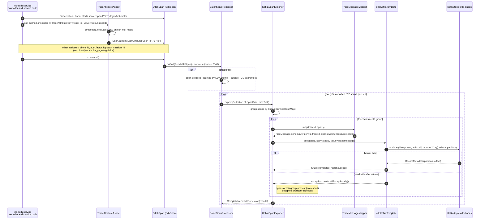

This diagram shows how a single business request becomes one or more fragments on `otlp-traces`. Two consequences shape the whole TCS design:

- **Fragmentation.** Each 5-second batch of each service instance yields one record per trace, so a trace arrives as many partial messages.
- **Co-partitioning.** key = traceId sends all fragments of a trace to one partition, and therefore to one ingester thread.

The recommendation for producers (02) is to set `management.otlp.kafka.producer.compression-type=zstd`.

---

## SD-01 — UC-01 Ingest one poll batch

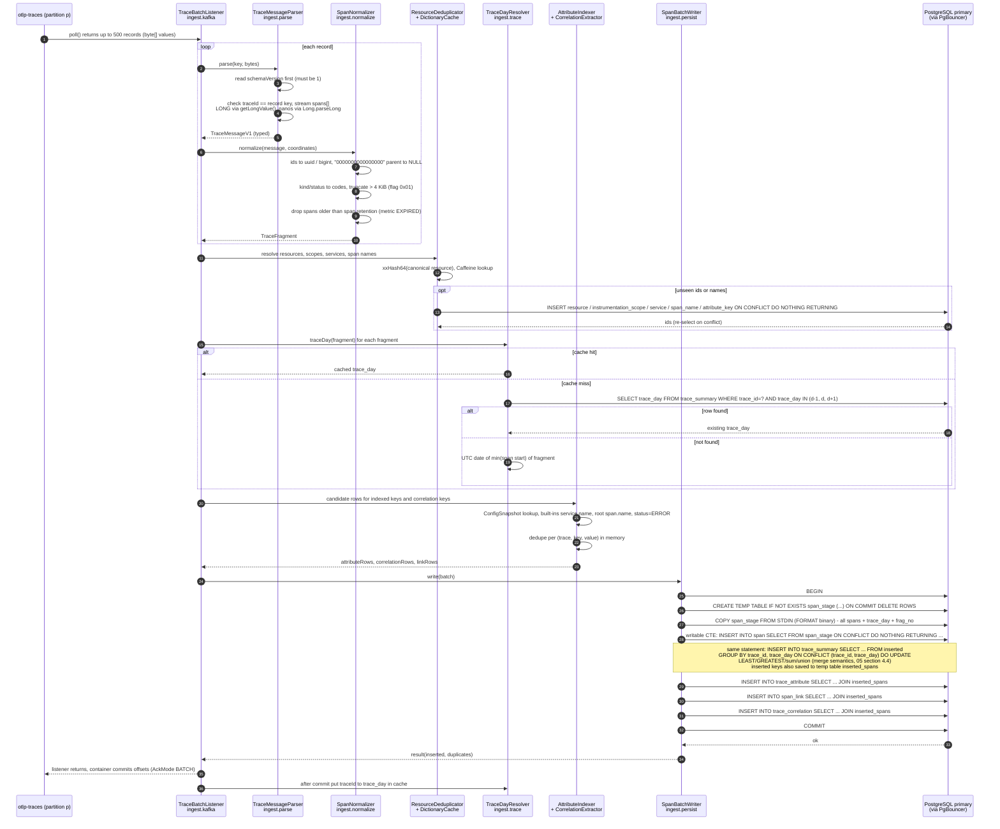

**Explanation.** The batch is processed in two phases.

The first phase is CPU only: parse, normalize, deduplicate and index. It runs entirely in memory and touches the DB only for dictionary misses and summary-day lookups.

The second phase is a single transaction:

1. `COPY` into a per-connection temp table (`ON COMMIT DELETE ROWS`, so it is empty at the start of every transaction). COPY has no `ON CONFLICT`, hence the staging table.
2. One writable CTE inserts spans with `ON CONFLICT DO NOTHING` and upserts `trace_summary` **only from the rows it actually inserted**.
3. Side tables are filled from the same inserted set.

This is what makes replays harmless (SD-02). Offsets are committed only after `COMMIT` (ADR-02).

**Note.** PgBouncer in transaction mode does not support temp tables declared `ON COMMIT PRESERVE ROWS` or `ON COMMIT DELETE ROWS`, because they outlive a transaction on a pooled server connection. `tc-ingester` therefore uses a dedicated **session-mode** PgBouncer pool `tc_ingest`, and each physical connection reuses its `ON COMMIT DELETE ROWS` staging tables. That avoids creating and dropping catalogue entries on every batch. Creating the tables per transaction with `ON COMMIT DROP` works under transaction pooling, but it is the not-recommended fallback because of the catalogue churn (see 04).

---

## SD-02 — UC-02 Replay after a crash between PG commit and offset commit

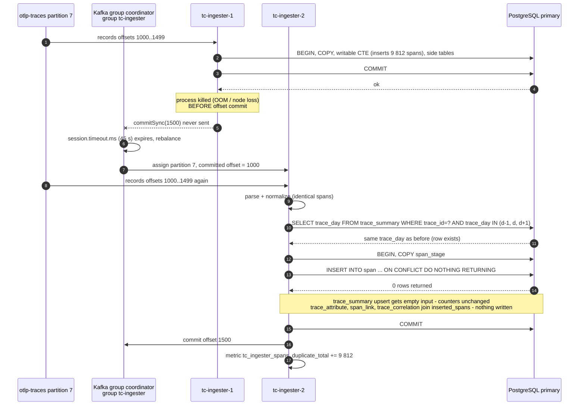

**Explanation.** At-least-once delivery combined with idempotent writes gives an effectively-once effect.

The key property is that **every derived write depends on the RETURNING set of the span insert**. A replayed record therefore leaves no trace in counters, indexes or correlations. The same mechanism covers deliberate replays (UC-18) and producer-side duplicates.

---

## SD-03 — UC-03 Poison record to otlp-traces.dlq

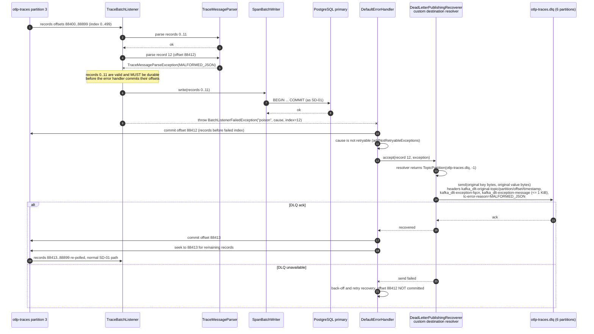

**Explanation.** The listener persists the valid prefix before throwing. That step is essential, because `DefaultErrorHandler` commits the offsets of the records before the failed index.

The DLQ has fewer partitions (6) than the source (24), so the destination resolver must return partition `-1`. Spring's default would use the same partition number and point at a non-existent partition, and its default name `otlp-traces-dlt` is not a pre-created topic.

---

## SD-04 — UC-17 PostgreSQL outage and back-pressure

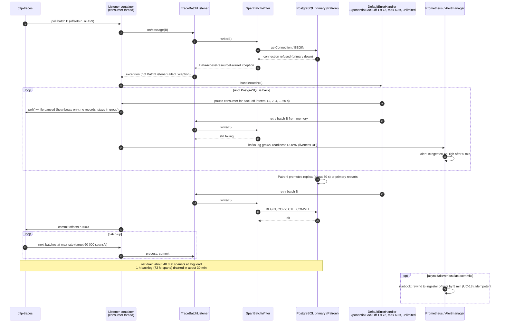

**Explanation.** DB errors never go to the DLQ and never skip data. The container stays assigned and paused, Kafka buffers (3-day retention), and producers are unaffected.

The only residual risk is an asynchronous Patroni failover that loses commits whose offsets were already committed. The runbook closes that gap with a rewind, which is safe because of SD-02.

---

## SD-05 — UC-04 Register connection and source with preview and dry-run

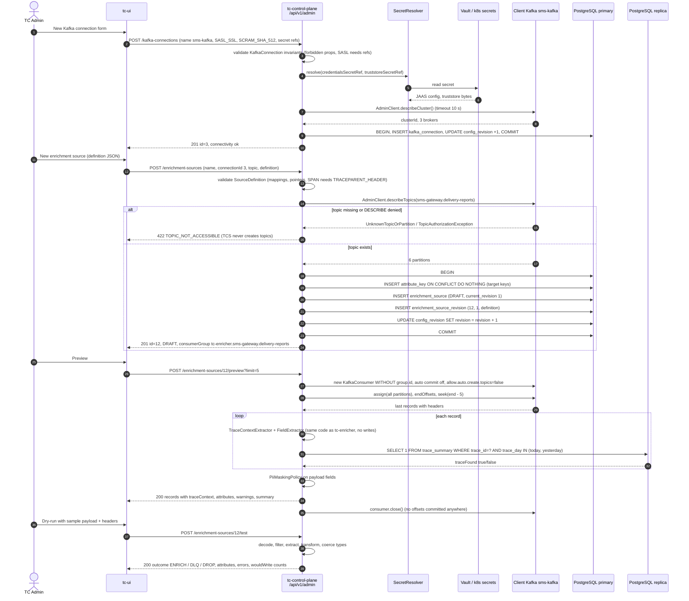

**Explanation.** Every step that touches the client's cluster is read-only and group-less: describe the cluster, describe topics, and assign plus seek. Nothing in TCS can create a topic or a consumer group there before activation.

Preview and dry-run reuse the exact extraction classes of `tc-enricher` (from `tc-kafka-support`), so what the admin sees is what will be stored.

---

## SD-06 — UC-05 Source lifecycle to container start-stop

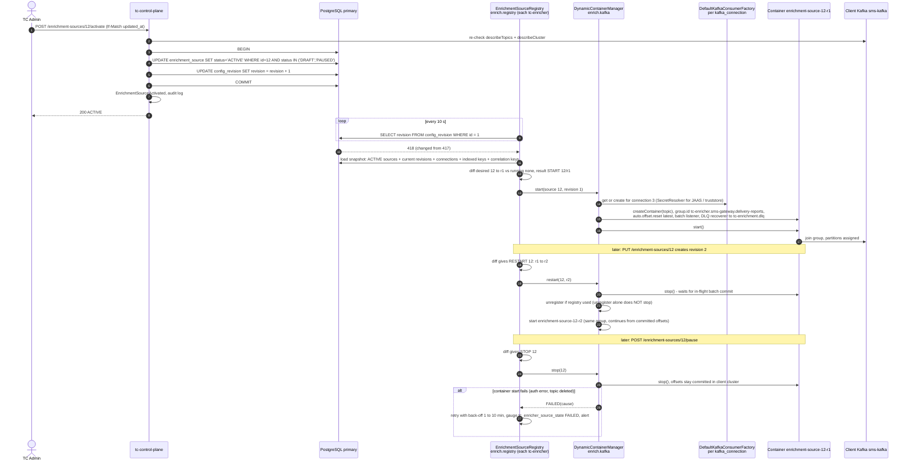

**Explanation.** The control plane writes desired state and bumps `config_revision` in the same transaction. Each enricher instance converges to that state by polling and diffing, which is level-triggered.

Container ids include the revision, so a definition change is a clean stop and start, while the consumer group (named after the source) keeps the offsets. UC-08 uses the same "write config, bump `config_revision`, poll, reload snapshot" pattern for `tc-ingester` (`ConfigSnapshotPoller`).

---

## SD-07 — UC-06 Enrichment event arrives before the spans

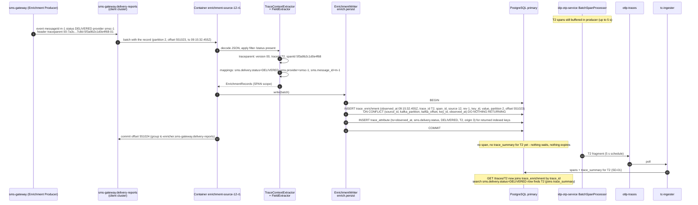

**Explanation.** Because enrichment rows are keyed only by `trace_id` (plus `span_id` for SPAN scope) and joined at read time, arrival order does not matter. No pending queue, no timer and no state store are needed. This is the main simplification over a Kafka Streams join (ADR-07).

---

## SD-08 — UC-06 Enrichment event arrives after the spans

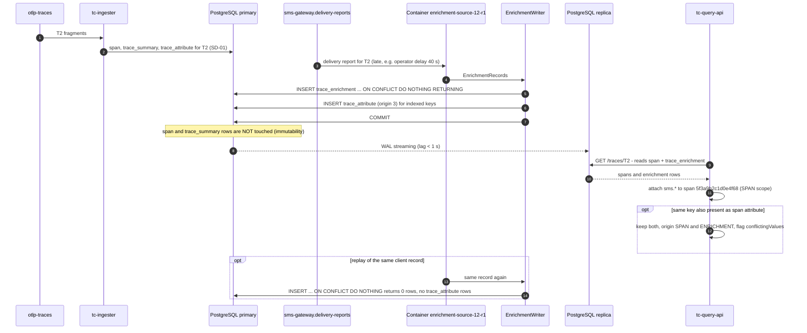

**Explanation.** A late event is visible on the next read. The idempotency key on `trace_enrichment` makes client-side replays (rebalance, offset reset) harmless, and the side writes to `trace_attribute` and `trace_correlation` are driven by `RETURNING`, just like on the span path.

---

## SD-09 — UC-07 Define indexed attribute and backfill

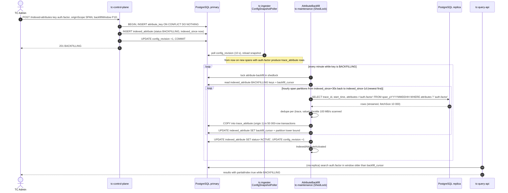

**Explanation.** Indexing a key needs no DDL. It means writing rows from now on, plus an optional throttled backfill that reads from the replica and writes to the primary.

Newest-first ordering means the most frequently searched recent windows become complete first. The `backfill_cursor` column (an addition to the brief's `indexed_attribute`) makes the job resumable after a leader change.

---

## SD-10 — UC-09 IdP login T1, T2, T3 linked into one business operation

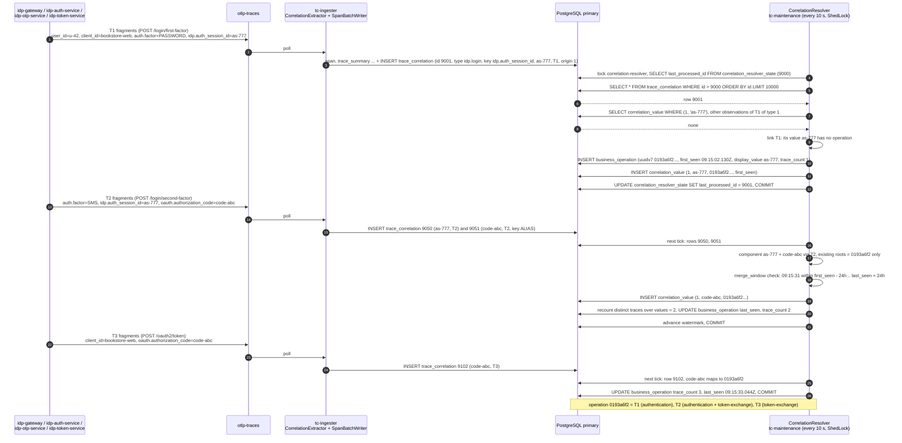

**Explanation.** Extraction is synchronous and cheap: an append in the ingest transaction, driven by inserted spans. Resolution is asynchronous and single-leader.

The resolver only ever reads `trace_correlation` forward from its watermark, and it keeps two invariants:

- each value maps to exactly one **root** operation;
- `trace_count` is an exact recount.

The watermark advance respects the 30 s gap-grace rule (05 §4.11).

---

## SD-11 — UC-10 Alias arrives first and operations are merged

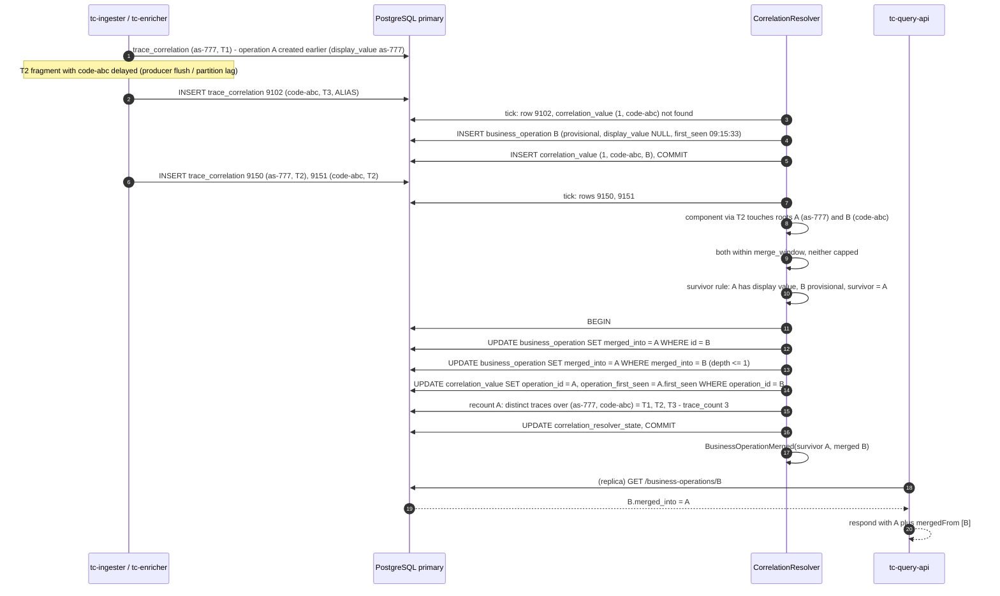

**Explanation.** The arrival order of fragments across partitions is not controllable. A provisional operation is created for an alias seen alone, and union-find merges it when a bridging trace appears.

The deterministic survivor rule is: has a display value, then earlier `first_seen`, then smaller id. Together with path compression it makes the final state independent of processing order.

---

## SD-12 — UC-11 Get trace by id

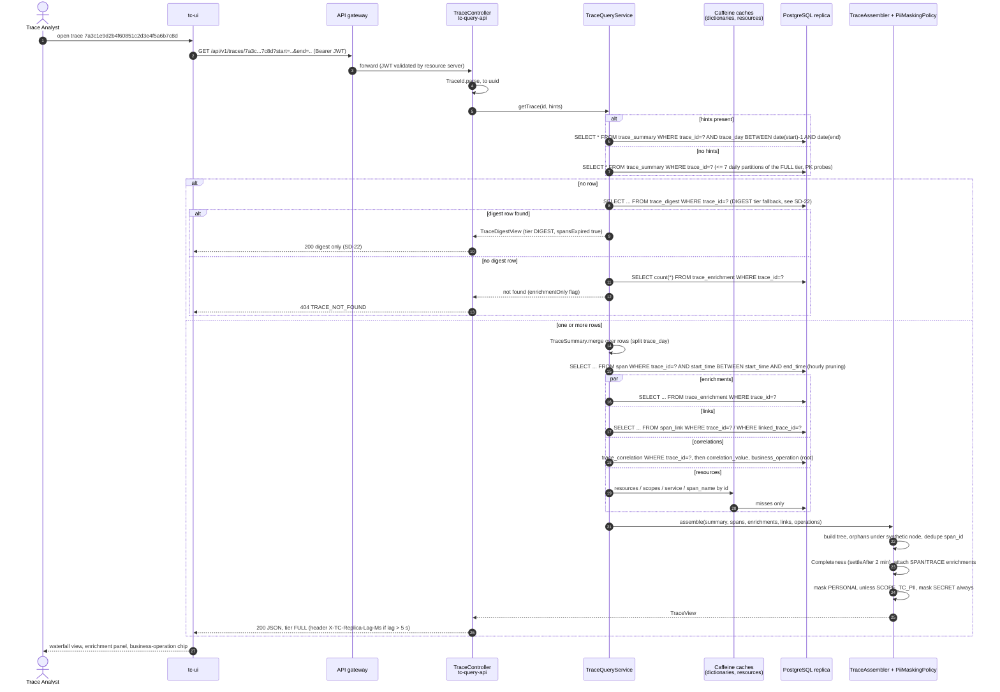

**Explanation.** `trace_summary` acts as the trace directory. It converts a bare trace id into a time window, so span reads touch only the 1–2 hourly partitions that can contain the trace.

Without hints, the cost is at most 7 index probes on the summary, one per retained day of the FULL tier (n = 7). A miss falls back to `trace_digest` (SD-22). Side data is fetched in parallel on virtual threads (`StructuredTaskScope`).

---

## SD-13 — UC-12 Search traces

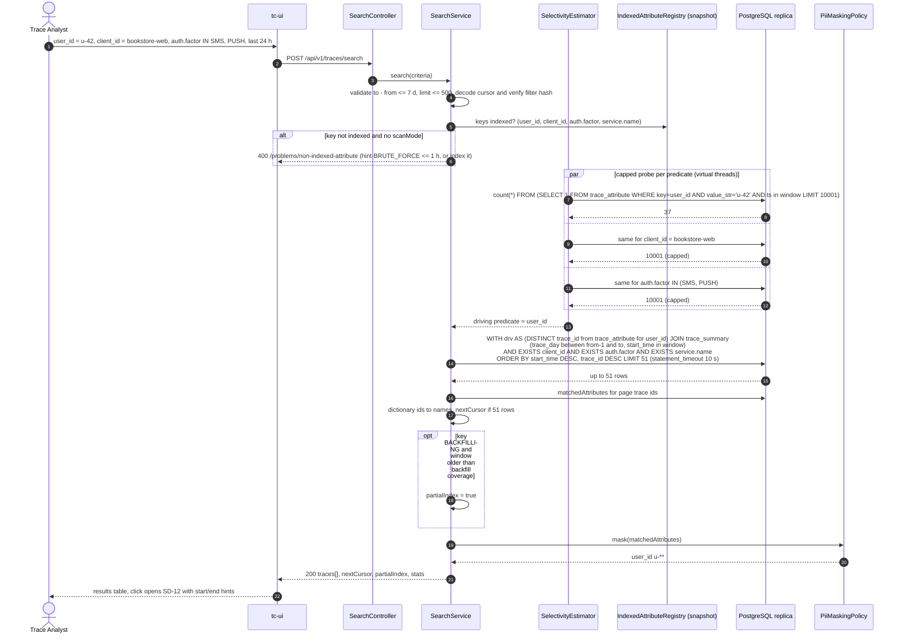

**Explanation.** Search drives from the most selective indexed predicate, estimated with cheap capped index-only counts rather than planner statistics, which are unreliable for a multi-key table like `trace_attribute`. The other predicates are checked with `EXISTS` probes on the same covering index.

The final filter and the ordering are on `trace_summary.start_time`. This produces deterministic, keyset-paginated results.

---

## SD-14 — UC-13 Bounded brute-force search

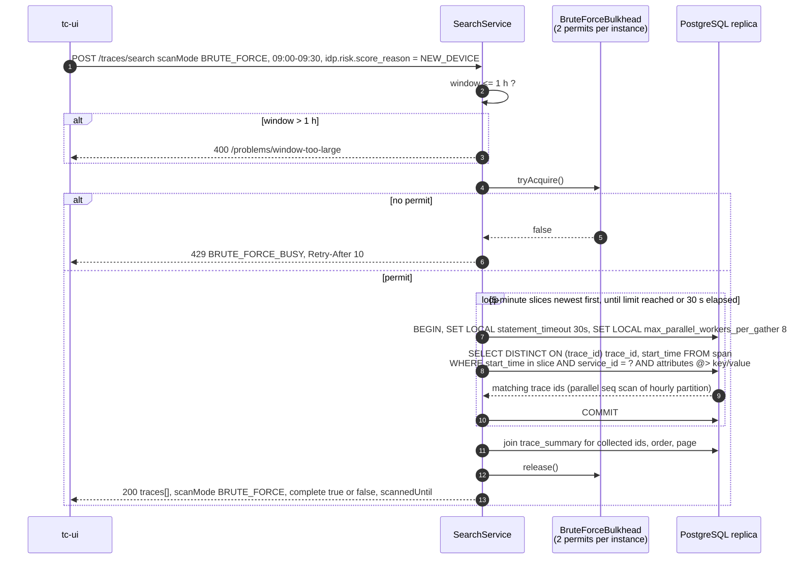

**Explanation.** Brute force is the safety valve for non-indexed keys (ADR-05). It is limited in four ways:

- the window (≤ 1 h);
- concurrency (a bulkhead);
- the per-statement timeout;
- slicing, which turns a timeout into a partial but honest answer (`complete: false`).

It runs only on the replica.

---

## SD-15 — UC-14 Business-operation timeline from the UI

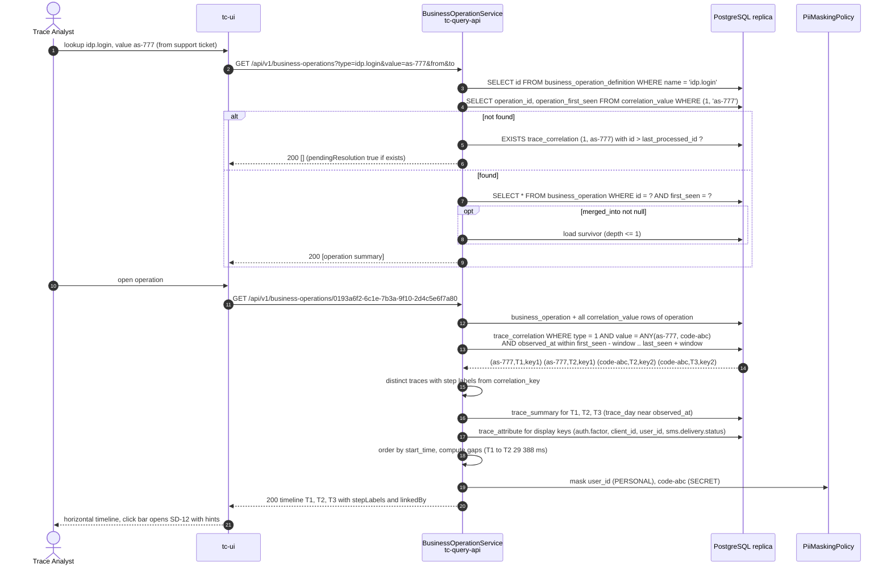

**Explanation.** The timeline is built from durable facts (`trace_correlation`) and the resolver's mapping (`correlation_value`). It therefore shows *why* each trace belongs to the operation (`linkedBy`, `stepLabels`), not just that it does.

Secret alias values are never revealed. They are still used for linking.

---

## SD-16 — UC-16 Partition create and drop

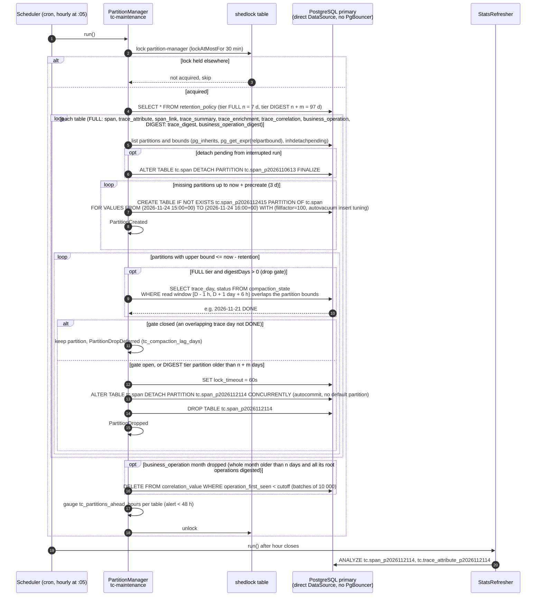

**Explanation.** Retention is entirely partition DDL: no DELETE on big tables, no vacuum debt.

The **drop gate** (ADR-13) makes PartitionManager depend on compaction: a FULL-tier partition older than n days is dropped only when every trace day whose compaction read window overlaps it is `DONE` in `compaction_state` (SD-21). If compaction lags, the data is kept and `tc_compaction_lag_days` rises; uncompacted data is never dropped. DIGEST-tier partitions have no gate and are dropped at n + m days. With `digestDays = 0` the gate is skipped.

DETACH CONCURRENTLY requires autocommit, is forbidden when a DEFAULT partition exists (there is none), and can be finalized after an interruption. Partitions are created three days ahead, so the brief ACCESS EXCLUSIVE lock of CREATE never coincides with the moment ingest needs the partition.

DDL uses a direct connection, not the transaction pooler.

---

## SD-17 — UC-19 UI login via OIDC and PII masking

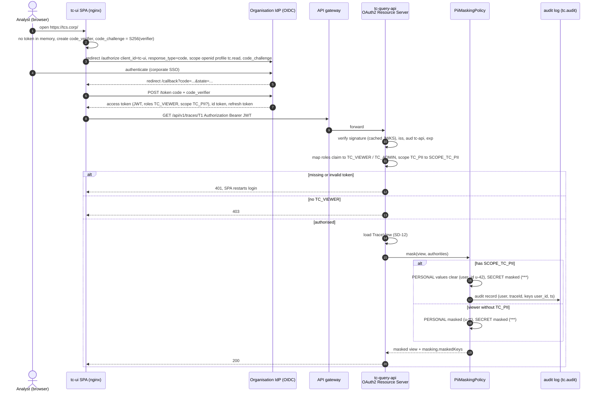

**Explanation.** The SPA is a public OIDC client using Authorization Code + PKCE, and it keeps tokens in memory.

Authorisation and masking happen only on the server. The browser never receives unmasked PII it is not entitled to, and any unmasked access is audited. `tc-control-plane` uses the same resource-server configuration with `TC_ADMIN`.

---

## SD-18 — UC-20 Related traces

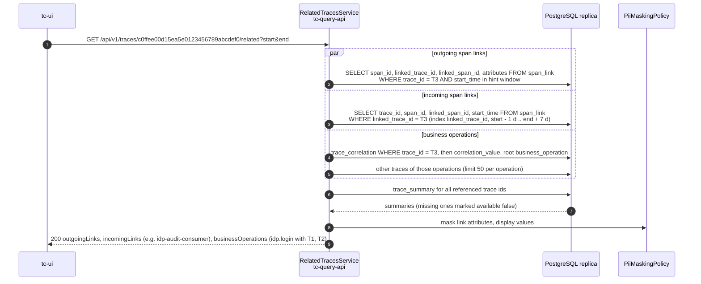

**Explanation.** The UI keeps two kinds of relation apart:

- **causal** relations from native OTel span links, indexed in both directions by `span_link`;
- **business** relations from business operation definitions.

The incoming-link query relies on the `(linked_trace_id)` index of each daily partition. Hints narrow the partitions probed.

---

## SD-19 — UC-18 Replay from Kafka and DLQ re-drive

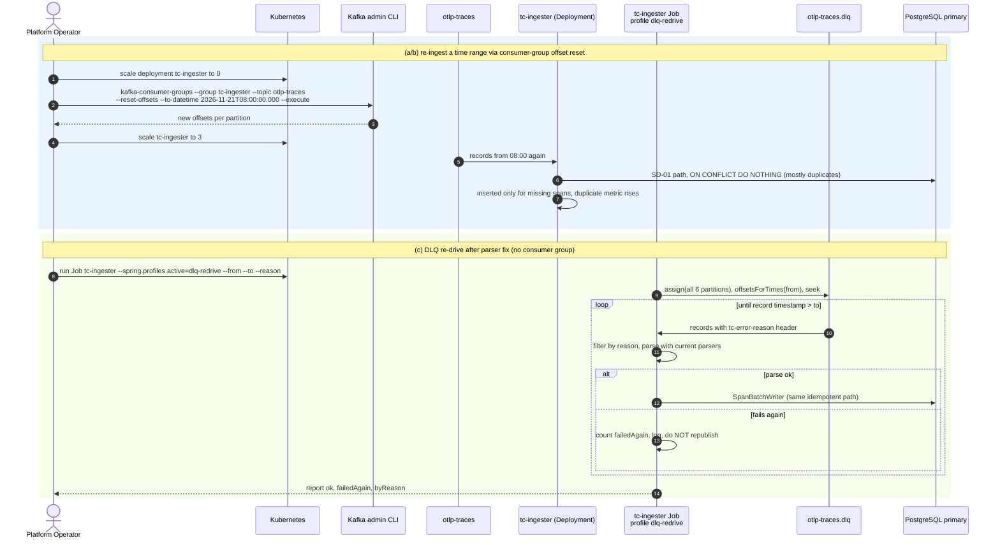

**Explanation.** Kafka retention is the replay horizon (3 d for `otlp-traces`, 14 d for the DLQ). Because all writes are idempotent, a replay never needs DB cleanup.

DLQ re-drive uses assignment, not a consumer group, so no new group or topic is introduced. Failures are not re-published, which avoids loops.

---

## SD-20 — UC-15 Autocomplete

```mermaid
sequenceDiagram
    autonumber
    participant UI as tc-ui search form
    participant AC as AutocompleteController<br/>tc-query-api
    participant CA as Caffeine (60 s)
    participant PGR as PostgreSQL replica

    UI->>AC: GET /api/v1/services
    AC->>CA: services
    alt miss
        CA->>PGR: SELECT name FROM service ORDER BY name
    end
    AC-->>UI: idp-auth-service, idp-gateway, idp-otp-service, idp-token-service
    UI->>AC: GET /api/v1/services/idp-gateway/span-names
    AC->>PGR: SELECT name FROM span_name WHERE service_id = ? ORDER BY name LIMIT 1000
    AC-->>UI: POST /login/first-factor, POST /login/second-factor, POST /oauth2/token
    UI->>AC: GET /api/v1/search/attributes?from&to
    AC->>AC: indexed keys from snapshot (status, numeric, partialIndex for window)
    AC-->>UI: auth.factor, client_id, service.name, sms.delivery.status, span.name, status, user_id
    UI->>AC: GET /api/v1/search/attributes/auth.factor/values?prefix=S&from&to&limit=20
    AC->>AC: PERSONAL key and no TC_PII ? then 403 PII_ENUMERATION_FORBIDDEN
    AC->>PGR: value_str range [S, T) on (key_id, value_str, ts) index, sample LIMIT 50000, GROUP BY, top 20
    PGR-->>AC: SMS 18233
    AC-->>UI: [SMS]
```

**Explanation.** Autocomplete reads only dictionaries and the inverted index. Value suggestions are sampled with a row cap, bounded to ≤ 24 h, and forbidden for PERSONAL keys without `TC_PII`. This prevents enumeration of user identifiers.

---

## SD-21 — UC-21 Compaction of one trace day into the digest tier

```mermaid
sequenceDiagram
    autonumber
    participant SCH as Scheduler (every 5 min)
    participant DC as DigestCompactor<br/>tc-maintenance
    participant SL as shedlock table
    participant PG as PostgreSQL primary<br/>(direct DataSource, no PgBouncer)
    participant OR as OutcomeRule.evaluate
    participant PM as PartitionManager<br/>(next hourly run)

    SCH->>DC: run() at 2026-11-29T00:05Z
    DC->>SL: lock digest-compactor
    alt lock held elsewhere
        SL-->>DC: not acquired, skip
    else acquired
        DC->>PG: load config snapshot: retained keys (user_id SHA256, client_id, auth.factor,<br/>sms.delivery.status, idp.auth_session_id NONE), compaction_exclusion, outcome rules, fullDays 7
        DC->>PG: INSERT compaction_state (2026-11-21, PENDING) ON CONFLICT DO NOTHING<br/>for every day with D + 1 day <= now - 7 d
        DC->>PG: pick oldest day not DONE: 2026-11-21, UPDATE status RUNNING, started_at now
        loop 1-hour chunks of trace_summary.start_time from last_chunk_end to 2026-11-22T00:00Z
            DC->>PG: BEGIN, SET LOCAL statement_timeout 15min
            DC->>PG: INSERT INTO trace_digest SELECT trace_summary (D, chunk)<br/>LEFT JOIN retained trace_attribute values (ts in D - 1 h .. D + 1 day + 6 h, transform applied)<br/>LEFT JOIN root business_operation via trace_correlation, correlation_value<br/>WHERE operation found OR root not in compaction_exclusion<br/>ON CONFLICT (trace_id, trace_day) DO NOTHING
            PG-->>DC: rows inserted (T1, T2, T3 in chunk 09:00-10:00)
            DC->>PG: UPDATE compaction_state SET last_chunk_end, traces_digested, traces_excluded
            DC->>PG: COMMIT
        end
        alt a chunk failed or timed out
            DC->>PG: ROLLBACK, UPDATE compaction_state SET status FAILED, error
            Note over DC,PG: next tick: FAILED to RUNNING, resume from last_chunk_end
        else all chunks committed
            DC->>PG: UPDATE compaction_state SET status DONE, finished_at now
            DC->>DC: TraceDayCompacted(2026-11-21)
            DC->>PG: SELECT root business_operation (merged_into IS NULL) with last_seen < now - 7 d,<br/>no digest yet, all member trace days DONE
            PG-->>DC: 0193a6f2 (idp.login, as-777, members T1, T2, T3)
            loop each operation
                DC->>PG: member trace_digest rows, step labels via trace_correlation and correlation_key,<br/>outcomeKey values from trace_attribute (if the rule has an outcomeKey)
                DC->>OR: evaluate(rule finalStepLabel token-exchange, members)
                OR->>OR: 1 no outcomeKey, 2 no member errors, 3 token-exchange reached by T2 and T3
                OR-->>DC: SUCCESS, outcome_detail null
                DC->>PG: INSERT INTO business_operation_digest (op_day 2026-11-21, outcome 1, steps T1 authentication,<br/>T2 token-exchange, T3 token-exchange, attributes union) ON CONFLICT DO NOTHING
                DC->>PG: UPDATE compaction_state SET operations_digested + 1
                DC->>DC: BusinessOperationCompacted(0193a6f2, SUCCESS)
            end
        end
        DC->>DC: metrics tc_compaction_lag_days, tc_compaction_traces_total, tc_compaction_chunk_seconds
        DC->>SL: unlock
    end
    PM->>PG: drop gate: compaction_state for days overlapping span_p2026112109
    PG-->>PM: 2026-11-21 DONE
    PM->>PG: DETACH CONCURRENTLY and DROP FULL-tier partitions of 2026-11-21 (SD-16)
```

**Explanation.** Compaction is a set-based batch over one closed trace day. Each 1-hour chunk is one `INSERT ... SELECT` that reads only `trace_summary`, the retained-key rows of `trace_attribute` and the correlation tables; spans are never read. Progress is stored in `compaction_state.last_chunk_end` and every insert is `ON CONFLICT DO NOTHING`, so a leader change or a failed chunk only repeats work.

Business operations are compacted after their trace days are DONE, so `steps` and the outcome see every member. The outcome rule runs in its fixed order (05 §4.10.1); for `idp.login` the final step `token-exchange` decides SUCCESS. Only after the day is DONE does the drop gate in PartitionManager let the FULL-tier partitions go.

---

## SD-22 — UC-22 Cross-tier search and trace-by-id fallback

```mermaid
sequenceDiagram
    autonumber
    actor AN as Trace Analyst
    participant UI as tc-ui
    participant TQ as TraceQueryService<br/>tc-query-api
    participant SS as SearchService
    participant BO as BusinessOperationService
    participant PGR as PostgreSQL replica
    participant PM as PiiMaskingPolicy

    rect rgb(235, 245, 255)
    Note over AN,PM: trace by id after n days (now 2026-11-30T12:00Z)
    AN->>UI: open trace 7a3c1e9d2b4f60851c2d3e4f5a6b7c8d from a support ticket
    UI->>TQ: GET /api/v1/traces/7a3c...7c8d
    TQ->>PGR: SELECT * FROM trace_summary WHERE trace_id=? (FULL tier, <= 7 daily partitions)
    PGR-->>TQ: no row (2026-11-21 partitions dropped after compaction)
    TQ->>PGR: SELECT * FROM trace_digest WHERE trace_id=? (<= n + m daily partitions, PK probes)
    PGR-->>TQ: digest row (trace_day 2026-11-21, outcome OK, attributes, business_operation_id 0193a6f2)
    TQ->>PGR: SELECT display_value, outcome FROM business_operation_digest WHERE operation_id=?
    TQ->>PM: mask(digest view)
    PM-->>TQ: user_id hash masked to 16** (PERSONAL, no TC_PII)
    TQ-->>UI: 200 tier DIGEST, spansExpired true, digest, businessOperations (SUCCESS)
    UI-->>AN: banner span details expired - digest only, no waterfall
    end

    rect rgb(245, 255, 235)
    Note over AN,PM: cross-tier search, boundary = now - 7 d = 2026-11-23T12:00Z
    AN->>UI: user_id = u-42, auth.factor IN SMS, PUSH, 2026-11-20T12:00Z .. 2026-11-27T12:00Z
    UI->>SS: POST /api/v1/traces/search
    SS->>SS: range touches FULL tier, so max 7 d: ok
    SS->>PGR: SELECT trace_day FROM compaction_state WHERE status <> DONE AND trace_day < boundary
    PGR-->>SS: none (no lag, boundary stays 2026-11-23T12:00Z)
    par FULL part 2026-11-23T12:00Z .. 2026-11-27T12:00Z
        SS->>PGR: SD-13 path on trace_attribute + trace_summary
        PGR-->>SS: 5e8d0c1b... (tier FULL)
    and DIGEST part 2026-11-20T12:00Z .. 2026-11-23T12:00Z
        SS->>SS: user_id has digest_transform SHA256: hash u-42 to 16ec525b...28a3
        SS->>PGR: SELECT FROM trace_digest WHERE start_time in part<br/>AND attributes @> user_id hash AND (auth.factor SMS OR PUSH)<br/>AND service_ids @> idp-auth-service (GIN jsonb_path_ops)
        PGR-->>SS: 7a3c1e9d... (tier DIGEST)
    end
    SS->>SS: concatenate FULL first then DIGEST, keyset cursor on (start_time, trace_id)
    SS->>PM: mask matchedAttributes
    SS-->>UI: 200 traces with tier badges, warnings []
    AN->>UI: add client_id PREFIX book
    UI->>SS: POST /api/v1/traces/search (same range, extra predicate)
    SS->>SS: PREFIX not supported on digest attributes: skip DIGEST part
    SS->>PGR: FULL part only (SD-13)
    SS-->>UI: 200 FULL results, warnings DIGEST_TIER_UNSUPPORTED_PREDICATE key client_id
    end

    rect rgb(255, 245, 235)
    Note over AN,PM: historical business operation (2026-12-15, FULL month already dropped)
    AN->>UI: lookup idp.login as-777, outcome SUCCESS
    UI->>BO: GET /api/v1/business-operations?type=idp.login&value=as-777&outcome=SUCCESS&from&to
    BO->>PGR: correlation_value (1, as-777) in FULL tier
    PGR-->>BO: none
    BO->>PGR: SELECT FROM business_operation_digest WHERE operation_definition_id=1 AND display_value='as-777' AND outcome=1
    PGR-->>BO: 0193a6f2 (tier DIGEST)
    BO-->>UI: 200 [operation, outcome SUCCESS]
    UI->>BO: GET /api/v1/business-operations/0193a6f2-6c1e-7b3a-9f10-2d4c5e6f7a80
    BO->>PGR: business_operation by id (FULL)
    PGR-->>BO: not found
    BO->>PGR: SELECT * FROM business_operation_digest WHERE operation_id=?
    BO->>BO: timeline from steps (authentication, token-exchange, token-exchange), gaps
    BO->>PM: mask attributes (user_id hash)
    BO-->>UI: 200 tier DIGEST, outcome SUCCESS, timeline
    UI-->>AN: timeline bars open trace digests
    end
```

**Explanation.** `tc-query-api` splits every time range at the tier boundary `now − n days` and answers the older part from the digest tables. The boundary moves back if a trace day before it is not yet DONE, because the drop gate still keeps that day in the FULL tier. Lookups by id try the FULL tier first and fall back to the digest, so links and bookmarks keep working for n + m days.

Values of `SHA256` keys are hashed by the API before matching. Predicates the digest cannot answer (non-retained keys, PREFIX and range operators, keys stored with MASK) skip the digest part and are reported in `warnings`, never silently ignored.

---

## SD-23 — UC-23 Configure retention tiers, retained attribute and outcome rule

```mermaid
sequenceDiagram
    autonumber
    actor ADM as TC Admin
    participant UI as tc-ui admin
    participant CP as tc-control-plane
    participant PG as PostgreSQL primary
    participant AUD as audit log (tc.audit)
    participant DC as DigestCompactor<br/>tc-maintenance
    participant PM as PartitionManager<br/>tc-maintenance

    ADM->>UI: Retention tiers form: fullDays 7, digestDays 90
    UI->>CP: PUT /api/v1/admin/retention-policies/tiers {fullDays 7, digestDays 90}
    CP->>CP: RetentionTiers: fullDays >= 2, digestDays >= 0
    CP->>PG: SELECT max(merge_window) FROM business_operation_definition (idp.login PT24H = 1 d)
    CP->>CP: fullDays 7 > 1 d: ok
    alt invalid
        CP-->>UI: 400 FULL_DAYS_TOO_SMALL / FULL_DAYS_BELOW_MERGE_WINDOW / INVALID_DIGEST_DAYS
    else valid
        CP->>PG: BEGIN, SELECT config_revision FOR UPDATE
        CP->>PG: UPDATE retention_policy SET retention = 7 days WHERE tier = 'FULL'
        CP->>PG: UPDATE retention_policy SET retention = 97 days WHERE tier = 'DIGEST'
        CP->>CP: RetentionPolicy.validateSet
        CP->>PG: UPDATE config_revision +1, COMMIT
        CP->>AUD: RetentionTiersChanged (actor, old and new values)
        CP-->>UI: 200 policies, digestDropAgeDays 97
    end

    ADM->>UI: Indexed attributes: user_id, Retain in digest, transform SHA256
    UI->>CP: PATCH /api/v1/admin/indexed-attributes/7 {retainInDigest true, digestTransform SHA256}
    CP->>CP: user_id is PERSONAL: SHA256 ok (NONE would warn, SECRET with NONE is refused)
    CP->>PG: UPDATE indexed_attribute SET retain_in_digest = true, digest_transform = 'SHA256'
    CP->>PG: UPDATE config_revision +1, COMMIT
    CP->>AUD: audit (key user_id, retain SHA256)
    CP-->>UI: 200 retainInDigest true
    ADM->>UI: Retain idp.auth_session_id (not indexed yet)
    UI->>CP: POST /api/v1/admin/indexed-attributes {key idp.auth_session_id, retainInDigest true, backfillWindow P7D}
    CP->>PG: INSERT attribute_key, INSERT indexed_attribute (BACKFILLING, retain_in_digest true), config_revision +1
    CP-->>UI: 201 BACKFILLING (backfill as SD-09)

    ADM->>UI: Business operation definition idp.login, outcome rule finalStepLabel token-exchange
    UI->>CP: PUT /api/v1/admin/business-operation-definitions/1 {..., outcomeRule {finalStepLabel token-exchange}}
    CP->>CP: BusinessOperationDefinition + OutcomeRule invariants: token-exchange is the step label of oauth.authorization_code
    alt unknown step label or outcomeKey not indexed
        CP-->>UI: 400 UNKNOWN_STEP_LABEL or OUTCOME_KEY_NOT_INDEXED
    else valid
        CP->>PG: UPDATE business_operation_definition SET outcome_rule = finalStepLabel token-exchange
        CP->>PG: UPDATE config_revision +1, COMMIT
        CP->>AUD: audit (outcome rule changed)
        CP-->>UI: 200 business operation definition with outcomeRule
    end

    Note over DC,PM: prospective only, days already DONE are never re-compacted
    DC->>PG: next tick (<= 5 min): load retained keys, transforms, outcome rules, exclusions at start of the next trace day
    PM->>PG: next hourly run: SELECT * FROM retention_policy (new durations, drop gate as SD-16)
```

**Explanation.** All digest-related settings are ordinary configuration rows changed by `tc-control-plane` in one transaction together with a `config_revision` bump, like every other config change. Retention durations are set per tier, so the FULL-tier tables can never get inconsistent retentions. The `tc-maintenance` jobs read the configuration when they start a unit of work, so each trace day is compacted with one consistent configuration and changes never rewrite days already compacted.
