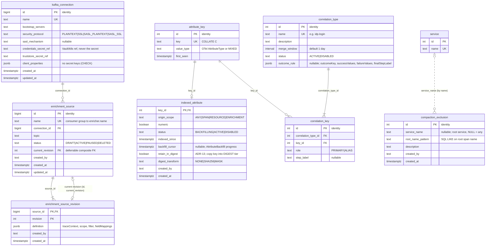
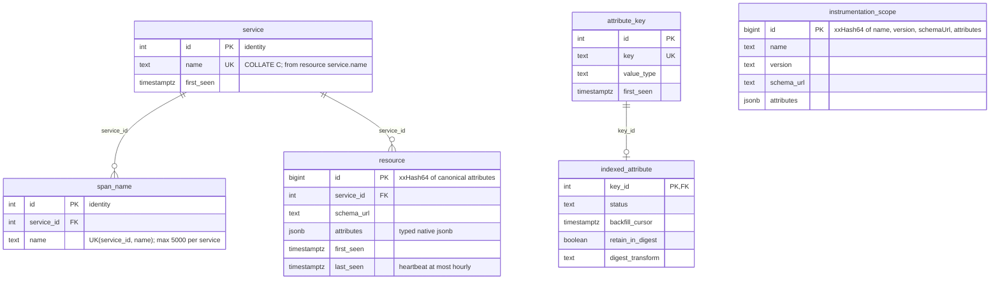
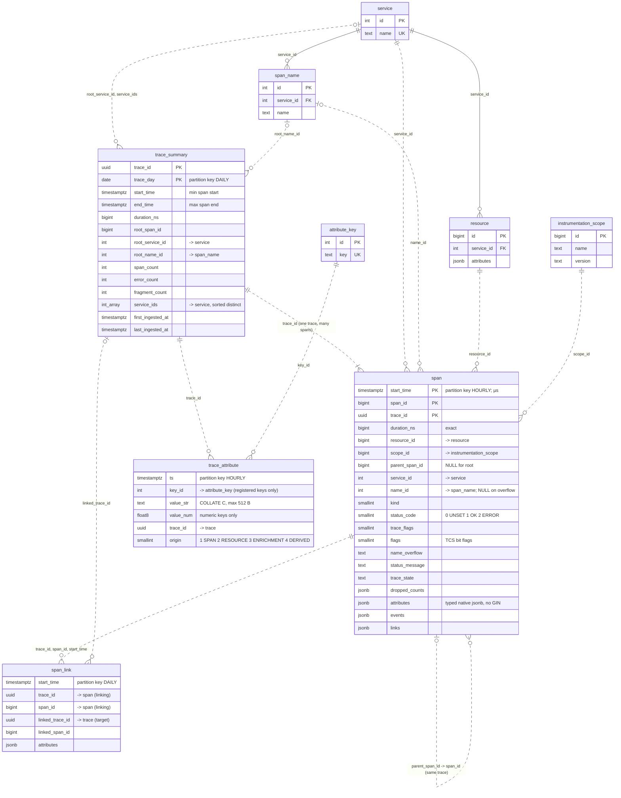
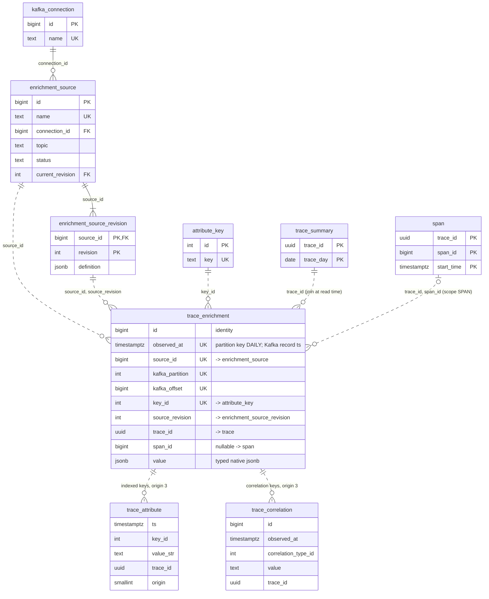
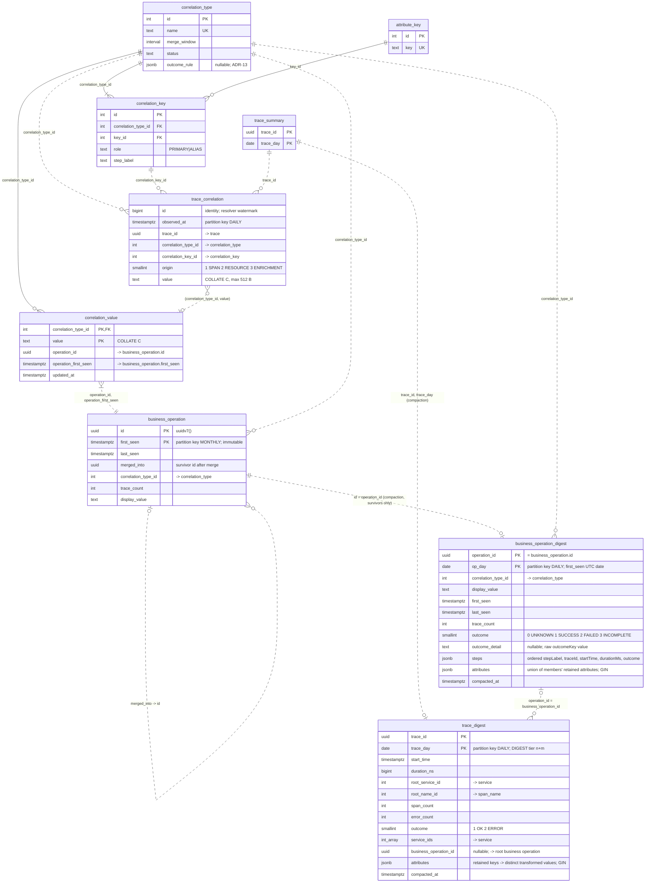
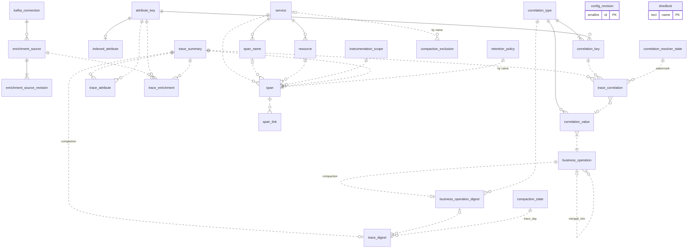

# 08 — ER Diagrams

**Related documents**

- [01-technology-overview.md](01-technology-overview.md): Tempo, the OTel Collector, Jaeger, ClickHouse and Promscale
- [02-high-level-design.md](02-high-level-design.md): C4 context and containers, ADRs, input contract
- [03-low-level-design.md](03-low-level-design.md): services, packages, Kafka consumers, error handling
- [04-storage-design.md](04-storage-design.md): DDL, write and read SQL, partitioning, capacity, HA, security
- [05-domain-model.md](05-domain-model.md): domain records and invariants
- [06-use-cases.md](06-use-cases.md): UC-01 … UC-23
- [07-sequence-diagrams.md](07-sequence-diagrams.md): sequence diagrams
- [08-er-diagrams.md](08-er-diagrams.md): this document

All tables live in PostgreSQL schema `tc`. Column types follow the DDL in [04-storage-design.md](04-storage-design.md) §4.

## Notation

- **Solid lines (`--`)** are foreign keys that PostgreSQL **enforces**. They exist only between the small, unpartitioned configuration and dictionary tables.
- **Dashed lines (`..`)** are **logical relationships** that the database does not enforce. Every relationship that involves a partitioned data table (`span`, `trace_summary`, `trace_attribute`, `span_link`, `trace_enrichment`, `trace_correlation`, `business_operation`, and the DIGEST-tier tables `trace_digest` and `business_operation_digest`) is logical. There are three reasons:
  1. An enforced FK costs an index probe for every inserted row. At 60 000 spans/s that would add tens of thousands of probes per second to the write path.
  2. Retention is a per-table `DETACH … CONCURRENTLY` + `DROP` of whole partitions, and each table has its own retention: the FULL tier keeps n = 7 days and the DIGEST tier keeps n + m = 97 days (ADR-13, doc 04 §8.7). An FK would forbid dropping a referenced partition, or force cascades across tables.
  3. Partitioned PKs include the partition key (for example `(trace_id, span_id, start_time)`), so a reference would have to carry that time column as well.
- Integrity of the logical relationships is ensured by the writers instead: the ingester and enricher write related rows in one transaction, and replay safety is described in doc 04 §6.6. Readers tolerate dangling references, for example a `trace_summary` row whose spans have already expired.
- Mermaid attribute types are single words. `int_array` stands for PostgreSQL `int[]`.
- Keys are marked `PK`, `FK` (enforced) or `UK` (unique). A logical reference is noted in the attribute comment as `"-> table"`.

---

## 1. Configuration and control plane

**Entities**

- **`kafka_connection`**: how to reach a Kafka cluster, which may belong to a client. It holds only *references* to credentials and truststores. `SecretResolver` resolves those references at runtime. A CHECK rejects inline secrets in `client_properties`.
- **`enrichment_source`**: a client-defined enrichment topic (UC-04, UC-05). `status` drives the runtime lifecycle of its listener container in `tc-enricher`. Deletion is soft (`DELETED`).
- **`enrichment_source_revision`**: an immutable, versioned definition. It covers payload format, trace-context strategy, scope, filter, start position, missing-context policy and field mappings. `tc_admin` has INSERT but no UPDATE or DELETE on this table. `trace_enrichment.source_revision` records which revision produced each value.
- **`attribute_key`**: the dictionary of every attribute key ever seen or configured. It is also listed in §2 because the ingester populates it.
- **`indexed_attribute`**: the registry of searchable keys (ADR-05).
  - A new key starts in `BACKFILLING`. `backfill_cursor` stores the last hour that AttributeBackfill processed, so a new `tc-maintenance` leader can resume. When backfill finishes, the status becomes `ACTIVE` (UC-07).
  - Built-in keys are `service.name`, `span.name` and `status`.
  - ADR-13: `retain_in_digest` marks a key whose values are copied into `trace_digest.attributes` when the trace is compacted, after `digest_transform` (`NONE`, `SHA256` = hex SHA-256, `MASK` = first 2 characters + `***`). A retained key must be indexed. Setting the flag on a non-indexed key makes the control plane create the registry entry in `BACKFILLING`. Flagging is not retroactive for days that are already compacted.
- **`correlation_type` / `correlation_key`**: the definition of a business operation (UC-08). The keys of a type are its `PRIMARY` and `ALIAS` attribute keys, and `step_label` names the step in the timeline.
  - ADR-13: `outcome_rule` (nullable jsonb) defines how the outcome of a business operation is derived at compaction: `outcomeKey` value → `successValues` / `failureValues`, otherwise any error → FAILED, otherwise `finalStepLabel` reached → SUCCESS or INCOMPLETE, otherwise SUCCESS (doc 04 §6.8). An `outcomeKey` is automatically flagged `retain_in_digest` with transform `NONE`.
- **`compaction_exclusion`** (ADR-13): traces whose root span name matches `root_name_pattern` (SQL `LIKE`), optionally restricted to a root service, are not digested unless they belong to a business operation. It is seeded with `GET /actuator/%` and managed via `/api/v1/admin/compaction-exclusions`. The service is matched **by name**, so this is a logical relationship and no FK.

**Cardinalities (all enforced)**

- `kafka_connection` 1 — 0..n `enrichment_source`. Many sources can share one cluster connection.
- `enrichment_source` 1 — 1..n `enrichment_source_revision`. An `ACTIVE` or `PAUSED` source has at least one revision (CHECK).
- `enrichment_source` 0..1 — 0..1 `enrichment_source_revision` (current).
  - The composite FK `(id, current_revision)` → `(source_id, revision)` makes sure the current revision belongs to the same source.
  - The FK is `DEFERRABLE INITIALLY DEFERRED`, so a new revision and the pointer to it can be written in one transaction in either order.
- `attribute_key` 1 — 0..1 `indexed_attribute`. The registry entry shares the key's id as its PK.
- `correlation_type` 1 — 1..n `correlation_key`, with `UNIQUE (correlation_type_id, key_id)`.
- `attribute_key` 1 — 0..n `correlation_key`. One key may serve several correlation types.
- `service` 0..1 — 0..n `compaction_exclusion` (logical, by `service_name`; NULL = any service).

`tc-control-plane` writes every change together with a bump of `config_revision` in the same transaction. That table is shown in §6.

---

## 2. Dictionaries and resources

**Entities**

- **`service`**: the service-name dictionary. It feeds autocomplete (UC-15) and the `service_id` columns of `span`, `resource` and `trace_summary`. Rows are never deleted.
- **`span_name`**: the operation-name dictionary for each service. It has a cardinality guard: after 5 000 names in one service, new names are stored inline in `span.name_overflow` and `span.name_id` is set to NULL.
- **`resource`**: the deduplicated OTel resource (ADR-06). The starter repeats the resource in every span, about 700 B each time. TCS stores it once, keyed by the 64-bit xxHash of its canonical sorted form, and each span keeps only `resource_id`. DictionaryGc deletes rows whose `last_seen` is older than span retention + 1 day.
- **`instrumentation_scope`**: the deduplicated instrumentation library, also keyed by hash. It has no FK; spans reference it logically.
- **`attribute_key` / `indexed_attribute`**: see §1. They are repeated here because the ingester inserts new keys on first sight and changes `value_type` to `MIXED` when it sees conflicting types.

**Cardinalities**

| Relationship | Kind | Note |
|---|---|---|
| `service` 1 — 0..n `span_name` | enforced | |
| `service` 1 — 0..n `resource` | enforced | Several service instances or versions produce different resources. |
| `instrumentation_scope` | — | No enforced relations. |

**Logical relationships** to the data tables are drawn in §3:
- `span.service_id`, `span.name_id`, `span.resource_id` and `span.scope_id`;
- `trace_summary.root_service_id`, `trace_summary.root_name_id` and the elements of `trace_summary.service_ids`;
- `trace_attribute.key_id` and `trace_enrichment.key_id`;
- `trace_digest.root_service_id`, `trace_digest.root_name_id` and the elements of `trace_digest.service_ids` (§5).

---

## 3. Trace data

**Entities**

- **`span`**: one row per OTel span, insert-only, with hourly RANGE partitions on `start_time`. The PK `(trace_id, span_id, start_time)` is the idempotency key for `ON CONFLICT DO NOTHING`. It is the only index on the table; there is no GIN index. The `events` and `links` arrays are kept inline for rendering the trace view.
- **`trace_summary`**: the trace header, one row per `(trace_id, trace_day)`. It is updated incrementally, but only from spans that were actually inserted, so it is replay-safe:
  - start and end via `LEAST` / `GREATEST`;
  - counts via sums;
  - `service_ids` via set union;
  - the root via the first non-null value.

  `trace_day` is the UTC day assigned by TraceDayResolver. It satisfies `date(start_time) ≤ trace_day ≤ date(start_time) + 1` for traces shorter than about one day. The table serves both search (UC-12) and trace-by-id time hints (UC-11).
- **`trace_attribute`**: a narrow inverted index containing **registered keys only** (ADR-05). It holds one row per `(trace, key, value)` for each batch or enrichment event, and one row per element for array values. There is no uniqueness constraint; duplicates are removed with `DISTINCT` at query time. `ts` is the start of the carrying span, or `observed_at` for enrichment rows.
- **`span_link`**: native OTel links, one row per link, indexed in both directions (`trace_id` and `linked_trace_id`) for UC-20.

**Cardinalities (all logical)**

| Relationship | Meaning |
|---|---|
| Trace 1 — 1..n `span` | A trace is identified by `trace_id`. It normally has one `trace_summary` row; two rows are possible if its fragments straddle more than one resolver window. |
| `span` 0..1 — 0..n child `span` | Through `parent_span_id`, within the same `trace_id`. Orphans (parent not yet received, or already expired) are allowed and are rendered as separate subtrees. |
| `span` 1 — 0..n `span_link` | `linked_trace_id` may point at a trace that TCS has never seen. |
| Trace 1 — 0..n `trace_attribute` | |
| `attribute_key` 1 — 0..n `trace_attribute` | |
| Dictionary 1 — 0..n `span` | `service`, `span_name`, `resource` and `instrumentation_scope` each relate to `span` by id. `span_name` is 0..1 because of overflow. |

**Why these relationships are not enforced.**
- All FULL-tier tables are retained n = 7 days (ADR-13), but each is dropped independently once the compaction drop gate allows. After the FULL tier has expired, a trace exists only as its `trace_digest` row, and the UI reports `spansExpired`.
- Fragments of one trace arrive in different transactions and possibly in different hours. The parent of a span may arrive later than the span itself, or never.
- Dictionary rows are always inserted before the data rows that reference them, in short autocommit statements, so the dictionary references are effectively always valid. They are still not enforced, to avoid an FK probe per span.

---

## 4. Enrichment

**Entities**

- **`trace_enrichment`**: append-only "additions" to a trace (ADR-07). Spans are never mutated.
  - Each row is one extracted field (`key_id`, `value`) from one Kafka record of one source.
  - `UNIQUE (source_id, kafka_partition, kafka_offset, key_id, observed_at)` makes the write idempotent. `observed_at` is included because it is the partition key, and it is deterministic because it is the Kafka record timestamp.
  - Rows are joined to traces at read time. That is why an event may arrive **before or after** the spans of its trace (UC-06) and no pending queue is needed.
- **Derived rows.** If the target key is registered in `indexed_attribute`, the same value is also written to `trace_attribute` with origin 3, which makes search uniform across span and enrichment data. If the key is a correlation key, a `trace_correlation` row is also written. Both derived rows are written only for enrichment rows that were actually inserted (from `RETURNING`).

**Cardinalities**

| Relationship | Kind | Note |
|---|---|---|
| `enrichment_source` 1 — 0..n `trace_enrichment` | logical | Dropping a source never cascades; old values age out with retention. |
| `enrichment_source_revision` 1 — 0..n `trace_enrichment` | logical | Audit: which mapping produced a value. |
| Trace 1 — 0..n `trace_enrichment` | logical | A value whose trace never arrives is kept until retention and shown only if the trace is queried. |
| `span` 0..1 — 0..n `trace_enrichment` | logical | Only when the source scope is `SPAN` (parent span id from `traceparent`). |
| `trace_enrichment` 1 — 0..1 `trace_attribute` / `trace_correlation` | logical | |

The source and its revisions are enforced (§1). The enrichment *data* is not: `trace_enrichment` is partitioned, retained for the FULL tier's n days (ADR-13), and must survive a source being set to `DELETED`. Indexed enrichment values reach the DIGEST tier through `trace_attribute` (origin 3) when their key is `retain_in_digest`.

---

## 5. Correlation and business operations

**Entities**

- **`trace_correlation`**: the append-only input of the resolver.
  - The ingester writes it for spans that carry a correlation key, and the enricher writes it for enrichment values.
  - Each row says: "trace T carries value V of correlation type C via key K".
  - Its `id` is used as the resolver watermark. The watermark lags behind by `transaction_timeout` + 30 s, because identity values are not assigned in commit order (doc 04 §6.7).
- **`correlation_value`**: an unpartitioned map from `(type, value)` to the current operation. It is maintained only by the single-leader CorrelationResolver. Maintenance deletes rows once `operation_first_seen` is older than the `business_operation` retention.
- **`business_operation`**: one business operation, such as one IdP login made of traces T1 (first factor), T2 (second factor) and T3 (token exchange).
  - It is partitioned monthly by `first_seen`, which is set when the operation is created and never changes.
  - When two operations turn out to be the same, the loser keeps its row with `merged_into = survivor` (UC-10). Path compression keeps every `merged_into` chain at most one hop long.
  - `trace_count` is maintained idempotently.
  - `tc.operation_root(uuid)` (doc 04 §4.7) follows `merged_into` to the survivor. Compaction and the API use it.
- **`trace_digest`** (DIGEST tier, ADR-13): one write-once row per trace, built by `DigestCompactor` from `trace_summary`, the retained keys of `trace_attribute` and the correlation path, never from spans.
  - It is partitioned daily by `trace_day`, the same value as in `trace_summary`. It is filled about n + 1 days after the trace day and dropped at n + m (default 97) days.
  - `attributes` maps each retained key to a sorted array of distinct transformed values. Its GIN `jsonb_path_ops` index serves `@>` containment search (doc 04 §7.8).
  - `business_operation_id` is the root survivor of the trace's first-observed operation.
- **`business_operation_digest`** (DIGEST tier, ADR-13): one row per closed, non-merged business operation, written once its `last_seen` is older than n days and every member trace day is compacted.
  - It is partitioned daily by `op_day`, the UTC date of `first_seen`.
  - `outcome` follows `correlation_type.outcome_rule`. `steps` is the ordered timeline (step label from `correlation_key`, member trace timing and status). `attributes` is the union of the members' retained attributes.
  - It serves historical business-operation search and the timeline for up to 97 days (UC-14, UC-22).

**Cardinalities**

| Relationship | Kind | Note |
|---|---|---|
| `correlation_type` 1 — 1..n `correlation_key` | enforced | |
| `correlation_type` 1 — 0..n `correlation_value` | enforced | `correlation_value` is unpartitioned and the types are never hard-deleted. |
| trace 1 — 0..n `trace_correlation` | logical | |
| `trace_correlation` n — 0..1 `correlation_value` | logical | Joined on `(correlation_type_id, value)`. The value becomes 1 once resolved. |
| `correlation_value` n — 1 `business_operation` | logical | The reference carries both PK columns `(id, first_seen)`, so a lookup is pruned to one monthly partition. |
| `business_operation` 0..1 — 0..n `business_operation` | logical | Through `merged_into`. |
| business operation 1 — n traces | derived | Via `correlation_value` → `trace_correlation.trace_id`. There is no stored link table; the timeline (UC-14) is computed by a join. |
| `trace_summary` 1 — 0..1 `trace_digest` | logical | Same `(trace_id, trace_day)`. 0 if the trace was excluded; the summary row itself expires after n days. |
| `business_operation` 1 — 0..1 `business_operation_digest` | logical | Same id. Merged losers are never digested. |
| `business_operation_digest` 0..1 — 0..n `trace_digest` | logical | Through `trace_digest.business_operation_id`. A trace in several operations points at one of them; `steps` lists it in all of them. |
| `correlation_type` 1 — 0..n `business_operation_digest` | logical | |

**Worked example (IdP).**
1. T1 carries `idp.auth_session_id = as-777`.
2. T2 carries `as-777` and `oauth.authorization_code = code-abc`.
3. T3 carries `code-abc`.

Both values map to one `business_operation` of type `idp.login`, and the timeline lists T1, T2 and T3 with their step labels, taken from `correlation_key.step_label`.

---

## 6. Operational tables

```mermaid
erDiagram
    retention_policy ||..|| span : "table_name = 'span'"
    retention_policy ||..|| trace_summary : "table_name = 'trace_summary'"
    retention_policy ||..|| trace_correlation : "table_name = 'trace_correlation'"
    retention_policy ||..|| business_operation : "table_name = 'business_operation'"
    retention_policy ||..|| trace_digest : "table_name = 'trace_digest', tier DIGEST"
    retention_policy ||..|| business_operation_digest : "table_name = 'business_operation_digest', tier DIGEST"
    correlation_resolver_state ||..o{ trace_correlation : "last_processed_id watermark over id"
    compaction_state ||..o{ trace_summary : "trace_day (source day)"
    compaction_state ||..o{ trace_digest : "trace_day (digested day)"

    config_revision {
        smallint id PK "always 1"
        bigint revision "bumped with every config change"
        timestamptz updated_at
    }
    retention_policy {
        text table_name PK "one of 9 partitioned tables"
        interval retention "FULL rows n; DIGEST rows n+m"
        text partition_granularity "HOUR|DAY|MONTH"
        interval precreate "default 3 days"
        text tier "FULL|DIGEST"
    }
    compaction_state {
        date trace_day PK
        text status "PENDING|RUNNING|DONE|FAILED"
        timestamptz last_chunk_end "resume point"
        bigint traces_digested
        bigint traces_excluded
        bigint operations_digested
        timestamptz started_at
        timestamptz finished_at
        text error "nullable"
    }
    correlation_resolver_state {
        smallint id PK "1"
        bigint last_processed_id
        timestamptz updated_at
    }
    shedlock {
        text name PK "varchar(64)"
        timestamp lock_until
        timestamp locked_at
        text locked_by "varchar(255)"
    }
    span {
        timestamptz start_time PK
    }
    trace_summary {
        date trace_day PK
    }
    trace_correlation {
        bigint id
        timestamptz observed_at
    }
    business_operation {
        uuid id PK
        timestamptz first_seen PK
    }
    trace_digest {
        uuid trace_id PK
        date trace_day PK
    }
    business_operation_digest {
        uuid operation_id PK
        date op_day PK
    }
```

The diagram shows six of the nine tables governed by `retention_policy`. The other three (`trace_attribute`, `span_link` and `trace_enrichment`) are governed in the same way.

**Entities**

- **`config_revision`**: a singleton counter. `tc-control-plane` increments it in the same transaction as any configuration change. Each service's `ConfigSnapshotPoller` polls it every 10 s and reloads its configuration snapshot only when the value changes. This makes configuration propagation cheap and consistent across tc-ingester, tc-enricher, tc-query-api and tc-maintenance.
- **`retention_policy`**: one row per partitioned data table. PartitionManager reads it for:
  - pre-creation `precreate` ahead (default 3 days);
  - granularity (`HOUR`, `DAY` or `MONTH`);
  - drop after `retention`.

  It is related to the data tables by **name** (logical). The CHECK on `table_name` restricts it to the 9 known tables.
  - ADR-13: `tier` is `FULL` for the 7 original tables, with `retention` = n (default 7 d, minimum 2 d). It is `DIGEST` for `trace_digest` and `business_operation_digest`, with `retention` = the **total** age n + m (default 97 d).
  - `PUT /api/v1/admin/retention-policies/tiers` updates all rows of each tier in one transaction.
  - FULL-tier partitions are dropped only after the compaction drop gate (doc 04 §8.7).
- **`compaction_state`** (ADR-13): one row per `trace_day`, the progress of `DigestCompactor`.
  - `last_chunk_end` is the resume point for the 1-hour chunks.
  - `DONE` is set only after both the trace phase and the business-operation phase are finished.
  - The drop gate trusts only `DONE`, and `tc_compaction_lag_days` is derived from the newest `DONE` day.
  - Rows older than n + m days are deleted daily.
- **`correlation_resolver_state`**: the persisted resolver watermark. It is updated in the same transaction as the resolver's writes and locked with `FOR UPDATE`, which serialises an overlapping second leader.
- **`shedlock`**: the standard ShedLock table, used with `.usingDbTime()`. Leader election for `tc-maintenance` jobs takes one row per lock: `partition-manager`, `correlation-resolver`, `attribute-backfill`, `dictionary-gc`, `stats-refresher` and `digest-compactor` (ADR-13).

**Seed rows (doc 04 §4.4)**

- `config_revision (1, 0)`
- `correlation_resolver_state (1, 0)`
- nine `retention_policy` rows: seven FULL and two DIGEST (changelog 005, §8 below)
- one `compaction_exclusion` row: `GET /actuator/%` (changelog 005)

---

## 7. Overview (entities and relationships only)

In this overview:
- Solid edges are the eight enforced FKs of the configuration and dictionary tables.
- Every edge into or out of a partitioned table is dashed.
- `config_revision` and `shedlock` have no relationships.
- `retention_policy` governs all nine partitioned tables, seven FULL and two DIGEST. The diagram draws only one representative edge.
- The DIGEST-tier tables (`trace_digest`, `business_operation_digest`) and the compaction tables (`compaction_exclusion`, `compaction_state`) were added by ADR-13.

---

## 8. Partitioning and retention summary

| Entity | Partitioned | Key / granularity | Partition name example | Retention (default) | Removal mechanism | FKs enforced |
|---|---|---|---|---|---|---|
| `span` | yes | `start_time`, HOUR | `span_p2026112114` | FULL: n = 7 d (+ ≤ 1 d drop-gate slack) | DETACH CONCURRENTLY + DROP, after the drop gate | none (logical) |
| `trace_attribute` | yes | `ts`, HOUR | `trace_attribute_p2026112114` | FULL: 7 d (+ gate) | DETACH CONCURRENTLY + DROP, after the gate | none |
| `span_link` | yes | `start_time`, DAY | `span_link_p20261121` | FULL: 7 d (+ gate) | DETACH CONCURRENTLY + DROP, after the gate | none |
| `trace_summary` | yes | `trace_day` (date), DAY | `trace_summary_p20261121` | FULL: 7 d (+ gate: day must be compacted) | DETACH CONCURRENTLY + DROP, after the gate | none |
| `trace_enrichment` | yes | `observed_at`, DAY | `trace_enrichment_p20261121` | FULL: 7 d (+ gate) | DETACH CONCURRENTLY + DROP, after the gate | none |
| `trace_correlation` | yes | `observed_at`, DAY | `trace_correlation_p20261121` | FULL: 7 d + gate + `max(merge_window)` + 1 d (≈ 10 d) | DETACH CONCURRENTLY + DROP, after the gate | none |
| `business_operation` | yes | `first_seen`, MONTH | `business_operation_p202611` | FULL: whole month older than 7 d **and** every operation compacted (≤ ≈ 40 d) | DETACH CONCURRENTLY + DROP | none |
| `trace_digest` | yes | `trace_day` (date), DAY, created on demand | `trace_digest_p20261121` | DIGEST: n + m = 97 d (data present from ≈ day n + 1) | DETACH CONCURRENTLY + DROP | none |
| `business_operation_digest` | yes | `op_day` (date), DAY, created on demand | `business_operation_digest_p20261121` | DIGEST: 97 d | DETACH CONCURRENTLY + DROP | none |
| `correlation_value` | no | — | — | until its operation is compacted and the `trace_correlation` hold has passed (≈ 10 d) | batched DELETE (daily) | → `correlation_type` |
| `compaction_state` | no | — | — | n + m days | DELETE (daily) | none |
| `compaction_exclusion` | no | — | — | kept (admin CRUD) | DELETE by admin | none |
| `resource` | no | — | — | `last_seen` older than span retention + 1 d | DELETE (DictionaryGc, daily) | → `service` |
| `instrumentation_scope` | no | — | — | kept (tiny) | — | none |
| `service`, `span_name`, `attribute_key` | no | — | — | kept forever (bounded by cardinality guards) | — | `span_name` → `service` |
| `kafka_connection`, `enrichment_source`, `enrichment_source_revision` | no | — | — | kept (sources soft-deleted) | — | yes (§1) |
| `indexed_attribute`, `correlation_type`, `correlation_key` | no | — | — | kept (status DISABLED) | `correlation_key` DELETE by admin | yes (§1) |
| `retention_policy`, `config_revision`, `correlation_resolver_state`, `shedlock` | no | — | — | kept | — | none |

The **effective retentions** above are the defaults n = 7 and m = 90. They change with `PUT /api/v1/admin/retention-policies/tiers`. With `digestDays = 0` the DIGEST tier and the drop gate are disabled.

The following rules apply to every partitioned table:
- **No DEFAULT partitions.** A DEFAULT partition would block `DETACH … CONCURRENTLY` and silently swallow bad timestamps.
- **UTC bounds.** All partition bounds are in UTC.
- **Pre-creation.** FULL-tier partitions are created 3 days ahead by `tc-maintenance` PartitionManager, using CREATE + ATTACH with low locking. DIGEST-tier partitions are created on demand by DigestCompactor for the day being compacted, with the same routine.
- **Retention.** A partition is dropped once its upper bound is older than `now() − retention`. A FULL-tier partition is additionally dropped only when every trace day it can contribute to is compacted (`compaction_state.status = 'DONE'`): never drop uncompacted data. If compaction lags, the FULL tier grows; `tc_compaction_lag_days` alerts at more than 1 day.
- **Late or replayed data.** Spans and enrichment values older than retention are dropped by the writers before insert, and counted in a metric. Data more than 1 day in the future goes to the DLQ (`FUTURE_TIMESTAMP`).

Sizes per partition and in total, for profiles S, M and L, are in [04-storage-design.md](04-storage-design.md) §9.
