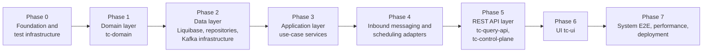

# 09 — Implementation Plan (Test-Driven, Layer by Layer)

**Related documents:**
- [01-technology-overview.md](01-technology-overview.md)
- [02-high-level-design.md](02-high-level-design.md)
- [03-low-level-design.md](03-low-level-design.md)
- [04-storage-design.md](04-storage-design.md)
- [05-domain-model.md](05-domain-model.md)
- [06-use-cases.md](06-use-cases.md)
- [07-sequence-diagrams.md](07-sequence-diagrams.md)
- [08-er-diagrams.md](08-er-diagrams.md)

This plan turns the design (01–08) into a step-by-step, test-driven implementation of the Trace Collector System (TCS). It is a checklist: every step ends with checkboxes that must all be ticked before the next step starts.

---

## 0. Ground rules

### 0.1 The TDD cycle applied to every layer

Every layer goes through the same five steps, in this order. A step may not start before the previous one is done and reviewed.

| Step | Name | Output | Done when |
|---|---|---|---|
| **a** | **Design interfaces and their API** | Java interfaces, records, sealed result types, error codes, Javadoc contracts (pre/post-conditions, invariants, thread-safety), for REST: the OpenAPI document | Reviewed against 03/04/05; compiles; no implementation bodies beyond `throw new UnsupportedOperationException()` |
| **b** | **Prepare the test model** | Builders, Object Mothers, scenario datasets, golden files, container/WireMock fixtures; custom AssertJ assertions only where plain `isEqualTo` / `usingRecursiveComparison()` on records cannot express the check | Test model compiles; it is reused by the tests of this and all higher layers |
| **c** | **Write the tests (red)** | Tests for every contract of step **a**: plain JUnit for the domain layer, full-context integration tests for all other layers (§0.3) | All tests compile and **fail** for the right reason (`UnsupportedOperationException` or assertion failure, never a context-startup error) |
| **d** | **Write the implementation (green)** | Production code | All tests of the layer and of all lower layers pass |
| **e** | **Refactor and gate** | Clean code, updated docs | The layer checklist (gate) is ticked |

### 0.2 Layer order

The user-mandated order is: **domain first, then down to the data layer, then back up to the REST API layer.**

- **Phase 1, Domain** (`tc-domain`): value objects, aggregates, policies, state machines. No I/O.
- **Phase 2, Data**: the PostgreSQL schema (Liquibase changelogs 001–005 from 04 §4), every repository and SQL statement, and the Kafka/secret infrastructure clients (topic guard, DLQ publisher, client-properties builder, secret resolver).
- **Phase 3, Application**: the services that orchestrate domain plus data for each use case (ingest pipeline, enrichment processing, correlation, compaction, query, administration). They are invoked directly from tests, without listeners, schedulers or controllers.
- **Phase 4, Inbound messaging and scheduling**: Kafka listeners, dynamic listener containers, error handlers, schedulers with ShedLock. This is the asynchronous inbound edge.
- **Phase 5, REST API**: controllers, security, ProblemDetail mapping, OpenAPI.
- **Phase 6, UI** and **Phase 7, E2E/performance/deployment** close the plan.

Inside each phase the services are implemented in this order: `tc-ingester` → `tc-enricher` → `tc-maintenance` → `tc-query-api` → `tc-control-plane`. This order follows the data dependencies: you can only query what was ingested.

### 0.3 Mandatory testing rules

These rules apply to every Java test in the repository; T2–T10 do not concern the domain layer, which has no I/O (T1). They **replace** the "Unit" and "Slice" rows of the testing strategy in 03 §9.3.

| # | Rule |
|---|---|
| T1 | **Every test of a Spring-based layer (data, application, messaging, REST) is an integration test that starts the full Spring Boot context** of the module under test: `@SpringBootTest`, through the module's meta-annotation `@TcIntegrationTest` (§1.3). No `@WebMvcTest`, `@DataJdbcTest`, `@JsonTest` or other slices, and no plain JUnit tests without a context in those layers. **Only exception: the domain layer** (`tc-domain`), which has no Spring code, is tested with plain JUnit 5 + AssertJ, with no context and no containers (see the note below the table). |
| T2 | **PostgreSQL only through Testcontainers**: `postgres:18.7`, connected with `@ServiceConnection`, schema created by the real Liquibase changelogs of `tc-schema-migrator`. No H2, no embedded or in-memory databases. |
| T3 | **Kafka only through Testcontainers**: the `apache/kafka` image (KRaft) with `auto.create.topics.enable=false`. A **second** Kafka container plays the "foreign" client cluster for enrichment sources. Topics are created by the test fixture through `Admin`, exactly as platform admins would. |
| T4 | **External HTTP endpoints are mocked with WireMock**: the OIDC issuer (discovery document + JWKS) and the secret store (Vault KV v2 HTTP API). Nothing else is mocked. |
| T5 | **No mocks of the system's own beans** (`@MockitoBean`, `@SpyBean` are forbidden). Allowed: the `Clock` bean replaced by a `MutableClock` (§1.3), and configuration properties set per test class. |
| T6 | **One context configuration per module.** All tests of a module use the same `@TcIntegrationTest` configuration, so Spring's context cache starts the context once per test JVM. `@DirtiesContext` needs a written justification in the test. |
| T7 | **Containers are JVM singletons** (started once in a static holder, `@ServiceConnection` beans in `TcContainersConfiguration`). Local runs may use Testcontainers reuse (`testcontainers.reuse.enable=true`). CI never reuses. |
| T8 | **Isolation through unique data, not cleanup.** Every test generates its own trace ids, source names, keys and topic names (`TestIds`). Configuration tables that are singletons (`config_revision`, `retention_policy`) are reset by `ConfigTableReset` in `@BeforeEach` only for the test classes that change them. |
| T9 | **Asynchrony is awaited, never slept**: Awaitility with explicit timeouts (default 15 s, Kafka 30 s). |
| T10 | **Time is controlled**: production code reads time only from the `Clock` bean; partition creation in tests goes through `TestPartitions`, which uses the production `PartitionDdl`. |
| T11 | Integration test classes are named `*IT` and run by `maven-failsafe-plugin` in `mvn verify`. Domain tests are named `*Test` and run by `maven-surefire-plugin` in `mvn test`. Test methods use the `given_when_then` naming style and a plain-language `@DisplayName`; test ids appear only in this plan, mapped to test classes. |
| T12 | Architecture rules (ArchUnit: `tc-domain` has no Spring dependency, `ingest.*` does not use `query.*`, DDL only in `tc-schema-migrator` and `persistence.partition`) are **build checks**, not functional tests. They are plain JUnit 5 ArchUnit tests (no context needed: they analyse bytecode). |

**Why the domain layer is tested without Spring.** `tc-domain` contains only framework-free Java (records, value objects, policies, state machines) and the ArchUnit rule keeps it that way. There is no context to start and no I/O to integrate with, so its tests are plain JUnit 5 tests: they run in milliseconds and give the fastest feedback in the TDD cycle. Checks that need the real database — `TraceId` ↔ `uuid`, `SpanId` ↔ signed `bigint`, and `DigestValueHasher` ↔ PostgreSQL `encode(sha256(convert_to(v,'UTF8')),'hex')` — belong to the data layer and are covered there (P-23) inside the full context with Testcontainers.

### 0.4 Definition of Done (every step)

- [ ] Code compiles with `-Xlint:all -Werror` (Java 25), formatting applied (Spotless).
- [ ] All tests of the module and of the lower layers (`*Test` and `*IT`) pass in `mvn verify`.
- [ ] Each test id from the step's checklist is implemented and green.
- [ ] Line coverage of the layer's production code ≥ 85 %, branch coverage ≥ 75 % (JaCoCo, merged per module). Every listed error code is exercised by at least one test.
- [ ] No TODOs without a ticket; docs 03/04/05 updated if a contract changed (with a "Deviation" note).
- [ ] Code reviewed.

---

## 1. Phase 0 — Foundation and test infrastructure

### 1.1 Repository and build

- [x] **0-1** Create the Maven multi-module repository `trace-collector` per 03 §9.2. Parent: `spring-boot-starter-parent` 4.1.3, `java.version` 25, dependency management for Caffeine, ShedLock, zero-allocation-hashing (xxHash64), RE2/J, springdoc, ArchUnit, Awaitility, WireMock.
- [x] **0-2** Add the test-only module **`tc-test-infra`** (normal jar, used in `test` scope by all modules). It contains **no domain types**, so it never depends on the layer modules. `tc-domain` does **not** depend on it: domain tests need no containers.
- [x] **0-3** Test-model artifacts are published as **`test-jar`s** of the layer modules: `tc-domain:test-jar` (domain test model), `tc-persistence:test-jar` (data test model), and so on. Higher layers depend on the lower layers' test-jars (§0.1 step b: the test model is reused upwards).
- [x] **0-4** Configure `maven-surefire-plugin` (`*Test`, domain only), `maven-failsafe-plugin` (`*IT`), JaCoCo (merged report), Spotless, `-Werror`, and the ArchUnit build checks (T12).
- [ ] **0-5** CI pipeline: `mvn -B verify` on a runner with Docker; Testcontainers Ryuk enabled; images pre-pulled (`postgres:18.7`, `apache/kafka:<pinned 4.x>`, `wiremock/wiremock` if the standalone image is used); test reports and JaCoCo published. *Workflow written (`.github/workflows/trace-collector.yml`, GitHub Actions; images `postgres:18.7`, `apache/kafka:4.2.2`; no WireMock image needed because the in-JVM standalone jar is used). Not yet run: the workspace has no git remote/CI runner.*

### 1.2 Phase-0 spike: verify the toolchain assumptions

Several library details were not verified during design. Settle them with a small spike before Phase 1 and record the results in this document.

- [x] **0-6** Testcontainers version and class names managed by Spring Boot 4.1.3 (Testcontainers 2.x moved containers into per-module packages, for example `org.testcontainers.postgresql.PostgreSQLContainer`, `org.testcontainers.kafka.KafkaContainer`). Confirm the exact classes and `@ServiceConnection` support for both.
- [x] **0-7** The HTTP test client for full-context web tests: Spring Framework 7 `RestTestClient` (with Boot's auto-configuration for `@SpringBootTest(webEnvironment = RANDOM_PORT)`), falling back to `TestRestTemplate`. Pick one and use it everywhere.
- [x] **0-8** WireMock integration with Boot 4: `org.wiremock.integrations:wiremock-spring-boot` (`@EnableWireMock`), or a plain `WireMockServer` bean plus a Spring `DynamicPropertyRegistrar` bean. Pick the option that works with Jackson 3 on the classpath.
- [x] **0-9** Jackson 3 streaming API names used by the parser (`tools.jackson.core.JsonParser`, `JsonNode.isString()`/`asString()`; flagged unverified in 03 §2.8).
- [x] **0-10** Kafka broker image version compatible with kafka-clients 4.2.2 and with the production cluster.
- [x] **0-11** Liquibase with Spring Boot 4.1.3: the starter/module name (`spring-boot-starter-liquibase`), the property names used in 03 §7.2 (`spring.liquibase.change-log`, `default-schema`, `liquibase-schema`, `parameters.*`), that Hikari `connection-init-sql` applies to the connection Liquibase uses, the formatted-SQL attributes (`splitStatements`, `runInTransaction`, `runOnChange`), and the licence terms of the Liquibase 5.x release managed by Boot (confirm they are acceptable for the organisation).

### 1.3 Shared test infrastructure (`tc-test-infra`)

| Component | Responsibility |
|---|---|
| `TcContainers` | Static singletons: `postgres` (`postgres:18.7`, `shm_size` 1 GB, `max_connections` 200, `max_prepared_transactions` not needed), `kafka` (TCS cluster, `auto.create.topics.enable=false`), `foreignKafka` (client cluster for enrichment sources). Started once per JVM. |
| `TcContainersConfiguration` | `@TestConfiguration(proxyBeanMethods = false)` with `@Bean @ServiceConnection` for `postgres` and `kafka`; exposes `foreignKafka` bootstrap servers as property `tc.test.foreign-kafka.bootstrap-servers`. |
| `WireMockConfiguration` | Starts WireMock on a random port; registers properties `spring.security.oauth2.resourceserver.jwt.issuer-uri` / `jwk-set-uri` and `tc.secrets.vault.uri`. |
| `TestJwtIssuer` | RSA key pair; publishes the JWKS and OIDC discovery document on WireMock; mints JWTs with roles `TC_VIEWER`, `TC_ADMIN` and scope `TC_PII`, expired tokens, wrong-issuer tokens. |
| `VaultStubs` | WireMock stubs for Vault KV v2 (`GET /v1/<mount>/data/<path>`): success, 403, 404, timeout. |
| `MutableClock` + `ClockTestConfiguration` | `@Primary Clock` bean that tests can set or advance. |
| `LiquibaseMigrations` | Creates the roles and the empty schema `tc` exactly as the infrastructure-as-code does (one SQL script run as superuser at container start), puts `tc-schema-migrator`'s `db/changelog` on the test classpath, and runs Liquibase as `tc_migrator` with `SET ROLE tc_owner` once per JVM. Test contexts set `spring.liquibase.enabled=false` (as the services do) and rely on this one-time run, so the schema is always the real one. |
| `TestPartitions` | Creates the partitions a test needs (via the production `PartitionDdl`, available from Phase 2), e.g. `ensureHourly("span", from, to)`. Until Phase 2 it falls back to the `default`-free creation SQL from 04 §8. |
| `KafkaTopicsFixture` | Creates topics with `Admin` (`otlp-traces`, `otlp-traces.dlq`, `tc-enrichment.dlq`, per-test enrichment topics on `foreignKafka`). |
| `KafkaProbe` | Test producer/consumer helpers: send raw bytes with headers, read a topic from the beginning, list consumer groups, read committed offsets. |
| `TestIds` | Unique trace ids, span ids, names, topics per test. |
| `JdbcProbe` | Read-only helper queries for assertions (`countSpans(traceId)`, `summary(traceId)`, `explain(sql)`), executed as a superuser connection. |
| `TcIntegrationTest` | Meta-annotation: `@SpringBootTest` + `@Import({TcContainersConfiguration, WireMockConfiguration, ClockTestConfiguration})` + `@ActiveProfiles("it")`. Each module defines its own variant (e.g. `@IngesterIT`) that adds module-specific imports. |

### 1.4 Phase-0 tests

- [x] **0-T1** `TcContainersIT`: PostgreSQL 18.7 is reachable, `SHOW server_version` starts with `18.`; `uuidv7()` exists.
- [x] **0-T2** `KafkaContainersIT`: both clusters reachable; auto-creation is disabled (producing to an unknown topic fails); `KafkaTopicsFixture` creates topics.
- [x] **0-T3** `WireMockIT`: discovery document and JWKS served; a JWT minted by `TestJwtIssuer` validates with Spring's `NimbusJwtDecoder`.
- [x] **0-T4** `MutableClockIT`: the context uses the mutable clock.
- [x] **0-T5** `ArchitectureIT` (T12). *Done as `tc-domain`'s `DomainArchitectureTest` (plain JUnit, `*Test`, because `tc-domain` must not depend on `tc-test-infra`). The rules for `ingest.*`/`query.*` and DDL placement are added with the first code of those packages (Phase 2/3).*

### 1.5 Phase-0 gate

- [ ] `mvn verify` green on CI with all Phase-0 tests; first run time and cached-context run time recorded (budget: ≤ 30 s of container start per module JVM). *Green locally (2026-11-22, `mvn clean verify`, 24 tests). The first test class of `tc-test-infra` takes ≈ 6 s (PostgreSQL + 2 Kafka containers started, IaC bootstrap, Liquibase, context start); later classes reuse the cached context (0.05–0.2 s each); the whole module is ≈ 14 s. `tc-schema-migrator`: ≈ 4 s. CI run pending (0-5).*
- [x] Spike results 0-6…0-11 recorded in §1.6 of this document.

### 1.6 Phase-0 results (2026-11-22)

**Layout as built.** The reactor lives directly in the workspace root (`pom.xml` + `tc-*/` modules), next to the independent projects `otlp-kafka-export-tracing-starter/` and `opentelemetry-demo/`, which are not reactor modules. Coordinates: `ru.aasmc:trace-collector:0.0.1-SNAPSHOT`.

| Module | State after Phase 0 |
|---|---|
| `tc-domain` | Empty package `…collector.domain`; JUnit 5/AssertJ/ArchUnit only; `DomainArchitectureTest` (0-T5) |
| `tc-schema-changelog` | **New (deviation, see below).** Resources only: `db/changelog/db.changelog-master.yaml` (empty list until Phase 2) |
| `tc-persistence`, `tc-kafka-support` | Empty packages, dependencies per 03 §9.2 (`spring-vault-core` is added with `SecretResolver` in Phase 2) |
| `tc-test-infra` | Complete for Phase 0 (§1.3) with its own tests 0-T1…0-T4 and `TestPartitionsIT` |
| `tc-schema-migrator` | Boot application, production `application.yaml` (03 §7.2), spike test `LiquibaseSpikeIT` |
| `tc-ingester`, `tc-enricher`, `tc-maintenance`, `tc-query-api`, `tc-control-plane` | `@SpringBootApplication` skeletons with the dependencies of 03 §9.2 and `spring.liquibase.enabled: false` |

The Boot plugin attaches executable jars with classifier `exec`, so the plain jars stay usable as reactor dependencies.

**Spike results.**

| Item | Result |
|---|---|
| 0-6 | Boot 4.1.3 manages **Testcontainers 2.0.5**. Classes: `org.testcontainers.postgresql.PostgreSQLContainer` (not generic) and `org.testcontainers.kafka.KafkaContainer` (`apache/kafka` image); artifacts `testcontainers-postgresql`, `testcontainers-kafka`. `@ServiceConnection` works for both (factories `JdbcContainerConnectionDetailsFactory` in `spring-boot-jdbc`, `ApacheKafkaContainerConnectionDetailsFactory` in `spring-boot-kafka`). A `@ServiceConnection` bean fails if the module lacks the matching Boot module, so `TcContainersConfiguration` registers each connection under `@ConditionalOnClass`. The image's default KRaft `CLUSTER_ID` is a constant: two `KafkaContainer`s report the **same cluster id** unless `CLUSTER_ID` is set; `TcContainers` sets fixed, distinct ids. |
| 0-7 | **`RestTestClient`** (Spring Framework 7, `org.springframework.test.web.servlet.client`) with `@AutoConfigureRestTestClient` from `spring-boot-resttestclient`, on `RANDOM_PORT`. Used everywhere; `TestRestTemplate` is not used. `@TcIntegrationTest` exposes `webEnvironment` as an alias for the web modules. |
| 0-8 | **Plain `WireMockServer` from `org.wiremock:wiremock-standalone:3.13.2`** (shaded Jetty 11 and Jackson 2, so no clash with Boot 4's Jetty 12 / Jackson 3), as a JVM singleton (`TcWireMock`) plus a `DynamicPropertyRegistrar` bean. `wiremock-spring-boot` is not used. The class is named `TcWireMockConfiguration` (not `WireMockConfiguration`) to avoid clashing with WireMock's own class. |
| 0-9 | Jackson 3.1.8: `JsonNode.isString()`, `asString()`, `at(JsonPointer)`, `bigIntegerValue()`, `canConvertToLong()`; `JsonParser.getString()`, `getNumberType()`, `getLongValue()`; `JsonPointer.compile(String)` throws `IllegalArgumentException`; `JacksonException` is unchecked. The Jackson 2 names `isTextual()`/`asText()`/`getText()` still exist; TCS uses the Jackson 3 names. 03 §2.8 is confirmed. |
| 0-10 | **`apache/kafka:4.2.2`** (same version as kafka-clients 4.2.2). Compatibility with the production cluster is still to be confirmed with the platform team. |
| 0-11 | Confirmed by `LiquibaseSpikeIT` through Boot's auto-configuration and the migrator's real `application.yaml`: starter `spring-boot-starter-liquibase`; `spring.liquibase.change-log`, `default-schema`, `liquibase-schema`, `parameters.*` bind; Hikari `connection-init-sql: SET ROLE tc_owner` applies to Liquibase's connection (tables, functions and tracking tables owned by `tc_owner` while logged in as `tc_migrator`); `splitStatements:false` keeps `$$` bodies; `runInTransaction:false` allows `CREATE INDEX CONCURRENTLY`; `SET LOCAL lock_timeout` works inside a changeset; `runOnChange:true` is accepted (re-application on change is covered by P-01). Liquibase 5 sends usage analytics by default: the migrator sets `spring.liquibase.analytics-enabled: false`. **Licence: Liquibase 5.0.4 is `FSL-1.1-ALv2` (Functional Source License 1.1, converting to Apache 2.0 two years after each release), not Apache 2.0. Needs approval by the organisation (open).** |

**Other findings and deviations.**
- **`tc-schema-changelog` module (deviation from 03 §9.2).** `LiquibaseMigrations` needs the changelogs on every module's test classpath, but `tc-schema-migrator` depends on `tc-persistence`, whose tests use `tc-test-infra`. That is a Maven cycle. The changelogs therefore live in a resources-only module that `tc-schema-migrator` and `tc-test-infra` both depend on.
- **PostgreSQL session time zone.** PgJDBC sets the session `TimeZone` to the JVM's default zone. On a non-UTC machine partition bounds render as e.g. `03:00:00+03`, and any SQL `::date` cast or `date_trunc` without an explicit zone would compute the wrong UTC day. `JdbcProbe` runs its sessions in UTC. **Phase 2 requirement:** every service sets the session time zone to UTC (Hikari `connection-init-sql`, or `options=-c TimeZone=UTC` in the JDBC URL), and P-xx tests run on a non-UTC JVM to catch violations.
- **Database name.** The test database is `tracing`, as in 04 §13.2 (`GRANT TEMPORARY ON DATABASE tracing`); 03 §7.2 used `tcs` and was corrected.
- **Service connection role.** Contexts connect as the container superuser through `@ServiceConnection`. Modules that need a specific role turn it off with `tc.test.postgres.service-connection=false` and register `spring.datasource.*` themselves (`tc-schema-migrator` logs in as `tc_migrator`). Phase 2 decides whether service modules test with their own roles (`tc_ingester`, …) to exercise `004-grants.sql`.
- **Deferred to Phase 2** (they need tables): `ConfigTableReset`, `JdbcProbe.countSpans/summary`, and `TestPartitions` delegating to `PartitionDdl`.
- **Not managed by Boot, pinned in the parent POM:** ShedLock 7.11.0, zero-allocation-hashing 0.27ea1 (removed in step 1d, §2.6), RE2/J 1.8, springdoc 3.0.3, ArchUnit 1.4.1, WireMock 3.13.2, Spotless 3.12.0 (Palantir Java Format), JaCoCo 0.8.16.

---

## 2. Phase 1 — Domain layer (`tc-domain`)

Reference: 05-domain-model.md (§3–§7), 03 §9.1, ADR-13 types.

### 2.1 Step a — Design interfaces and their API

- [x] **1a-1 Value objects** (records with validating compact constructors): `TraceId` (32 lowercase hex, not all zeros; `toUuid()`, `fromUuid()`), `SpanId` (16 hex ↔ signed `long`; `ROOT_PARENT = "0000000000000000"` → absent), `AttributeKey` (length ≤ 255, no reserved prefix `tc.`), `AttrValue` sealed hierarchy (`StringValue`, `BoolValue`, `LongValue`, `DoubleValue` and the four array variants), `Attributes` (ordered, immutable, canonical form for hashing), `TimeRange` (half-open, `from < to`), `TraceDay`.
- [x] **1a-2 Trace model**: `Span`, `SpanEvent`, `SpanLinkRef`, `SpanKind`, `StatusCode`, `SpanFlag` (bit layout from 04 §5.5), `TraceFragment`, `ResourceRef` and `ResourceHasher` (xxHash64 over canonical sorted attributes), `TraceSummary` with `merge(TraceSummary)` (min/max/sum/union; commutative, associative, and idempotent with respect to inserted spans — 05 §4.4).
- [x] **1a-3 Limits**: `IngestLimits` (50 000 spans/trace, 4 KiB attribute value, 8 MiB fragment, future-timestamp threshold now + 1 day, 512-byte `value_str`); all limits are configurable defaults (§2.6).
- [x] **1a-4 Configuration aggregates**: `KafkaConnection`, `EnrichmentSourceDefinition` (+ `TraceContextDef` sealed: `TraceparentHeader`, `RawHeader`, `PayloadPointer`; `FieldMapping`, `ValueTransform`, `FilterDef`, `ConsumerOptions`), `SourceStatus` state machine (DRAFT → ACTIVE ↔ PAUSED → DELETED) with `transitionTo(...)` returning a sealed `Transition` result, `SourceRevision`.
- [x] **1a-5 Indexing and retention**: `IndexedAttribute` (status BACKFILLING → ACTIVE → DISABLED; `retainInDigest`, `DigestTransform`), `RetentionTiers` (`fullDays ≥ 2`, `digestDays ≥ 0`, `fullDays > max merge window`), `Tier`.
- [x] **1a-6 Correlation**: `BusinessOperationDefinition`, `CorrelationKey` (PRIMARY / ALIAS, `stepLabel`), `CorrelationRole`, `BusinessOperation`, `OperationMergePolicy` (union-find rules: survivor = earliest `first_seen`, merge window, size guard — 03 §6.3), `OutcomeRule`, `OperationOutcome`, `TraceOutcome`, `OperationOutcomeEvaluator` (§3 order of the ADR-13 addendum: outcome key → error → final step → default).
- [x] **1a-7 Digest**: `TraceDigest`, `BusinessOperationDigest`, `DigestStep`, `DigestValueHasher` (`SHA256` → lowercase hex; `MASK` → first 2 chars + `***`), `CompactionState` state machine (PENDING → RUNNING → DONE; FAILED → RUNNING).
- [x] **1a-8 PII**: `PiiClass` (NONE, PERSONAL, SECRET), `PiiPolicy` (key patterns → class), `PiiMasker` (masking rules of 05 §7.3).
- [x] **1a-9 Domain events** (internal, not Kafka): `TraceFragmentIngested`, `EnrichmentApplied`, `CorrelationObserved`, `BusinessOperationMerged`, `EnrichmentSourceActivated`, `TraceDayCompacted`, `BusinessOperationCompacted`, `PartitionDropDeferred`, `RetentionTiersChanged`.
- [x] **1a-10 Error model**: `DomainViolation` (code + message) with the codes used by the control plane (03 §5.4 V1–V15, §5.9 R1–R3, O1–O5, `SECRET_KEY_REQUIRES_TRANSFORM`, `PII_RETAINED_IN_CLEAR`, …). Constructors throw `DomainViolationException`; policies return sealed results.
- [x] **1a-11** API review: every public type has Javadoc with its invariants and an explicit link to the 05 section it implements. *Revised: Javadoc is self-contained instead (§2.6).*

### 2.2 Step b — Domain test model (`tc-domain` test-jar, package `…testmodel.domain`)

- [x] **1b-1** Test dependencies of `tc-domain`: JUnit 5, AssertJ, and jqwik or JUnit `@ParameterizedTest` for the property-style checks (commutativity, round-trips). No Spring, no Testcontainers. Policies are instantiated directly (`new OperationOutcomeEvaluator()`), which also proves they have no hidden dependencies.
- [x] **1b-2** Builders with sensible defaults: `SpanBuilder`, `TraceFragmentBuilder`, `TraceSummaryBuilder`, `EnrichmentSourceDefinitionBuilder`, `BusinessOperationDefinitionBuilder`, `OutcomeRuleBuilder`, `IndexedAttributeBuilder`.
- [x] **1b-3** **Object Mother `IdpScenario`** (the worked example of 06): services `idp-gateway`, `idp-auth-service`, `idp-otp-service`, `idp-token-service`; traces T1 (first factor, `user_id=u-42`, `client_id=bookstore-web`, `auth.factor=PASSWORD`, `idp.auth_session_id=as-777`), T2 (second factor, `auth.factor=SMS`, same session, `oauth.authorization_code=code-abc`), T3 (token exchange, `oauth.authorization_code=code-abc`); business operation definition `idp.login` (PRIMARY `idp.auth_session_id`, ALIAS `oauth.authorization_code`, step labels `first-factor`, `second-factor`, `token-exchange`, outcome rule with `finalStepLabel = token-exchange`); enrichment source `sms-gateway.delivery-reports`.
- [x] **1b-4** **Attribute matrix**: all eight OTel attribute types, LONG > 2^53, negative zero, NaN/Infinity doubles, empty arrays, unicode, `\u0000`, 4 KiB + 1 strings.
- [x] **1b-5** **W3C trace-context vectors**: valid, version `ff`, unknown future version with extra fields, all-zero trace id / span id, uppercase hex, wrong lengths, flags variations.
- [x] **1b-6** **Time edge cases**: midnight-crossing traces, spans in the future, spans older than `fullDataDays`, nanosecond truncation cases.
- [x] **1b-7** **Union-find orderings** for the IdP scenario: T1→T2→T3, T3→T2→T1, T2→T3→T1, plus a merge outside the merge window and an oversized merge.
- [x] **1b-8** ~~Custom AssertJ assertions: `TraceSummaryAssert`, `TransitionAssert`, `OutcomeAssert`.~~ Replaced by plain AssertJ on records plus one helper `Violations.assertViolation(code, call)` (§2.6).

### 2.3 Step c — Domain tests (red)

| Id | Test class | What it proves | UC / doc |
|---|---|---|---|
| D-01 | `TraceIdTest` | Hex validation; all-zero rejected; `toUuid` / `fromUuid` round-trip (database equality in P-23) | 05 §4.1 |
| D-02 | `SpanIdTest` | Hex ↔ signed long round-trip for `8000000000000000`, `ffffffffffffffff`; root parent `0000000000000000` → absent (database equality in P-23) | 04 §5 |
| D-03 | `AttributeValueTest` | Every row of the attribute matrix maps to the expected typed value; LONG keeps precision; arrays stay typed | 04 §5.2 |
| D-04 | `ResourceHasherTest` | Hash is stable across attribute order and JVM restarts (golden values); differs on any value change | ADR-06 |
| D-05 | `TraceSummaryMergeTest` | Merge is commutative and associative over random fragment permutations of `IdpScenario`; root detection; `service_ids` union | UC-01, UC-02 |
| D-06 | `IngestLimitsTest` | Each limit is enforced at its boundary (exact limit passes, limit + 1 fails or truncates and sets the flag) | UC-01, UC-03 |
| D-07 | `EnrichmentSourceDefinitionTest` | Invariants: unique target keys, reserved prefixes rejected, JSON Pointer syntax, transform arguments (RE2/J compiles) | UC-04 |
| D-08 | `EnrichmentSourceTest` | Every allowed transition succeeds and every forbidden one returns the expected violation; name and topic rules | UC-05 |
| D-09 | `IndexedAttributeTest` | Status transitions; `retainInDigest` requires the key to be indexed; `DISABLED` with `retainInDigest` is a violation | UC-07, UC-23 |
| D-10 | `RetentionTiersTest` | R1–R3 boundaries (`fullDataDays` 1 / 2, `digestDays` −1 / 0, `fullDataDays` vs merge window) | UC-23 |
| D-11 | `OperationLinkerTest`, `OperationMergePolicyTest` | Specification by use case (nested groups, Given/When/Then display names, exact `LinkingResult` per run): creating (naming, provisional, chains, independent groups, duplicates), extending (widening, new values, naming once, earlier observations of the same trace), merge window (inclusive bounds both ways, reuse), merging (survivor rules, three-way, order independence), size limit (at limit, refused, per merge; growth of one operation not limited), trace counting (shared trace counted twice), idempotence and statelessness, input rules, and all IdP arrival orders across runs | UC-09, UC-10 |
| D-12 | `OutcomeRuleTest` | Rule order 1–4 with one test per branch (SUCCESS via outcome key, FAILED via failure value, UNKNOWN for other values, FAILED via error, SUCCESS / INCOMPLETE via final step, SUCCESS without rule) | UC-21 |
| D-13 | `DigestTransformTest` | `SHA256` output equals published SHA-256 test vectors (lowercase hex, UTF-8) for the attribute matrix; `MASK` output (PostgreSQL equality in P-23) | UC-21, UC-22 |
| D-14 | `DigestProgressTest` | State machine transitions incl. resume (`RUNNING` with `last_chunk_end`) and `FAILED → RUNNING` | UC-21 |
| D-15 | `SensitivityPolicyTest` | PERSONAL masked without `TC_PII`, shown with it; SECRET always masked; hashed PERSONAL shown only with `TC_PII` | UC-19 |
| D-16 | `TraceContextSourceTest` | Parsing the W3C vectors of 1b-5 with `Traceparent.parse` and the `TraceparentHeader` / `RawHeader` / `PayloadPointer` rules (version `ff` invalid; future versions accepted by prefix) | UC-06 |
| D-17 | `TraceTimeTest` | Epoch-nanosecond parsing and microsecond truncation; UTC trace day across midnight; `TimeRange` bounds | UC-01 |
| D-18 | `SpanTest` | Root and end; empty name; truncation flag; `INVALID_SPAN` for broken spans and span parts | UC-01 |
| D-19 | `AttributesTest` | Key length; enrichment-target keys; 512-entry limit; order and immutable copy; truncation | UC-01, UC-04 |
| D-20 | `BusinessOperationDefinitionTest` | Name, merge-window bounds, keys, final step label, key and observation rules | UC-08 |
| D-22 | `EnrichmentExtractionTest` | One event → `Enriched` / `NoTraceContext` / `Rejected`: SMS report enriches the T2 span; TRACE scope drops the span; values from payload, header, record key and timestamp; conversions and type mismatches; every transform; regex without match; missing optional vs required; value cut to the configured size | UC-06 |
| D-21 | `BusinessOperationTest` | Provisional vs named; widening on observation; merge marking; invariants | UC-09 |

- [x] **1c-1** All tests D-01…D-21 written and failing for the right reason (§2.6).

### 2.4 Step d — Domain implementation

- [x] **1d-1** Value objects and trace model (makes D-01…D-06, D-17…D-19 green).
- [x] **1d-2** Configuration aggregates and state machines (D-07…D-10, D-14, D-16).
- [x] **1d-3** Correlation, outcome, digest and PII policies (D-11…D-13, D-15, D-20, D-21).

### 2.5 Step e — Domain gate

- [x] All D-xx tests green; coverage targets met (0.4).
- [x] ArchUnit: `tc-domain` main code has no Spring, JDBC or Kafka imports.
- [x] 05-domain-model.md updated where names or invariants changed.

### 2.6 Phase-1a/1b results (revised 2026-11-22)

**Code rules (apply to every later phase).** Write only what a current test or caller needs (KISS, DRY, YAGNI). Javadoc is self-contained: it explains the rule itself and never cites ADRs, design-doc sections, use cases or plan items; traceability lives in this plan only. Records are compared with plain AssertJ (`isEqualTo`, `usingRecursiveComparison()`); custom assertion classes only when that cannot express a check.

**Domain API (`tc-domain`, 64 files).** Packages `trace`, `attribute`, `resource`, `enrichment`, `correlation`, `config`, `digest` and the error model in the base package. Records carry components and documented rules without compact constructors; methods throw `UnsupportedOperationException` until step d. Error model: `DomainViolation(ViolationCode, message)`, `DomainViolationException extends IllegalArgumentException`, and the sealed `Transition<S>` (`Changed`, `Unchanged`, `Rejected`) returned by `SourceStatus`, `IndexStatus` and `DigestStatus`; aggregates (`EnrichmentSource.moveTo`, `IndexedAttribute.moveTo`, `DigestProgress.startOrResume/…`) throw the rejection.

The first 1a draft (113 files) was cut to what D-01…D-16 exercise:

- **Removed until the phase that needs them:** domain events; DLQ types; `KafkaConnection`, secrets and SASL types; `EnrichmentRecord`, `SourceRevision`; `ConsumerOptions`, `EventFilter`, `StartFrom`, `OnMissingTraceContext`, `PayloadFormat`; `RetentionPolicy`, `Granularity`, `RetentionTier`, `ConfigRevision`; `TraceDigest`, `BusinessOperationDigest`, `DigestStep`, `TraceOutcome`, `CompactionExclusion`; `Completeness`; `TraceFragment`, `KafkaCoordinates`; `Resource`, `InstrumentationScope`, `ServiceId`, `SpanNameId`; `CorrelationValue`, `CorrelationNode`, `BusinessOperationDefinitionStatus`; `OriginScope`, `AttributeOrigin`; wire/storage codes of `SpanKind`, `StatusCode`, `SpanFlag`; and unused methods and components (e.g. `IndexedAttribute.backfillCursor`, the digest read window).
- **Merged:** outcome evaluation is `OutcomeRule.evaluate(members)` (no separate evaluator); SHA-256 and masking are `DigestTransform.apply` (no `DigestValueHasher`); classification and masking are `SensitivityPolicy.sensitivityOf/displayValue` (no `PiiMasker`); `IngestLimits` no longer duplicates the 4 KiB string limit of `AttributeValue`; `RetentionTiers.requireFullDataOutlives(mergeWindow)` is the single merge-window bound; all source life-cycle errors are `INVALID_SOURCE_TRANSITION`.
- **Still deviating from 05:** name pattern 3..63 characters; at most 50 field mappings; `Mask` keeps 0..16 characters; only enrichment targets reject reserved keys; `TimeRange` requires `from < to`; `SpanEvent` has absolute `epochNanos`; index token cap 512 bytes.
- **Renamed for readability** (names must read correctly at the call site): `ScopeId` → `InstrumentationScopeId`; `Span.flags`/`dropped` → `collectorFlags`/`droppedByProducer`; `SpanLinkRef` → `SpanLink`; `RootInfo` → `RootSpan`; `JsonPointerExpr` → `JsonPointer`; `TraceContextExtraction` (`RawHeader`, `PayloadPointer`) → `TraceContextSource` (`TraceIdHeader`, `PayloadField`); `ExtractedTraceContext` → `TraceContext`; `SourceDefinition` → `EnrichmentSourceDefinition`; `PiiClass`/`PiiPolicy` → `Sensitivity`/`SensitivityPolicy`; `CompactionState`/`CompactionStatus` → `DigestProgress`/`DigestStatus`; `OperationForest` (`load`, `observe`, `resolve`) → `OperationLinker.link(LinkingInput)`; `ForestResolution` → `LinkingResult`; `HubBlocked` → `RefusedMerge`; `RetentionTiers.fullDays` → `fullDataDays`; booleans `truncated`/`retainInDigest` → `wasTruncated`/`retainedInDigest`; `AttributeKey.reservedForEnrichment()` → `allowedAsEnrichmentTarget()`.
- **Resolved in step d:** `ResourceHasher` uses a small pure-Java xxHash64 (`XxHash64`, checked by the golden values) instead of zero-allocation-hashing, which relies on `sun.misc.Unsafe` and warns on Java 25.

**Test model (`tc-domain` test-jar, package `…testmodel.domain`, 15 classes).** `DomainIds`, `TestTime` (hex ids and epoch nanos without production code), `AttributesBuilder`, `SpanBuilder`, `TraceSummaryBuilder` (with `expectedOf`, the reference summary for D-05), `BusinessOperationBuilder`, `Permutations` (all orders, seeded random chunks; no jqwik), `Violations.assertViolation`, `Transitions.assertTransition` (one state-machine step: `Changed`/`Unchanged` or `Rejected` with its code), `InMemoryEnrichmentEvent`, and the data sets `IdpScenario`, `AttributeMatrix`, `TraceContextVectors`, `TimeEdgeCases`, `ArrivalOrders`. Small records (`BusinessOperationDefinition`, `OutcomeRule`, `IndexedAttribute`, `EnrichmentSource`, `EnrichmentSourceDefinition`) are built with their constructors. `IdpScenario` follows 06 for step labels (`authentication`, `token-exchange`), because a label belongs to one of the type's two keys.

**Step 1c (2026-11-22).** 22 test classes (D-11 has two), 362 tests: 356 fail with `UnsupportedOperationException` or an assertion error; 6 already pass (valid JSON Pointers, which guard against an over-strict implementation). D-17…D-21 were added because documented rules of `EpochNanos`/`TraceDay`/`TimeRange`, `Span`, `AttributeKey`/`Attributes`, `BusinessOperationDefinition` and `BusinessOperation` had no test; D-08 became `EnrichmentSourceTest` (status machine plus the source's own rules), and D-11 is split into the linker and the policy. Expected values come from outside production code: xxHash64 golden ids from an independent implementation checked against the published vectors, SHA-256 from Python `hashlib`. API clarifications made while writing the tests: `ResourceHasher` encodes the type as the `AttributeType` name and sorts keys by `String.compareTo`; `DigestTransform.MASK` counts code points like PostgreSQL `left`; null keys/values of `Attributes` and broken `DroppedCounts`/`SpanEvent`/`SpanLink`/`TraceFlags` have violation codes. Limits without a code (`IngestLimits`, `OperationMergePolicy.maxTracesPerOperation`, `DigestProgress.digestedUntil`) are checked as `IllegalArgumentException`.

**Configurable limits (2026-11-22).** Every size, count, length and time limit is configuration, not code: records keep only rules that never change (not null, not blank, syntax, ordering), and the limits live in records with a `DEFAULT` that the application overrides from properties (3a-3): `AttributeLimits` (key length 255, value 4 KiB, 512 entries; part of `IngestLimits`), `EnrichmentLimits` (name 63, 50 mappings, target key 128, mask 16, regex 256), `CorrelationLimits` (name 63, merge window 1 min..30 d with default 1 d, step label 64, correlation value 512, 50 outcome values of 512, deciding value 256), `OperationMergePolicy` (10 000 traces) and the digest chunk length (a `nextChunk` parameter). Each has `requireWithin(...)` that throws the same violation codes as before; `StringValue.of`/`StringArrayValue.of` and `OutcomeRule.evaluate` take their limit as a parameter; `BusinessOperationDefinition` needs an explicit merge window (the caller applies `defaultMergeWindow`). Length `CHECK` constraints in 04 §4 were removed accordingly (04 §2 principle 11). Deliberately fixed, because they are external formats or correctness rules rather than limits: W3C id and `traceparent` layout, Kafka topic-name rules (249 characters), RFC 6901 JSON Pointer syntax, UUIDv7 ids, the trace-flags byte, the name character set and minimum length, the 2-character `MASK` (must equal the SQL used for digest search), and `RetentionTiers` full data ≥ 2 days and ≥ merge window + 1 day (data must outlive digesting and linking). Tests: `AttributeLimitsTest`, `EnrichmentLimitsTest`, `CorrelationLimitsTest` (default boundaries, a raised limit accepted, broken limits rejected); 374 domain tests, 98.5 % lines, 91.3 % branches.

**Accepted limitations of linking (2026-11-22).** Kept as designed, to revisit if production metrics show the need: (1) the size limit `maxTracesPerOperation` guards merges only, so an operation can still grow without bound by extension, e.g. through a correlation key that is the same on most traces (`client_id`) or a placeholder value (`"unknown"`); (2) when a merge is refused, the trace that would have caused it is counted by each operation it touches but joins none of them, so its brand-new values belong to no operation, and every later run touching these values reports the same refusal again; (3) storage keeps only the current operation of each value, so when a value was reused and a late fragment of an old trace arrives, the fragment's new values form a separate operation instead of joining the old one (the old values are left out, so the fragment never takes them from the operation that reused them). Options considered: limit all growth, a per-value trace limit ("hub" values stop linking), linking without merging, and warning in the control plane about keys already seen on many traces.

**Test audit (2026-11-22).** Every class with logic was checked rule by rule against its Javadoc. Added `XxHash64Test` (published vectors and every input-length branch), `FieldReadingTest`, `TruncatedTextTest`, and missing cases in the existing classes (digest chunk cut at midnight and record rules, conversion edge cases, `traceparent` separators and non-hex fields, sensitivity pattern precedence, unsigned id order, retaining secrets hashed or masked, null and negative inputs, immutable copies). 512 domain tests; JaCoCo 99.4 % lines, 96.8 % branches; the rest are compiler-generated branches of record-pattern switches and an unreachable `default`.

**Event extraction in the domain (2026-11-22).** Applying a definition to one event is domain logic: `EnrichmentSourceDefinition.extract(EnrichmentEvent, maxValueBytes)` returns the sealed `Extraction` (`Enriched(target, attributes)`, `NoTraceContext`, `Rejected(ExtractionFailure, targetKey)`), which the enricher handles with an exhaustive `switch` (rows of a poll in one transaction, rejections to the DLQ). Each `FieldMapping.read` is a fluent pipeline over the package-private `FieldReading` (read raw value → transform and cut, or convert to BOOLEAN/LONG/DOUBLE → `requiredIf`); `Transform.apply` implements every transform; `EnrichmentEvent` also gives the record key, the timestamp and payload scalars (`JsonScalar`); mappings write scalar types only (`INVALID_MAPPING`). Deviation from 03 §3.6: there is no separate extraction engine in `tc-kafka-support` and no second `TraceContext`; that module only implements `EnrichmentEvent` over a Kafka record and Jackson. `RegexExtract` compiles its pattern on every `apply`; precompiling per definition is left for when a profile shows the need. Test model: `InMemoryEnrichmentEvent` (fluent), `IdpScenario.smsDeliveryReport()`.

**Trace-context sources read the event themselves (2026-11-22).** `TraceContextSource.extract(EnrichmentEvent)` replaces `parse(rawValue)`: each source reads the header or payload field it names, through the domain interface `EnrichmentEvent` (`header(name)`, `payloadText(pointer)`), so its `headerName` / `pointer` is part of the behaviour instead of data the caller has to interpret. tc-enricher implements `EnrichmentEvent` over a Kafka record and Jackson (Phase 3); the test model has `InMemoryEnrichmentEvent`. `FieldMapping` will read values the same way when the enricher needs it.

**Stateless `OperationLinker` (2026-11-22).** The linker keeps no data between calls: only its fixed dependencies (`OperationMergePolicy`, id supplier) are fields, so one instance can be a shared bean. One call `link(LinkingInput)` takes what 03 §6.3 loads per run: the new observations, the earlier observations of the same traces ("siblings"), and the current live operation of each value involved; it no longer needs the member traces of every operation. Trace counts are derived from the operations' `traceCount`: their sum, minus the operations that already count the trace, plus 1. After a refused merge each operation counts the trace; if another trace merges them later, that trace is counted twice (never too low). `LinkingResult` covers only the run's values; storage re-points the other values of merged operations (`UPDATE correlation_value … WHERE operation_id = ANY(:losers)`). Runs of one business operation definition must not overlap: besides the ShedLock lock (`lockAtMostFor` 5 min), the write transaction locks the `correlation_resolver_state` row (`SELECT … FOR UPDATE`), so an overrunning run cannot race the next one (Phase 2, resolver SQL).

**Review fixes (2026-11-22).** A code review of `tc-domain` found, and these changes fix:
- `OperationLinker` links the traces of a batch **one at a time**, in the order of their earliest new observation, on a working copy, exactly as if each trace came in a run of its own. So the merge window applies within one run too (the same value three days apart in one batch gives two operations, as in two runs), ids no longer depend on `HashMap` order, and the union-find `ConnectedGroups` is gone. A value outside its operation's window that the trace already carried in an earlier run was taken over by a newer operation and is left out, so a late fragment or replay of an old trace never takes a value away from the operation that reused it. An operation created and merged in one run is not reported. `MergeDecision` became the record `RefusedMerge`; `OperationMergePolicy.allowsMerge(count)` replaces `decideMerge`. `LinkingInput` rejects two different versions of one operation id.
- `FieldMapping` writes a JSON number as `BigDecimal.toString()` (`1e3` → `1E+3`): `toPlainString()` expanded `1e2000000000` into two billion digits and ran out of memory.
- `DigestProgress.finish` requires the day digested up to its end (DONE opens the drop gate); `chunkDigested` requires progress to move forward and `traces >= 0`; taking over a RUNNING day is documented and tested (keeps the chunks, `startedAt = now`).
- `ResourceHasher` uses a length-prefixed encoding (`<UTF-8 length>:<bytes>` per text, element count per array): the separator encoding gave `[]` and `[""]`, or values containing separators, the same id. New golden ids from an independent Python xxHash64.
- `OutcomeRule` cuts the deciding value by code points; `MemberTrace` copies its step labels; step labels and outcome values must not be blank; `BusinessOperationDefinition` rejects duplicate key ids.
- Removed unused `RetentionTiers.DEFAULT` and `DomainViolationException.violation()` (the exception now keeps a serializable `code`); `SensitivityPolicy` compiles its patterns once; leftover "type" wording and document references in POM comments removed; 03, 04 and 05 updated where they described the old encoding, the union-find resolver and `CompactionState`.
- 526 domain tests.

**Step 1d (2026-11-22).** All 363 domain tests and the ArchUnit rule pass; JaCoCo: 98.5 % lines, 91.8 % branches. Records validate in compact constructors through `DomainViolationException.require(condition, code, message)`; the three status enums decide with `Transition.of(from, to, allowed, rejection)`; `Names.requireValid` holds the name rule shared by `EnrichmentSource` and `BusinessOperationDefinition`; `TraceId.tryParse` is the non-throwing parser used by `Traceparent` and the trace-context sources; hex is parsed strictly (`Long.parseUnsignedLong` alone would accept `+`). Behaviour decided where the tests were silent, now documented in Javadoc: of several matching `SensitivityPolicy` patterns the most sensitive class wins; `OperationLinker` treats a value seen outside its operation's merge window as a new value, and when the size limit refuses a merge it merges nothing and reports the refusal (see the domain gate for how the trace is counted); `BusinessOperationDefinition` replaces a missing outcome rule with `OutcomeRule.defaultRule()`.

**Domain gate (2026-11-22).** 527 domain tests and the ArchUnit rule (no Spring, JDBC, Kafka or Jackson in `tc-domain`) pass in the full `mvn verify`; JaCoCo 99.5 % lines, 97.0 % branches; every `ViolationCode` is exercised by a test. The code was reviewed (review fixes above). 05 now describes the implemented types by their contracts (the code and its Javadoc are the reference) and marks the rest as *planned*; 02, 03, 04, 06 and 07 use the domain names (`fullDataDays`, `EnrichmentSourceDefinition`, `Sensitivity`/`SensitivityPolicy`, `OutcomeRule.evaluate`, `DigestTransform.SHA256`, the domain violation codes such as `PERSONAL_DATA_RETAINED_IN_CLEAR`), and 03 has deviation notes where the ingester and the source validation now use the domain types. A test for the last uncovered branch of `OperationLinker` found that a refused merge left the trace uncounted while its values pointed at both operations, so the next run of that trace under-counted by one and could merge past the size limit; now each operation the trace touches counts it, and the merge count subtracts the operations that already count the trace.

---

## 3. Phase 2 — Data layer

Reference: 04-storage-design.md (§4 DDL, §5 encoding, §6 write path, §7 read path, §8 partitions, §13 roles), 03 §2.9–§2.12, §3.8, §6.

The data layer is everything that talks to PostgreSQL or is a raw infrastructure client (Kafka `Admin`/producer, Vault). Components live in the module that 03 assigns them to; their tests run in that module's full context.

### 3.1 Step a — Design interfaces and their API

**Schema (`tc-schema-migrator`)**
- [x] **2a-1** Liquibase changelogs as 04 §4.0–§4.7: master `db.changelog-master.yaml` including formatted-SQL files `001-control-plane-and-dictionaries.sql` (incl. `tc.try_float8(text)`), `002-partitioned-data-tables.sql` (incl. `tc.operation_root(uuid)`), `003-seed.sql`, `004-grants.sql` (`runOnChange:true`); the former `005-two-tier-retention.sql` is folded into these (§3.6). Changeset ids `tc:NNN-MM-<name>`; `splitStatements:false` for function bodies; changelog parameters `${fullDataDays}`, `${digestDays}` via `spring.liquibase.parameters.*`; schema `tc` pre-created as in production (IaC), tracking tables in `tc`.
- [x] **2a-2** Database roles and grants (04 §13): `tc_owner`, `tc_migrator`, `tc_ingester`, `tc_enricher`, `tc_query`, `tc_admin`, `tc_maintenance`. Each service's test context connects with **its** role (a second `@ServiceConnection`-derived `DataSource` per role is configured by `tc-test-infra`). *Grants done (P-02); the per-role `DataSource` of each service is added with that service's first repository.*

**Repositories (`tc-persistence`, interfaces in `…persistence.*`, all `NamedParameterJdbcTemplate`-based, which also batches rows)**
- [ ] **2a-3** Configuration: `KafkaConnectionRepository`, `EnrichmentSourceRepository` (+ `SourceRevisionRepository`), `AttributeKeyRepository`, `IndexedAttributeRepository`, `BusinessOperationDefinitionRepository` (+ keys, outcome rule), `RetentionPolicyRepository` (+ tiers), `CompactionExclusionRepository`, `ConfigRevisionRepository` (`bump()` in the caller's transaction), `ConfigSnapshotLoader` (one consistent snapshot).
- [ ] **2a-4** Dictionaries and resources: `DictionaryRepository` (`service`, `span_name` with cardinality guard, `attribute_key` — insert-if-absent with `ON CONFLICT DO NOTHING RETURNING` + reselect), `ResourceRepository`, `InstrumentationScopeRepository`. *`DictionaryRepository` done (§3.6); `ResourceRepository` and `InstrumentationScopeRepository` move to slice 2d-4, which adds the jsonb attribute encoding they share with spans.*
- [ ] **2a-5** Partitions: `PartitionDdl` (create, attach, `DETACH … CONCURRENTLY`, `FINALIZE`, drop, naming `span_p2026112114`), `PartitionCatalog` (list partitions and bounds via `pg_inherits` / `pg_get_expr`).
- [ ] **2a-6** Read side (used by `tc-query-api`, against the replica role `tc_query`): `TraceReadRepository` (summary probe over daily partitions, spans by time window, enrichments, links, correlations, digest fallback), `SearchRepository` (single/multi-predicate SQL from a `SearchPlan`, numeric ranges, keyset pagination, DIGEST-tier containment query, brute-force jsonb scan with `statement_timeout`), `CatalogRepository` (services, span names, keys, values), `BusinessOperationReadRepository` (both tiers), `RelatedTraceRepository`.
- [ ] **2a-7** Maintenance SQL: `CorrelationResolverRepository` (watermark with gap grace, loading the linking input, writing the linking result), `BackfillRepository` (hourly chunk with `backfill_cursor`), `CompactionRepository` (chunk `INSERT … SELECT` into `trace_digest`, business-operation digest, `compaction_state` progress), `RetentionGateRepository` (drop-gate query), `DictionaryGcRepository`.

**Write-side components in service modules**
- [ ] **2a-8** `tc-ingester`: `SpanBatchWriter` (session pool `tc_ingest`, per-connection `CREATE TEMP TABLE IF NOT EXISTS … ON COMMIT DELETE ROWS`, `CopyManager.copyIn`, writable CTE with `RETURNING` → `trace_summary` upsert, side tables joined to the inserted set), `CopyTextEncoder`, `SqlStateClassifier`, `TraceDayLookup` (d−1, d, d+1 probe).
- [ ] **2a-9** `tc-enricher`: `EnrichmentWriter` (idempotent on `(source_id, kafka_partition, kafka_offset, key_id, observed_at)`, plus `trace_attribute` and `trace_correlation` rows).

**Kafka and secret infrastructure (`tc-kafka-support`)**
- [ ] **2a-10** `KafkaClientPropertiesBuilder` (connection + resolved secrets → client properties, allow-list of client properties), `SecretResolver` SPI + `VaultSecretResolver` (HTTP, mocked by WireMock) + `KubernetesSecretResolver` (mounted files), `TopicGuard` (`Admin.describeTopics`), `DlqPublisher` (custom destination resolver to `otlp-traces.dlq` / `tc-enrichment.dlq`, headers `tc-error-reason`, `tc-source-id`, `kafka_dlt-*`).

### 3.2 Step b — Data test model (`tc-persistence` test-jar, `…testmodel.db` and `…testmodel.kafka`)

- [ ] **2b-1** `@PersistenceIT` meta-annotation and a `PersistenceTestApplication` (test sources) wiring the repositories, the Liquibase-migrated schema and the role-specific `DataSource`s.
- [ ] **2b-2** `DbSeed`: fluent seeding of configuration rows (connections, sources with revisions, indexed attributes incl. `retained_in_digest`, business operation definitions with keys and outcome rules, exclusions, tiers).
- [ ] **2b-3** **Datasets** written through the production write components once they exist (never through hand-written INSERTs, except for the write components' own tests):
  - `IdpDataset` — T1–T3 spans, summaries, attributes, correlations, enrichment for T2;
  - `MidnightDataset` — traces crossing midnight and fragments arriving after midnight;
  - `VolumeDataset` — N traces × M spans generator for plan and pagination tests (default 50 000 spans);
  - `DigestDataset` — FULL-tier data older than `fullDataDays` ready for compaction, plus pre-compacted digest rows for query tests.
- [ ] **2b-4** `TestPartitions` switched to the production `PartitionDdl`.
- [ ] **2b-5** `PlanAssertions` over `EXPLAIN (FORMAT JSON)`: `prunedTo(partitions)`, `usesIndex(name)`, `noSeqScanOn(table)`.
- [ ] **2b-6** `SqlStateFaults`: provoke real SQL errors (missing partition, check violation, `statement_timeout`, connection kill via `pg_terminate_backend`).
- [ ] **2b-7** Kafka fixtures: `DlqRecordAssert` (headers and original bytes), `VaultStubs` scenarios for secret paths used by `kafka_connection.credentials_secret_ref`.

### 3.3 Step c — Data tests (red)

| Id | Module / test class | What it proves | UC / doc |
|---|---|---|---|
| P-01 | migrator `MigrationsIT` | Changelogs 001–004 apply on an empty PG 18.7 (schema `tc` pre-created as by IaC); second run is a no-op; every object and the tracking tables are owned by `tc_owner`; modifying an applied changeset fails checksum validation; `information_schema` matches 04 (golden column list); no DEFAULT partitions exist | 04 §4 |
| P-02 | migrator `RolesAndGrantsIT` | Each role can do exactly what 04 §13 allows (e.g. `tc_query` cannot `INSERT`; `tc_ingester` cannot `DROP`) | UC-19 |
| P-03 | persistence `ConfigRepositoriesIT` | CRUD + revisions; `config_revision` bumped in the same transaction (rollback leaves it unchanged); snapshot consistency under concurrent bump | UC-04, UC-05 |
| P-04 | persistence `DictionaryRepositoryIT` | Insert-if-absent under 8 concurrent threads returns one id; span-name limit per service (configured) → names beyond it get no id; the ingester role's privileges suffice | UC-01 |
| P-05 | persistence `PartitionDdlIT` | Create hourly/daily/monthly partitions; detach concurrently; finalize after an interrupted detach; drop; naming ↔ bounds cross-check; nonconforming partition never dropped | UC-16 |
| P-06 | persistence `RetentionGateIT` | Drop gate: FULL partition kept while an overlapping trace_day is not DONE; extended gate for `trace_correlation`/`correlation_value` (max merge window + 1 day); DIGEST partitions dropped at n + m | UC-16, UC-21 |
| P-07 | ingester `SpanBatchWriterIT` | Writable CTE: first write inserts all; replay of the same fragment inserts nothing and leaves `span_count`/`error_count` unchanged; partial duplicates count only new spans; side tables joined to the inserted set only | UC-01, UC-02 |
| P-08 | ingester `SpanBatchWriterFaultsIT` | Missing partition → `TRANSIENT`; check violation → `DATA_REJECTED`; connection kill mid-transaction → nothing committed | UC-03, UC-17 |
| P-09 | ingester `TraceDayLookupIT` | Finds an existing summary on d−1, d, d+1; returns empty otherwise | UC-01 |
| P-10 | enricher `EnrichmentWriterIT` | Idempotent on Kafka coordinates; writes `trace_attribute` only for indexed keys and `trace_correlation` only for correlation keys; works with no spans present | UC-06 |
| P-11 | persistence `TraceReadRepositoryIT` | Trace by id with and without time hints (`PlanAssertions` shows pruning to the right span partitions); digest fallback when the summary is gone | UC-11, UC-22 |
| P-12 | persistence `SearchRepositoryIT` | Single and multi-predicate intersect, numeric range, `IN`, `PREFIX` (`COLLATE "C"`), keyset pagination without gaps/duplicates, `EXPLAIN` uses `(key_id, value_str, ts)`; DIGEST containment via GIN | UC-12, UC-22 |
| P-13 | persistence `BruteForceSearchIT` | jsonb scan within 1 h; `statement_timeout` produces the timeout classification | UC-13 |
| P-14 | persistence `CatalogRepositoryIT` | Services, span names, keys; value autocomplete with prefix and limit | UC-15 |
| P-15 | persistence `BusinessOperationReadRepositoryIT` | Operation by id / by type+value across both tiers; ordered timeline with step labels | UC-14, UC-22 |
| P-16 | persistence `CorrelationResolverRepositoryIT` | Watermark with gap grace (uncommitted lower id is not skipped); linking results for all orderings from 1b-7 produce identical `business_operation`/`correlation_value` state; `tc.operation_root` follows `merged_into` | UC-09, UC-10 |
| P-17 | persistence `BackfillRepositoryIT` | Hourly chunks write `trace_attribute` rows for a newly indexed key; resume from `backfill_cursor` | UC-07 |
| P-18 | persistence `CompactionRepositoryIT` | Chunk SQL produces `trace_digest` rows with retained attributes (NONE/SHA256/MASK), `business_operation_id` via `operation_root`, exclusions honoured unless the trace belongs to an operation; idempotent re-run; resume after a killed chunk; business-operation digest with steps and outcome; late attribute beyond the 6 h look-ahead not captured | UC-21 |
| P-19 | kafka-support `KafkaClientPropertiesBuilderIT` | Allow-list rejects forbidden properties; secrets resolved from WireMock-backed Vault; a consumer built from the properties reads from `foreignKafka` | UC-04 |
| P-20 | kafka-support `VaultSecretResolverIT` | WireMock: 200, 403, 404, timeout → typed results; secrets never logged | UC-04 |
| P-21 | kafka-support `TopicGuardIT` | Existing topics pass; a missing DLQ topic fails readiness; no topic is ever created (`listTopics` before/after) | UC-01 |
| P-22 | kafka-support `DlqPublisherIT` | Record lands in `otlp-traces.dlq` / `tc-enrichment.dlq` with original key, value, headers and `tc-*` reason headers | UC-03 |
| P-23 | persistence `DomainEncodingAgainstPostgresIT` | Domain encodings agree with PostgreSQL for the domain test vectors: `TraceId.toUuid()` = `'<hex>'::uuid`; `SpanId` long = `('x' \|\| hex)::bit(64)::bigint`; `DigestValueHasher` SHA256 = `encode(sha256(convert_to(v,'UTF8')),'hex')`; `MASK` = the SQL mask expression used by the compactor | 04 §5, UC-21, UC-22 |

- [ ] **2c-1** All P-xx tests (P-01…P-23) written and failing for the right reason.

### 3.4 Step d — Data implementation

- [x] **2d-1** Liquibase changelogs 001–004 and grants (P-01, P-02).
- [ ] **2d-2** Configuration, dictionary, resource repositories (P-03, P-04).
- [ ] **2d-3** `PartitionDdl`, `PartitionCatalog`, `RetentionGateRepository` (P-05, P-06).
- [ ] **2d-4** `SpanBatchWriter`, `CopyTextEncoder`, `SqlStateClassifier`, `TraceDayLookup` (P-07…P-09).
- [ ] **2d-5** `EnrichmentWriter` (P-10).
- [ ] **2d-6** Read repositories (P-11…P-15).
- [ ] **2d-7** Maintenance repositories (P-16…P-18).
- [ ] **2d-8** Kafka and secret infrastructure (P-19…P-22).
- [ ] **2d-9** Encoding cross-checks against PostgreSQL (P-23).

### 3.6 Phase-2 results

**Order of work (2026-11-22).** Phase 2 is built in vertical slices in the order of step d (2d-1, 2d-2, …): each slice designs its interfaces, writes its tests and implements them before the next slice starts. Designing all ten 2a items up front would repeat Phase 1a, whose first draft had to be cut from 113 to 64 files, and every repository needs the schema first.

**Slice 2d-1: schema and grants (2026-11-22).** `tc-schema-changelog` holds `001-control-plane-and-dictionaries.sql`, `002-partitioned-data-tables.sql`, `003-seed.sql` and `004-grants.sql` (`runOnChange:true`). Tests in `tc-schema-migrator`: `MigrationsIT` (P-01, 13 tests: changesets applied in order, a second run changes nothing, everything owned by `tc_owner`, an edited applied changeset fails checksum validation, golden column list `golden/tc-columns.txt`, range partition keys and no DEFAULT partition, `STORAGE MAIN`/lz4 on `span`, the seed, the JSON checks, `tc.try_float8`, `tc.operation_root`) and `RolesAndGrantsIT` (P-02, 7 tests: the full table-privilege list per role, column privileges, default privileges for later tables, and statements run while logged in as the role). `JdbcProbe.loggedInAs(role)` gives tests a connection as any bootstrap role. Full `mvn verify` green. Deviations, recorded in 04 §4 and §13.2:
- changelog 005 is folded into 001–004 (nothing was deployed): each table is created once, retention is seeded once from `${fullDataDays}`/`${digestDays}`, all grants are in 004;
- names: column `retained_in_digest` (like the domain's `retainedInDigest`), changelog parameter `fullDataDays`, property `tc.retention.full-data-days`;
- no `?` in changelog SQL: PgJDBC reads it as a bind parameter, so the jsonb key checks use `->` and `-` instead of `?` and `?|`;
- `retention_policy` checks `retention >= 2 days` (the correctness floor of full data) and `precreate >= 1 hour`, without the former 31-day upper bound (a limit, not a rule);
- `GRANT TEMPORARY ON DATABASE` moved to infrastructure-as-code: only the database owner can grant it, and `PUBLIC` has it by default;
- the Phase-0 `LiquibaseSpikeIT` and its throw-away changelog are removed: the real changelogs and P-01/P-02 now cover ownership, `$$` functions, parameters and grants. `runInTransaction:false` (`CREATE INDEX CONCURRENTLY`) is tested again with the first changeset that needs it;
- ids of the configuration tables (`kafka_connection`, `enrichment_source`, `business_operation_definition`, `correlation_key`, `compaction_exclusion`) are UUIDv7 (`DEFAULT uuidv7()`), and so are the domain types (`KafkaConnectionId`, `EnrichmentSourceId`, `CorrelationKey.id`, `BusinessOperationDefinition.id`, the definition and key ids of `CorrelationObservation` and `BusinessOperation`); dictionaries, write-order positions, content hashes and wire ids stay integers because of their size in the largest tables (04 §5.1, "Surrogate ids"). `MigrationsIT` checks the defaults;
- the initial compaction exclusions are a changelog parameter (`tc.compaction.initial-exclusions`, comma-separated root-name patterns, empty by default) instead of a fixed `GET /actuator/%`, which assumed the clients' span names and actuator path. Liquibase checksums include substituted parameters, so a parameter changed after installation failed every later migration; the two parameterized seeds now carry `validCheckSum: ANY`, and the migrator context (other exclusions than the test schema) proves it starts. `MigrationsIT` has 13 tests;
- `SchemaVersionGuard` moves to the slice that adds the services' readiness checks, because nothing calls it before; those roles then also need `SELECT` on `tc.databasechangelog`.

**Slice 2d-2a: dictionaries (2026-11-22).** `tc-persistence` got its test context: `@PersistenceIT` and `PersistenceTestApplication` (test sources; Boot's JDBC auto-configuration plus the repository beans). `DictionaryRepository` (`persistence.dictionary`) resolves service names, span names per service and attribute keys to ids, inserting new ones: read existing values, insert the rest in sorted order with `ON CONFLICT DO NOTHING RETURNING`, read again those a concurrent caller inserted. The span-name limit is a parameter and is enforced in the insert statement (deviation in 03 §2.9: no `countByService` cache). `DictionaryRepositoryIT` (P-04, 8 tests): ids stable and stored once, 8 concurrent callers get the same ids, the per-service span-name limit, first-seen key types, and the `tc_ingester` role's privileges. Not yet: changing `attribute_key.value_type` to `MIXED` when a key is seen with another type (04 §5.3); it comes with the ingester's attribute indexing, which knows the types.

### 3.5 Step e — Data gate

- [ ] All P-xx (and D-xx) tests green.
- [ ] Every SQL statement in 04 §6–§8 has at least one test that executes it.
- [ ] Informational micro-benchmark recorded (not a pass criterion): COPY + CTE throughput of `SpanBatchWriter` on the container for 50 000 spans.
- [ ] 04 updated for any SQL that changed during implementation.

---

## 4. Phase 3 — Application layer (use-case services)

Reference: 03 §2.7–§2.11, §3.5–§3.7, §4.5–§4.13, §5.4–§5.9, §6; 06 use cases.

Application services orchestrate domain and data components. Tests call them **directly** (no listener, scheduler or controller yet), still inside the full context of the owning module.

### 4.1 Step a — Design interfaces and their API

| Module | Service interface (`…collector.<module>.app`) | Key operations (command → result) |
|---|---|---|
| tc-ingester | `IngestPipeline` | `IngestOutcome process(List<RawRecord> batch)`; sealed per-record `RecordResult` (Ingested, Duplicate, Poison(reason), Dropped(reason)) |
| | `TraceMessageParser` | `ParseResult parse(byte[] value)` (Parsed / Poison: `UNSUPPORTED_SCHEMA_VERSION`, `TRACE_ID_MISMATCH`, `FRAGMENT_TOO_LARGE`, malformed JSON) |
| | `SpanNormalizer`, `AttributeIndexer`, `CorrelationExtractor`, `TraceDayResolver` | Pure transformation steps over a `ConfigSnapshot` |
| | `ConfigSnapshotHolder` | `ConfigSnapshot current()`, `boolean refreshIfChanged()` |
| tc-enricher | `EnrichmentProcessor` | `EnrichmentBatchResult process(SourceSpec, List<RawRecord>)` (per record: Applied, NoTraceContext, Filtered, ExtractionFailed(code)) |
| | `ExtractionPlanCompiler` (tc-kafka-support) | `ExtractionPlan compile(EnrichmentSourceDefinition)` |
| | `SourceReconciler` | `ReconcilePlan diff(Set<SourceSpec> desired, Set<RunningSource> actual)` → start / stop / restart / hot-swap |
| tc-maintenance | `PartitionMaintenanceService`, `CorrelationResolverService`, `AttributeBackfillService`, `DigestCompactionService`, `DictionaryGcService`, `StatsRefreshService` | `JobRunReport runOnce()` (idempotent, resumable) |
| tc-query-api | `TraceQueryService` | `TraceView getTrace(TraceId, Optional<TimeRange> hint, Caller)` (tier-aware) |
| | `TraceSearchService` | `SearchPage search(SearchRequest, Caller)` (planner, cross-tier split, warnings, cursor) |
| | `BusinessOperationQueryService`, `RelatedTracesService`, `CatalogService` | as in 03 §4.8–§4.9 |
| | `CursorCodec`, `PiiResponseMasker` | HMAC cursor encode/verify; masking of DTOs |
| tc-control-plane | `KafkaConnectionAdminService` (+ `ConnectionTester`) | create/update/test (Admin `describeTopics`, no side effects) |
| | `EnrichmentSourceAdminService` | create/update (new revision), activate/pause/delete, `DryRunResult test(id, sample)`, `PreviewResult preview(id, limit)` (assign + seek, no group, no topics) |
| | `IndexedAttributeAdminService`, `BusinessOperationDefinitionAdminService`, `RetentionTierAdminService`, `CompactionExclusionAdminService` | validation codes from 03 §5.4 and §5.9; outcome-key auto-retain |

- [ ] **3a-1** Interfaces, command/result records and sealed result types written with Javadoc; error codes enumerated per service.
- [ ] **3a-2** `Caller` abstraction (subject, roles, `TC_PII` scope) defined so services are testable without HTTP.
- [ ] **3a-3** Configurable limits: `@ConfigurationProperties` (`tc.limits.ingest.*`, `tc.limits.enrichment.*`, `tc.limits.correlation.*`, `tc.maintenance.digest.chunk-length`, `tc.correlation.max-traces-per-operation`) bound to the domain records `IngestLimits`/`AttributeLimits`, `EnrichmentLimits`, `CorrelationLimits`, `OperationMergePolicy`, defaulting to their `DEFAULT`; validated at startup (the records reject non-positive values; `maxIndexValueBytes` below the B-tree entry ceiling, 04 §2 principle 11). The domain does not enforce these limits by itself: every entry point below must apply them, and A-21 proves each one does.

  | Module | Entry point | Limit applied |
  |---|---|---|
  | tc-ingester | `TraceMessageParser` | `maxFragmentBytes` |
  | | `SpanNormalizer` (span, event, link, resource, scope attributes) | `AttributeLimits.requireWithin`; strings cut by `StringValue.of(raw, maxValueBytes)`; `judgeSpanStart` with `futureTolerance` |
  | | `IngestPipeline` | `spansToStore` (`maxSpansPerTrace`) |
  | | `AttributeIndexer` | `truncateIndexValue` (`maxIndexValueBytes`) |
  | | `CorrelationExtractor` | `CorrelationLimits.requireWithin(observation)` |
  | tc-enricher | `EnrichmentProcessor` | `definition.extract(event, maxValueBytes)` cuts mapped strings; `CorrelationLimits.requireWithin(observation)` for enrichment-sourced values |
  | tc-control-plane | `EnrichmentSourceAdminService` create / update / rename | `EnrichmentLimits.requireWithin(source)` and `requireWithin(definition)` |
  | | `BusinessOperationDefinitionAdminService` create / update | `defaultMergeWindow` applied when absent; `CorrelationLimits.requireWithin(type)` |
  | tc-maintenance | `CorrelationResolverService` | `OperationMergePolicy(maxTracesPerOperation)` |
  | | `DigestCompactionService` | `nextChunk(chunkLength)`; `evaluate(members, maxDecidingValueLength)` |

### 4.2 Step b — Application test model

- [ ] **3b-1** **Golden starter messages**: a generator test (in `tc-ingester` test sources) uses the real starter (`ru.aasmc:otlp-kafka-export-tracing-starter`, test scope) with an OTel `SdkTracerProvider`, `BatchSpanProcessor` and `KafkaSpanExporter` against the Testcontainers Kafka. It emits the `IdpScenario` and the attribute matrix and saves the resulting record values under `src/test/resources/golden/`. These files are committed and reused by all parser and pipeline tests; a CI job regenerates them on a starter version bump and fails on diff.
- [ ] **3b-2** `RawRecordBuilder` (topic, partition, offset, key, headers, timestamp, value) for direct service invocation.
- [ ] **3b-3** Enrichment payloads: `sms-gateway.delivery-reports` events with `traceparent` of T2, events without trace context, filter mismatches, malformed JSON.
- [ ] **3b-4** `SearchRequests` / `Callers` mothers (viewer, PII viewer, admin; requests from the 06 examples).
- [ ] **3b-5** `ScenarioRunner`: given → `IdpDataset` loaded through the real `IngestPipeline` and `EnrichmentProcessor`, so query and maintenance tests use data produced by production code.

### 4.3 Step c — Application tests (red)

| Id | Module / test class | What it proves | UC |
|---|---|---|---|
| A-01 | ingester `TraceMessageParserIT` | Every golden file parses; LONG > 2^53 exact; unknown `schemaVersion` → Poison; `traceId` key/body mismatch → Poison | UC-01, UC-03 |
| A-02 | ingester `IngestPipelineIT` | IdP fragments in random order and split across batches produce the expected spans, one summary per trace, attributes, links and correlation rows | UC-01 |
| A-03 | ingester `IngestPipelineReplayIT` | Re-processing the same batch is a no-op (counts unchanged) | UC-02, UC-18 |
| A-04 | ingester `IngestLimitsIT` | Oversize fragment, too many spans per trace, future timestamp → Poison/Dropped with the right reason; truncated attributes flagged | UC-01, UC-03 |
| A-05 | ingester `TraceDayResolverIT` | Midnight crossing keeps one `trace_day`; cache miss after a restart (new context instance not needed: cache cleared) finds the existing day | UC-01 |
| A-06 | ingester `ConfigSnapshotHolderIT` | A config change (new indexed key) is picked up after `refreshIfChanged()`; subsequent batches index the new key | UC-07 |
| A-07 | enricher `EnrichmentProcessorIT` | Event after spans and event before spans both produce the same enrichment rows; `traceparent`, raw header and payload pointer strategies; transforms; `on_missing_trace_context` DLQ vs DROP | UC-06 |
| A-08 | enricher `SourceReconcilerIT` | Diff decisions for start / stop / restart (connection changed) / hot-swap (plan changed only) | UC-05 |
| A-09 | maintenance `PartitionMaintenanceServiceIT` | Pre-creates 3 days; drops only gated, expired partitions; reports deferred drops | UC-16 |
| A-10 | maintenance `CorrelationResolverServiceIT` | IdP orderings merge T1–T3 into one operation; idempotent re-run | UC-09, UC-10 |
| A-11 | maintenance `AttributeBackfillServiceIT` | Newly indexed key becomes ACTIVE after backfill; resumable | UC-07 |
| A-12 | maintenance `DigestCompactionServiceIT` | With `MutableClock` set to D + n + 1 days: day D compacted, `idp.login` operation digested with outcome SUCCESS (final step reached), `user_id` hashed when configured; then the drop gate opens | UC-21 |
| A-13 | query `TraceQueryServiceIT` | Full trace assembly (tree, resources, enrichments, links, correlations, incomplete flags); DIGEST fallback with `spansExpired`; PII masking per caller | UC-11, UC-19, UC-22 |
| A-14 | query `TraceSearchServiceIT` | Planner picks the most selective predicate; multi-predicate; pagination; non-indexed key → error; brute force ≤ 1 h; cross-tier split with warnings and SHA256 query-value hashing | UC-12, UC-13, UC-22 |
| A-15 | query `BusinessOperationQueryServiceIT` | Timeline for both tiers with outcome and step labels | UC-14, UC-22 |
| A-16 | query `RelatedTracesServiceIT`, `CatalogServiceIT` | Links in both directions; autocomplete | UC-15, UC-20 |
| A-17 | control-plane `EnrichmentSourceAdminServiceIT` | Validation codes V1–V15; revision creation; `config_revision` bump; lifecycle transitions | UC-04, UC-05 |
| A-18 | control-plane `PreviewAndDryRunIT` | Dry-run extracts the expected trace id and fields; preview reads the last N records from `foreignKafka`; **no consumer group and no topic created** (Admin before/after) | UC-04 |
| A-19 | control-plane `ConnectionTesterIT` | Reachable / unreachable cluster / missing topic / bad credentials (WireMock Vault 403) | UC-04 |
| A-20 | control-plane `RetentionAndDigestAdminIT` | Tier validation R1–R3; retained key auto-creates the indexed attribute; PERSONAL `NONE` needs `acknowledgePii`; SECRET `NONE` refused; outcome rule O1–O5 with auto-retain of `outcomeKey`; exclusions CRUD | UC-07, UC-08, UC-23 |
| A-21 | `ConfiguredLimitsIT` in each of ingester, enricher, control-plane, maintenance | The context starts with every limit of the module lowered by properties; each entry point of the 3a-3 table rejects or cuts input one above the lowered limit with the expected code or flag, and accepts input exactly at it. A missing `requireWithin`, or a service reading `DEFAULT` instead of the configured value, fails this test | UC-01, UC-04, UC-08, UC-21 |

- [ ] **3c-1** All A-xx tests written and failing for the right reason.

### 4.4 Step d — Application implementation

- [ ] **3d-1** Ingester services (A-01…A-06).
- [ ] **3d-2** Enricher services and the extraction engine (A-07, A-08).
- [ ] **3d-3** Maintenance services (A-09…A-12).
- [ ] **3d-4** Query services (A-13…A-16).
- [ ] **3d-5** Control-plane services (A-17…A-20).

### 4.5 Step e — Application gate

- [ ] All A-xx, P-xx and D-xx tests green.
- [ ] Every entry point of the 3a-3 limits table is exercised by A-21.
- [ ] Every main success scenario and alternative flow of UC-01…UC-23 that does not depend on Kafka listeners, schedulers or HTTP is covered by at least one A-xx test (traceability in §9).

---

## 5. Phase 4 — Inbound messaging and scheduling adapters

Reference: 03 §2.5–§2.6, §2.13–§2.14, §3.4–§3.7, §3.9, §6.1; 07 SD-01…SD-06, SD-16, SD-21.

### 5.1 Step a — Design

- [ ] **4a-1** `TraceBatchListener` (`@KafkaListener(id = "tc-ingester", batch = "true")`, `AckMode.BATCH`, `enable.auto.commit=false`, `allow.auto.create.topics=false`), `IngestErrorHandlerConfig` (`DefaultErrorHandler`, `ExponentialBackOff` max 60 s, `BatchListenerFailedException` for poison records, DLQ recoverer), graceful shutdown.
- [ ] **4a-2** `DynamicContainerManager` (`SmartLifecycle`, own `Map<Long, ManagedSource>`, stop before removal), `ConsumerFactoryProvider`, `SourceBatchListener`, `SourceErrorHandlerFactory`, `EnrichmentSourceRegistry` (10 s poll + 5 min full reconcile).
- [ ] **4a-3** Schedulers in `tc-maintenance` with ShedLock (`usingDbTime()`), lock names per 03 §6.1 incl. `digest-compactor`; schedule properties overridable so tests can trigger runs quickly.
- [ ] **4a-4** Observability contract: metric names from 03 §2.15, §3.11, §6 (consumer lag, spans/s, batch tx latency, DLQ rate, per-source lag, `tc_compaction_lag_days`, …) as part of the API.

### 5.2 Step b — Test model

- [ ] **4b-1** `KafkaProbe` extensions: committed offsets per group, wait-for-lag-zero, consumer-group listing.
- [ ] **4b-2** `PostgresChaos`: pause/unpause the PostgreSQL container (Docker pause via Testcontainers client) and `pg_terminate_backend` for the ingester's connections.
- [ ] **4b-3** `SecondInstance`: starts a second application context of the same module (`SpringApplicationBuilder`) to verify ShedLock exclusivity and consumer-group balancing.
- [ ] **4b-4** `MeterProbe`: reads Micrometer meters from the context.

### 5.3 Step c — Tests (red)

| Id | Module / test class | What it proves | UC / SD |
|---|---|---|---|
| M-01 | ingester `IngestionFlowIT` | Golden IdP messages produced to `otlp-traces` appear in PG; offsets committed only after the DB commit | UC-01, SD-01 |
| M-02 | ingester `PoisonMessageIT` | Poison record → `otlp-traces.dlq` with reason headers; the rest of the batch is committed; partition keeps flowing | UC-03, SD-03 |
| M-03 | ingester `DatabaseOutageIT` | PG paused → no offsets committed, no DLQ records, lag grows; PG resumed → all records ingested exactly once | UC-17 |
| M-04 | ingester `CrashReplayIT` | Context closed between DB commit and offset commit (simulated by a test hook that stops the container before ack), then restarted → no duplicates, counters unchanged | UC-02, SD-02 |
| M-05 | ingester `OffsetResetReplayIT` | Consumer group reset to earliest → reprocessing is a no-op | UC-18 |
| M-06 | ingester `StarterContractIT` | The real starter (`KafkaSpanExporter`) → `otlp-traces` → ingester → PG: spans, attributes incl. `@TraceAttribute` values, events and links stored as specified | UC-01 |
| M-07 | enricher `DynamicSourceLifecycleIT` | Activating a source in the DB starts a container on `foreignKafka`; pause stops it; definition change hot-swaps without restart; connection change restarts; delete stops and removes | UC-05, SD-05 |
| M-08 | enricher `EnrichmentFlowIT` | Event before spans and event after spans (with the ingester's data from the shared dataset) are both visible in the joined read | UC-06, SD-06a/b |
| M-09 | enricher `SourceIsolationIT` | A source with wrong credentials (WireMock Vault 403) or a missing topic fails alone; the other sources keep consuming | UC-05 |
| M-10 | enricher `EnrichmentDlqIT` | Extraction failure and missing trace context (DLQ policy) → `tc-enrichment.dlq` with `tc-source-id` | UC-06 |
| M-11 | enricher `ConsumerGroupBalancingIT` | Two enricher contexts share a source's partitions in group `tc-enricher.<sourceName>` | UC-05 |
| M-12 | maintenance `SchedulersIT` | Each job runs on schedule; with two contexts only one executes a lock at a time (`SecondInstance`) | UC-16, UC-21 |
| M-13 | maintenance `CompactionScheduleIT` | `MutableClock` advanced past D + n + 1: compactor runs, `compaction_state` DONE, then PartitionManager drops the FULL partitions; with compaction failing the partitions stay and `tc_compaction_lag_days` rises | UC-16, UC-21, SD-21 |
| M-14 | all `MetricsIT` | Metrics of 4a-4 exist and move as expected | — |

- [ ] **4c-1** All M-xx tests written and failing for the right reason.

### 5.4 Step d — Implementation

- [ ] **4d-1** Ingester listener, error handling, DLQ, back-pressure (M-01…M-06).
- [ ] **4d-2** Enricher dynamic containers and registry (M-07…M-11).
- [ ] **4d-3** Maintenance schedulers (M-12, M-13).
- [ ] **4d-4** Metrics (M-14).

### 5.5 Step e — Gate

- [ ] All M-xx and lower-layer tests green; no flaky test in 10 consecutive CI runs (`-Dsurefire.rerunFailingTestsCount=0`).
- [ ] Readiness probes include the DB, `TopicGuard` and `SchemaVersionGuard`.

---

## 6. Phase 5 — REST API layer

Reference: 03 §4.3–§4.4, §4.10–§4.13, §5.3–§5.9; 06 example JSON; 02 security.

### 6.1 Step a — Design (API first)

- [ ] **5a-1** Write the OpenAPI 3.1 documents by hand **before** the controllers: `api/query-api.yaml` (`/api/v1/traces/{traceId}`, `/traces/search`, `/traces/{traceId}/related`, `/search/attributes`, `/search/attributes/{key}/values`, `/services`, `/services/{service}/span-names`, `/business-operations`, `/business-operations/{id}`) and `api/control-plane.yaml` (`/api/v1/admin/kafka-connections`, `/enrichment-sources` incl. `activate`, `pause`, `test`, `preview`, `/indexed-attributes`, `/business-operation-definitions`, `/retention-policies` incl. `/tiers`, `/compaction-exclusions`, `/compaction-state`). Include every DTO field (`tier`, `spansExpired`, `warnings`, `nextCursor`, …) and the examples from 06.
- [ ] **5a-2** ProblemDetail catalogue (RFC 9457): `type` URIs (`/problems/non-indexed-attribute`, `/problems/window-too-large`, `/problems/query-timeout` (503 + `Retry-After`), `/problems/cursor-mismatch`, `/problems/pii-scope-required`, `/problems/trace-not-found`, `/problems/digest-transform-change`, `/problems/retained-key-must-be-indexed`, validation `400` with field-level codes).
- [ ] **5a-3** Security model: JWT resource server (issuer from WireMock in tests), roles `TC_VIEWER`, `TC_ADMIN`, scope `TC_PII`; endpoint → role matrix.
- [ ] **5a-4** Controller interfaces generated from or checked against the OpenAPI documents (decide in this step; if not generated, a contract test compares springdoc's output with the hand-written document).

### 6.2 Step b — Test model

- [ ] **5b-1** `@QueryApiIT` / `@ControlPlaneIT`: `@SpringBootTest(webEnvironment = RANDOM_PORT)` + the HTTP test client chosen in 0-7 + `TestJwtIssuer` tokens.
- [ ] **5b-2** JSON fixtures: request/response examples from 06 (UC-04, UC-08, UC-11, UC-12, UC-14, UC-22, UC-23), stored as files and asserted with JSON comparison (strict on fields, lenient on order where the API defines no order).
- [ ] **5b-3** Datasets loaded with `ScenarioRunner` (production ingest and enrichment paths).

### 6.3 Step c — Tests (red)

| Id | Module / test class | What it proves | UC |
|---|---|---|---|
| R-01 | query `TraceEndpointIT` | 200 full trace (JSON matches fixture); 200 digest (`tier: DIGEST`, `spansExpired: true`); 404 ProblemDetail; time hints | UC-11, UC-22 |
| R-02 | query `SearchEndpointIT` | Search examples from 06; pagination with `nextCursor`; tampered cursor → 400 `cursor-mismatch`; window > 7 d → `window-too-large`; non-indexed key → `non-indexed-attribute`; cross-tier warnings | UC-12, UC-22 |
| R-03 | query `BruteForceEndpointIT` | `scanMode: BRUTE_FORCE` within 1 h; timeout → 503 + `Retry-After` | UC-13 |
| R-04 | query `BusinessOperationEndpointIT` | Timeline JSON for the IdP operation in FULL and DIGEST tiers with outcome | UC-14, UC-22 |
| R-05 | query `CatalogAndRelatedEndpointIT` | Autocomplete endpoints and related traces | UC-15, UC-20 |
| R-06 | query `SecurityIT` | 401 without token / expired / wrong issuer; 403 for missing role; PII masked without `TC_PII`; PREFIX/autocomplete on PII keys → 403 `pii-scope-required` | UC-19 |
| R-07 | control-plane `KafkaConnectionEndpointIT` | CRUD + `test` with WireMock Vault and `foreignKafka` | UC-04 |
| R-08 | control-plane `EnrichmentSourceEndpointIT` | CRUD, activate/pause, validation codes, `test` and `preview` responses | UC-04, UC-05 |
| R-09 | control-plane `IndexAndCorrelationEndpointIT` | Indexed attributes (incl. `retainInDigest`, `digestTransform`, 409 cases), business operation definitions with `outcomeRule` | UC-07, UC-08, UC-23 |
| R-10 | control-plane `RetentionEndpointIT` | `GET/PUT /retention-policies/tiers` validation; exclusions CRUD; `compaction-state` | UC-16, UC-23 |
| R-11 | control-plane `AdminSecurityIT` | Only `TC_ADMIN` can write; viewers get 403 | UC-19 |
| R-12 | both `OpenApiContractIT` | The served `/v3/api-docs` matches the hand-written OpenAPI documents (no undocumented or missing operations/fields) | — |

- [ ] **5c-1** All R-xx tests written and failing for the right reason.

### 6.4 Step d — Implementation

- [ ] **5d-1** Security configuration and ProblemDetail handling (R-06, R-11 first, so later tests run against the real security chain).
- [ ] **5d-2** Query controllers and DTO mapping (R-01…R-05).
- [ ] **5d-3** Control-plane controllers (R-07…R-10).
- [ ] **5d-4** springdoc configuration (R-12).

### 6.5 Step e — Gate

- [ ] All R-xx and lower-layer tests green.
- [ ] OpenAPI documents published as build artifacts (input for the UI client generation).
- [ ] p95 latency smoke on the container (informational): trace by id, 1 h indexed search.

---

## 7. Phase 6 — UI (`tc-ui`)

The Java rules T1–T12 do not apply to the TypeScript code. The same spirit does: no hand-written fake services. **The backend is mocked with WireMock** (rule T4), using stubs derived from the OpenAPI examples. The final journeys run against the real stack (Phase 7).

### 7.1 Step a — Design
- [ ] **6a-1** Routes and pages per 03 §8.2: Search, Trace view (waterfall, span details, enrichment panel, related traces, DIGEST banner), Business operation timeline (tier badge, outcome), Admin (connections, enrichment source editor with test/preview, indexed attributes with retain/transform, business operation definitions with outcome-rule editor, retention tiers, exclusions, compaction state).
- [ ] **6a-2** TypeScript API client generated from the Phase-5 OpenAPI documents; OIDC (Authorization Code + PKCE) flow design.

### 7.2 Step b — Test model
- [ ] **6b-1** WireMock stub mappings generated from the OpenAPI examples plus the 06 fixtures (FULL and DIGEST variants, ProblemDetails, PII-masked variants).
- [ ] **6b-2** A test OIDC provider: WireMock serving discovery, JWKS and token endpoints (same keys as `TestJwtIssuer`).

### 7.3 Step c — Tests (red)
- [ ] **6c-1** Playwright journeys against `vite preview` + WireMock: search by `user_id=u-42` → open T2 → see the SMS enrichment; open the `idp.login` operation timeline; DIGEST trace shows the expired banner; cross-tier search shows warnings; admin creates the `sms-gateway.delivery-reports` source, runs test and preview, activates it; sets retention tiers and an outcome rule; validation errors are shown inline.
- [ ] **6c-2** Accessibility checks (axe) on every page.

### 7.4 Step d — Implementation
- [ ] **6d-1** Pages and components until all journeys are green.

### 7.5 Step e — Gate
- [ ] All Playwright journeys green against WireMock; no axe violations of level A/AA.

---

## 8. Phase 7 — System end-to-end, performance and deployment

### 8.1 End-to-end (`tc-e2e-tests`)
- [ ] **7-1** Build container images of all deployables (buildpacks) and start them with Testcontainers on one Docker network together with PostgreSQL 18.7 (primary only), both Kafka clusters, PgBouncer (session pool `tc_ingest` and transaction pools) and WireMock (OIDC, Vault).
- [ ] **7-2** `tc-schema-migrator` runs as a one-shot container before the services start.
- [ ] **7-3** The `opentelemetry-demo` application (with the starter) produces real traces; a scripted IdP flow produces T1–T3; an SMS event is produced on the foreign cluster.
- [ ] **7-4** Journeys (Playwright against the real UI + APIs): find the trace by `user_id`, see the enrichment, see the business operation with three steps.
- [ ] **7-5** Compaction end to end: the services run with profile `e2e`, which exposes a test-only clock endpoint (`tc.test.clock-control.enabled=true`, never enabled in production). Advance the clock by n + 1 days → digest visible in the UI, FULL partitions dropped, operation outcome SUCCESS.
- [ ] **7-6** Failure drills: stop PostgreSQL for 2 minutes during ingestion → no data loss; restart the ingester mid-batch → no duplicates.

### 8.2 Performance (04 §11 benchmark plan)
- [ ] **7-7** Load generator at profile M (20 k spans/s, 60 k peak) on production-like hardware; measure spans/s per vCPU, batch transaction latency, WAL rate, replica lag, query p95, compaction duration per day of data, bytes per trace per table.
- [ ] **7-8** Update every ASSUMPTION in 02/04 with measured values; re-run the capacity tables.

### 8.3 Deployment
- [ ] **7-9** Helm chart (`deploy/helm/trace-collector`), migrator Job hook, PgBouncer and Patroni settings (`synchronous_mode: true`), topic definitions (`deploy/kafka/topics.yaml`: `otlp-traces` 24 partitions/3 d, `otlp-traces.dlq` and `tc-enrichment.dlq` 6 partitions/14 d).
- [ ] **7-10** Runbooks: offset rewind after an async failover, compaction lag, DLQ replay, adding an enrichment source, changing retention tiers.
- [ ] **7-11** Dashboards and alerts for the metrics of 4a-4.

---

## 9. Traceability: use cases → tests

| UC | Domain | Data | Application | Messaging | REST | UI / E2E |
|---|---|---|---|---|---|---|
| UC-01 Ingest fragments | D-01…D-06 | P-04, P-07, P-09, P-21, P-23 | A-01, A-02, A-04, A-05, A-21 | M-01, M-06 | — | 7-3 |
| UC-02 Idempotent replay | D-05 | P-07 | A-03 | M-04 | — | 7-6 |
| UC-03 Poison → DLQ | D-06 | P-08, P-22 | A-01, A-04 | M-02 | — | — |
| UC-04 Register connection & source | D-07 | P-03, P-19, P-20 | A-17, A-18, A-19, A-21 | — | R-07, R-08 | 6c-1 |
| UC-05 Source lifecycle | D-08 | P-03 | A-08, A-17 | M-07, M-09, M-11 | R-08 | 6c-1 |
| UC-06 Enrich trace | D-16 | P-10 | A-07 | M-08, M-10 | — | 7-4 |
| UC-07 Indexed attribute + backfill | D-09 | P-17 | A-06, A-11, A-20 | — | R-09 | 6c-1 |
| UC-08 Business operation definition | D-11 | P-03 | A-20, A-21 | — | R-09 | 6c-1 |
| UC-09 Link into business operation | D-11 | P-16 | A-10 | — | — | 7-4 |
| UC-10 Merge via alias keys | D-11 | P-16 | A-10 | — | — | — |
| UC-11 Trace by id | — | P-11 | A-13 | — | R-01 | 6c-1 |
| UC-12 Search | — | P-12 | A-14 | — | R-02 | 6c-1, 7-4 |
| UC-13 Brute-force search | — | P-13 | A-14 | — | R-03 | — |
| UC-14 Business-operation timeline | — | P-15 | A-15 | — | R-04 | 6c-1, 7-4 |
| UC-15 Autocomplete | — | P-14 | A-16 | — | R-05 | 6c-1 |
| UC-16 Retention & partitions | — | P-05, P-06 | A-09 | M-12, M-13 | R-10 | 7-5 |
| UC-17 Back-pressure / PG outage | — | P-08 | — | M-03 | — | 7-6 |
| UC-18 Replay from Kafka | — | — | A-03 | M-05 | — | — |
| UC-19 Access control & PII | D-15 | P-02 | A-13 | — | R-06, R-11 | 6c-1 |
| UC-20 Related traces | — | P-11 | A-16 | — | R-05 | — |
| UC-21 Compaction | D-12…D-14 | P-06, P-18, P-23 | A-12, A-21 | M-12, M-13 | — | 7-5 |
| UC-22 Query DIGEST tier | D-13 | P-11, P-12, P-15, P-23 | A-13…A-15 | — | R-01, R-02, R-04 | 6c-1, 7-5 |
| UC-23 Configure tiers, retained keys, outcome rules | D-09, D-10, D-12 | P-03 | A-20 | — | R-09, R-10 | 6c-1 |

---

## 10. Master checklist

**Phase 0 — Foundation**
- [ ] Repository, build, CI (0-1…0-5) — 0-1…0-4 done; CI workflow written, not yet run (0-5)
- [x] Toolchain spike recorded (0-6…0-11) — §1.6; Liquibase licence approval open
- [ ] `tc-test-infra` complete; 0-T1…0-T5 green; gate passed — all green locally; gate waits for the first CI run

**Phase 1 — Domain**
- [x] 1a Interfaces and API designed and reviewed (1a-1…1a-11) — §2.6, trimmed
- [x] 1b Domain test model ready (1b-1…1b-8) — §2.6
- [x] 1c Tests D-01…D-21 red
- [x] 1d Implementation green
- [x] 1e Gate passed — §2.6 "Domain gate"

**Phase 2 — Data**
- [ ] 2a Migrations, repository interfaces and infrastructure APIs designed (2a-1…2a-10; 2a-1, 2a-2 done)
- [ ] 2b Data test model ready (2b-1…2b-7)
- [ ] 2c Tests P-01…P-23 red
- [ ] 2d Implementation green (2d-1…2d-8)
- [ ] 2e Gate passed

**Phase 3 — Application**
- [ ] 3a Service interfaces designed (3a-1, 3a-2)
- [ ] 3b Application test model ready, golden starter messages committed (3b-1…3b-5)
- [ ] 3c Tests A-01…A-21 red
- [ ] 3d Implementation green (3d-1…3d-5)
- [ ] 3e Gate passed

**Phase 4 — Messaging and scheduling**
- [ ] 4a Listener, container and scheduler designs (4a-1…4a-4)
- [ ] 4b Test model ready (4b-1…4b-4)
- [ ] 4c Tests M-01…M-14 red
- [ ] 4d Implementation green (4d-1…4d-4)
- [ ] 4e Gate passed (incl. 10 flake-free CI runs)

**Phase 5 — REST API**
- [ ] 5a OpenAPI documents, ProblemDetail catalogue, security model (5a-1…5a-4)
- [ ] 5b Test model ready (5b-1…5b-3)
- [ ] 5c Tests R-01…R-12 red
- [ ] 5d Implementation green (5d-1…5d-4)
- [ ] 5e Gate passed

**Phase 6 — UI**
- [ ] 6a Design, 6b WireMock stubs, 6c journeys red, 6d implementation, 6e gate

**Phase 7 — E2E, performance, deployment**
- [ ] E2E journeys and drills green (7-1…7-6)
- [ ] Benchmark at profile M done; assumptions in 02/04 replaced by measurements (7-7, 7-8)
- [ ] Helm, topics, runbooks, dashboards (7-9…7-11)

---

## 11. Risks and mitigations for this plan

| Risk | Mitigation |
|---|---|
| Full-context tests everywhere make the suite slow | One context per module (T6), singleton containers (T7), unique data instead of cleanup (T8), parallel Maven modules (`-T 1C`) with each module JVM owning its containers; budget tracked from Phase 0 |
| Shared database state leaks between tests | Unique ids per test (T8); singleton config tables reset explicitly; `JdbcProbe` assertions always filter by the test's ids |
| Time-dependent logic (partitions, compaction, retention) is flaky | Only the `Clock` bean is used (T10); partitions created explicitly by `TestPartitions` |
| Kafka asynchrony causes flaky tests | Awaitility only (T9); offsets and lag asserted through `KafkaProbe`; 10 flake-free runs gate in Phase 4 |
| Toolchain details unverified at design time (Testcontainers 2.x names, `RestTestClient`, WireMock + Boot 4 + Jackson 3) | Phase-0 spike (0-6…0-10) before any layer starts |
| Domain encodings drift from PostgreSQL semantics (ids, hashing) because domain tests run without a database | P-23 cross-checks every encoding against the real PostgreSQL in the data layer; ArchUnit keeps `tc-domain` framework-free (T12) |
| Golden starter messages drift from the real starter | Regenerated in CI on every starter version bump; diff fails the build (3b-1) |
